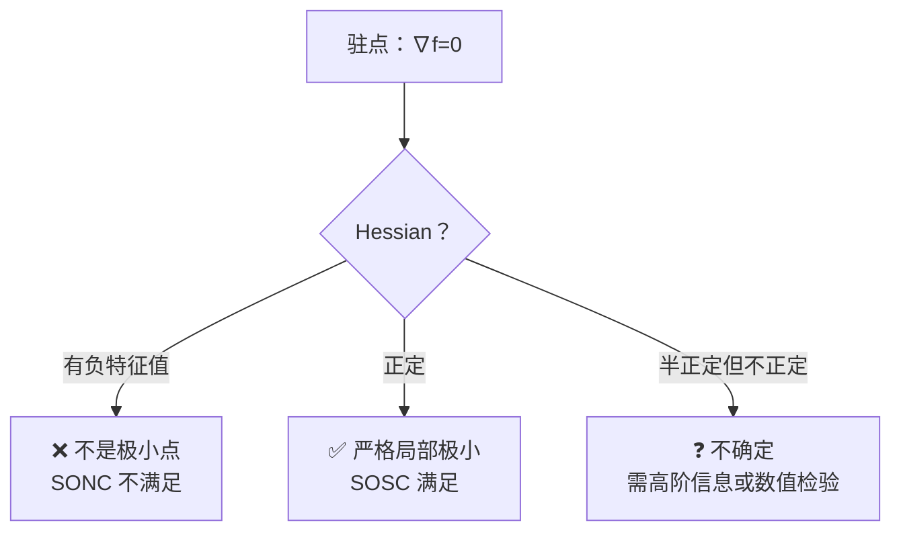

---
subject:
- 最优化方法
chapter: 6
source_context:
- file: 09-牛顿法-知识梳理.md
  line: 60
  text: 对逼近函数 m(x) 求一阶最优性条件
- file: 06-最优性条件-知识梳理.md
  line: 164
  text: 一阶必要条件（FONC）
related_notes:
- '[[03_Sources/Reviews/归档/最优化方法/知识点解析梳理/06-最优性条件-知识梳理]]'
- '[[03_Sources/Reviews/归档/最优化方法/知识点解析梳理/09-牛顿法-知识梳理]]'
tags:
- 一阶必要条件
- 二阶必要条件
- 二阶充分条件
- 梯度
- 可行方向
- 无约束优化
- 内点
aliases:
- 第6章 答疑 — 一阶最优性条件（FONC）详解
time: "2026-08-31T11:44:20+08:00"
legacy_topics:
- 一阶最优性条件
- FONC
- 二阶必要条件
- SONC
- 二阶充分条件
- SOSC
- 梯度
- 可行方向
- 无约束优化
- 内点
source: []
status: not done
legacy_type: review
legacy_schema_version: 2
migration_reason: Missing traceable source in legacy source note
---

# 第6章 答疑 — 一阶最优性条件（FONC）详解

> 问题：**什么是一阶最优性条件？为什么在牛顿法中说"对逼近函数 $m(x)$ 求一阶最优性条件"？**

> 来源：`09-牛顿法-知识梳理.md` 第 60 行；`06-最优性条件-知识梳理.md` 第 164 行

---

## 一、核心回答

**一阶最优性条件（First-Order Necessary Condition, FONC）**：

> 设 $x^*$ 是一个局部极小点，则对 $x^*$ 处的**任何可行方向** $d$：
>
> $$d^T \nabla f(x^*) \geq 0$$

用大白话说：**在极小点处，沿任何可行方向走，函数值都不可能下降**——否则这个点就不是极小点了。

---

## 二、最常用的特殊情况：无约束 / 内点

当 $x^*$ 在可行域**内部**时（$\Omega = \mathbb{R}^n$ 或 $x^* \in \text{int}(\Omega)$），FONC 退化为最常见的形式：

$$\nabla f(x^*) = \mathbf{0}$$

**为什么？** 内点时**所有**方向都可行（你可以朝任意方向走）。条件 $d^T \nabla f(x^*) \geq 0$ 要对**所有** $d$ 和**所有** $-d$ 同时成立，唯一解就是 $\nabla f(x^*) = 0$。

---

## 三、在牛顿法中的应用

牛顿法对当前点 $x^{(k)}$ 构造二次逼近函数：

$$m(x) = f(x^{(k)}) + (x - x^{(k)})^T g^{(k)} + \frac{1}{2}(x - x^{(k)})^T H(x^{(k)})(x - x^{(k)})$$

$m(x)$ 是一个**无约束**二次函数。对它应用 FONC（内点情形）：令 $\nabla m(x) = 0$：

$$0 = \nabla m(x) = g^{(k)} + H(x^{(k)})(x - x^{(k)})$$

解出牛顿迭代格式：

$$x^{(k+1)} = x^{(k)} - H(x^{(k)})^{-1} g^{(k)}$$

---

## 四、FONC 的完整形式 —— 约束情形

当 $x^*$ 在约束边界上时，不能直接用 $\nabla f(x^*) = 0$，必须用完整形式 $d^T \nabla f(x^*) \geq 0$，其中 $d$ 只能是**可行方向**。

可行方向由**切锥**描述：

| 约束类型 | 切锥 $\mathcal{T}(x)$ | 含义 |
|----------|---------------------|------|
| 等式约束 $h_i(x) = 0$ | $\{ d \mid Dh(x) d = 0 \}$ | $d$ 与等式约束梯度正交（子空间）|
| 不等式约束 $g_j(x) \leq 0$ | $\{ d \mid Dg_j(x) d < 0, j \in \mathcal{J}(x) \}$ | $d$ 指向可行侧（锥）|

> ⚠️ **重要**：边界点不能用无约束的结论直接令 $\nabla f(x^*) = 0$，必须验 FONC 对所有可行方向成立。

---

## 五、证明思路

用一阶 Taylor 展开：

$$f(x^* + \alpha d) = f(x^*) + \alpha \nabla f(x^*)^T d + o(\alpha)$$

若 $x^*$ 是极小点，则对小的 $\alpha > 0$ 有 $f(x^* + \alpha d) \geq f(x^*)$，故：

$$\alpha \nabla f(x^*)^T d + o(\alpha) \geq 0 \quad \Rightarrow \quad \nabla f(x^*)^T d \geq 0$$

---

## 六、一阶条件在知识体系中的位置

完整的最优性条件有三个层次：

| 层次 | 名称 | 类型 | 核心公式（内点） |
|------|------|------|-----------------|
| 一阶 | **FONC** | 必要条件 | $\nabla f(x^*) = 0$ |
| 二阶 | **SONC** | 必要条件 | $\nabla^2 f(x^*) \succeq 0$（半正定）|
| 二阶 | **SOSC** | 充分条件 | $\nabla^2 f(x^*) \succ 0$（正定）|

> FONC 是"第一道门槛"——过了再检查二阶条件。

---

## 七、易错点

> [!warning] FONC 只是必要条件，不是充分条件
> $\nabla f(x^*) = 0$ 的点也可能是鞍点或极大点（如 $f(x) = x^3$ 在 $x=0$），需要二阶条件进一步判断。

> [!warning] 边界点不能令梯度为零
> 当 $x^*$ 在可行域边界上时，必须使用完整 FONC：$d^T \nabla f(x^*) \geq 0$ 对所有可行方向 $d$ 成立。

---

## 八、相关链接

- [[03_Sources/Reviews/归档/最优化方法/知识点解析梳理/06-最优性条件-知识梳理#五、最优性条件（本章核心）|第6章 — 最优性条件（核心）]]
- [[03_Sources/Reviews/归档/最优化方法/知识点解析梳理/06-最优性条件-知识梳理#三、可行方向与切锥（难点）|第6章 — 可行方向与切锥]]
- [[03_Sources/Reviews/归档/最优化方法/知识点解析梳理/09-牛顿法-知识梳理#2.2 推导过程|第9章 — 牛顿法推导（FONC 的应用）]]
- [[03_Sources/Reviews/归档/最优化方法/知识点解析梳理/06-最优性条件-知识梳理#5.3 二阶必要条件（SONC）|SONC（二阶必要条件）]]
- [[03_Sources/Reviews/归档/最优化方法/知识点解析梳理/06-最优性条件-知识梳理#5.4 二阶充分条件（SOSC）— 内点情形|SOSC（二阶充分条件）]]

---

## 补充：二阶必要条件（SONC）与二阶充分条件（SOSC）的区别

> **追问**：FONC 只是必要条件。那二阶必要条件（SONC）和二阶充分条件（SOSC）到底有什么区别？为什么需要两个不同的二阶条件？

### 一、核心结论（一句话兜底）

> SONC 和 SOSC 的本质区别在于**必要 vs 充分**：
>
> - **SONC（二阶必要条件）**：极小点**必定**满足 $\nabla^2 f(x^*) \succeq 0$，但满足 SONC 的点**不一定是**极小点。
> - **SOSC（二阶充分条件）**：只要满足 $\nabla f(x^*) = 0$ 且 $\nabla^2 f(x^*) \succ 0$，就能**100% 断定** $x^*$ 是局部极小点——不需要再检查别的。

二者之间的「灰色地带」是 $\nabla^2 f(x^*) \succeq 0$ 但 $\nabla^2 f(x^*) \nsucc 0$（即半正定但不正定）：此时 SONC 满足，SOSC 不满足，需要高阶信息才能判断。

### 二、三条条件的对比

| 条件 | 类型 | 内点形式 | 含义 |
|------|------|----------|------|
| **FONC** | 必要条件 | $\nabla f(x^*) = 0$ | 一阶导数信息——驻点是极小点的候选 |
| **SONC** | 必要条件 | $\nabla^2 f(x^*) \succeq 0$（半正定） | 二阶导数信息——极小点处曲率不能向下弯 |
| **SOSC** | 充分条件 | $\nabla^2 f(x^*) \succ 0$（正定） | 只要梯度为零 + 曲率严格向上弯 → 一定是极小点 |

> [!warning] 关键区别：FONC + SONC → 不能断定极小；FONC + SOSC → 一定是极小。

### 三、为什么需要两个不同的二阶条件？

**SONC 的存在理由 — 判断"不可能"**：如果你找到一个驻点，Hessian 有负特征值（$\nabla^2 f \nsucceq 0$），那它**不可能是**极小点。SONC 帮你快速排除鞍点和极大点。

**SOSC 的存在理由 — 判断"一定是"**：如果 Hessian 正定，那驻点**一定是**严格局部极小点。SOSC 是收敛性分析的基石（牛顿法、拟牛顿法的收敛性证明依赖 SOSC）。

**灰色地带举例**：$f(x) = x^4$ 在 $x = 0$

- $\nabla f(0) = 0$ ✓（FONC 满足）
- $\nabla^2 f(0) = 0 \succeq 0$ ✓（SONC 满足——半正定）
- $\nabla^2 f(0) = 0 \nsucc 0$ ✗（SOSC 不满足——不正定）

然而 $x = 0$ 确实是全局极小点。这说明 **SOSC 不满足不代表不是极小点**，只是无法用二阶信息下结论——需要看更高阶导数。

### 四、从 Taylor 展开直观理解

将 $f(x^* + d)$ 在 $x^*$ 处做二阶 Taylor 展开（设 $\nabla f(x^*) = 0$）：

$$f(x^* + d) = f(x^*) + \frac{1}{2} d^T \nabla^2 f(x^*) d + o(\|d\|^2)$$

- 若 $\nabla^2 f(x^*) \succ 0$（正定）：对一切 $d \neq 0$，$d^T \nabla^2 f(x^*) d > 0$，二次项严格正 → $f(x^* + d) > f(x^*)$ 在局部成立 → **确定的极小点**。这就是 SOSC。
- 若 $\nabla^2 f(x^*) \succeq 0$（半正定）：二次项 $\geq 0$，但可能为 $0$——函数值是否上升取决于高阶项 → **无法下结论**。SONC 只告诉我们「二阶信息没发现矛盾」。
- 若 $\nabla^2 f(x^*) \nsucceq 0$（有负特征值）：存在方向 $d$ 使 $d^T \nabla^2 f(x^*) d < 0$ → $f(x^* + d) < f(x^*)$ → **不可能是极小点**。

### 五、判定流程图

### 六、相关链接（补充）

- [[03_Sources/Reviews/归档/最优化方法/知识点解析梳理/06-最优性条件-知识梳理#5.3 二阶必要条件（SONC）|SONC — 二阶必要条件（约束情形）]]
- [[03_Sources/Reviews/归档/最优化方法/知识点解析梳理/06-最优性条件-知识梳理#5.4 二阶充分条件（SOSC）— 内点情形|SOSC — 二阶充分条件（内点情形）]]
- [[03_Sources/Reviews/归档/最优化方法/知识点解析梳理/09-牛顿法-知识梳理#2.2 推导过程|牛顿法推导中的 SOSC 应用]]
