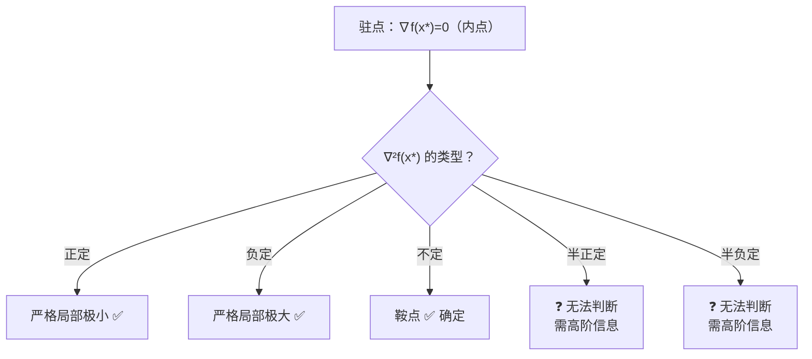

---
subject:
- 最优化方法
chapter: 6
source_context:
- file: II-凸集与凸函数.md
  line: 450
  text: ∇²f(x*) 不定 → 鞍点
related_notes:
- '[[../复习/II-凸集与凸函数]]'
- '[[03_Sources/Reviews/归档/最优化方法/知识点解析梳理/06-最优性条件-知识梳理]]'
tags:
- Hessian
- 鞍点
- 二阶充分条件
- 二阶必要条件
- Taylor展开
aliases:
- 第6章 答疑 — 内点处Hessian不定为何必为鞍点
time: "2026-08-31T11:44:20+08:00"
legacy_topics:
- Hessian
- 不定矩阵
- 鞍点
- 二阶充分条件
- SOSC
- 二阶必要条件
- SONC
- 半正定
- Taylor展开
source: []
status: not done
legacy_type: review
legacy_schema_version: 2
migration_reason: Missing traceable source in legacy source note
---

# 第6章 答疑 — 内点处 Hessian 不定为何必为鞍点

> 问题：**为什么内点处的 Hessian 不定就是鞍点？半正定时是"无法判断"，不定为什么不会有其他情况？**

> 来源：`II-凸集与凸函数.md` 第 450 行，表格中 Hessian 不定的结论为"鞍点"

---

## 一、核心回答（一句话兜底）

> 不定 Hessian = 同时存在"上升方向"和"下降方向" → 既不是局部极小也不是局部极大 → **只可能是鞍点，没有例外。**
>
> 半正定时，某些方向的二阶项为零（Hessian"沉默"了），函数行为由更高阶导数决定 → **无法仅凭 Hessian 下结论。**

---

## 二、Taylor 展开的决定性作用

内点处 $\nabla f(x^*) = 0$，二阶 Taylor 展开退化为：

$$f(x^* + \varepsilon d) = f(x^*) + \frac{\varepsilon^2}{2} d^\top \nabla^2 f(x^*) d + o(\varepsilon^2)$$

当 $\varepsilon \to 0$ 时，二阶项 $\frac{\varepsilon^2}{2} d^\top \nabla^2 f d$ 主导了函数值的变化方向，高阶无穷小 $o(\varepsilon^2)$ **无法逆转**二阶项的符号。

---

## 三、不定 Hessian → 必然鞍点（逐条论证）

不定意味着 $\nabla^2 f(x^*)$ 同时有**正特征值** $\lambda_+ > 0$ 和**负特征值** $\lambda_- < 0$。

| 方向 | 二阶项符号 | 局部行为 | 意味着 |
|------|:---:|------|------|
| 沿 $\lambda_+$ 的特征向量 $d_+$ | $d_+^\top \nabla^2 f \, d_+ = \lambda_+ \|d_+\|^2 > 0$ | $f(x^* + \varepsilon d_+) > f(x^*)$ | $x^*$ 在此方向上像**局部极小** |
| 沿 $\lambda_-$ 的特征向量 $d_-$ | $d_-^\top \nabla^2 f \, d_- = \lambda_- \|d_-\|^2 < 0$ | $f(x^* + \varepsilon d_-) < f(x^*)$ | $x^*$ 在此方向上像**局部极大** |

由于 $o(\varepsilon^2)$ 是更高阶的无穷小，当 $\varepsilon$ 足够小时，二阶项的符号决定了 $f(x^* + \varepsilon d) - f(x^*)$ 的符号。

> 结论：**一个方向上是最小值，另一个方向上是最大值——正是鞍点的定义。** 没有任何"其他可能"，因为「同时有上升和下降方向」排斥了「局部极小」也排斥了「局部极大」。

---

## 四、半正定 Hessian → 无法判断（对比分析）

半正定时，存在某个方向 $d_0$ 使 $d_0^\top \nabla^2 f \, d_0 = 0$。在此方向上，二阶项**消失**——函数行为由三阶及更高阶项接管：

$$f(x^* + \varepsilon d_0) = f(x^*) + \frac{\varepsilon^3}{6} \cdot (\text{三阶项}) + \cdots$$

而 Hessian **完全看不到**三阶及以上的信息。同一种半正定 Hessian 可以对应完全不同的实际行为：

| 函数 | $x^*=0$ 处的 Hessian | 实际结论 |
|------|:---:|------|
| $f(x) = x^4$ | $f''(0) = 0 \succeq 0$（半正定） | **局部极小**（四阶项主导，正） |
| $f(x) = x^3$ | $f''(0) = 0 \succeq 0$（半正定） | **鞍点/拐点**（三阶项主导，符号变化） |
| $f(x) = -x^4$ | $f''(0) = 0 \preceq 0$（半负定） | **局部极大**（四阶项主导，负） |

Hessian 完全相同（都是 $0$），结论却截然不同——**二阶信息在此放弃发言**。

---

## 五、五种 Hessian 情况的对比

| Hessian | 二阶项给出了什么信息 | 结论确定吗 | 为什么 |
|---------|---------------------|:---:|------|
| 正定 $\succ 0$ | "所有方向向上弯" | ✅ 确定 | 严格局部极小 |
| 负定 $\prec 0$ | "所有方向向下弯" | ✅ 确定 | 严格局部极大 |
| **不定** | **"有上弯也有下弯"** | ✅ 确定 | **鞍点（不可能有其他结论）** |
| 半正定 $\succeq 0$ | "有的方向我不表态" | ❌ 不定 | 需高阶信息 |
| 半负定 $\preceq 0$ | "有的方向我不表态" | ❌ 不定 | 需高阶信息 |

> [!tip] 关键洞察
> 不定时 Hessian 给出了**两个相互矛盾的方向**（一个有正曲率、一个有负曲率），这本身就是结论——矛盾意味着鞍点。半正定时 Hessian 在某个方向上**沉默了**，沉默不等于没有结论，只是需要更高阶导数来开口。

---

## 六、验证流程

---

## 七、相关链接

- [[../复习/II-凸集与凸函数#2.6 最优性条件（第6章核心）|复习：最优性条件 — Hessian 五种情况表格]]
- [[03_Sources/Reviews/归档/最优化方法/知识点解析梳理/06-最优性条件-知识梳理#5.3 二阶必要条件（SONC）|SONC — 二阶必要条件]]
- [[03_Sources/Reviews/归档/最优化方法/知识点解析梳理/06-最优性条件-知识梳理#5.4 二阶充分条件（SOSC）— 内点情形|SOSC — 二阶充分条件]]
- [[答疑/06-最优性条件/06-一阶最优性条件详解|FONC/SONC/SOSC 三者辨析]]
