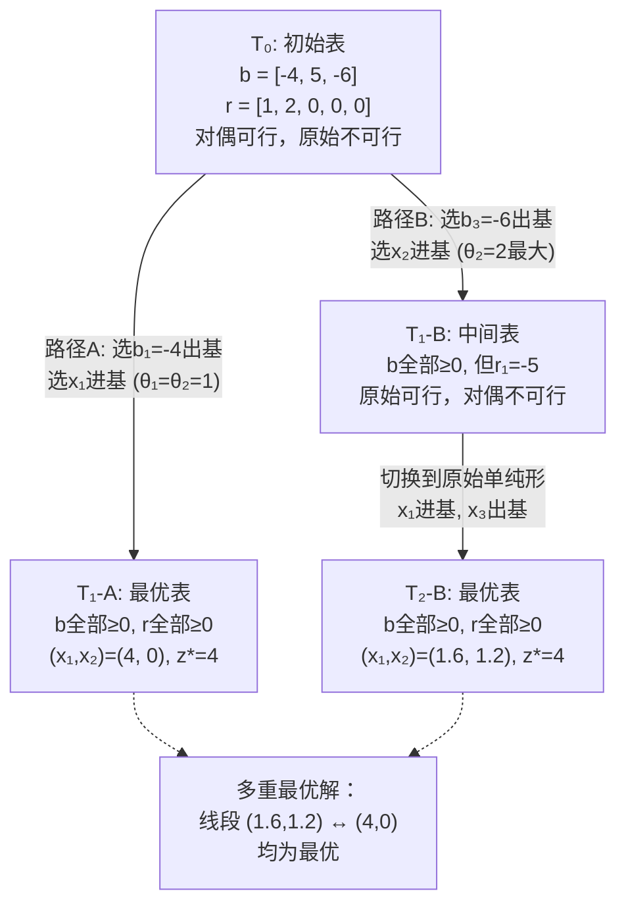

---
subject:
- 最优化方法
chapter: 17
source_context:
- file: 17-对偶单纯形法-知识梳理.md
  line: 291
  text: 迭代：选 b₃ = -6 行出基 → 在负元素中选对偶 θ 最大的列进基 → pivot → 迭代至所有 b ≥ 0。
related_notes:
- '[[03_Sources/Reviews/归档/最优化方法/知识点解析梳理/17-对偶单纯形法-知识梳理]]'
- '[[03_Sources/Reviews/归档/最优化方法/知识点解析梳理/16-单纯形法-知识梳理]]'
- '[[00_Inbox/待核实来源/归档/最优化方法/答疑/16-单纯形法/16-单纯形表完整迭代示例]]'
tags:
- 对偶单纯形法
- 对偶可行性
aliases:
- 第17章 答疑 — 对偶单纯形法例一完整迭代详解
time: "2026-08-31T11:44:20+08:00"
legacy_topics:
- 对偶单纯形法
- 单纯形表迭代
- 对偶可行性
- 原始可行性
- 转轴规则
- 对偶 θ 规则
- 多重最优解
- 进基列选择
source: []
status: not done
legacy_type: review
legacy_schema_version: 2
migration_reason: Missing traceable source in legacy source note
---

# 第17章 答疑 — 对偶单纯形法例一完整迭代详解

> 问题：**笔记 §6.1 例一的描述过于简略——只说「选 $b_3 = -6$ 行出基 → 选对偶 θ 最大的列进基 → pivot → 迭代至所有 $b \geq 0$」，没有给出具体每步的单纯形表。能否还原完整的推演过程？**

> 来源：`17-对偶单纯形法-知识梳理.md` §6.1 (第 291 行)

---

## 一、问题回顾

**原问题**：

$$
\begin{aligned}
\min\;& x_1 + 2x_2 \\
\text{s.t.}\;& x_1 + 2x_2 \geq 4,\; x_1 \leq 5,\; 3x_1 + x_2 \geq 6,\; x_1, x_2 \geq 0
\end{aligned}
$$

---

## 二、标准化与初始表构造

### 2.1 标准化

引入剩余变量 $x_3, x_5$ 和松弛变量 $x_4$：

$$
\begin{aligned}
\min\;& x_1 + 2x_2 + 0x_3 + 0x_4 + 0x_5 \\
\text{s.t.}\;& x_1 + 2x_2 - x_3 = 4 \\
& x_1 + x_4 = 5 \\
& 3x_1 + x_2 - x_5 = 6 \\
& x_i \geq 0,\; i = 1,2,3,4,5
\end{aligned}
$$

$m = 3$，$n = 5$，$c = [1, 2, 0, 0, 0]^T$。

### 2.2 构造初始基——对部分行乘 -1

直接看系数矩阵 $A$：只有第二行有自然基列（$x_4$ 列 $[0, 1, 0]^T$）。$x_3, x_5$ 的系数为 $-1$，不成单位列。若用原始单纯形法，需要人工变量。

**技巧**：对第一、三两行乘以 $-1$，使得 $x_3, x_5$ 所在列变成单位向量：

$$
\begin{aligned}
-x_1 - 2x_2 + x_3 &= -4 \\
x_1 + x_4 &= 5 \\
-3x_1 - x_2 + x_5 &= -6
\end{aligned}
$$

此时 $A = \begin{bmatrix} -1 & -2 & 1 & 0 & 0 \\ 1 & 0 & 0 & 1 & 0 \\ -3 & -1 & 0 & 0 & 1 \end{bmatrix}$，$b = [-4, 5, -6]^T$。

### 2.3 初始单纯形表

初始基 $B = \{x_3, x_4, x_5\}$，$c_B = [0, 0, 0]^T$，$B^{-1} = I_3$。

判别数：$r_j = c_j - c_B^T B^{-1} a_j = c_j$（因为 $c_B = 0$）。

$$
\boxed{
\begin{array}{c|ccccc|c}
\text{基} & x_1 & x_2 & x_3 & x_4 & x_5 & \text{RHS} \\ \hline
x_3 & -1 & -2 & 1 & 0 & 0 & -4 \\
x_4 & 1  & 0  & 0 & 1 & 0 & 5  \\
x_5 & -3 & -1 & 0 & 0 & 1 & -6 \\ \hline
r   & 1  & 2  & 0 & 0 & 0 & 0
\end{array}
}
\qquad \text{(迭代 0：初始表 } T_0\text{)}
$$

**状态诊断**：
- 判别数 $r = [1, 2, 0, 0, 0] \geq \mathbf{0}$ → **对偶可行** ✓
- $b_1 = -4 < 0$，$b_3 = -6 < 0$ → **原始不可行** ✗
- ➡ 适用对偶单纯形法！

---

## 三、迭代 1 —— 第一次对偶换基

### 3.1 选出基行（原始不可行的行）

选最负的 $b$：$b_1 = -4$，$b_3 = -6$ → 最负为 $b_3 = -6$。

> **出基变量：$x_5$（第 3 行的基变量）。**

### 3.2 选进基列（对偶 θ 规则）

在第 3 行（$x_5$ 所在行）中，找出所有**负元素**：

$$
a_{31} = -3 < 0,\quad a_{32} = -1 < 0
$$

计算对偶 θ（判别数除以负的系数）：

$$
\theta_1 = \frac{r_1}{-a_{31}} = \frac{1}{3},\qquad
\theta_2 = \frac{r_2}{-a_{32}} = \frac{2}{1} = 2
$$

取最大值：$\max\{\frac{1}{3}, 2\} = 2$。

> **进基变量：$x_2$（第 2 列）。转轴元素：$a_{32} = -1$。**

### 3.3 枢轴变换（pivot）

目标是使 $x_2$ 列变为单位向量 $[0, 0, 1, 0]^T$。

**Step 1**：转轴行归一化 — $R_3 \leftarrow R_3 / (-1)$

$$
R_3:\; [3,\; 1,\; 0,\; 0,\; -1 \mid 6]
$$

**Step 2**：消去其他行的 $x_2$ 系数

- $R_1 \leftarrow R_1 - (-2) \cdot R_3 = R_1 + 2R_3$

$$
\begin{aligned}
R_1 &: [-1 + 2\cdot 3,\; -2 + 2\cdot 1,\; 1 + 2\cdot 0,\; 0 + 2\cdot 0,\; 0 + 2\cdot (-1) \mid -4 + 2\cdot 6] \\
   &= [5,\; 0,\; 1,\; 0,\; -2 \mid 8]
\end{aligned}
$$

- $R_2$：$x_2$ 系数为 $0$，不变

$$
R_2:\; [1,\; 0,\; 0,\; 1,\; 0 \mid 5]
$$

- $R_4 \leftarrow R_4 - 2 \cdot R_3$（消去目标行的 $r_2 = 2$）

$$
\begin{aligned}
R_4 &: [1 - 2\cdot 3,\; 2 - 2\cdot 1,\; 0 - 2\cdot 0,\; 0 - 2\cdot 0,\; 0 - 2\cdot (-1) \mid 0 - 2\cdot 6] \\
    &= [-5,\; 0,\; 0,\; 0,\; 2 \mid -12]
\end{aligned}
$$

### 3.4 第一次迭代后的单纯形表

$$
\boxed{
\begin{array}{c|ccccc|c}
\text{基} & x_1 & x_2 & x_3 & x_4 & x_5 & \text{RHS} \\ \hline
x_3 & 5  & 0  & 1 & 0 & -2 & 8  \\
x_4 & 1  & 0  & 0 & 1 & 0  & 5  \\
x_2 & 3  & 1  & 0 & 0 & -1 & 6  \\ \hline
r   & -5 & 0  & 0 & 0 & 2  & -12
\end{array}
}
\qquad \text{(迭代 1：} T_1\text{)}
$$

**状态诊断**：
- $b = [8, 5, 6]^T \geq \mathbf{0}$ → **原始可行** ✓
- $r_1 = -5 < 0$ → **对偶不可行** ✗

> [!warning] 发生了状态翻转
> 第一次对偶 pivot 后，原始可行性得到满足，但对偶可行性丢失了！现在需要切换到**原始单纯形法**，选最负判别数的列进基。

---

## 四、迭代 2 —— 切换到原始单纯形法

### 4.1 选进基列

$r_1 = -5$ 是唯一个负判别数 → **$x_1$ 进基**。

### 4.2 选出基行（θ 规则）

在 $x_1$ 列中找出所有**正元素**，计算 $\theta = b_i / a_{i1}$（$a_{i1} > 0$）：

| 行 | $b_i$ | $a_{i1}$ | $\theta$ |
|----|-------|----------|----------|
| 1  | 8     | 5        | $8/5 = 1.6$ |
| 2  | 5     | 1        | $5/1 = 5.0$ |
| 3  | 6     | 3        | $6/3 = 2.0$ |

最小 $\theta = 1.6$ → **$x_3$ 出基**（第 1 行）。转轴元素：$a_{11} = 5$。

### 4.3 枢轴变换

**Step 1**：转轴行归一化 — $R_1 \leftarrow R_1 / 5$

$$
R_1:\; [1,\; 0,\; \tfrac{1}{5},\; 0,\; -\tfrac{2}{5} \mid \tfrac{8}{5}]
$$

**Step 2**：消去其他行的 $x_1$ 系数

- $R_2 \leftarrow R_2 - 1 \cdot R_1$

$$
R_2:\; [0,\; 0,\; -\tfrac{1}{5},\; 1,\; \tfrac{2}{5} \mid \tfrac{17}{5}]
$$

- $R_3 \leftarrow R_3 - 3 \cdot R_1$

$$
R_3:\; [0,\; 1,\; -\tfrac{3}{5},\; 0,\; \tfrac{1}{5} \mid \tfrac{6}{5}]
$$

- $R_4 \leftarrow R_4 - (-5) \cdot R_1 = R_4 + 5R_1$

$$
R_4:\; [0,\; 0,\; 1,\; 0,\; 0 \mid -4]
$$

### 4.4 最终单纯形表

$$
\boxed{
\begin{array}{c|ccccc|c}
\text{基} & x_1 & x_2 & x_3 & x_4 & x_5 & \text{RHS} \\ \hline
x_1 & 1 & 0 & \frac{1}{5}  & 0 & -\frac{2}{5} & \frac{8}{5} \\[4pt]
x_4 & 0 & 0 & -\frac{1}{5} & 1 & \frac{2}{5}  & \frac{17}{5} \\[4pt]
x_2 & 0 & 1 & -\frac{3}{5} & 0 & \frac{1}{5}  & \frac{6}{5} \\[2pt] \hline
r   & 0 & 0 & 1           & 0 & 0            & -4
\end{array}
}
\qquad \text{(迭代 2：} T_2 \text{ — 已达到最优)}
$$

**状态诊断**：
- $b = [\frac{8}{5}, \frac{17}{5}, \frac{6}{5}]^T \geq \mathbf{0}$ → 原始可行 ✓
- $r = [0, 0, 1, 0, 0] \geq \mathbf{0}$ → 对偶可行 ✓
- ➡ **已达最优！**

---

## 五、最优解与多重最优性

### 5.1 从最终表读取解

| 基变量 | 值 | 非基变量 | 值 |
|--------|-----|---------|-----|
| $x_1$ | $\frac{8}{5} = 1.6$ | $x_3$ | $0$ |
| $x_4$ | $\frac{17}{5} = 3.4$ | $x_5$ | $0$ |
| $x_2$ | $\frac{6}{5} = 1.2$ | | |

**原始变量**：$(x_1, x_2) = (1.6,\; 1.2)$

**最优值**：$z^* = 1 \times 1.6 + 2 \times 1.2 = 1.6 + 2.4 = 4.0$

**验证**（带回原约束）：
- $x_1 + 2x_2 = 1.6 + 2.4 = 4.0 \geq 4$ ✓（紧缩约束！）
- $x_1 = 1.6 \leq 5$ ✓
- $3x_1 + x_2 = 4.8 + 1.2 = 6.0 \geq 6$ ✓（紧缩约束！）

### 5.2 多重最优解

> [!hint] 笔记给出的解是 $(4, 0)$，我们算得的是 $(1.6, 1.2)$——两者目标值都是 4，这说明**存在多重最优解**！

两个最优基本可行解：

| | $x_1$ | $x_2$ | $z^*$ | 紧缩约束 |
|---|-------|-------|-------|----------|
| $P_1$ | $1.6$ | $1.2$ | $4$ | 第 1、3 约束均取等号 |
| $P_2$ | $4.0$ | $0.0$ | $4$ | 第 1 约束取等号，$x_2 = 0$ |

**几何解释**：目标函数 $x_1 + 2x_2$ 的方向与约束 $x_1 + 2x_2 \geq 4$ 的边界平行，因此整条线段上的点都是最优解。最优面为：

$$
\{(x_1, x_2) \mid x_1 + 2x_2 = 4,\; 3x_1 + x_2 \geq 6,\; 0 \leq x_1 \leq 5,\; x_2 \geq 0\}
$$

线段端点：$(1.6, 1.2)$ 到 $(4, 0)$。

---

## 六、如何得到笔记中的解 $(4, 0)$？

笔记的迭代描述是"选 $b_3 = -6$ 行出基"，但我们沿此路径得到了 $(1.6, 1.2)$。要直接得到 $(4, 0)$，只需在初始表中**选择 $b_1 = -4$ 所在的行出基**：

### 备选路径（一 pivot 直达 $(4, 0)$）

在 $T_0$ 中，选 $b_1 = -4$（第 1 行）出基。

第 1 行负元素：$a_{11} = -1$，$a_{12} = -2$。对偶 θ：

$$\theta_1 = \frac{1}{-(-1)} = 1,\qquad \theta_2 = \frac{2}{-(-2)} = 1$$

两者相等。**选 $x_1$ 列进基**（若选 $x_2$ 则两步后得到 $(1.6, 1.2)$）。

转轴元素 $a_{11} = -1$：

- $R_1 \leftarrow R_1 / (-1) = [1,\; 2,\; -1,\; 0,\; 0 \mid 4]$
- $R_2 \leftarrow R_2 - 1 \cdot R_1 = [0,\; -2,\; 1,\; 1,\; 0 \mid 1]$
- $R_3 \leftarrow R_3 - (-3) \cdot R_1 = [0,\; 5,\; -3,\; 0,\; 1 \mid 6]$
- $R_4 \leftarrow R_4 - 1 \cdot R_1 = [0,\; 0,\; 1,\; 0,\; 0 \mid -4]$

$$
\boxed{
\begin{array}{c|ccccc|c}
\text{基} & x_1 & x_2 & x_3 & x_4 & x_5 & \text{RHS} \\ \hline
x_1 & 1 & 2  & -1 & 0 & 0 & 4 \\
x_4 & 0 & -2 & 1  & 1 & 0 & 1 \\
x_5 & 0 & 5  & -3 & 0 & 1 & 6 \\ \hline
r   & 0 & 0  & 1  & 0 & 0 & -4
\end{array}
}
$$

$b \geq 0$ ✓，$r \geq 0$ ✓。**一次 pivot 即达最优！**

解：$(x_1, x_2) = (4, 0)$，$z^* = 4$。

> **点评**：对偶单纯形法出基行的选择（有多个负 $b$ 时选哪个）会影响收敛路径。笔记的"选 $b_3 = -6$"和"选 $b_1 = -4$"都是合法的，但前者需要 2 次 pivot（含一次切换到原始单纯形），后者 1 次即可。理论上两种选择都是对的——出基行的选择规则是"选最负的 $b$"，但也允许选其他负 $b$。

---

## 七、完整迭代过程小结

---

## 八、关键要点总结

| 要点 | 说明 |
|------|------|
| **对偶转轴规则** | 先选行（最负 $b$）→ 在负 $a_{kj}$ 中选 $\max\{r_j/(-a_{kj})\}$ → pivot |
| **状态翻转** | 对偶 pivot 可能使原始可行性满足但同时丢失对偶可行性，此时需切换到原始单纯形法 |
| **多重最优解** | 判别数 $r_j = 0$ 的非基变量可进基获得另一最优顶点——本题 $r_2 = 0$（非基时）即此标志 |
| **出基行选择** | 有多个负 $b$ 时，"最负 $b$"规则不一定最短路径；但所有路径最终都收敛 |
| **与原始单纯形的对称** | 对偶法"从对偶可行走向原始可行"；原始法"从原始可行走向对偶可行"——两者互为镜像 |

---

## 相关链接

- [[03_Sources/Reviews/归档/最优化方法/知识点解析梳理/17-对偶单纯形法-知识梳理]] — 笔记原文
- [[03_Sources/Reviews/归档/最优化方法/知识点解析梳理/16-单纯形法-知识梳理]] — 原始单纯形法基础
- [[00_Inbox/待核实来源/归档/最优化方法/答疑/16-单纯形法/16-单纯形表完整迭代示例]] — 原始单纯形表完整推演（同类答疑）
- [[00_Inbox/待核实来源/归档/最优化方法/答疑/15-线性规划概述/15-单纯形法迭代推演]] — 单纯形法迭代原理
