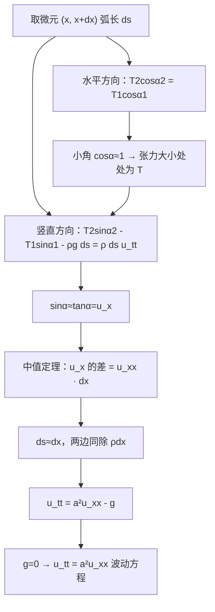

---
subject:
- 数学物理方程
chapter: 2
source_context:
- file: 课程/数学物理方程/课本/数学物理方程 第2版 (李明奇，田太心主编, 主编李明_ (z-library.sk, 1lib/数学物理方程 第2版 (李明奇，田太心主编, 主编李明_ (z-library.sk, 1lib..md
  line: 1057
  text: 细弦线横向微振动时，$u_{x}$ 表示细弦线的切线斜率也会很小，即有 $ds=\int_{x}^{x+dx}\sqrt{1+u_{x}^{2}}dx\approx dx$。因此，细弦线上任意点位移函数 $u(x,t)$ 满足 $u_{tt}=a^{2}u_{xx}-g$
related_notes: []
tags:
- 波动方程
- 中值定理
aliases:
- 第2章 答疑 — 细弦线横振动与一维波动方程推导
time: "2026-10-14T20:49:51+08:00"
legacy_topics:
- 波动方程
- 细弦线横振动
- 横振动与纵振动
- 微元法
- 张力
- 小角近似
- 中值定理
- 弧长近似
source: []
status: not done
legacy_type: review
legacy_schema_version: 2
migration_reason: Missing traceable source in legacy source note
---

# 第2章 答疑 — 细弦线横振动与一维波动方程推导

> 问题：课本 2.1 例 1「细弦线横向微振动」这一段推导（从受力分析到 $u_{tt}=a^2u_{xx}$）完全没看懂。

> 来源：[[03_Sources/Courses/数学物理方程/课本/数学物理方程 第2版 (李明奇，田太心主编, 主编李明_ (z-library.sk, 1lib/数学物理方程 第2版 (李明奇，田太心主编, 主编李明_ (z-library.sk, 1lib..md]] 第 1027–1075 行（2.1 节 例 1）

---

## 0. 一句话兜底

整段推导只做了一件事：**对弦上的一小段写牛顿第二定律 $F=ma$**。
因为振动"微小"⇒ 角度都很小 ⇒ **张力大小处处相等**（这是关键红利，决定了方程是常系数线性方程）；
再把角度换成斜率 $u_x$，用中值定理把"差"变成"导数"，就得到 $u_{tt}=a^2u_{xx}$。

## 1. 场景与记号

- 弦：均匀、**柔软**、线密度 $\rho$，两端固定在 $x=0$ 与 $x=L$。
- 平衡位置沿 $x$ 轴，振动是**横向**的（= 垂直于弦的平衡位置，本题中即"上下"），位移 $u(x,t)$，**$u$ 轴向上为正**。
- 张力 $T(x,t)$：弦内相邻部分互相拉的作用力。

> [!note] "柔软"这个词很关键
> 柔软的弦不抵抗弯曲，所以张力**只能沿切线方向**——这是后面所有几何关系成立的前提。

## 2. 微元受力（图 2.1）

取微元 $[x,\ x+\mathrm{d}x]$，弧长 $\mathrm{d}s$。受力三项：

| 力 | 方向 | 大小 |
|:--|:--|:--|
| 右端张力 $T_2$ | 沿 $x+\mathrm{d}x$ 处切线（指右上） | $T_2$ |
| 左端张力 $T_1$ | 沿 $x$ 处切线（指左下） | $T_1$ |
| 重力 | 竖直向下 | $\rho g\,\mathrm{d}s$ |

牛顿第二定律按两个方向写：

**水平方向**（弦只横向振动，无水平加速度）：

$$T_2\cos\alpha_2 - T_1\cos\alpha_1 = 0$$

**竖直方向**（向上为正）：

$$T_2\sin\alpha_2 - T_1\sin\alpha_1 - \rho g\,\mathrm{d}s = \rho\,\mathrm{d}s\,u_{tt}$$

其中 $\rho\,\mathrm{d}s$ 是微元质量，$u_{tt}$ 是其竖直加速度。

## 3. 第一步：小角度 ⇒ 张力处处相等（核心）

由 $T_2\cos\alpha_2 = T_1\cos\alpha_1$，微振动使 $\alpha_1,\alpha_2$ 很小，$\cos\alpha\approx1$，于是

$$T_2 \approx T_1 \approx T\ (\text{常数})$$

> [!important] 这是整段推导最重要的结论
> 张力大小沿弦处处相同，所以最终方程里 $a^2=T/\rho$ 是**常数**，得到常系数线性 PDE。
> 如果振幅不小、角度不小，这个结论不成立，方程会变成非线性的。

> [!warning] 常见误解
> 不是"水平方向没力"，而是两个水平分量**恰好抵消**；抵消的代价是换来"张力大小不变"这一结论。

## 4. 第二步：把角度换成 $u$ 的导数

小角时 $\sin\alpha\approx\tan\alpha$。严格地：

$$\sin\alpha = \frac{\tan\alpha}{\sqrt{1+\tan^2\alpha}},\qquad \tan\alpha = \frac{\partial u}{\partial x} = u_x$$

$u_x$ 很小 ⇒ $\sqrt{1+u_x^2}\approx1$ ⇒ $\sin\alpha\approx\tan\alpha = u_x$。

而 $\tan\alpha$ **就是切线斜率**（$u$ 轴竖直，斜率即倾角正切）。这就是书上"$\sin x\sim\tan x$"一句的全部含义。

$$T\big[u_x(x+\mathrm{d}x,t) - u_x(x,t)\big] - \rho g\,\mathrm{d}x = \rho\,\mathrm{d}s\,u_{tt}$$

## 5. 第三步：中值定理（最容易卡住）

$$u_x(x+\mathrm{d}x,t) - u_x(x,t) = u_{xx}(x+\theta\,\mathrm{d}x,t)\,\mathrm{d}x,\quad \theta\in(0,1)$$

> [!tip] $\theta$ 是什么
> 拉格朗日中值定理：把 $u_x(\cdot,t)$ 看成关于位置 $s$ 的函数（$t$ 当参数），它在 $[x,\ x+\mathrm{d}x]$ 上的
> **增量 = 区间内某一点的导数 × 区间长度**。那个"某一点"记作 $x+\theta\,\mathrm{d}x$。

> [!tip] 为什么可以不管它
> 后面令 $\mathrm{d}x\to0$，该点被夹在 $x$ 与 $x+\mathrm{d}x$ 之间，由 $u_{xx}$ 连续得 $u_{xx}(x+\theta\mathrm{d}x,t)\to u_{xx}(x,t)$。
> $\theta$ 只是过渡符号，最终消失。

## 6. 第四步：$\mathrm{d}s \approx \mathrm{d}x$

$$\mathrm{d}s = \int_x^{x+\mathrm{d}x}\sqrt{1+u_x^2}\,\mathrm{d}x \approx \sqrt{1+u_x^2}\,\mathrm{d}x \approx \mathrm{d}x$$

横向微振动 ⇒ 斜率 $u_x$ 很小 ⇒ 弦几乎不被拉伸。

物理含义：微振动下弦长基本不变，故线密度 $\rho$ 与张力 $T$ 都不变——与第 3 步是同一假设的两面。

## 7. 第五步：整理得方程

$$T\,u_{xx}\,\mathrm{d}x - \rho g\,\mathrm{d}x = \rho\,\mathrm{d}x\,u_{tt}
\quad\Longrightarrow\quad
u_{tt} = a^2u_{xx} - g,\qquad a^2=\frac{T}{\rho}$$

忽略自重（$g=0$）即得**一维波动方程**：

$$u_{tt} = a^2u_{xx}$$

### $a$ 是什么

量纲：$[T]=\mathrm{N}=\mathrm{kg\cdot m/s^2}$，$[\rho]=\mathrm{kg/m}$ ⇒ $[a^2]=\mathrm{m^2/s^2}$，**$a$ 是速度**，即波的传播速度。弦越紧波越快，弦越重波越慢。

## 8. 有外力时的非齐次形式

若弦上有分布外力 $F(x,t)$（单位长度上的力），竖直方向再加 $F(x,t)\,\mathrm{d}x$：

$$T u_{xx}\,\mathrm{d}x + F\,\mathrm{d}x - \rho g\,\mathrm{d}x = \rho\,\mathrm{d}x\,u_{tt}$$

$$u_{tt} = a^2u_{xx} + f(x,t),\qquad f(x,t) = \frac{F(x,t)}{\rho} - g$$

这就是**非齐次波动方程**，$f$ 为源项（单位质量所受外力）。

> [!warning] 文字表述的逻辑坑
> 书上"当不考虑细弦线的自重时 ⇒ $u_{tt}=a^2u_{xx}$"其实**默认同时没有外力** $F$。
> 只去掉自重应得 $u_{tt}=a^2u_{xx}+F/\rho$。别被字面绕进去。

## 9. 推导链条图

## 10. 卡点速查

| 卡住的地方 | 真正的意思 |
|:--|:--|
| $T_2\cos\alpha_2-T_1\cos\alpha_1=0$ ⇒ $T_2\approx T_1$ | $\cos\alpha\approx1$，两边都约成 $T$ |
| $\sin x\sim\tan x$ | 小角时 $\sin\approx\tan$；而 $\tan\alpha=u_x$ 正是需要的 |
| 突然出现的 $\theta$ | 中值定理"区间内某点"，$\mathrm{d}x\to0$ 后消失 |
| $\mathrm{d}s$ 怎么变成 $\mathrm{d}x$ | $\mathrm{d}s=\sqrt{1+u_x^2}\mathrm{d}x\approx\mathrm{d}x$（斜率小） |
| 那个 $-g$ 从哪来 | 重力 $\rho g\,\mathrm{d}s$，同除以 $\rho\,\mathrm{d}x$ 后留下 |
| 为什么 $a^2=T/\rho$ | 同除以 $\rho\,\mathrm{d}x$ 自然得到，$a$ 是波速 |
| 为什么叫"波动方程" | 它有 $f(x-at)$、$g(x+at)$ 形式的行波解（见第4章 d'Alembert 公式） |

---

## 补充：「横向」不是「水平」，参照系是弦轴

> 追问：振动不是上下的吗？为什么叫"横向"？

**"上下"没错，"横向"也没错——因为「横 / 纵」的参照系是弦的平衡位置（$x$ 轴），不是重力方向。**

- **横振动**：振动方向 **⊥** 弦轴
- **纵振动**：振动方向 **∥** 弦轴

本例题中弦水平放置，所以"上下"恰好就是"垂直于 $x$ 轴"，**上下振动 = 横振动**。

| 名称 | 振动方向 | 相对什么 | 课本例子 | 系数 |
|:--|:--|:--|:--|:--|
| 横振动 | ⊥ 弦轴 | 弦的平衡位置 | 例 1 细弦线（上下抖） | $a^2 = T/\rho$ |
| 纵振动 | ∥ 弦轴 | 弦的平衡位置 | 例 2 弹性细杆（沿 $x$ 伸缩） | $a^2 = Y/\rho$ |

> [!tip] 反直觉检验
> 把同一根弦**竖直悬挂**（2.1 节习题 1），"横向"就变成**左右**方向了。
> 可见参照系只能是弦轴，不可能是重力方向。

> [!important] 为什么必须区分
> 两者推导入口不同：横振动靠"柔软 ⇒ 张力沿切线"＋小角近似（$a^2=T/\rho$）；
> 纵振动靠 Hooke 定律 $P=Yu_x$（例 2，$a^2=Y/\rho$）。
> 方程形式同为 $u_{tt}=a^2u_{xx}$，但物理内容与 $a$ 的含义完全不同。

---

## 补充：$\mathrm{d}s \approx \mathrm{d}x$ 这一步起了什么作用

> 追问：第四步 $\mathrm{d}s \approx \mathrm{d}x$ 到底有什么用？

**一句话**：把"弧长 $\mathrm{d}s$"换成"水平投影 $\mathrm{d}x$"，让质量写成 $\rho\,\mathrm{d}x$，从而两边同除 $\rho\,\mathrm{d}x$ 后系数剩下纯常数 $a^2=T/\rho$。
这是方程成为**常系数线性**方程的必要一环。

### 作用① 让惯性项的质量"换脸"

惯性项是 $\rho\,\mathrm{d}s\,u_{tt}$。把 $\mathrm{d}s$ 换成 $\mathrm{d}x$，"单位弧长的密度"变成"单位水平长度的密度"，
第 7 步两边同除 $\rho\,\mathrm{d}x$ 时 $\mathrm{d}x$ 干净约掉，剩下 $u_{tt}=a^2u_{xx}$。

### 作用② 保证方程是线性的（最关键）

若不做此近似，两边同除 $\rho\,\mathrm{d}s$：

$$u_{tt} = \frac{T}{\rho}\cdot\frac{\mathrm{d}x}{\mathrm{d}s}\,u_{xx} - g
= \frac{a^2}{\sqrt{1+u_x^2}}\,u_{xx} - g$$

分母出现 $\sqrt{1+u_x^2}$，系数依赖 $u_x$ ⇒ **拟线性**方程，比线性方程难得多。
做了 $\sqrt{1+u_x^2}\approx1$ 才是线性常系数。

> [!warning] 别误会
> 上式只是"单独丢掉这一条近似"的产物，**不是**大振幅弦的真实物理模型
> （真实情形下 $T$ 也不再是常数、$\sin\alpha\neq\tan\alpha$，三个近似一起失效）。
> 它只说明：这一步在结构上决定方程是不是线性。

### 作用③ 物理含义：弦不被拉伸

$\mathrm{d}s\approx\mathrm{d}x$ 等价于"弦长几乎不变" ⇒ 线密度 $\rho$ 不变、张力 $T$ 不变，
正是第 3 步"张力处处相等"这一物理依据的另一面。

### 三个近似的统一视角

| 近似 | 依据 | 换来了什么 |
|:--|:--|:--|
| $\cos\alpha\approx1$ | 小角 | $T$ 处处相等 ⇒ 系数是常数 |
| $\sin\alpha\approx\tan\alpha=u_x$ | 小角 | 角度化为 $u_x$ ⇒ 方程里出现 $u_{xx}$ |
| $\mathrm{d}s\approx\mathrm{d}x$ | 小斜率 | 质量写成 $\rho\,\mathrm{d}x$ ⇒ 约出 $a^2=T/\rho$；弦不伸缩 ⇒ 线性 |

三者是"微小振动"这**一个**假设的三个化身，必须一起用。

### 课本此处的一个小不一致

竖直方向方程为

$$T_2\sin\alpha_2 - T_1\sin\alpha_1 - \rho g\,\mathrm{d}x = \rho\,\mathrm{d}s\,u_{tt}$$

**左边重力项用 $\mathrm{d}x$，右边惯性项用 $\mathrm{d}s$** —— 说明重力那里已暗中用了 $\mathrm{d}s\approx\mathrm{d}x$，
"官方声明"却放在第四步。同一近似，不算错，但会造成"为什么左右一个 $\mathrm{d}x$ 一个 $\mathrm{d}s$"的困惑。

> [!tip] 等价写法
> 很多教材从一开始就取**水平投影** $[x,\ x+\mathrm{d}x]$ 作微元，质量直接写 $\rho\,\mathrm{d}x$，全程不出现 $\mathrm{d}s$。
> 等价，且没有上述不一致。

---

## 相关链接

- 课本原文：[[03_Sources/Courses/数学物理方程/课本/数学物理方程 第2版 (李明奇，田太心主编, 主编李明_ (z-library.sk, 1lib/数学物理方程 第2版 (李明奇，田太心主编, 主编李明_ (z-library.sk, 1lib..md]]（2.1 节，L1027 起）
- 后续内容（待建）：非齐次波动方程、定解条件（2.1 节后半）、d'Alembert 公式（4.1）
