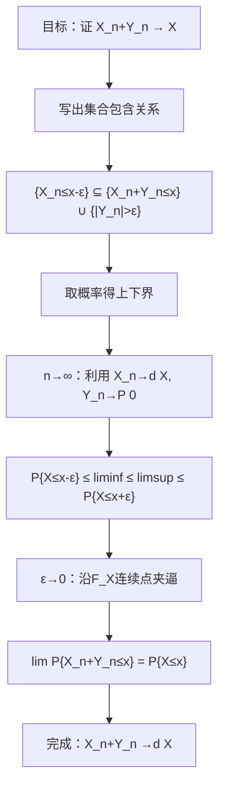

# 夹逼法（集合包含）

## 适用场景

证明随机变量序列的依分布收敛或依概率收敛——特别适用于 $X_n+Y_n$ 类组合的收敛性分析。

## 核心步骤

### 核心集合包含关系

$$\boxed{\{X_n \leq x - \varepsilon\} \subseteq \{X_n + Y_n \leq x\} \cup \{|Y_n| > \varepsilon\}}$$

同理可得反向包含：

$$\{X_n + Y_n \leq x\} \subseteq \{X_n \leq x + \varepsilon\} \cup \{|Y_n| > \varepsilon\}$$

### 操作流程

**①** 写出核心集合包含关系

**②** 取概率，得到上下界：

$$P\{X_n \leq x-\varepsilon\} - P\{|Y_n| > \varepsilon\} \leq P\{X_n + Y_n \leq x\} \leq P\{X_n \leq x+\varepsilon\} + P\{|Y_n| > \varepsilon\}$$

**③** 令 $n \to \infty$，利用已知收敛条件

**④** 令 $\varepsilon \to 0$（沿分布函数的连续点），夹逼得极限

> [!warning] 关键点
> - 集合包含关系的推导需要仔细验证：以"如果 $X_n+Y_n > x$ 且 $|Y_n|\le\varepsilon$，则 $X_n > x-\varepsilon$"为出发点。
> - 取概率后的不等式是**双侧夹逼**——既给上界也给下界。
> - $\varepsilon \to 0$ 时必须沿 $F_X$ 的连续点取值，否则极限分布可能不收敛。

## 流程图

## 典型例题

> **题目**（习题 5.12(2)）：已知 $X_n \xrightarrow{d} X$，$Y_n \xrightarrow{d} 0$（常数），证明 $X_n + Y_n \xrightarrow{d} X$。

> [!example]- 解答
> **第一步**：$Y_n \xrightarrow{d} 0$（收敛到常数），等价于 $Y_n \xrightarrow{P} 0$。
>
> **第二步**：对任意 $x \in \mathbb{R}$ 和 $\varepsilon > 0$，由集合包含：
>
> 若 $X_n \leq x-\varepsilon$，考虑两种情况：要么 $|Y_n| > \varepsilon$，要么 $|Y_n| \leq \varepsilon$ 时 $X_n+Y_n \leq (x-\varepsilon)+\varepsilon = x$。
> 因此 $\{X_n \leq x-\varepsilon\} \subseteq \{X_n+Y_n \leq x\} \cup \{|Y_n| > \varepsilon\}$。
>
> **第三步**：取概率得：
> $$P\{X_n \leq x-\varepsilon\} - P\{|Y_n| > \varepsilon\} \leq P\{X_n+Y_n \leq x\} \leq P\{X_n \leq x+\varepsilon\} + P\{|Y_n| > \varepsilon\}$$
>
> **第四步**：令 $n\to\infty$，利用 $X_n \xrightarrow{d} X$（取 $x\pm\varepsilon$ 为 $F_X$ 连续点）和 $Y_n \xrightarrow{P} 0$：
> $$P\{X \leq x-\varepsilon\} \leq \liminf P\{X_n+Y_n \leq x\} \leq \limsup P\{X_n+Y_n \leq x\} \leq P\{X \leq x+\varepsilon\}$$
>
> **第五步**：令 $\varepsilon \to 0$（沿 $F_X$ 的连续点），夹逼得：
> $$\lim_{n\to\infty} P\{X_n+Y_n \leq x\} = P\{X \leq x\}$$
>
> 即 $X_n+Y_n \xrightarrow{d} X$。$\square$

## 知识链接

- [[00_Inbox/待核实核心/知识点/随机变量序列的收敛性]]
- [[01_Knowledge/中心极限定理]]

## 习题链接

- [[03_Sources/Courses/概率论/作业/05-极限定理/习题5.12]] — 依概率/依分布收敛的线性性质与 Slutsky 定理
