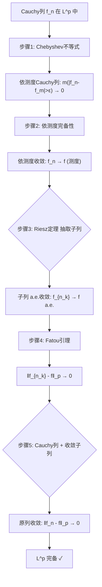

# 完备性证明方法

## 适用场景

证明某个函数空间（或序列空间）是完备的（即构成 Banach 空间）——每个 Cauchy 列在该空间中收敛。核心应用于 $L^p$ 完备性（Riesz-Fischer）、$L^\infty$ 完备性、$C[0,1]$ 在 sup 范数下完备性、$\ell^p$ 序列空间完备性。

## 核心公式/步骤

**标准证明链**（以 $L^p\ (1 \leq p < \infty)$ 完备性为例，五步走）：

> [!warning] 关键前提：$L^p$ 空间中的"收敛"是范数收敛 $\|f_n - f\|_p \to 0$，不是逐点收敛。必须使用子列技术——原 Cauchy 列不一定 a.e. 收敛。

**1. Cauchy 列 $\Rightarrow$ 测度基本列**

由 Chebyshev 不等式：

$$\boxed{m(\{|f_n - f_m| > \varepsilon\}) \leq \varepsilon^{-p} \|f_n - f_m\|_p^p \to 0}$$

即 $\{f_n\}$ 是依测度 Cauchy 列（测度基本列）。

**2. 测度基本列 $\Rightarrow$ 依测度收敛**

在依测度收敛的完备空间中，Cauchy 列必依测度收敛于某个 $f$（可测）：

$$f_n \xrightarrow{m} f$$

**3. 依测度收敛 $\Rightarrow$ 子列 a.e. 收敛**

由 Riesz 定理，抽取子列 $\{f_{n_k}\}$ 使得：

$$\boxed{f_{n_k} \xrightarrow{a.e.} f}$$

**4. Fatou 引理控制 $\Rightarrow$ 子列范数收敛**

对子列 $\{f_{n_k}\}$，利用 Fatou 引理：

$$\boxed{\|f_{n_k} - f\|_p \leq \liminf_{j \to \infty} \|f_{n_k} - f_{n_j}\|_p < \varepsilon}$$

由此推出 $\|f_{n_k} - f\|_p \to 0$。

> [!warning] Fatou 用法要点：$\liminf$ 必须放在范数**里面**（对积分用 Fatou），而非外面。具体地：先将差值写为积分形式，再用 Fatou 交换 $\liminf$ 与积分。

**5. 子列收敛 $\Rightarrow$ 原列收敛**

Cauchy 列若有范数收敛子列，则原列收敛到同一极限：

$$\boxed{\|f_n - f\|_p \leq \|f_n - f_{n_k}\|_p + \|f_{n_k} - f\|_p \to 0}$$

---

**其他空间的完备性证明要点**：

| 空间 | 核心差异 | 关键步骤 |
|:--|:--|:--|
| $L^\infty$ | 无需子列技术 | Cauchy 条件 $\to$ 去掉可数个零测集之并 $\to$ 余集上逐点一致 Cauchy $\to$ 一致收敛 |
| $C[0,1]$ (sup 范数) | 连续性需要保持 | 逐点 Cauchy（逐点极限存在）$\to$ 一致收敛保连续性 $\to$ 极限仍在 $C[0,1]$ |
| $\ell^p$ (序列空间) | 分量 $\to$ 分量 | 分量 Cauchy $\to$ 逐分量收敛 $\to$ 对角线法取子列 $\to$ 范数收敛 |
| $R[a,b]$ (Riemann 可积, $L^1$ 范数) | **不完备！** | 反例：构造 Riemann 可积函数列在 $L^1$ 范数下 Cauchy 但极限 Dirichlet 函数非 Riemann 可积 |

## 流程图

## 典型例题

> **题目**：写出 $L^p\ (1 \leq p < \infty)$ 完备性的完整证明链，并解释每一步为何必要——特别是"子列技术"为何不可绕过。

> [!example]- 解答
> **完整证明**：
>
> 设 $\{f_n\} \subset L^p(E)$ 为 Cauchy 列，即 $\forall\varepsilon>0,\ \exists N,\ \forall n,m \geq N,\ \|f_n-f_m\|_p < \varepsilon$。
>
> **步骤 1 (Cauchy $\to$ 测度基本)**：由 Chebyshev 不等式，
> $$m(\{|f_n-f_m| > \delta\}) \leq \delta^{-p}\|f_n-f_m\|_p^p \to 0$$
> 故 $\{f_n\}$ 是依测度 Cauchy 列。
>
> > 必要性：将范数的 Cauchy 条件转化为更弱的测度条件，为 Riesz 定理铺路。
>
> **步骤 2 (测度基本 $\to$ 依测度收敛)**：依测度收敛空间是完备的，存在可测函数 $f$ 使 $f_n \xrightarrow{m} f$。
>
> **步骤 3 (依测度收敛 $\to$ 子列 a.e. 收敛)**：由 Riesz 定理，存在子列 $\{f_{n_k}\}$ 使 $f_{n_k} \xrightarrow{a.e.} f$。
>
> > **为何必须取子列？** 原 Cauchy 列不一定 a.e. 收敛。经典反例是"打字机序列"（在 $[0,1]$ 上依次扫描越来越细的区间），该序列在 $L^p$ 范数下收敛到 $0$（故是 Cauchy 列），但对每个 $x$ 都有子列取值为 $1$——逐点不收敛。
>
> **步骤 4 (Fatou 控制)**：取 $n_k$ 足够大使得 $\forall j \geq k,\ \|f_{n_k} - f_{n_j}\|_p < \varepsilon$。由 Fatou 引理：
> $$\int |f_{n_k} - f|^p = \int \liminf_{j\to\infty} |f_{n_k} - f_{n_j}|^p \leq \liminf_{j\to\infty} \int |f_{n_k} - f_{n_j}|^p \leq \varepsilon^p$$
> 故 $\|f_{n_k} - f\|_p \to 0$，且 $f = f_{n_k} - (f_{n_k} - f) \in L^p(E)$。
>
> > **Fatou 为何关键？** Fatou 将 a.e. 收敛（$\liminf$ 在积分内）与范数 Cauchy 条件（$\liminf$ 在积分外）连接起来。没有 Fatou，a.e. 收敛本身不足以保证 $L^p$ 收敛。
>
> **步骤 5 (子列 $\Rightarrow$ 原列)**：
> $$\|f_n - f\|_p \leq \|f_n - f_{n_k}\|_p + \|f_{n_k} - f\|_p$$
> 第一项由 Cauchy 条件控制（取 $n,k$ 充分大），第二项由步骤 4 控制。
>
> **总结**：五步是一个不可拆的完整链条——Chebyshev 将范数条件转为测度条件，Riesz 从测度收敛中"捞出" a.e. 收敛子列，Fatou 将 a.e. 信息提升为范数信息，最后 Cauchy 性质扩散到全列。

> **题目**：证明 Riemann 可积函数空间 $R[0,1]$ 在 $L^1$ 范数 $\|f\| = \int_0^1 |f(x)|dx$ 下**不完备**。

> [!example]- 解答
> 构造 $[0,1]$ 上有理数枚举 $\{q_n\}$，定义：
> $$f_n(x) = \begin{cases} 1 & x \in \{q_1,\ldots,q_n\} \\ 0 & \text{otherwise} \end{cases}$$
>
> 每个 $f_n$ 为有限个点非零，故 Riemann 可积且 $\|f_n\|_1 = 0$。
>
> 当 $n,m \to \infty$ 时 $\|f_n - f_m\|_1 = 0$，故 $\{f_n\}$ 是 Cauchy 列。但 $f_n$ 的逐点极限为 Dirichlet 函数 $\mathbb{1}_{\mathbb{Q}\cap[0,1]}$，该函数不是 Riemann 可积的，且 $f_n$ 在 $L^1$ 范数下不收敛于任何 Riemann 可积函数。
>
> 这说明了 $L^1$ 完备化引入 Lebesgue 积分的动机：Riemann 可积空间不完备，需要更大的 Lebesgue 可积空间来使其完备化。

## 知识链接

- [[01_Knowledge/Riesz定理]] — 依测度收敛序列存在 a.e. 收敛子列（步骤 3 核心定理）
- [[01_Knowledge/Fatou引理]] — $\liminf$ 与积分交换，连接 a.e. 收敛与范数收敛（步骤 4 核心定理）
- [[01_Knowledge/Lebesgue控制收敛定理]] — 更强的极限/积分交换工具，可用于简化部分完备性证明
- [[01_Knowledge/Levi单调收敛定理]] — 非负递增列的积分极限定理，完备性证明的备选工具

## 习题链接

- [[03_Sources/Courses/归档/实变函数/作业/05-重积分与Lp空间/习题5.12-L^p空间的完备性（Riesz-Fischer定理）-习题]] — $L^p$ 完备性的完整证明
- [[03_Sources/Courses/归档/实变函数/作业/05-重积分与Lp空间/习题5.10-L^p收敛蕴含依测度收敛（定理4.1.9）-习题]] — 步骤 1~2 的具体验证
- [[03_Sources/Courses/归档/实变函数/作业/05-重积分与Lp空间/习题5.11-L^p控制收敛定理（定理4.1.10）-习题]] — 控制收敛定理替代 Fatou 的完备性证明
- [[03_Sources/Courses/归档/实变函数/作业/05-重积分与Lp空间/习题5.18-Riemann可积函数空间在L^1范数下不完备-习题]] — 不完备性反例，理解完备化的动机
- [[03_Sources/Courses/归档/实变函数/作业/03-可测函数/习题3.22-Riesz定理（依测度收敛蕴含几乎处处收敛子列）-习题]] — Riesz 定理的直接练习
- [[03_Sources/Courses/归档/实变函数/作业/04-Lebesgue积分/习题4.14-Fatou引理-习题]] — Fatou 引理的核心使用练习
