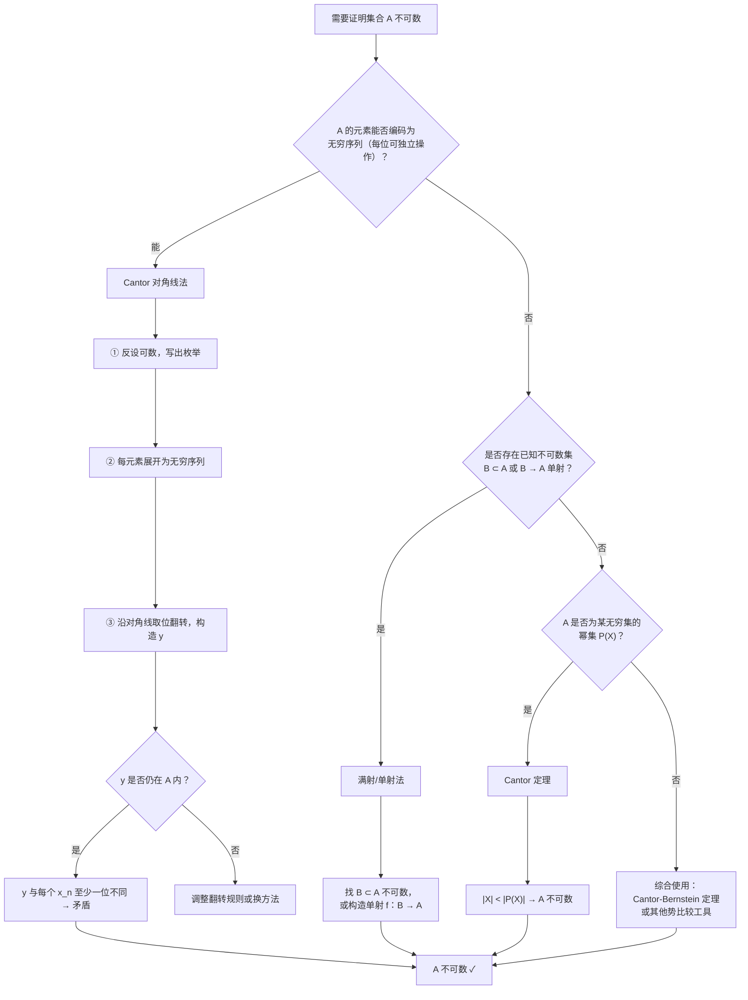

# 证明集合不可数的方法

## 适用场景

证明一个集合不是可数集（即其势 $> \aleph_0$）。三类场景：(1) 集合元素可表示为无穷序列 → 对角线法；(2) 已知某不可数集的结构关系 → 满射/单射法；(3) 集合为某无穷集的幂集 → Cantor 定理。

## 核心公式/步骤

### 方法一：Cantor 对角线法（最核心）

**标准执行模板**（以 $(0,1)$ 为例）：

1. 反设可数，写出枚举 $x_1, x_2, x_3, \ldots$
2. 将每个 $x_n$ 展开为十进制（或二进制等）无穷序列
3. 沿对角线取第 $n$ 个元素的第 $n$ 位 $a_{nn}$，翻转构造 $b_n$

$$\boxed{b_n = \begin{cases} 2 & a_{nn} = 1 \\ 1 & a_{nn} \neq 1 \end{cases}}$$

4. 令 $y = 0.b_1 b_2 b_3 \cdots$，确保 $y$ 仍属于原集合
5. $y$ 与每个 $x_n$ 在第 $n$ 位不同 $\implies y \notin \{x_n\}$，矛盾

> [!warning] 对角线法两大前提
> 1. **表示唯一性**：十进制展开需禁止从某位起全为 0 或全为 9 的表示，否则 $b_n$ 展开可能等于某 $a_n$ 的另一表示（如 $0.1000\cdots = 0.0999\cdots$），论证失效。
> 2. **$b_n$ 不能取 $0$ 或 $9$**：取 $0$ 可能使 $y \notin (0,1)$（如 $0.000\cdots$），取 $9$ 可能越界或落入歧义。稳妥做法：始终取 $\{1,2\}$ 或 $\{3,7\}$。

### 方法二：满射/单射法

若已知 $B \subset A$ 且 $B$ 不可数，则 $A$ 不可数；或证明不存在满射 $\mathbb{N} \to A$。

$$\boxed{B \subset A,\; |B| > \aleph_0 \;\Longrightarrow\; |A| > \aleph_0}$$

**常用桥接**：$(0,1) \sim \mathbb{R}$（双射 $x \mapsto \tan(\pi x - \pi/2)$），故证 $\mathbb{R}$ 不可数等价于证 $(0,1)$ 不可数。

### 方法三：Cantor 定理

$$\boxed{|A| < |\mathcal{P}(A)|}$$

核心构造：假设 $g: A \to \mathcal{P}(A)$ 为满射，构造 $D = \{a \in A : a \notin g(a)\}$，则 $D$ 不在像中——这是对角线法在抽象集合上的推广。

特别地：$\mathcal{P}(\mathbb{N})$ 不可数，势 $\mathfrak{c} = 2^{\aleph_0}$。

## 流程图

## 典型例题

> **题目 1**：用 Cantor 对角线法证明区间 $(0,1)$ 不可列。

> [!example]- 解答
> **（一）反设假设**：假设 $(0,1)$ 可列，存在枚举 $(0,1) = \{r_1, r_2, r_3, \ldots\}$。
>
> **（二）十进制展开**（唯一化处理）：禁止从某位起全为 $0$ 的表示，在此约定下每个实数有唯一十进制展开：
> $$
> \begin{aligned}
> r_1 &= 0.a_{11} a_{12} a_{13} \cdots \\
> r_2 &= 0.a_{21} a_{22} a_{23} \cdots \\
> r_3 &= 0.a_{31} a_{32} a_{33} \cdots \\
> &\;\;\vdots
> \end{aligned}
> $$
>
> **（三）对角线构造**：取 $a_{11}, a_{22}, a_{33}, \ldots$，定义
> $$
> b_n = \begin{cases} 2 & a_{nn} = 1 \\ 1 & a_{nn} \neq 1 \end{cases}
> $$
> 令 $x = 0.b_1 b_2 b_3 \cdots$
>
> **（四）验证**：
> - $x \in (0,1)$：因 $b_n \in \{1,2\}$，故 $0.111\cdots \leq x \leq 0.222\cdots \subset (0,1)$。
> - $x \neq r_n$（对所有 $n$）：$x$ 与 $r_n$ 在第 $n$ 位不同，且唯一表示约定保证「展开不同 $\Rightarrow$ 值不同」。
>
> **（五）矛盾与结论**：$x$ 是 $(0,1)$ 中的实数却不在枚举中，矛盾。故 $(0,1)$ 不可列。
>
> **点评**：两个关键点——(i) 对角线构造保证逐位不同；(ii) 唯一表示约定保证论证严格。取 $b_n \in \{1,2\}$ 而非 $\{0,9\}$，是初学者最易忽略的细节。

> **题目 2**：证明 Cantor 三分集不可数，但其 Lebesgue 测度为零。

> [!example]- 解答
> **（一）Cantor 集的构造**：$C = \bigcap_{n=1}^{\infty} F_n$，其中 $F_1 = [0, \frac{1}{3}] \cup [\frac{2}{3}, 1]$，$F_n$ 由 $2^n$ 个长度为 $1/3^n$ 的闭区间组成（每步挖去中间 $\frac{1}{3}$ 开区间）。
>
> **（二）测度为零**：$F_n$ 总长度为 $(2/3)^n \to 0$，由测度的上连续性，$m(C) = \lim_{n\to\infty} m(F_n) = 0$。
>
> **（三）不可数性（满射法）**：Cantor 集中的点可唯一表示为三进制小数
> $$x = \sum_{n=1}^{\infty} \frac{a_n}{3^n}, \quad a_n \in \{0, 2\}$$
> 建立映射 $\varphi: C \to [0,1]$：
> $$\varphi\left(\sum_{n=1}^{\infty} \frac{a_n}{3^n}\right) = \sum_{n=1}^{\infty} \frac{a_n/2}{2^n}$$
> 即将三进制 $\{0,2\}$ 序列映射为二进制 $\{0,1\}$ 序列。$\varphi$ 是满射（甚至双射），故 $|C| \geq |[0,1]| = \mathfrak{c}$；又 $C \subset [0,1]$ 故 $|C| \leq \mathfrak{c}$。因此 $|C| = \mathfrak{c}$，Cantor 集不可数。
>
> **点评**：Cantor 集是实变函数中最重要的反例——说明**基数（大）和测度（小）是独立的概念**。不可数性用满射/单射法（方法二）比对角线法更自然，因 Cantor 集的三进制编码天然给出到 $[0,1]$ 的映射。

## 知识链接

- [[01_Knowledge/Cantor对角线法]] — 对角线法的严格定义、推导、易错点与相关性质
- [[01_Knowledge/不可数集]] — 不可数集的定义与基本性质
- [[01_Knowledge/可数集]] — 可数集的定义、判定与运算封闭性
- [[01_Knowledge/势]] — 势的比较：$\leq$、$=$、$<$ 的定义，Cantor-Bernstein 定理
- [[01_Knowledge/零测集]] — 测度为零的集合，Cantor 集为零测不可数集的典型代表

## 习题链接

- [[03_Sources/Courses/归档/实变函数/作业/01-集合论与点集拓扑基础/习题1.5-与(0,1)一一对应但长度为零的集合-思考题]] — Cantor 集：不可数但测度为零（方法二）
- [[03_Sources/Courses/归档/实变函数/作业/01-集合论与点集拓扑基础/习题1.30-不相交开区间族可数-例题]] — 用有理数稠密性证可数性（可数性判定的对偶视角）
- [[03_Sources/Courses/归档/实变函数/作业/01-集合论与点集拓扑基础/习题1.31-单调函数不连续点可数-例题]] — 单调函数跳跃间断点的可数性
- [[03_Sources/Courses/归档/实变函数/作业/01-集合论与点集拓扑基础/习题1.32-可列集的有限子集全体可列-证明题]] — 势的运算与可数性保持
- [[03_Sources/Courses/归档/实变函数/作业/01-集合论与点集拓扑基础/习题1.33-连续统假设-思考题]] — 连续统假设：$\aleph_0$ 与 $\mathfrak{c}$ 之间无其他基数
- [[03_Sources/Courses/归档/实变函数/作业/01-集合论与点集拓扑基础/习题1.44-学习报告（类Cantor集、可数-不可数集例、Zorn公理）-作业]] — 综合：类 Cantor 集构造、可数/不可数集的更多例子
