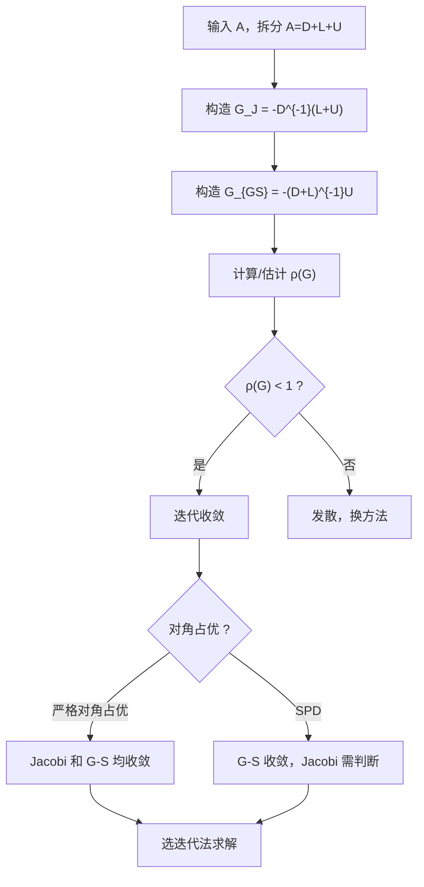

# 迭代法收敛性判断流程

## 适用场景
面对大型稀疏线性方程组 $Ax=b$，选择迭代法前先判断 Jacobi / Gauss-Seidel 哪种方法收敛。

## 核心公式/步骤

1. 拆分矩阵 $\boxed{A=D+L+U}$（$D$ 对角，$L$ 严格下三角，$U$ 严格上三角）
2. 构造迭代矩阵：
   - Jacobi：$\boxed{G_J=-D^{-1}(L+U)}$
   - G-S：$\boxed{G_{GS}=-(D+L)^{-1}U}$
3. 判断收敛的充要条件：$\boxed{\rho(G)<1}$（谱半径 < 1）
4. 充分条件（更易检查）：
   - 严格对角占优→Jacobi 和 G-S 均收敛
   - $A$ 对称正定→G-S 收敛
   - 弱对角占优且不可约→收敛

## 典型例题

> **题目**：判断 $A=\begin{bmatrix}4&-1&0\\-1&4&-1\\0&-1&4\end{bmatrix}$ 的 Jacobi 和 G-S 收敛性。

> [!example]- 解答
> $A$ 严格对角占优→Jacobi 和 G-S 均收敛。
> 直接计算 $\rho(G_J)=\frac{\sqrt{2}}{2}\approx0.707<1$，$\rho(G_{GS})=0.5<1$。
> G-S 收敛速度快于 Jacobi（$\rho$ 更小）。点评：先用充分条件快速判断，不必每次都算谱半径。

## 链接的知识点
- [[01_Knowledge/迭代收敛定理(谱半径)]]
- [[01_Knowledge/Jacobi迭代]]
- [[01_Knowledge/Gauss-Seidel迭代]]

## 链接的习题
- [[03_Sources/Courses/归档/数值分析/习题库/04-线性方程组的迭代法/README|第4章习题库]]
