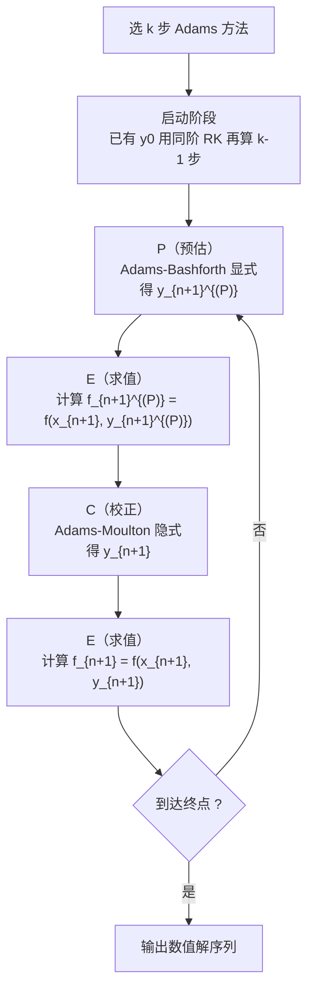

# Adams多步法启动与PECE预估校正

## 适用场景
当需要高效计算 ODE 且步长固定时，纯显式 Adams-Bashforth 在缓存历史值后每步新增一次 $f$ 求值；下述一次校正 PECE 每步新增两次。稳定性及误差控制也须检查。

## 核心公式/步骤

1. **启动阶段**：选定 $k$ 步 Adams 方法 → 用同阶 RK 方法计算前 $k$ 个启动值 $y_0,y_1,\ldots,y_{k-1}$
2. **Adams-Bashforth（显式预估）**：
   - 4 步 AB：$\boxed{y_{n+1}^{(P)}=y_n+\frac{h}{24}(55f_n-59f_{n-1}+37f_{n-2}-9f_{n-3})}$
3. **Adams-Moulton 校正**：真正隐式 AM 用未知的 $f(x_{n+1},y_{n+1})$ 并解方程；PECE 则代入预测值只校正一次：
   - 3 步 AM：$\boxed{y_{n+1}=y_n+\frac{h}{24}(9f_{n+1}^{(P)}+19f_n-5f_{n-1}+f_{n-2})}$
4. **PECE 模式**：Prediction → Evaluation → Correction → Evaluation → 下一步
5. 4 步 AB 是 4 阶，每步一次新增求值；AB4 配四阶 AM 的一次校正 PECE 每步两次新增求值。在光滑性、稳定性和启动精度条件下，全局误差 $O(h^4)$

## 典型例题

> **题目**：用 2 步 Adams-Bashforth-Moulton PECE 解 $y'=-y$, $y(0)=1$, $h=0.1$，求 $y(0.2)$。

> [!example]- 解答
> 启动：用中点法（2阶）得 $y_1=y(0.1)\approx0.905$。
> 2步AB预估：$y_2^{(P)}=y_1+\frac{h}{2}(3f_1-f_0)=0.905+0.05(-2.715+1)=0.8193$
> 梯形 AM（一步、二阶）校正：$y_2=y_1+\frac{h}{2}(f_2^{(P)}+f_1)=0.905+0.05(-0.8193-0.905)=0.8188$
> 精确 $y(0.2)=e^{-0.2}=0.8187$。点评：PECE 以 2 次 $f$ 求值达到 2 阶精度，每步求值次数与 RK2 相同，不能仅据阶数判定效率更高。

## 链接的知识点
- [[01_Knowledge/线性多步法(Adams)]]
- [[01_Knowledge/Runge-Kutta方法]]
- [[01_Knowledge/预估校正法]]

## 链接的习题
- [[03_Sources/Courses/归档/数值分析/习题库/10-常微分方程初值问题的数值解法/README|第10章习题库]]
