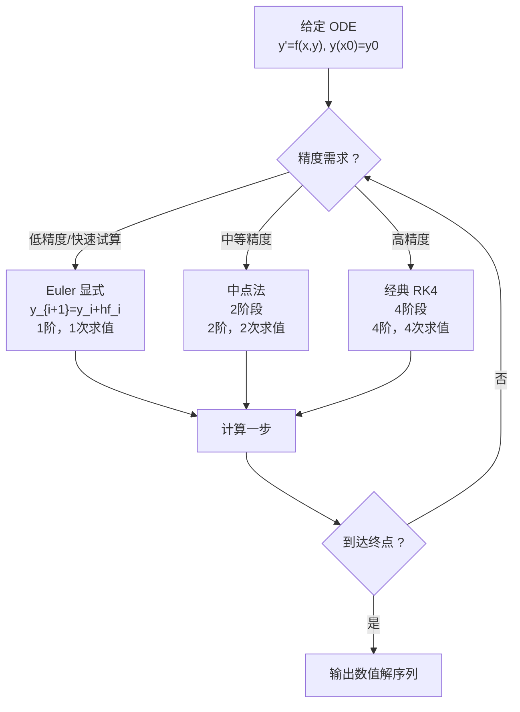

# EulerRK迭代流程

## 适用场景
求解 ODE 初值问题 $y'=f(x,y)$, $y(x_0)=y_0$，根据精度需求选择 Euler（简单低精度）或 Runge-Kutta（高精度多阶段）。

## 核心公式/步骤

| 方法 | 公式 | 阶数 | 每步求值 |
|:--|:--|:--|:--|
| Euler 显式 | $\boxed{y_{i+1}=y_i+hf(x_i,y_i)}$ | 1 | 1 |
| 中点法 | $\boxed{y_{i+1}=y_i+hf(x_i+\frac{h}{2},y_i+\frac{h}{2}f_i)}$ | 2 | 2 |
| 经典 RK4 | $\boxed{\begin{aligned}&k_1=hf(x_i,y_i),\ k_2=hf(x_i+\frac{h}{2},y_i+\frac{k_1}{2})\\&k_3=hf(x_i+\frac{h}{2},y_i+\frac{k_2}{2}),\ k_4=hf(x_i+h,y_i+k_3)\\&y_{i+1}=y_i+\frac{1}{6}(k_1+2k_2+2k_3+k_4)\end{aligned}}$ | 4 | 4 |

## 典型例题

> **题目**：用 Euler 和 RK4 解 $y'=-y$, $y(0)=1$，步长 $h=0.2$，求 $y(1)$。

> [!example]- 解答
> 精确解 $y=e^{-x}$，$y(1)=e^{-1}\approx0.3679$。
> Euler：$y_1=0.8$, $y_2=0.64$, ..., $y_5=0.3277$，误差 $0.040$
> RK4：$y_5\approx0.3679$，误差极小。点评：RK4 的局部截断误差为 $O(h^5)$，在光滑问题上远优于 Euler。

## 链接的知识点
- [[01_Knowledge/Euler方法]]
- [[01_Knowledge/Runge-Kutta方法]]

## 链接的习题
- [[03_Sources/Courses/归档/数值分析/习题库/10-常微分方程初值问题的数值解法/README|第10章习题库]]
