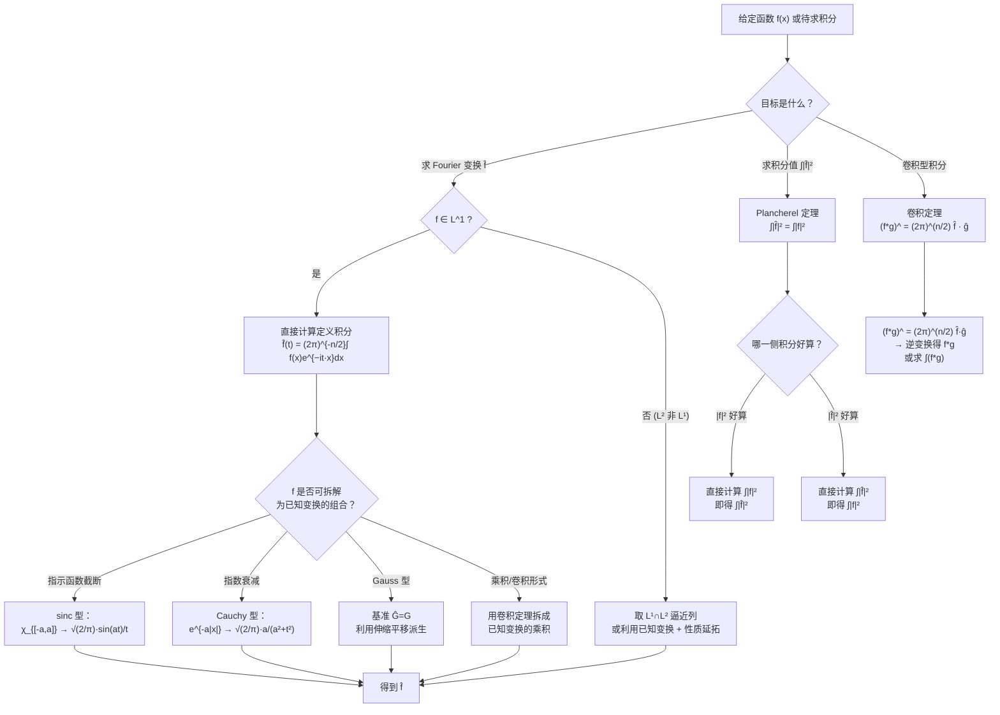

# Fourier变换与Plancherel积分计算法

## 适用场景

需要计算具体函数的 Fourier 变换、利用卷积定理简化含卷积的积分、或利用 Plancherel 定理将难以直接计算的积分转化为 $L^2$ 范数等式求解。

## 核心公式/步骤

**Fourier 变换定义**（$L^1$ 中）：

$$\boxed{\hat{f}(t) = (2\pi)^{-n/2} \int_{\mathbb{R}^n} f(x)\, e^{-i t \cdot x}\, dx}$$

**Fourier 逆变换**（速降函数类 $\mathcal{S}$ 中）：

$$\boxed{f(x) = (2\pi)^{-n/2} \int_{\mathbb{R}^n} \hat{f}(t)\, e^{i x \cdot t}\, dt}$$

---

### 操作步骤

1. **判断函数所属空间**：确认 $f \in L^1$（可直接积分定义）还是 $f \in L^2 \setminus L^1$（需用延拓 / Plancherel）
2. **识别可用的简化性质**：
   - 平移 $\leftrightarrow$ 乘相位：$\widehat{f(x-a)}(t) = e^{-i a \cdot t}\,\hat{f}(t)$
   - 卷积 $\leftrightarrow$ 乘积：$\widehat{f*g} = (2\pi)^{n/2}\hat{f} \cdot \hat{g}$（卷积定理）
   - 伸缩 $\leftrightarrow$ 反伸缩：$\widehat{f(ax)}(t) = |a|^{-n}\,\hat{f}(t/a)$（实数 $a\ne0$）
3. **选用基准变换**（见下方变换表），组合性质得出目标函数的 Fourier 变换
4. **利用 Plancherel 求积分值**：$\|\hat{f}\|_2 = \|f\|_2$，即
   $$\boxed{\int_{\mathbb{R}^n} |\hat{f}(t)|^2\,dt = \int_{\mathbb{R}^n} |f(x)|^2\,dx}$$
   当等式一侧易于计算时，即可求出另一侧的积分值

---

### 常见变换表（$n=1$，归一化 $(2\pi)^{-1/2}$）

| $f(x)$ | $\hat{f}(t)$ | 备注 |
|:---|:---|:---|
| $\chi_{[-a,a]}(x)$ | $\displaystyle \sqrt{\frac{2}{\pi}}\,\frac{\sin(at)}{t}$ | sinc 型 — 截断函数的 Fourier 变换 |
| $e^{-a\|x\|}\;(a>0)$ | $\displaystyle \sqrt{\frac{2}{\pi}}\,\frac{a}{a^{2}+t^{2}}$ | Cauchy 分布 — 指数衰减对应有理衰减 |
| $e^{-ax^{2}}\;(a>0)$ | $\displaystyle (2a)^{-1/2}\,e^{-t^{2}/4a}$ | Gauss 型 — $a=1/2$ 时 $\hat{G}=G$ |
| $G(x)=e^{-\|x\|^{2}/2}$ | $\hat{G}(t)=G(t)$ | **基准**：Gauss 函数是 Fourier 变换的特征函数 |

> [!warning] 关键易错点
> - **归一化常数因文献而异**：本文采用 $(2\pi)^{-n/2}$，部分教材用 $(2\pi)^{-1/2}$ 或 $1$——做题前必须先确认定义
> - **卷积定理对 $L^1$ 函数成立**，推广到其他函数空间须逐项检查卷积与乘积的可积性——不可直接在 $L^2$ 中对任意函数套用
> - **$L^1$ 中 Fourier 变换的值不一定回到 $L^1$**（如 $\chi_{[-a,a]}$ 的变换为 sinc，不属于 $L^1$），因此不能随意写逆变换积分公式
> - 使用 Plancherel 时，等式为 $\|\hat{f}\|_2 = \|f\|_2$，不要误写成 $\|\hat{f}\|_1 = \|f\|_1$（**一般不成立**）

## 流程图

## 典型例题

> **题目 1**：计算 $f(x) = e^{-|x|}$（$x \in \mathbb{R}$）的 Fourier 变换，并利用 Plancherel 定理验证结果。

> [!example]- 解答
> **直接计算**（$f \in L^1$，归一化 $(2\pi)^{-1/2}$）：
> $$\begin{aligned}
> \hat{f}(t) &= \frac{1}{\sqrt{2\pi}} \int_{-\infty}^{\infty} e^{-|x|}\, e^{-i t x}\, dx \\
> &= \frac{1}{\sqrt{2\pi}} \left( \int_{-\infty}^{0} e^{x(1-it)}\, dx + \int_{0}^{\infty} e^{-x(1+it)}\, dx \right) \\
> &= \frac{1}{\sqrt{2\pi}} \left( \frac{1}{1-it} + \frac{1}{1+it} \right)
>   = \sqrt{\frac{2}{\pi}}\,\frac{1}{1+t^{2}}
> \end{aligned}$$
>
> **Plancherel 验证**：
> $$\begin{aligned}
> \|f\|_2^2 &= \int_{-\infty}^{\infty} e^{-2|x|}\, dx = 2\int_{0}^{\infty} e^{-2x}\,dx = 1 \\
> \|\hat{f}\|_2^2 &= \frac{2}{\pi} \int_{-\infty}^{\infty} \frac{1}{(1+t^{2})^{2}}\, dt
>   = \frac{2}{\pi} \cdot \frac{\pi}{2} = 1
> \end{aligned}$$
> 验证通过 $\|\hat{f}\|_2 = \|f\|_2 = 1$。
>
> **点评**：本题展示了 Fourier 变换从定义出发的直接计算路线——先拆分积分区间消去绝对值，再合并为有理函数。Plancherel 验证不仅是检查，也是"$\|\hat{f}\|_2 = 1$"这个事实本身可反过来用于后续积分计算。

---

> **题目 2**：利用卷积定理证明 $\displaystyle \int_{-\infty}^{\infty} \frac{\sin^{2} x}{x^{2}}\,dx = \pi$。

> [!example]- 解答
> **思路**：将 $\frac{\sin x}{x}$ 与某已知函数的 Fourier 变换关联。
>
> 令 $f(x) = \chi_{[-1,1]}(x)$（区间 $[-1,1]$ 上的指示函数）。由变换表：
> $$\hat{f}(t) = \sqrt{\frac{2}{\pi}}\,\frac{\sin t}{t}$$
>
> 卷积定理：$\widehat{f*f}=\sqrt{2\pi}(\hat f)^2$。这里 $f*f(x)=\max(0,2-|x|)$ 连续可积，且其变换可积，故可在连续点使用 $L^1$ 反演（$f$ 并不属于 $\mathcal S$）：
> $$(f*f)(x)=\int_{-\infty}^{\infty}(\hat f(t))^2e^{ixt}\,dt.$$
> 在 $x=0$ 处，左边为 $2$，右边为 $\frac{2}{\pi}\int_{-\infty}^{\infty}\frac{\sin^2t}{t^2}\,dt$，因此积分为 $\pi$。
>
> **独立校验**：Plancherel 给出 $\int|\hat f|^2=\int|f|^2=2$，代入 $\hat f(t)=\sqrt{2/\pi}\sin(t)/t$ 得同一结论。
>
> **点评**：对称归一化下，卷积公式中的 $\sqrt{2\pi}$ 与逆变换的系数抵消。

---

> **题目 3**：设 $f(x) = e^{-x^{2}/2}$（$x \in \mathbb{R}$），利用 Gauss 函数为 Fourier 变换特征函数的性质，求 $\displaystyle \int_{-\infty}^{\infty} x^{2} e^{-x^{2}}\,dx$。

> [!example]- 解答
> Gauss 基准：$G(x) = e^{-x^{2}/2}$ 满足 $\hat{G} = G$。
>
> 令 $f(x) = e^{-x^{2}/2}$，则 $\hat{f} = f$。Plancherel 给出 $\|f\|_2 = \|\hat{f}\|_2$（平凡验证）。
>
> 对于 $xe^{-x^{2}/2}$：由 $f'(x) = -x f(x)$，且 $\widehat{f'}(t) = i t \hat{f}(t)$，得
> $$\widehat{-x f(x)}(t) = i t \hat{f}(t) \implies \widehat{x f(x)}(t) = -i t \hat{f}(t) = -i t f(t)$$
>
> 由此：
> $$\begin{aligned}
> \int_{-\infty}^{\infty} x^{2} e^{-x^{2}}\,dx
>   &= \int_{-\infty}^{\infty} (x e^{-x^{2}/2})^{2}\,dx \\
>   &= \|x f(x)\|_2^{2} \\
>   &= \|\widehat{x f}\|_2^{2} \quad \text{(Plancherel)} \\
>   &= \int_{-\infty}^{\infty} |-i t f(t)|^{2}\,dt \\
>   &= \int_{-\infty}^{\infty} t^{2} e^{-t^{2}}\,dt
> \end{aligned}$$
>
> 这给出等式 $\int x^{2} e^{-x^{2}}dx = \int t^{2} e^{-t^{2}}dt$（平凡）。更进一步的技巧是直接对 Gauss 积分求导：
> $$\int_{-\infty}^{\infty} e^{-a x^{2}} dx = \sqrt{\frac{\pi}{a}}
>   \implies \int_{-\infty}^{\infty} x^{2} e^{-a x^{2}} dx = \frac{\sqrt{\pi}}{2} a^{-3/2}$$
> 令 $a=1$ 即得 $\displaystyle \int_{-\infty}^{\infty} x^{2} e^{-x^{2}} dx = \frac{\sqrt{\pi}}{2}$。
>
> **点评**：本题展示 Plancherel 与 Fourier 变换性质结合求积分的模式。虽然本题可用参数求导绕过，但当被积函数结构更复杂（如混合 Fourier 变换）时，Plancherel + 性质组合往往是唯一可行的路线。

## 知识链接

- [[01_Knowledge/Plancherel定理]] — Fourier 变换在 $L^2$ 上的等距延拓，$\|\hat{f}\|_2 = \|f\|_2$
- [[01_Knowledge/Hilbert空间正交基与Parseval等式]] — $L^2$ 中 Fourier 展开与 Parseval 等式，Plancherel 的离散对应
- [[01_Knowledge/Young不等式(卷积版)]] — 卷积在 $L^p$ 中的连续性，卷积定理成立的基础

## 习题链接

- [[03_Sources/Courses/归档/实变函数/作业/05-重积分与Lp空间/考题-Fourier变换的核心性质]] — 卷积定理证明、Gauss 变换、Plancherel 陈述（考试级综合题）
- [[03_Sources/Courses/归档/实变函数/作业/05-重积分与Lp空间/考题-正交基与Fourier展开]] — 正交基、Fourier 展开与 Parseval 等式（离散版本对照）

## 本轮习题补充与边界核对

对χ[-1,1]直接积分得 $\hat f(t)=\sqrt{2/π}\sin t/t$，t=0按连续延拓为 $\sqrt{2/π}$。指数的虚部应为−sin(tx)，但此偶函数例中奇函数积分为0，不改结果。

对 $f(x)=\sin x\,χ_{[-π,π]}(x)$，奇偶性消去余弦项，积化和差给
$$\hat f(t)=\frac{i}{\sqrt{2π}}\left(\frac{\sin((t+1)π)}{t+1}-\frac{\sin((t-1)π)}{t-1}\right).$$
t=±1处均用sin u/u→1作可去奇点延拓，分别为−iπ/√(2π)、iπ/√(2π)。

对G=e^(−x²/2)，G'=−xG，Schwartz衰减允许积分分部及积分号下求导：$\widehat{G'}=it\hat G$、$\widehat{xG}=i\hat G'$，故 $it\hat G=-i\hat G'$，即 $\hat G'=-t\hat G$。初值 $\hat G(0)=1$ 给 $\hat G=e^{-t²/2}$。所有计算必须先固定指数符号和对称归一化。

## 非对称归一化下的性质、依据与核查例

本节专用 $\widehat f=\int f(x)e^{-i\omega x}dx$，逆变换系数 $1/(2\pi)$；与上文对称归一化的像函数差 $\sqrt{2\pi}$，不可混用。多数公式可先取Schwartz函数；放宽条件时逐项核对。

| 运算 | 本节公式 |
|---|---|
| 线性 | $\mathcal F[\alpha f+\beta g]=\alpha\hat f+\beta\hat g$ |
| 导数 | $\mathcal F[f^{(n)}]=(i\omega)^n\hat f$ |
| 频率导数 | $\partial_\omega\hat f=\mathcal F[-ixf]$ |
| 平移 | $\mathcal F[f(x-b)]=e^{-i\omega b}\hat f$ |
| 调制 | $\mathcal F[e^{i\omega_0x}f]=\hat f(\omega-\omega_0)$ |
| 缩放 | $\mathcal F[f(bx)]=|b|^{-1}\hat f(\omega/b)$，$b\ne0$ |
| 能量 | $\int|f|^2dx=(2\pi)^{-1}\int|\hat f|^2d\omega$ |

导数公式用分部积分：$\int f'e^{-i\omega x}=[fe^{-i\omega x}]_{-\infty}^{\infty}+i\omega\hat f$。例如 $f$ 局部绝对连续且 $f,f'\in L^1$ 时边界项消失；高阶还须相应低阶边界项与可积条件。于是二阶乘子为 $-\omega^2$，四阶为 $\omega^4$。若 $xf\in L^1$，积分下对频率求导给频率导数公式。平移令 $s=x-b$ 得负相位；调制直接合并指数得频率平移；缩放 $s=bx$ 时 $b<0$ 必须交换积分限，所以出现绝对值。

### 原函数积分不能忽略零频

若 $q(x)=\int_{-\infty}^xf(s)ds$，还须 $q$ 有可用变换且导数公式成立，才能由 $q'=f$ 得
$$\widehat q(\omega)=\widehat f(\omega)/(i\omega),\qquad\omega\ne0.$$
经典 $L^1$ 情形可要求 $q,f\in L^1$ 及相应正则性，尤其 $\int f=0$；总积分为零仍不足以自动保证 $q\in L^1$。零频由原定义或极限确定。总积分非零时原函数通常一端趋于非零常数，须采用分布及零频项，不能照搬普通函数除法。

### 高斯与平移自测

对 $A>0$，设 $I(x)=\int e^{-A\omega^2}e^{i\omega x}d\omega$。高斯衰减允许求导及分部积分，给 $I'=-xI/(2A)$、$I(0)=\sqrt{\pi/A}$，故
$$\mathcal F^{-1}[e^{-A\omega^2}]=\frac{e^{-x^2/(4A)}}{\sqrt{4\pi A}}.$$
配方涉及复平移时，不能直接当成实正态概率积分。平移高斯的变换为 $e^{-i\omega b}e^{-A\omega^2}$；改 $b$ 为 $-b$，相位改正号。零频为1检查空间积分归一化。

### 分段奇函数的参数化计算

设 $h_c(x)=cx$ 当 $|x|<2$，其余为零；$c$ 为实参数。奇偶性去掉余弦，分部积分得
$$
\widehat h_c(\omega)=-2ic\int_0^2x\sin(\omega x)dx
=\frac{4ic\cos(2\omega)}\omega-\frac{2ic\sin(2\omega)}{\omega^2}.
$$
$\omega=0$ 按可去奇点取0；小频率为 $-(16/3)ic\omega+O(\omega^3)$，与 $\hat h_c'(0)=-i\int xh_c(x)dx$ 相符。11月11日原课堂精确系数缺失，本式只说明参数族，未恢复原题 $c$。

### §5.1习题的公式与适用边界

按同一约定，$\mathcal F[e^{-|x|}]=2/(1+\omega^2)$（拆正负轴直接积分），$\mathcal F[e^{-\pi x^2}]=e^{-\omega^2/(4\pi)}$（用高斯缩放）。对 $y>0$，
$$
\mathcal F^{-1}[e^{-y|\omega|}](x)=\frac1\pi\int_0^\infty e^{-y\omega}\cos(x\omega)d\omega=\frac{y}{\pi(x^2+y^2)}.
$$
$\cos(ax^2)$ 不绝对可积；可先乘 $e^{-\varepsilon x^2}$、$\varepsilon>0$，计算复高斯后令 $\varepsilon\downarrow0$，按振荡积分或分布理解，不把题目的存在性误判为必须指数衰减。原课堂仅列其题面，没有已讲完整解的证据。

卷积方程的除法条件另见 [[01_Knowledge/卷积积分方程的频域求解]]；热高斯自测见 [[01_Knowledge/全线热方程的高斯核与反应因子]]。
