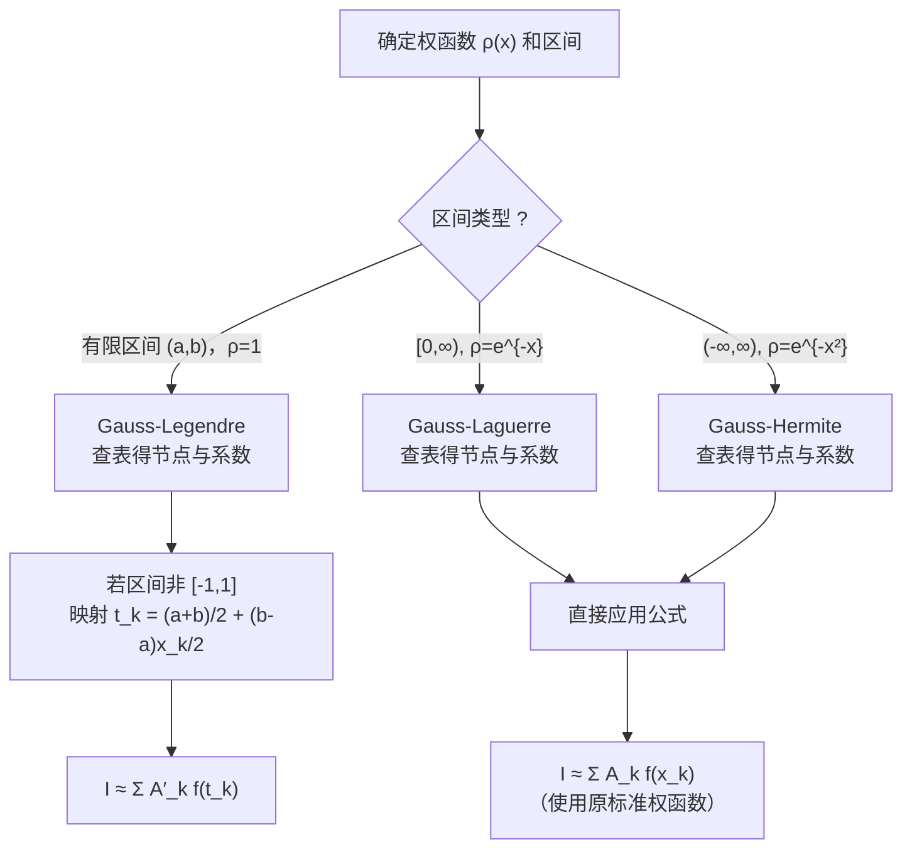

# Gauss求积

## 一句话

将节点也作为自由参数——$n+1$ 个节点达到 $2n+1$ 次代数精度（最高可能），节点为正交多项式零点。

## 严格定义

**Gauss 求积公式**：

$$
\boxed{\int_a^b \omega(x)f(x)dx\approx\sum_{k=0}^{n}A_k f(x_k)}
$$

其中 $\omega(x)$ 为权函数。

**最优性**：$n+1$ 个节点可达 $2n+1$ 次代数精度（精确积分不高于 $2n+1$ 次的多项式）。

**节点选取**：$x_k$ 为 $[a,b]$ 上关于权函数 $\omega$ 的（$n+1$ 次）正交多项式的零点。

**三类经典 Gauss 求积**：

| 类型 | 区间 | 权函数 $\omega(x)$ |
|------|------|--------------------|
| Gauss-Legendre | $[-1,1]$ | $1$ |
| Gauss-Laguerre | $[0,\infty)$ | $e^{-x}$ |
| Gauss-Hermite | $(-\infty,\infty)$ | $e^{-x^2}$ |

> [!important] $n+1$ 个 Gauss 节点的精度等于 $2n+2$ 个等距 Newton-Cotes 节点的精度

## 推导：自由度最大化

> [!proof]- 推导
> 一般插值型求积公式有 $n+1$ 个权重系数 $A_k$（自由度 = $n+1$）→精度 $\le n+1$。
>
> Gauss 将节点 $x_k$ 也作为自由参数→$n+1$ 个 $A_k$ + $n+1$ 个 $x_k$ →共 $2n+2$ 个自由度→可精确积分最高 $2n+1$ 次多项式。
>
> **节点定理**：使求积公式精度达 $2n+1$ 的节点是 $(n+1)$ 次正交多项式的零点——这是 Gauss 求积的存在唯一性保证。

## 算法步骤

1. 确定积分区间和权函数，选 Gauss 类型
2. 若区间不是标准形（如 $[a,b]$ 非 $[-1,1]$），做线性变换
3. 查表（或计算）Gauss 节点和权重
4. 计算 $\sum A_k f(x_k)$

## 关键性质

| 性质 | 数值 |
|------|------|
| $n+1$ 点精度 | $2n+1$ |
| vs NC $n+1$ 点 | 精度 $2n+1$ vs $\le n+1$ |
| 节点 | 非等距（正交多项式零点） |
| 权重 $A_k$ | 全为正（数值稳定） |
| 最需函数值 | 可在任意节点计算 |

## 典型例题

> **题目**：用 Gauss-Legendre $n=2$（3 点）计算 $\int_{-1}^1 x^2 e^x dx$。

> [!example]- 解答
> Gauss-Legendre 3 点（$n=2$）：节点 $x_k$ 权重 $A_k$：
>
> | $k$ | $x_k$ | $A_k$ |
> |-----|-------|-------|
> | 0 | $-\sqrt{3/5}$ | 5/9 |
> | 1 | $0$ | 8/9 |
> | 2 | $\sqrt{3/5}$ | 5/9 |
>
> $f(x)=x^2 e^x$：
>
> $f(-\sqrt{0.6})=0.6e^{-0.7746}=0.2773$
> $f(0)=0$
> $f(\sqrt{0.6})=0.6e^{0.7746}=1.3004$
>
> $\int\approx\frac{5}{9}\times0.2773+\frac{8}{9}\times0+\frac{5}{9}\times1.3004=0.8765$
>
> 真值 $\int_{-1}^1 x^2 e^x dx=2(e+e^{-1})-4(e-e^{-1})\approx0.8789$，误差 $0.0024$。
>
> **点评**：3 点 Gauss-Legendre 精度为 $2\times2+1=5$——比 3 点 Simpson 精度 3 高出两阶。

## 易错点

> [!warning] Gauss-Legendre 区间为 $[-1,1]$
> 对一般区间 $[a,b]$，需变换：$x=\frac{a+b}{2}+\frac{b-a}{2}t$，$dx=\frac{b-a}{2}dt$——忘做变换会导致结果差一个 $(b-a)/2$ 倍。

> [!warning] Gauss 节点不是等距的
> Gauss-Legendre 节点在 $[-1,1]$ 两端密集中间稀——与直观的"等间距均匀取点"完全不同。若数据只能从等距实验获取，Gauss 不可行。

> [!warning] 三类 Gauss 适用的积分区间不同
> Gauss-Laguerre 和 Gauss-Hermite 用于无限区间——若将有限区间积分误用这些公式，结果完全错误。

## 相关概念

- [[01_Knowledge/代数精度]]
- [[01_Knowledge/插值与拟合]]
- [[01_Knowledge/Newton-Cotes公式]]

## 习题

- [[03_Sources/Courses/归档/数值分析/习题库/09-数值积分与数值微分/README|第9章习题库]]

## 操作补充

### 操作补充：适用场景

本节 $n$ 表示节点总数；主文若以 $0,\ldots,n$ 编号，则节点总数为 $n+1$。
需要最高代数精度的求积公式，用 $n$ 个节点达到 $2n-1$ 次代数精度，远优于 Newton-Cotes 等距节点公式。

### 操作补充：核心公式/步骤

1. 确定权函数 $\rho(x)$ 和积分区间 → 选择 Gauss 类型：
   - **Gauss-Legendre**：$\rho(x)=1$, $[-1,1]$，通用
   - **Gauss-Laguerre**：$\rho(x)=e^{-x}$, $[0,\infty)$，半无限区间
   - **Gauss-Hermite**：$\rho(x)=e^{-x^2}$, $(-\infty,\infty)$，无限区间
2. 查表获取 $n$ 个节点 $\{x_k\}$ 和对应权系数 $\{A_k\}$
3. 区间映射（Legendre 需映射）：若积分区间为 $[a,b]$，则 $\boxed{t_k=\frac{a+b}{2}+\frac{b-a}{2}x_k}$，$\boxed{A'_k=\frac{b-a}{2}A_k}$
4. 对 Legendre 在 $[a,b]$ 上计算 $\boxed{\int_a^b f(x)dx\approx\sum_{k=1}^n A_k^{\prime} f(t_k)}$；Laguerre/Hermite 在各自标准区间按原权函数使用 $\sum A_k f(x_k)$。

### 操作补充：典型例题

> **题目**：用 2 点 Gauss-Legendre 求积分 $\int_{-1}^1 x^2 dx$。

> [!example]- 解答
> 查表：$n=2$，节点 $x_{1,2}=\pm 1/\sqrt{3}$，权重 $A_1=A_2=1$
> $\int_{-1}^1 x^2 dx\approx 1\cdot(1/\sqrt{3})^2+1\cdot(-1/\sqrt{3})^2=2/3$
> 精确值 $2/3$，完全精确（$x^2$ 为 2 次多项式，2 点 Gauss 精度达 $2n-1=3$ 次）。
> 点评：2 个节点达到 3 次精度，等距梯形公式 2 个节点仅 1 次精度。

### 操作补充：链接的知识点

本流程的条件、公式与推导已统一在本页前半部分维护。

### 操作补充：链接的习题
- [[03_Sources/Courses/归档/数值分析/习题库/09-数值积分与数值微分/README|第9章习题库]]
