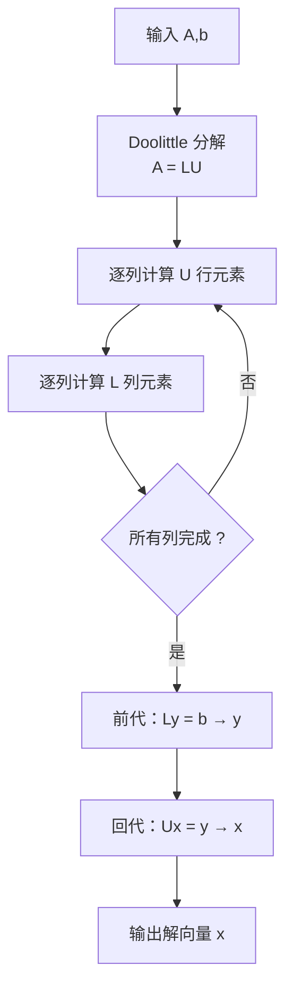

# LU分解(Doolittle)

## 一句话

$A=LU$（$L$ 单位下三角，$U$ 上三角）——将消元过程固化到矩阵分解中，一次分解可解多个右端项。

## 严格定义

**Doolittle 形式**：

$$
\boxed{A=LU}
$$

其中 $L$ 为**单位下三角**（对角元全为 1），$U$ 为上三角。

**逐元素计算**（按列）：

$$
u_{kj}=a_{kj}-\sum_{s=1}^{k-1}l_{ks}u_{sj},\quad j=k,\ldots,n
$$

$$
l_{ik}=\frac{a_{ik}-\sum_{s=1}^{k-1}l_{is}u_{sk}}{u_{kk}},\quad i=k+1,\ldots,n
$$

**存在条件**：$A$ 的各阶前主子式 $\det(A_{1:k,1:k})\neq 0$。

> [!important] 分解与右端项 $b$ 无关——解多组 $b$ 时只需一次分解

## 推导：消元矩阵求逆

> [!proof]- 推导
> Gauss 消元过程：$E_{n-1}\cdots E_1 A=U$。
>
> 每个 $E_k=I-m_k e_k^T$，其逆可直接写出：$E_k^{-1}=I+m_k e_k^T$。
>
> 故：
>
> $$
> A=E_1^{-1}\cdots E_{n-1}^{-1}U=LU
> $$
>
> 其中 $L=E_1^{-1}\cdots E_{n-1}^{-1}$ 的第 $k$ 列恰为 $m_k$（消元乘数），$L$ 为**单位下三角**矩阵。
>
> 此即 Doolittle 分解——$L$ 的对角元为 1 的特殊约定。

## 算法步骤

1. **分解**：对 $k=1,\ldots,n$
   - 计算 $U$ 的第 $k$ 行：$u_{kj}=a_{kj}-\sum_{s=1}^{k-1}l_{ks}u_{sj}$
   - 计算 $L$ 的第 $k$ 列：$l_{ik}=(a_{ik}-\sum_{s=1}^{k-1}l_{is}u_{sk})/u_{kk}$
2. **前代**：解 $Ly=b$（下三角，正向代入）
3. **回代**：解 $Ux=y$（上三角，逆向代入）

## 关键性质

| 性质 | 数值 |
|------|------|
| 计算量 | $\frac{2}{3}n^3$（分解） |
| 前代+回代 | 各 $O(n^2)$ |
| 存在条件 | 前主子式 $\neq0$ |
| 与 Gauss 消元 | 本质上等价 |
| 唯一性 | Doolittle（$L$ 对角元为 1）唯一 |

## 典型例题

> **题目**：对 $A=\begin{pmatrix}2&1&1\\4&3&3\\8&7&9\end{pmatrix}$ 做 Doolittle 分解。

> [!example]- 解答
> **$k=1$**：$u_{1j}=a_{1j}$，即 $u_{11}=2,\;u_{12}=1,\;u_{13}=1$。
>
> $l_{21}=a_{21}/u_{11}=4/2=2$，$l_{31}=8/2=4$。
>
> **$k=2$**：$u_{22}=a_{22}-l_{21}u_{12}=3-2\times1=1$，$u_{23}=a_{23}-l_{21}u_{13}=3-2\times1=1$。
>
> $l_{32}=(a_{32}-l_{31}u_{12})/u_{22}=(7-4\times1)/1=3$。
>
> **$k=3$**：$u_{33}=a_{33}-l_{31}u_{13}-l_{32}u_{23}=9-4\times1-3\times1=2$。
>
> 结果：
>
> $$
> L=\begin{pmatrix}1&0&0\\2&1&0\\4&3&1\end{pmatrix},\quad U=\begin{pmatrix}2&1&1\\0&1&1\\0&0&2\end{pmatrix}
> $$
>
> 验证 $LU=\begin{pmatrix}2&1&1\\4&3&3\\8&7&9\end{pmatrix}=A$。
>
> **点评**：$L$ 的对角元全是 1（Doolittle），而消元乘数（$m_{21}=2$，$m_{31}=4$，$m_{32}=3$）正是 $L$ 的下三角元素。

## 易错点

> [!warning] LU 分解不唯一
> Doolittle（$L$ 对角元为 1）和 Crout（$U$ 对角元为 1）是两种不同约定——切换时 $L$ 和 $U$ 的元素会变化但 $A=LU$ 不变。

> [!warning] 前主子式为零不意味方程组无解
> $A$ 可能可逆但某前主子式为零——此时 Doolittle 分解不存在，但交换行（列主元）后 $PA$ 有 LU 分解。

> [!warning] 分解后不可直接用于修改后的 $A$
> 若 $A$ 的某个元素变了，整个 $L$ 和 $U$ 都必须重算（除非用 Sherman-Morrison 秩 1 更新）。

## 相关概念

- [[01_Knowledge/范数]]
- [[01_Knowledge/Gauss消元法]]
- [[01_Knowledge/列主元消元(PA=LU)]]
- [[01_Knowledge/Cholesky分解]]

## 习题

- [[03_Sources/Courses/归档/数值分析/习题库/03-线性方程组的直接解法/README|第3章习题库]]

## 操作补充

### 操作补充：适用场景
同一系数矩阵 $A$ 对应多个右端项时，先分解再求解，避免重复消元。也用于分析矩阵结构和求行列式。

### 操作补充：核心公式/步骤

1. Doolittle 分解 $A=LU$：$L$ 为单位下三角（对角元为 1），$U$ 为上三角
   - 逐列计算：先 $U$ 的行元素，再 $L$ 的列元素
   - $\boxed{u_{kj}=a_{kj}-\sum_{r=1}^{k-1}l_{kr}u_{rj}}$（$j\ge k$）
   - $\boxed{l_{ik}=(a_{ik}-\sum_{r=1}^{k-1}l_{ir}u_{rk})/u_{kk}}$（$i>k$）
2. 前代解 $Ly=b$：$\boxed{y_i=b_i-\sum_{j=1}^{i-1}l_{ij}y_j}$
3. 回代解 $Ux=y$：$\boxed{x_i=(y_i-\sum_{j=i+1}^n u_{ij}x_j)/u_{ii}}$

### 操作补充：典型例题

> **题目**：对 $A=\begin{bmatrix}2&1&-1\\-1&3&1\\3&2&-2\end{bmatrix}$ 做 LU 分解并解 $Ax=[1,2,3]^T$。

> [!example]- 解答
> $L=\begin{bmatrix}1&0&0\\-0.5&1&0\\1.5&1/7&1\end{bmatrix}$, $U=\begin{bmatrix}2&1&-1\\0&3.5&0.5\\0&0&-4/7\end{bmatrix}$
> $Ly=b$ → $y=[1,5/2,8/7]^T$
> $Ux=y$ → $x=[-1,1,-2]^T$
> 点评：按乘加分别计数，LU 分解主项约 $2n^3/3$，之后每次求解为 $O(n^2)$。

### 操作补充：链接的知识点

本流程的条件、公式与推导已统一在本页前半部分维护。

### 操作补充：链接的习题
- [[03_Sources/Courses/归档/数值分析/习题库/03-线性方程组的直接解法/README|第3章习题库]]

## 2026-11-08 来源复核补充

真实习题3.2的$A$与正文首个分解例相同，右端$(6,17,45)^T$前代得$y=(6,5,6)^T$，回代$x=(1/2,2,3)^T$，代回$Ax=b$验证。无主元分解须保证所用主元非零；数值计算遇小主元还需列主元策略，不能只看形式存在性。
