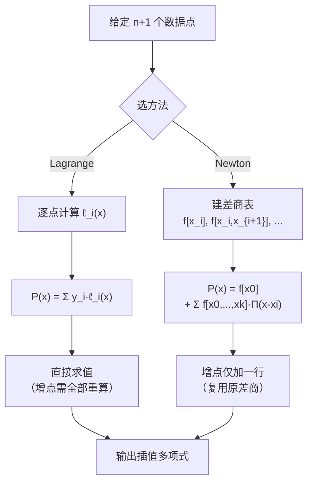

# LagrangeNewton插值构造流程

## 适用场景
给定 $n+1$ 个数据点 $(x_i,y_i)$，构造插值多项式。Lagrange 适合一次性构造（简单直观），Newton 适合逐步增点（可复用差商表）。

## 核心公式/步骤

**Lagrange 插值：**
1. 计算基函数：$\boxed{\ell_i(x)=\prod_{j\neq i}\frac{x-x_j}{x_i-x_j}}$
2. 插值多项式：$\boxed{P_n(x)=\sum_{i=0}^n y_i\ell_i(x)}$

**Newton 插值（差商法）：**
1. 建差商表：零阶 $\boxed{f[x_i]=y_i}$，$k$ 阶 $\boxed{f[x_i,\ldots,x_{i+k}]=\frac{f[x_{i+1},\ldots,x_{i+k}]-f[x_i,\ldots,x_{i+k-1}]}{x_{i+k}-x_i}}$
2. 插值多项式：$\boxed{P_n(x)=f[x_0]+\sum_{k=1}^n f[x_0,\ldots,x_k]\prod_{i=0}^{k-1}(x-x_i)}$

## 典型例题

> **题目**：已知 $(0,1),(1,2),(2,3)$，构造 Lagrange 和 Newton 插值多项式。

> [!example]- 解答
> Lagrange: $P_2(x)=1\cdot\frac{(x-1)(x-2)}{(0-1)(0-2)}+2\cdot\frac{(x-0)(x-2)}{(1-0)(1-2)}+3\cdot\frac{(x-0)(x-1)}{(2-0)(2-1)}=x+1$
> Newton 差商表：$f[0]=1$, $f[1]=2$, $f[2]=3$；一阶差商均为 $1$，二阶差商为 $0$
> $P_2(x)=1+1(x-0)+0(x-0)(x-1)=x+1$。点评：数据来自直线，二阶差商为 $0$。

## 链接的知识点
- [[01_Knowledge/Lagrange插值]]
- [[01_Knowledge/Newton插值(差商)]]

## 链接的习题
- [[03_Sources/Courses/归档/数值分析/习题库/07-插值法/README|第7章习题库]]

## 2026-11-08 来源复核补充

互异节点保证至多三次插值多项式唯一，因此分别构造后可通过化简或逐节点代入交叉核验。源例的Newton差商依次为$0,1/3,-1/12,1/24$，得$P(x)=x^3/24-x^2/4+11x/24+3/4$，四节点值0、1、1、2均满足。零数据对应的Lagrange项可以省去，但对应节点仍参与其他基函数分母。
