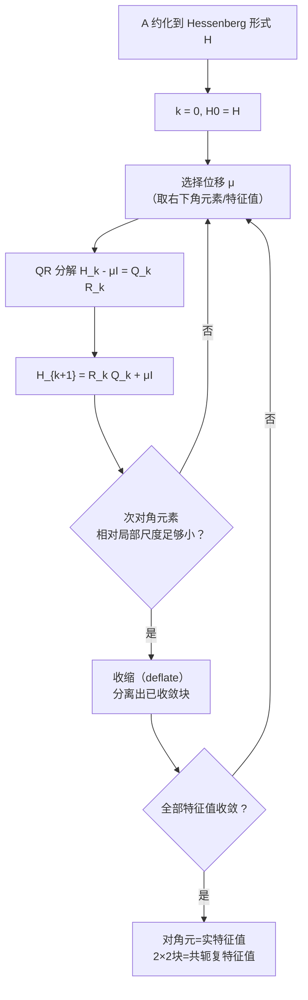

# QR算法

## 适用场景
计算一般实矩阵的全部特征值（含复特征值），是数值线性代数中最重要、最通用的特征值算法。

## 核心公式/步骤

1. 预步：约化到上 Hessenberg 形式 $\boxed{H=Q_0^T A Q_0}$（Householder 约化，$O(n^3)$）
2. QR 迭代（$k=0,1,2,\ldots$）：
   - QR 分解：$\boxed{H_k=Q_k R_k}$
   - 逆序乘：$\boxed{H_{k+1}=R_k Q_k}$
3. 带位移加速：$\boxed{H_k-\mu I=Q_k R_k}$，$\boxed{H_{k+1}=R_k Q_k+\mu I}$（$\mu$ 取右下角元素或特征值估计）
4. 检查次对角元是否相对局部尺度足够小，例如 $|h_{i+1,i}|\le\varepsilon(|h_{ii}|+|h_{i+1,i+1}|)$（另设极小量防护）；满足时置零并分割活动块。一般实矩阵的共轭复根需用实双位移等策略，不能指望单实位移总能消去所有次对角元
5. 收敛到实 Schur 形后，1×1 对角块给实特征值，不可约 2×2 对角块给共轭复特征值；未收敛的任意 2×2 块不能直接如此判读。设置迭代上限并报告未收敛活动块

## 典型例题

> **题目**：简述 QR 算法求 $A=\begin{bmatrix}2&1\\1&2\end{bmatrix}$ 特征值的过程。

> [!example]- 解答
> 已是 Hessenberg 形式。无位移迭代：
> $H_0$ QR→$Q_1R_1$, $H_1=R_1Q_1$；迭代若干步后对角元趋于特征值。
> 对本例若每步恰取右下角元素 $\mu=2$，$H_0-2I$ 的 QR 迭代会停滞（不改变该矩阵）；可改用 Wilkinson 位移或对本例直接解 2×2 块。
> 精确特征值为 $3$ 和 $1$。点评：位移改善通常收敛表现，但收敛阶取决于矩阵与位移策略，不能对一般实矩阵声称立方收敛。

## 链接的知识点
- [[01_Knowledge/QR算法]]
- [[01_Knowledge/幂法]]

## 链接的习题
- [[03_Sources/Courses/归档/数值分析/习题库/06-矩阵特征值的数值解法/README|第6章习题库]]

## 延伸材料

完整历史例题与补充说明见 [[03_Sources/Reviews/归档/数值分析/归档合并记录/QR算法迭代流程]]。
