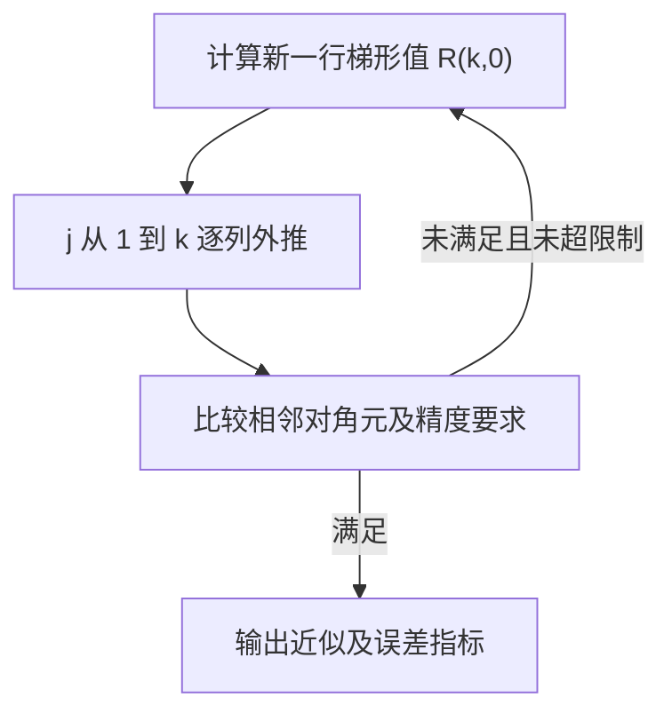

# Romberg外推

## 适用场景
被积函数充分光滑时，用梯形序列通过 Richardson 外推快速收敛到高精度积分值，兼具高效和高精度的优点。

## 核心公式/步骤

1. 令 $R_{k,0}=T_{2^k}$，即把 $[a,b]$ 分为 $2^k$ 段所得的复化梯形值，$k=0,1,\ldots$。
2. 对每行 $k$，依次计算 $j=1,\ldots,k$：
   $$R_{k,j}=\frac{4^jR_{k,j-1}-R_{k-1,j-1}}{4^j-1}.$$
3. 第 0、1、2、3 列分别对应梯形、Simpson、Boole（常称 Cotes）、更高阶外推。对角线为 $R_{0,0},R_{1,1},R_{2,2},\ldots$。
4. $|R_{k,k}-R_{k-1,k-1}|<\varepsilon$ 可作经验停机指标，需配合绝对/相对容差、最大细分层数及舍入误差检查；相邻近似接近不等于严格误差保证。高阶外推依赖足够光滑的偶次幂误差展开，不能任意无限加阶保证收敛。

## 典型例题

> **题目**：计算 $\int_0^\pi\sin x\,dx$。
>
> [!example]- 解答
> 统一使用行列编号，复算结果如下。
>
> | $k$ | $R_{k,0}$ | $R_{k,1}$ | $R_{k,2}$ | $R_{k,3}$ |
> |---|---|---|---|---|
> | 0 | 0 | | | |
> | 1 | 1.570796327 | 2.094395102 | | |
> | 2 | 1.896118898 | 2.004559755 | 1.998570732 | |
> | 3 | 1.974231602 | 2.000269170 | 1.999983131 | 2.000005550 |
>
> 精确值为 $2$。例如 $R_{2,1}=(4R_{2,0}-R_{1,0})/3$，不会混用粗网格下标和三角表行号。

## 链接的知识点
- [[01_Knowledge/Romberg外推]]
- [[01_Knowledge/复化求积法]]

## 链接的习题
- [[03_Sources/Courses/归档/数值分析/习题库/09-数值积分与数值微分/README|第9章习题库]]

## 延伸材料

完整历史例题与补充说明见 [[03_Sources/Reviews/归档/数值分析/归档合并记录/Romberg外推流程]]。
