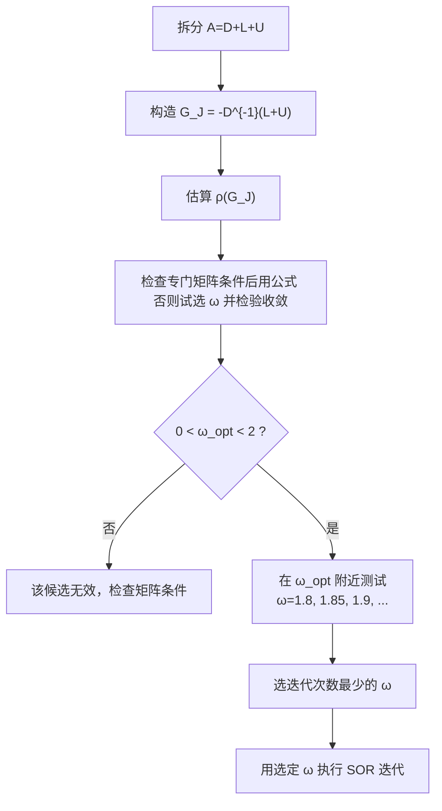

# SOR参数选择流程

## 适用场景
使用 SOR（逐次超松弛）迭代法求解大型线性方程组时，需选取最优松弛因子 $\omega_{opt}$ 以最大化收敛速度。

## 核心公式/步骤

1. 拆分 $A=D+L+U$，构造 Jacobi 迭代矩阵 $\boxed{G_J=-D^{-1}(L+U)}$
2. 计算（或估算）$\boxed{\rho(G_J)}$（Jacobi 矩阵的谱半径）
3. **仅在已满足相应谱结构条件时使用下式**：例如自然排序的一维 Dirichlet Poisson 三对角矩阵 $A=\operatorname{tridiag}(-1,2,-1)$。一般矩阵不能仅凭 Jacobi 谱半径套用。该模型的 SOR 最优参数：$\boxed{\omega_{opt}=\frac{2}{1+\sqrt{1-\rho(G_J)^2}}}$
4. 对一般非奇异矩阵，$0<\omega<2$ 仅是必要条件；若 $A$ 对称正定，该区间内 SOR 收敛。验证 $\boxed{0<\omega_{opt}<2}$（SOR 收敛的必要条件）
5. 实际中可在 $\omega_{opt}$ 附近试探几个值，比较迭代次数
6. SOR 迭代：$\boxed{x^{(k+1)}=(1-\omega)x^{(k)}+\omega D^{-1}(b-Lx^{(k+1)}-Ux^{(k)})}$

## 典型例题

> **题目**：对一维 Dirichlet Poisson 模型 $A=\operatorname{tridiag}(-1,2,-1)$，有 $n$ 个内点（$n$ 大），求 $\omega_{opt}$ 并分析 $\omega=1$（G-S）与 $\omega_{opt}$ 的差别。

> [!example]- 解答
> $\rho(G_J)=\cos(\pi/(n+1))\approx1-\frac{\pi^2}{2(n+1)^2}$ → $\omega_{opt}\approx\frac{2}{1+\pi/(n+1)}\approx2-\frac{2\pi}{n+1}$
> $\rho(G_{GS})=\rho(G_J)^2$，而 $\rho(G_{SOR,opt})=\omega_{opt}-1\approx1-\frac{2\pi}{n}$
> 点评：$n$ 大时 $\omega_{opt}\approx2$，SOR 比 G-S 快一个数量级（$\rho$ 从 $1-O(1/n^2)$ 降到 $1-O(1/n)$）。

## 链接的知识点
- [[01_Knowledge/SOR迭代]]
- [[01_Knowledge/迭代收敛定理(谱半径)]]

## 链接的习题
- [[03_Sources/Courses/归档/数值分析/习题库/04-线性方程组的迭代法/README|第4章习题库]]
