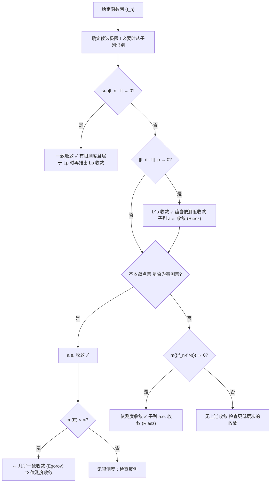

# 函数列收敛类型判别法

## 适用场景

给定一个函数列 $\{f_n\}$，需判断其属于哪种收敛类型（一致收敛、几乎一致收敛、几乎处处收敛、依测度收敛、$L^p$ 收敛），并分析各收敛之间的蕴含关系——是实变函数中贯穿可测函数、Lebesgue 积分与 $L^p$ 空间的核心方法。

## 核心公式/步骤

**四种收敛关系速查**：

$$\boxed{\text{一致收敛} \;\Rightarrow\; \text{几乎一致收敛} \;\Rightarrow\; \text{a.e. 收敛（有限测度下 Egorov 可逆）}}$$

$$\boxed{\text{一致收敛} \;\Rightarrow\; L^p\text{ 收敛（有限测度且各函数属于 }L^p\text{）} \;\Rightarrow\; \text{依测度收敛}}$$

$$\boxed{\text{a.e. 收敛（有限测度下）} \;\Rightarrow\; \text{依测度收敛} \;\Rightarrow\; \text{子列 a.e. 收敛（Riesz）}}$$

**判断流程**：

1. **计算逐点极限**：若逐点极限存在则先求出；若整列逐点不收敛，也可由候选极限直接检查依测度或 $L^p$ 收敛，不能就此停止。

2. **一致收敛**：计算 $\sup_{x \in E} |f_n(x) - f(x)| \to 0$ 是否成立？若成立，则逐点、几乎处处、几乎一致和依测度收敛成立；仅在 $m(E)<\infty$ 且函数属于 $L^p$ 时可由 $\|f_n-f\|_p\le m(E)^{1/p}\|f_n-f\|_\infty$ 推出 $L^p$ 收敛。无限测度时须另检积分，不能结束判断。

3. **$L^p$ 收敛**：计算 $\|f_n - f\|_p = \left(\int_E |f_n - f|^p \, dm\right)^{1/p} \to 0$ 是否成立？若成立，则蕴含依测度收敛（定理 4.1.9），但不直接蕴含 a.e. 收敛。

4. **几乎处处收敛**：检查不收敛点集 $\{x \in E : f_n(x) \nrightarrow f(x)\}$ 是否为零测集。

5. **依测度收敛**：检查 $\forall \varepsilon > 0,\; m(\{x \in E : |f_n(x) - f(x)| > \varepsilon\}) \to 0$ 是否成立？

6. **几乎一致收敛**（递归检查）：在有限测度下，a.e. 收敛 $\Leftrightarrow$ 几乎一致收敛（Egorov 定理）。

> [!warning] 有限测度条件是关键前提！
> Egorov 定理（a.e. $\Rightarrow$ a.u.）和 a.e. $\Rightarrow$ 依测度收敛都要求 $m(E) < \infty$。无限测度空间（如 $\mathbb{R}$ 上 $f_n = \chi_{(n,n+1)}$）上这些蕴含关系不成立。

> [!warning] $L^p$ 收敛不能直接推出 a.e. 收敛
> $L^p$ 收敛仅保证存在某个**子列** a.e. 收敛到 $f$（Riesz 定理），原序列本身可以处处不收敛（标准打字机指示函数序列本身就在有限 $p$ 的 $L^p$ 中收敛到 0 但每点都不收敛）。

**关键反例速查表**：

| 反例 | 收敛 | 不收敛 | 要点 |
|:--|:--|:--|:--|
| $f_n(x) = x^n$ 在 $[0,1)$ | a.e. 收敛于 0 | 不一致收敛 | $\sup \|f_n - f\| = 1 \nrightarrow 0$ |
| 打字机序列（$[0,1)$） | 依测度收敛于 0 | 不 a.e. 收敛，不一致收敛（有限 $p$ 时反而 $L^p$ 收敛） | 每点被无穷次覆盖 |
| $f_n = n\chi_{(0,1/n)}$ | a.e. 收敛于 0 | 不 $L^1$ 收敛 | $\|f_n\|_1 = 1 \nrightarrow 0$ |
| $f_n = \chi_{(n,n+1)}$ 在 $\mathbb{R}$ | a.e. 收敛于 0 | 不依测度收敛，不几乎一致 | 支集测度恒为 1，无限测度空间 |

## 流程图

## 典型例题

> **题目**：分析函数列 $f_n(x) = \dfrac{nx}{1 + n^2 x^2}$ 在 $[0, 1]$ 上的收敛类型。

> [!example]- 解答
> **Step 1：逐点极限。**
> 对每个固定 $x \in [0, 1]$，
> $$\lim_{n\to\infty} f_n(x) = \lim_{n\to\infty} \frac{nx}{1 + n^2 x^2} = 0 \quad (x > 0).$$
> 当 $x = 0$ 时 $f_n(0) = 0$，故 $f(x) \equiv 0$ 在 $[0,1]$ 上。
> 因此 $\{f_n\}$ **几乎处处收敛**于 $0$（事实上处处收敛）。
>
> **Step 2：判断一致收敛。**
> 求 $\sup_{x \in [0,1]} |f_n(x)|$。令 $g_n(x) = nx/(1 + n^2 x^2)$，求导：
> $$g_n'(x) = \frac{n(1 + n^2 x^2) - nx \cdot 2n^2 x}{(1 + n^2 x^2)^2} = \frac{n(1 - n^2 x^2)}{(1 + n^2 x^2)^2} = 0 \;\Rightarrow\; x = \frac{1}{n}.$$
> $$g_n\!\left(\frac{1}{n}\right) = \frac{n \cdot \frac{1}{n}}{1 + n^2 \cdot \frac{1}{n^2}} = \frac{1}{2}.$$
> 故 $\sup_{x \in [0,1]} |f_n(x)| = \frac{1}{2} \nrightarrow 0$，因此**不一致收敛**。
>
> **Step 3：判断依测度收敛。**
> 对于 $\varepsilon > 0$，$\{x : |f_n(x)| > \varepsilon\}$。当 $x \in (0, 1/n]$ 时 $f_n(x) \approx nx$ 可能较大，但当 $x > 1/n$ 时 $f_n(x) = \frac{nx}{1 + n^2 x^2} \leq \frac{nx}{n^2 x^2} = \frac{1}{nx} < \varepsilon$ 对充分大的 $n$。详细估计：
> $$|f_n(x)| \leq \frac{nx}{n^2 x^2} = \frac{1}{nx} \quad (\text{用分母部分 } n^2 x^2),$$
> 也可用 $|f_n(x)| = \frac{nx}{1+n^2 x^2} \leq \frac{nx}{2nx} = \frac{1}{2}$。实际上 $|f_n(x)| \leq \frac{1}{2}$ 恒成立（上面已证最大值 $1/2$），因此对 $\varepsilon \geq 1/2$，集合为空；对 $\varepsilon < 1/2$，
> $$\{x : |f_n(x)| > \varepsilon\} \subseteq \left[0, \frac{1}{n\varepsilon}\right]$$
> 测度为 $1/(n\varepsilon) \to 0$。故**依测度收敛**于 $0$。
>
> **Step 4：判断 $L^1$ 收敛。**
> $$\int_0^1 |f_n(x)| \, dx = \int_0^1 \frac{nx}{1 + n^2 x^2} \, dx = \frac{1}{2n} \ln(1 + n^2) \to 0 \quad (n \to \infty).$$
> 因此 $f_n \xrightarrow{L^1} 0$，同时按 Riesz 定理，存在子列 a.e. 收敛（但原序列已 a.e. 收敛）。
>
> **总结**：$\{f_n\}$ 在 $[0,1]$ 上 a.e. 收敛、依测度收敛、$L^1$ 收敛，但**不一致收敛**。
>
> **点评**：此例典型地展示了 a.e. 收敛 + $L^1$ 收敛但不一致收敛的情形。$\sup$ 不趋于 0 是因为在 $x = 1/n$ 附近总有一个值为 $1/2$ 的"尖峰"，虽然尖峰越来越窄（测度趋于 0），但高度不降。

## 知识链接

- [[01_Knowledge/Egorov定理]] — 有限测度下 a.e. 收敛 $\Leftrightarrow$ 几乎一致收敛
- [[01_Knowledge/Riesz定理]] — 依测度收敛蕴含子列 a.e. 收敛；$L^p$ 收敛蕴含子列 a.e. 收敛
- [[01_Knowledge/Lebesgue控制收敛定理]] — 提供控制函数时可从 a.e. 收敛推出 $L^1$ 收敛
- [[01_Knowledge/Fatou引理]] — 非负函数列积分与极限下极限的关系
- [[01_Knowledge/有界收敛定理]] — 有限测度下有界函数列 a.e. 收敛 $\Rightarrow$ $L^1$ 收敛

## 习题链接

- [[03_Sources/Courses/归档/实变函数/作业/01-集合论与点集拓扑基础/习题1.7-讨论四个函数列的收敛性-思考题]] — 判别 $\sin(nx)$、$\sin^n x$ 等经典函数列的各种收敛性
- [[03_Sources/Courses/归档/实变函数/作业/03-可测函数/习题3.15-一致收敛的判定-习题]] — 一致收敛的直接判定练习
- [[03_Sources/Courses/归档/实变函数/作业/03-可测函数/习题3.17-几乎一致收敛蕴含几乎处处收敛-习题]] — 几乎一致 $\Rightarrow$ a.e. 的证明
- [[03_Sources/Courses/归档/实变函数/作业/03-可测函数/习题3.18-依测度收敛但不逐点收敛（打字机序列）-习题]] — 经典反例：依测度收敛但处处不收敛
- [[03_Sources/Courses/归档/实变函数/作业/03-可测函数/习题3.21-Egorov定理-习题]] — Egorov 定理的完整证明
- [[03_Sources/Courses/归档/实变函数/作业/05-重积分与Lp空间/习题5.10-L^p收敛蕴含依测度收敛（定理4.1.9）-习题]] — $L^p$ 收敛 $\Rightarrow$ 依测度收敛的证明
