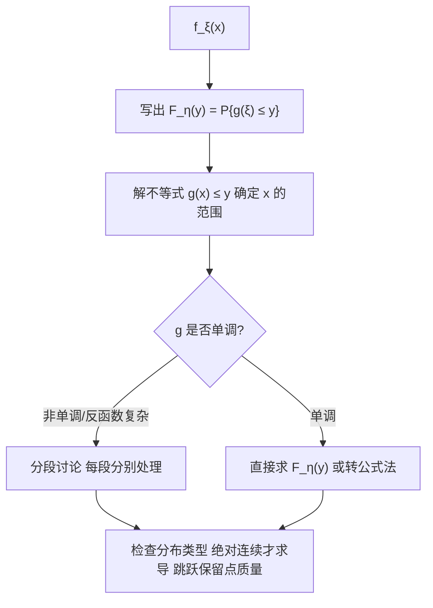

# 分布函数法

## 适用场景
求 $\eta = g(\xi)$ 的分布，当 $g$ 非单调（如 $g(x)=|x|$）或反函数难求（如 $g(x)=\tan x$）时，分布函数法可直接使用。也适用于 $g$ 单调但不想套公式的情况。

## 核心公式/步骤

**三步走**：

1. 写出分布函数表达式：$\boxed{F_\eta(y) = P\{g(\xi) \le y\}}$
2. 解不等式 $g(x) \le y$，确定 $x$ 的范围（需分段讨论）
3. 利用 $\xi$ 的已知分布计算 $F_\eta$。仅当 $F_\eta$ 绝对连续时，几乎处处求导得到密度 $f_\eta=F_\eta\prime$；跳跃给出点质量 $P(\eta=y)=F_\eta(y)-F_\eta(y-)$。混合型须同时保留离散与连续部分，奇异连续分布不能靠导数恢复全部概率

对于存在联合密度的多维情况，$\zeta = g(\xi_1, \ldots, \xi_n)$ 同样适用：
$$\boxed{F_\zeta(z) = P\{g(\xi_1, \ldots, \xi_n) \le z\} = \int\cdots\int_{\{(x_1,\ldots,x_n): g \le z\}} f(x_1,\ldots,x_n) \,dx_1\cdots dx_n}$$

## 典型例题

> **题目**（$\eta = |\xi|$ 的非单调情形）：设 $\xi$ 的密度函数为 $p(x)$，求 $\eta = |\xi|$ 的分布密度。

> [!example]- 解答
> $g(x) = |x|$ 非单调——用分布函数法。
>
> 当 $y < 0$：$F_\eta(y) = P\{|\xi| \le y\} = 0$。
>
> 当 $y \ge 0$：
> $$F_\eta(y) = P\{|\xi| \le y\} = P\{-y \le \xi \le y\} = F_\xi(y) - F_\xi(-y)$$
>
> 求导：
> $$p_\eta(y) = \frac{d}{dy}[F_\xi(y) - F_\xi(-y)] = p(y) + p(-y), \quad y \ge 0$$
>
> 当 $y < 0$ 时 $p_\eta(y) = 0$。
>
> 综上：
> $$p_\eta(y) = \begin{cases} p(y) + p(-y), & y \ge 0 \\ 0, & y < 0 \end{cases}$$
>
> **特别地**：若 $\xi$ 的密度关于 $0$ 对称（即 $p(x)=p(-x)$），则 $p_\eta(y)=2p(y)$（$y\ge0$）。
>
> **点评**：$g$ 不单调时分布函数法可直接使用，也可在满足条件时用分支密度变换公式——解不等式 $g(x) \le y$ 确定 $x$ 范围，分段讨论边界。关键一步是将 $|\xi| \le y$ 等价转化为 $-y \le \xi \le y$。

## 链接的知识点
- [[01_Knowledge/一维随机变量函数的分布]]
- [[01_Knowledge/多维随机变量函数的分布]]

## 链接的习题
- [[03_Sources/Courses/概率论/作业/03-多维随机变量/习题3.20]]
- [[03_Sources/Courses/概率论/作业/02-随机变量/习题2.14]]
