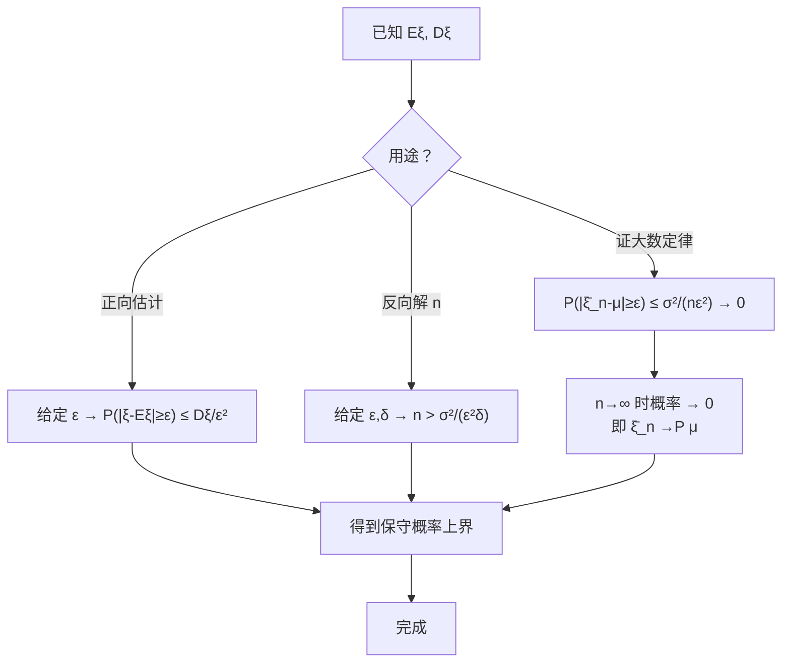

# 切比雪夫不等式法

## 适用场景

用方差给出随机变量偏离期望的概率上界——不依赖具体分布形式，是最通用的集中不等式。常用于估计样本量、证明大数定律、给出保守概率界。

## 核心步骤

### 公式

$$\boxed{P\{|\xi - E\xi| \geq \varepsilon\} \leq \frac{D(\xi)}{\varepsilon^2}}$$

等价形式：

$$\boxed{P\{|\xi - E\xi| < \varepsilon\} \geq 1 - \frac{D(\xi)}{\varepsilon^2}}$$

### 样本均值的切比雪夫应用

对 $n$ 个 i.i.d. 随机变量，样本均值 $\overline{\xi}_n = \frac{1}{n}\sum \xi_i$：

$$D(\overline{\xi}_n) = \frac{\sigma^2}{n}$$

$$P\{|\overline{\xi}_n - \mu| \geq \varepsilon\} \leq \frac{\sigma^2}{n\varepsilon^2}$$

### 两种用法

**① 正向**：已知 $E\xi, D\xi$ 和 $\varepsilon$，估计概率上界

$$P\{|\xi - E\xi| \geq 3\sigma\} \leq \frac{\sigma^2}{9\sigma^2} = \frac{1}{9}$$

**② 反向**：已知概率要求，反解所需样本量 $n$

$$P\{|\overline{\xi}_n - \mu| \geq \varepsilon\} \leq \frac{\sigma^2}{n\varepsilon^2} < \delta \;\Rightarrow\; n > \frac{\sigma^2}{\varepsilon^2\delta}$$

> [!warning] 关键点
> - 切比雪夫不等式给出的上界**非常保守**——真实尾部概率通常远小于此界（如正态 $3\sigma$ 外真概率约 0.0026，切比雪夫上界却是 0.1111）。
> - 它**不要求任何分布假设**——只需方差存在。这是它不可替代的通用性。
> - $D(\xi)=0 \iff P\{\xi = E\xi\} = 1$——方差为零等价于以概率 1 为常数。

## 流程图

## 典型例题

> **题目 1**：$E(\xi)=\mu$，$D(\xi)=\sigma^2$，用切比雪夫不等式估计 $P\{|\xi-\mu| < 3\sigma\}$ 的下界。

> [!example]- 解答
> 取 $\varepsilon = 3\sigma$：
> $$P\{|\xi-\mu| \geq 3\sigma\} \leq \frac{\sigma^2}{(3\sigma)^2} = \frac{1}{9} \approx 0.1111$$
> $$P\{|\xi-\mu| < 3\sigma\} \geq 1 - \frac{1}{9} = \frac{8}{9} \approx 0.8889$$
>
> **对比正态**：若 $\xi \sim N(\mu,\sigma^2)$，$P\{|\xi-\mu|<3\sigma\} \approx 0.9974$。切比雪夫下界 $0.8889$ 远低于实际值——不等式保守但普适。

---

> **题目 2**（习题 5.15）：$\{\xi_n\}$ 独立，$D\xi_n/n \to 0$，证明 $\{\xi_n\}$ 服从大数定律。

> [!example]- 解答
> 要证 $\frac{1}{n}\sum_{k=1}^n (\xi_k - E\xi_k) \xrightarrow{P} 0$。
>
> 由切比雪夫不等式（独立性下方差可加）：
> $$P\!\left\{\left|\frac{1}{n}\sum_{k=1}^n (\xi_k - E\xi_k)\right| \geq \varepsilon\right\} \leq \frac{1}{\varepsilon^2 n^2} \sum_{k=1}^n D\xi_k$$
>
> 由 $D\xi_n/n \to 0$ 可推出 $\frac{1}{n^2}\sum_{k=1}^n D\xi_k \to 0$（数学分析技巧）。
>
> 故右端 $\to 0$，即依概率收敛成立。$\square$
>
> **点评**：切比雪夫不等式是大数定律证明的标准工具——条件 $D\xi_n/n \to 0$（方差为 $o(n)$）保证了样本均值的方差趋于零。

## 知识链接

- [[00_Inbox/待核实核心/知识点/方差与切比雪夫不等式]]
- [[01_Knowledge/大数定律]]
- [[01_Knowledge/中心极限定理]]
- [[01_Knowledge/协方差]]

## 习题链接

- [[03_Sources/Courses/概率论/作业/05-极限定理/习题5.13]] — 切比雪夫不等式：硬币抛掷次数估计
- [[03_Sources/Courses/概率论/作业/05-极限定理/习题5.15]] — $D\xi_n/n\to0$ 时证大数定律（切比雪夫）
- [[03_Sources/Courses/概率论/作业/05-极限定理/习题5.17]] — $s<1/2$ 时大数定律成立（切比雪夫+CLT）
- [[03_Sources/Courses/概率论/作业/04-数字特征/习题4.12]] — 切比雪夫估计与相关系数
