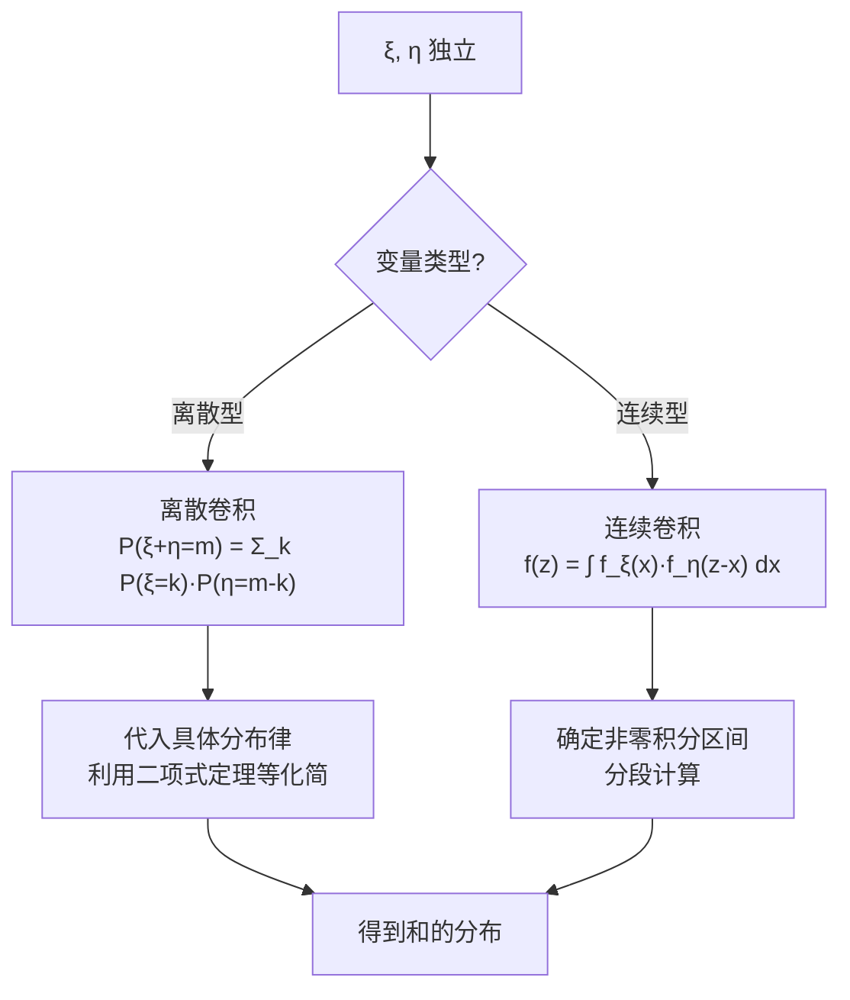

# 卷积法

## 适用场景
两个**相互独立**的随机变量之和 $\zeta = \xi + \eta$ 的分布。离散型用离散卷积（求和），连续型用连续卷积（积分）。要求两变量**同类型**（同离散或同连续）。

## 核心公式/步骤

**离散型卷积**（$\xi, \eta$ 独立取非负整数值）：
$$\boxed{P\{\xi + \eta = m\} = \sum_{k=0}^{m} P\{\xi = k\} \cdot P\{\eta = m-k\}}$$

**连续型卷积**（$\xi, \eta$ 独立，密度分别为 $f_\xi, f_\eta$）：
$$\boxed{f_{\xi+\eta}(z) = \int_{-\infty}^{+\infty} f_\xi(x) \, f_\eta(z-x) \, dx}$$

> **关键条件**：独立性 + 同类型。非独立或非和式变换必须用分布函数法。离散+连续混合和不属此列，须用全概率公式法。

## 典型例题

> **题目**（离散卷积——泊松可加性）：$\xi_1 \sim P(\lambda_1)$，$\xi_2 \sim P(\lambda_2)$ 独立，求 $\xi_1 + \xi_2$ 的分布。

> [!example]- 解答
> 用离散卷积公式：
> $$\begin{aligned}
> P\{\xi_1+\xi_2 = n\} &= \sum_{k=0}^{n} P\{\xi_1=k\} \cdot P\{\xi_2=n-k\} \\
> &= \sum_{k=0}^{n} \frac{\lambda_1^k}{k!} e^{-\lambda_1} \cdot \frac{\lambda_2^{n-k}}{(n-k)!} e^{-\lambda_2} \\
> &= e^{-(\lambda_1+\lambda_2)} \sum_{k=0}^{n} \frac{\lambda_1^k \lambda_2^{n-k}}{k!(n-k)!} \\
> &= \frac{e^{-(\lambda_1+\lambda_2)}}{n!} \sum_{k=0}^{n} \binom{n}{k} \lambda_1^k \lambda_2^{n-k} \\
> &= \frac{e^{-(\lambda_1+\lambda_2)}}{n!} (\lambda_1+\lambda_2)^n
> \end{aligned}$$
>
> 故 $\xi_1 + \xi_2 \sim P(\lambda_1 + \lambda_2)$。
>
> **点评**：关键技巧是将 $\frac{1}{k!(n-k)!}$ 凑成 $\frac{1}{n!}\binom{n}{k}$，再利用二项式定理合并求和。

---

> **题目**（连续型卷积——两个均匀之和）：$\xi, \eta$ 独立同分布于 $U[0,1]$，求 $\zeta = \xi + \eta$ 的密度。

> [!example]- 解答
> $f_\xi(x) = f_\eta(x) = 1$（$0 \le x \le 1$），否则为 $0$。
>
> 卷积公式：$f_\zeta(z) = \int_{-\infty}^{\infty} f_\xi(x) f_\eta(z-x) dx$。
>
> 被积函数非零需：$0 \le x \le 1$ 且 $0 \le z-x \le 1$，即 $\max(0, z-1) \le x \le \min(1, z)$。
>
> - 当 $0 \le z \le 1$：$f_\zeta(z) = \int_0^z 1 \cdot 1\,dx = z$
> - 当 $1 \le z \le 2$：$f_\zeta(z) = \int_{z-1}^1 1 \cdot 1\,dx = 2-z$
> - 其他：$f_\zeta(z) = 0$
>
> $$\boxed{f_\zeta(z) = \begin{cases} z, & 0 \le z \le 1 \\ 2-z, & 1 \le z \le 2 \\ 0, & \text{其他} \end{cases}}$$
>
> 这是一个**三角形分布**（Simpson 分布），图形为底边 $[0,2]$ 上的等腰三角形。
>
> **点评**：卷积公式中积分限的确定是重点——需要正确刻画 $x$ 与 $z-x$ 同时属于支撑集的条件。两个均匀之和产生三角形、三个产生二次样条，这是理解 CLT "卷积平滑"的直观入口。

## 链接的知识点
- [[01_Knowledge/多维随机变量函数的分布]]
- [[03_Sources/Reviews/概率论/专题复习/常见离散型分布]]
- [[03_Sources/Reviews/概率论/专题复习/常见连续型分布]]

## 链接的习题
- [[03_Sources/Courses/概率论/作业/03-多维随机变量/习题3.17]]
- [[03_Sources/Courses/概率论/作业/03-多维随机变量/习题3.19]]
