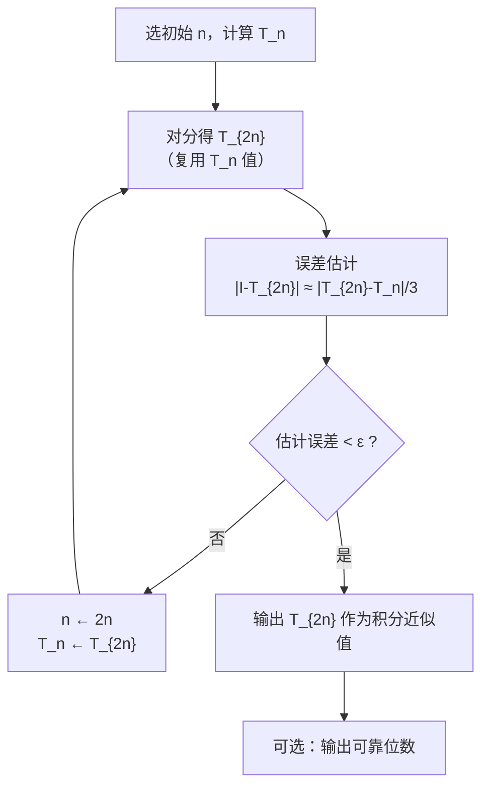

# 复化求积法

## 一句话

把区间分段，每段用低次公式——复化梯形 $O(h^2)$、复化 Simpson $O(h^4)$，工程实用方法。

## 严格定义

将 $[a,b]$ 等分 $n$ 份，$h=(b-a)/n$，$x_i=a+ih$。

**复化梯形公式**：

$$
\boxed{T_n=\frac{h}{2}\left[f(a)+2\sum_{i=1}^{n-1}f(x_i)+f(b)\right]}
$$

局部截断误差 $O(h^3)$，全局误差 $O(h^2)$。

**复化 Simpson 公式**（$n$ 为偶数）：

$$
\boxed{S_n=\frac{h}{3}\left[f(a)+4\sum_{\substack{i=1\\i\text{ 奇}}}^{n-1}f(x_i)+2\sum_{\substack{i=2\\i\text{ 偶}}}^{n-2}f(x_i)+f(b)\right]}
$$

全局误差 $O(h^4)$。

> [!important] 逐次对分复用：$T_{2n}=\frac12 T_n+h'\sum_{\text{新点}}f$（只需算新节点函数值）

## 推导：分段求和

> [!proof]- 推导
> 将积分拆为分段和：
>
> $$
> \int_a^b f=\sum_{i=1}^n\int_{x_{i-1}}^{x_i}f(x)dx
> $$
>
> 每段用梯形公式（$h_i=h$）：$\int_{x_{i-1}}^{x_i}f\approx\frac{h}{2}[f(x_{i-1})+f(x_i)]$。
>
> 将所有段相加，内部节点出现两次（被相邻两段各用一次），端点各出现一次——得到复化梯形公式。
>
> **误差叠加**：每段梯形误差 $\propto h^3$（$n$ 段），全局总和 $\propto n\cdot h^3=h^2(b-a)$——全局 $O(h^2)$。

## 算法步骤

1. 选分段数 $n$（梯形或 Simpson）
2. 计算 $h=(b-a)/n$，节点 $x_i=a+ih$
3. 计算函数值 $f(x_i)$
4. 套用公式（梯形或 Simpson）
5. **自适应**：比较 $T_n$ 和 $T_{2n}$，若差值 $<\varepsilon$ 停机；否则 $n\leftarrow2n$

## 关键性质

| 性质 | 数值 |
|------|------|
| 复化梯形全局误差 | $O(h^2)$ |
| 复化 Simpson 全局误差 | $O(h^4)$ |
| 逐次对分复用 | $T_{2n}=\frac12 T_n+h'\sum_{\text{新}}$ |
| 自适应控制 | 比较 $T_n,T_{2n}$ 差值 |
| $h$ 太小 | 舍入误差反超 |

## 典型例题

> **题目**：用复化梯形 $n=4$ 计算 $\int_0^1\frac{4}{1+x^2}dx=\pi$，估算误差。

> [!example]- 解答
> $h=0.25$，节点：$x_0=0,\;x_1=0.25,\;x_2=0.5,\;x_3=0.75,\;x_4=1$。
>
> $f(x)=4/(1+x^2)$：
>
> | $x$ | 0 | 0.25 | 0.5 | 0.75 | 1 |
> |-----|---|------|-----|------|---|
> | $f(x)$ | 4 | 3.7647 | 3.2 | 2.56 | 2 |
>
> $T_4=\frac{0.25}{2}[4+2(3.7647+3.2+2.56)+2]=3.1312$。
>
> 真值 $\pi\approx3.1416$，误差 $0.0104$。
>
> 用 $T_8=T_4/2+0.125\sum f(\text{新节点})$ 可复用旧值：$T_8=3.1389$，误差 $0.0027$（$h$ 减半误差约降 4 倍→$O(h^2)$的体现）。
>
> **点评**：$h$ 从 $0.25$ 到 $0.125$，$T_4$ 到 $T_8$ 误差从 $10^{-2}$ 降到 $3\times10^{-3}$——正好是 $4$ 倍（$O(h^2)$ 收敛）。

## 易错点

> [!warning] $h$ 太小时舍入误差反超
> 截断误差 $\propto h^2$ 下降，但舍入误差 $\propto 1/h$ 上升（需要更多加性项）——存在最优 $h$，通常在 $10^{-4}\sim10^{-6}$ 量级。

> [!warning] Simpson 要求 $n$ 为偶数
> 复化 Simpson 每段需要 3 个节点（两端+中点）——$n$ 必须为偶数才能覆盖整个区间。若不是偶数，最后一段用梯形或 3/8 公式补。

> [!warning] 端点奇点破坏收敛
> 若 $f$ 在区间端点有可积奇点（如 $\int_0^1 x^{-1/2}dx$），梯形/Simpson 的误差率会退化——需专用求积公式（如双指数变换）。

## 相关概念

- [[01_Knowledge/代数精度]]
- [[01_Knowledge/步长与离散化]]
- [[01_Knowledge/Newton-Cotes公式]]
- [[01_Knowledge/Romberg外推]]

## 习题

- [[03_Sources/Courses/归档/数值分析/习题库/09-数值积分与数值微分/README|第9章习题库]]

## 操作补充

### 操作补充：适用场景
给定精度要求 $\varepsilon$，自适应确定复化求积的分段数以计算 $\int_a^b f(x)dx$，避免过度计算或精度不足。

### 操作补充：核心公式/步骤

1. 选初始分段数 $n$（如 $n=1$），计算 $n$ 等分梯形公式 $T_n$
2. 将每个子区间对分，得 $2n$ 等分的 $T_{2n}$（可复用 $T_n$ 值：$\boxed{T_{2n}=\frac{1}{2}T_n+\frac{h}{2}\sum_{i=1}^n f(x_{i-1/2})}$）
3. 后验误差估计（梯形序列）：$\boxed{|I-T_{2n}|\approx\frac{|T_{2n}-T_n|}{3}}$
4. 若估计误差 $>\varepsilon$：$n\leftarrow 2n$，返回步骤 2
5. 若 $\le\varepsilon$：输出 $T_{2n}$ 作为近似值
6. 同理可扩展至 Simpson 复化公式：$\boxed{|I-S_{2n}|\approx\frac{|S_{2n}-S_n|}{15}}$

### 操作补充：误差估计的适用条件

后验比值 $1/3$、$1/15$ 基于足够光滑且已进入渐近误差区间的假设；奇异点、强振荡和舍入误差可能使估计失效。设定最大分段数，并在需要严格保证时使用导数余项上界。

### 操作补充：典型例题

> **题目**：用复化梯形公式计算 $\int_0^1 e^x dx$，要求误差 $\le10^{-4}$。

> [!example]- 解答
> $T_1=\frac{1}{2}[f(0)+f(1)]=1.8591$
> $T_2=\frac{1}{2}T_1+\frac{1}{2}f(0.5)=1.7539$
> 估计误差 $|T_2-T_1|/3\approx0.035$ → 继续
> $T_4\approx1.72722190$, $T_8\approx1.72051859$, $T_{16}\approx1.71884113$
> $|T_{16}-T_8|/3\approx0.0005$ 仍大于 $10^{-4}$ → $T_{32}\approx1.71842166$
> $|T_{32}-T_{16}|/3\approx1.40\times10^{-4}>10^{-4}$，继续得 $T_{64}\approx1.71831679$，后验估计约 $3.50\times10^{-5}<10^{-4}$，输出 $T_{64}$（精确值 $e-1\approx1.71828183$）。

### 操作补充：链接的知识点

本流程的条件、公式与推导已统一在本页前半部分维护。

### 操作补充：链接的习题
- [[03_Sources/Courses/归档/数值分析/习题库/09-数值积分与数值微分/README|第9章习题库]]
