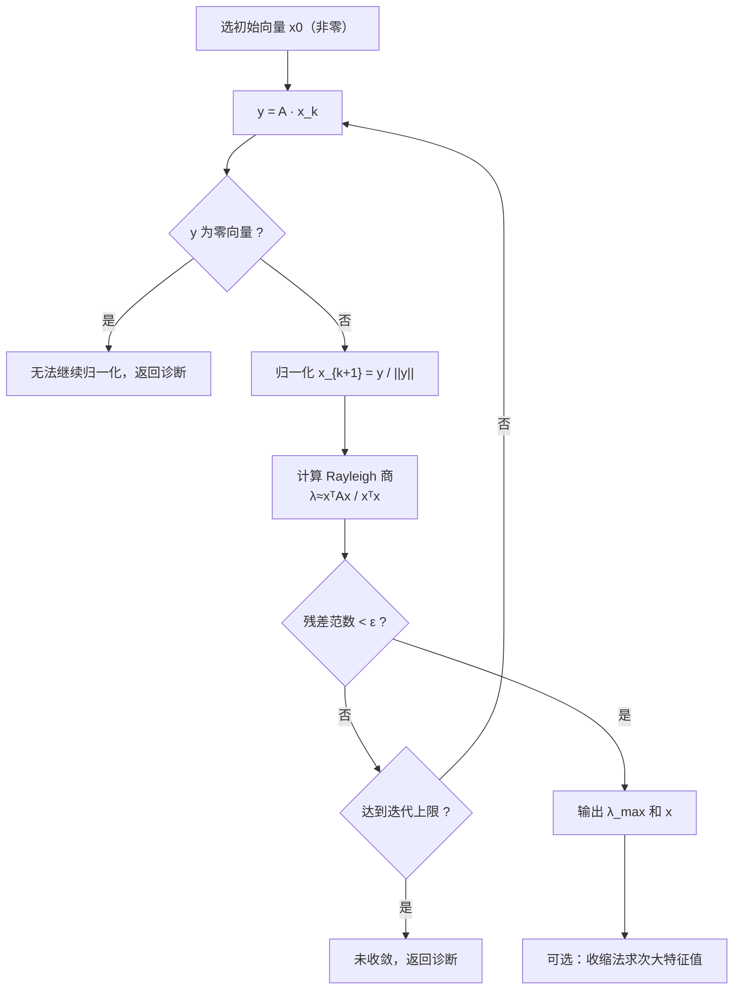

# 幂法

## 一句话

反复乘 $A$ 并归一化——向量方向收敛到主特征向量，Rayleigh 商收敛到主特征值——最基础的特征值算法。

## 严格定义

设 $A$ 有特征值 $|\lambda_1|>|\lambda_2|\ge\cdots\ge|\lambda_n|$（假设 $|\lambda_1|$ 唯一）。

**幂法迭代**：

$$
\boxed{x_{k+1}=Ax_k/\|Ax_k\|}
$$

**Rayleigh 商**（特征值近似）：

$$
\boxed{\lambda^{(k)}\approx\frac{x_k^T A x_k}{x_k^T x_k}}
$$

**收敛率**：$\approx|\lambda_2/\lambda_1|$（比值越小收敛越快）。

> [!important] 只求**模最大**的特征值——不能直接求所有特征值

## 推导：$A^k x_0$ 的渐近行为

> [!proof]- 推导
> 将 $x_0$ 用特征向量展开：$x_0=\sum_{i=1}^{n}c_i v_i$（设 $c_1\neq0$）。
>
> $$
> A^k x_0=\sum_{i=1}^{n}c_i\lambda_i^k v_i=c_1\lambda_1^k\left[v_1+\frac{c_2}{c_1}\left(\frac{\lambda_2}{\lambda_1}\right)^k v_2+\cdots+\frac{c_n}{c_1}\left(\frac{\lambda_n}{\lambda_1}\right)^k v_n\right]
> $$
>
> 因 $|\lambda_i/\lambda_1|<1\;(i\ge2)$，当 $k\to\infty$ 时：
>
> $$
> A^k x_0\approx c_1\lambda_1^k v_1
> $$
>
> 方向趋近 $v_1$。归一化保证向量不会溢出。Rayleigh 商 $\frac{v_1^T A v_1}{v_1^T v_1}=\lambda_1$ 给出特征值。

## 算法步骤

1. 给定初值 $x_0\neq0$，容差 $\varepsilon$
2. 对 $k=0,1,\ldots$
   - $y_{k+1}=A x_k$
   - $x_{k+1}=y_{k+1}/\|y_{k+1}\|$
   - $\lambda^{(k+1)}=x_{k+1}^T A x_{k+1}/(x_{k+1}^T x_{k+1})$
   - 若 $|\lambda^{(k+1)}-\lambda^{(k)}|<\varepsilon$ 停机

## 关键性质

| 性质 | 数值 |
|------|------|
| 收敛率 | $\approx|\lambda_2/\lambda_1|$ |
| 求模最大特征值 | 是 |
| 需要初值 $c_1\neq0$ | 是（随机初值几乎必然满足） |
| 复特征值 | $|\lambda_1|=|\lambda_2|$ 时慢/失败 |
| 归一化 | 必须（防溢出/下溢） |

## 典型例题

> **题目**：对 $A=\begin{pmatrix}2&1\\1&2\end{pmatrix}$ 做幂法求最大特征值，$x_0=(1,0)^T$，3 步。

> [!example]- 解答
> $A$ 的特征值：$\lambda_1=3,\;\lambda_2=1$。收敛率 $|\lambda_2/\lambda_1|=1/3$。
>
> | $k$ | $x_k$（未归一化） | $x_k$（归一化） | $\lambda^{(k)}$ |
> |-----|------------------|-----------------|-----------------|
> | 0 | $(1,0)$ | $(1,0)$ | — |
> | 1 | $(2,1)$ | $(0.894,0.447)$ | $(2,1)\cdot(2,1)/(1+0)=2.5$ |
> | 2 | $(2.236,1.789)$ | $(0.781,0.625)$ | $2.91$ |
> | 3 | $(2.187,2.031)$ | $(0.733,0.681)$ | $2.98$ |
>
> 3 步后 $\lambda^{(3)}\approx2.98$（真值 3.0），误差约 $0.7\%$。收敛率验证：$|2.98-3|/|2.91-3|=0.02/0.09\approx0.22\approx(1/3)^2$。
>
> **点评**：$|\lambda_2/\lambda_1|=1/3$ 意味着每步误差缩小约 3 倍——$1/3\times1/3=1/9$ 每两步。

## 易错点

> [!warning] $|\lambda_1|=|\lambda_2|$ 时幂法失效
> 若存在两个模相同的最大特征值（实数的 $\pm\lambda$ 对或复共轭对），幂法收敛极慢或震荡。此时需用块幂法或子空间迭代。

> [!warning] 初值 $c_1=0$ 导致收敛到次大特征值
> 若初值 $x_0$ 恰好只含 $v_2,v_3,\ldots$ 而无 $v_1$ 分量（$c_1=0$），幂法收敛到 $\lambda_2$——但浮点误差会逐渐引入 $v_1$ 分量。

> [!warning] 归一化必须每步执行
> $A^k x_0$ 的模会指数增长（$|\lambda_1|^k$）或缩小——不用归一化则溢出/下溢。

## 相关概念

- [[01_Knowledge/谱半径]]
- [[01_Knowledge/收敛性]]
- [[01_Knowledge/逆幂法与位移法]]
- [[01_Knowledge/QR算法]]

## 习题

- [[03_Sources/Courses/归档/数值分析/习题库/06-矩阵特征值的数值解法/README|第6章习题库]]

## 操作补充

### 操作补充：适用场景
只需求矩阵 $A$ 的模最大特征值（主特征值）及对应特征向量，矩阵可对角化，模最大特征值单重且严格占优，初向量在相应特征向量方向的分量非零。

### 操作补充：核心公式/步骤

1. 选初始向量 $x_0$（非零），通常取全 1 向量
2. 迭代：$\boxed{y_{k+1}=A x_k}$（乘 $A$）
3. 归一化：$\boxed{x_{k+1}=\frac{y_{k+1}}{\|y_{k+1}\|}}$（常用 $\|\cdot\|_\infty$ 或 $\|\cdot\|_2$）
4. 估计主特征值：Rayleigh 商 $\boxed{\lambda_{\max}\approx\frac{x_{k+1}^T A x_{k+1}}{x_{k+1}^T x_{k+1}}}$ 或 $\boxed{\lambda_{\max}\approx\frac{y_{k+1}^{(i)}}{x_k^{(i)}}}$
5. 检查残差 $\|Ax_{k+1}-\lambda_{k+1}x_{k+1}\|$；特征值变化小只作辅助标准。设置最大迭代次数，并处理 $y_{k+1}=0$。

### 操作补充：典型例题

> **题目**：用幂法求 $A=\begin{bmatrix}3&-1&0\\-1&2&-1\\0&-1&3\end{bmatrix}$ 的主特征值，$x_0=[1,1,1]^T$。

> [!example]- 解答
> $y_1=Ax_0=[2,0,2]^T$, 归一化 $x_1=[1,0,1]^T$, $\lambda=3$
> $y_2=Ax_1=[3,-2,3]^T$, $x_2=[1,-0.667,1]^T$, $\lambda=43/11\approx3.9091$
> $y_3=Ax_2=[3.667,-3.333,3.667]^T$, $\lambda=683/171\approx3.9942$（精确主特征值为 $4$）
> 点评：收敛速度取决于 $|\lambda_2/\lambda_1|$，比值越小收敛越快。

### 操作补充：链接的知识点

本流程的条件、公式与推导已统一在本页前半部分维护。

### 操作补充：链接的习题
- [[03_Sources/Courses/归档/数值分析/习题库/06-矩阵特征值的数值解法/README|第6章习题库]]
