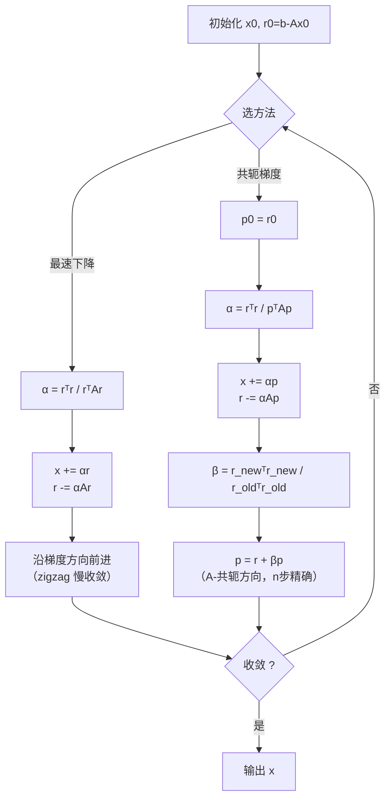

# 最速下降与CG迭代流程

## 适用场景
求解 SPD 大型稀疏线性方程组 $Ax=b$。最速下降简单但慢（zigzag），共轭梯度理论上 $n$ 步精确收敛。

## 核心公式/步骤

**最速下降法：**
1. 初始化 $x_0$, $r_0=b-Ax_0$
2. $\boxed{\alpha_k=\frac{r_k^T r_k}{r_k^T A r_k}}$（最优步长）
3. $\boxed{x_{k+1}=x_k+\alpha_k r_k}$，$r_{k+1}=r_k-\alpha_k A r_k$

**共轭梯度法：**
1. 初始化 $x_0$, $r_0=b-Ax_0$, $p_0=r_0$
2. $\boxed{\alpha_k=\frac{r_k^T r_k}{p_k^T A p_k}}$（精确步长）
3. $\boxed{x_{k+1}=x_k+\alpha_k p_k}$，$\boxed{r_{k+1}=r_k-\alpha_k A p_k}$
4. $\boxed{\beta_k=\frac{r_{k+1}^T r_{k+1}}{r_k^T r_k}}$，$\boxed{p_{k+1}=r_{k+1}+\beta_k p_k}$

## 典型例题

> **题目**：用 CG 法解 $A=\begin{bmatrix}2&-1\\-1&2\end{bmatrix}$, $b=[1,0]^T$，初值 $x_0=[0,0]^T$。

> [!example]- 解答
> $r_0=[1,0]^T$, $p_0=[1,0]^T$
> $\alpha_0=1/2$, $x_1=[0.5,0]^T$, $r_1=[0,0.5]^T$
> $\beta_0=0.25$, $p_1=[0.25,0.5]^T$
> $\alpha_1=2/3$, $x_2=[2/3,1/3]^T$ 即为精确解 $A^{-1}b$。2 步收敛（$n=2$）。

## 链接的知识点
- [[01_Knowledge/梯度下降法]]
- [[01_Knowledge/共轭梯度法]]

## 链接的习题
- [[03_Sources/Courses/归档/数值分析/习题库/05-对称正定线性方程组/README|第5章习题库]]
