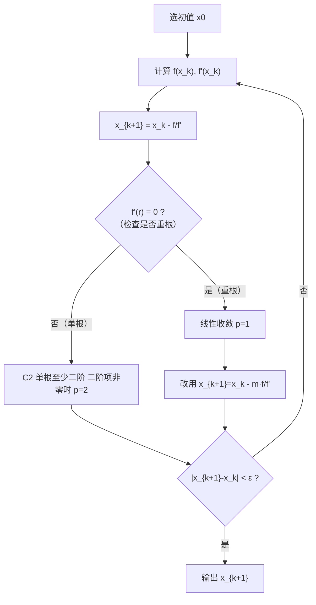

# 牛顿法

## 适用场景
对 $f\in C^2$、$f\prime(r)\ne0$ 的单根，初值充分靠近根时牛顿法至少二阶收敛；须避免除以零及不合适的远处初值。

## 核心公式/步骤

1. 选初值 $x_0$（靠近根）
2. 迭代公式：$\boxed{x_{k+1}=x_k-\frac{f(x_k)}{f'(x_k)}}$
3. 判断收敛阶：
   - 单根且 $f\in C^2$：$e_{k+1}=\frac{f\prime\prime(r)}{2f\prime(r)}e_k^2+o(e_k^2)$；若 $f\prime\prime(r)\ne0$，精确阶 $p=2$，否则可能更高阶或有限步终止
   - 有限重数 $m\ge2$，$f(x)=(x-r)^mh(x)$ 且 $h$ 足够光滑、$h(r)\ne0$：$\boxed{p=1}$（线性收敛），需改用 $\boxed{x_{k+1}=x_k-m\frac{f(x_k)}{f'(x_k)}}$（$m$ 为重数）
4. 停机准则：$|x_{k+1}-x_k|<\varepsilon$ 或 $|f(x_{k+1})|<\delta$

## 典型例题

> **题目**：用牛顿法求 $f(x)=x^2-2=0$ 的根 $\sqrt{2}$，初值 $x_0=1.5$，迭代 3 次。

> [!example]- 解答
> $f'(x)=2x$，迭代公式 $x_{k+1}=x_k-\frac{x_k^2-2}{2x_k}=\frac{x_k}{2}+\frac{1}{x_k}$。
> 
> $x_0=1.5$ → $x_1=1.4167$ → $x_2=1.4142157$ → $x_3=1.4142136$
> 
> 每次迭代有效数字翻倍（平方收敛特征）。点评：牛顿法对单根收敛极快，但初值必须足够近。

## 链接的知识点
- [[01_Knowledge/牛顿法]]
- [[01_Knowledge/改进牛顿法(重根)]]
- [[01_Knowledge/收敛阶定理]]

## 链接的习题
- [[03_Sources/Courses/归档/数值分析/习题库/02-非线性方程求根/README|第2章习题库]]

## 求极值

### 求极值：一句话

牛顿法在当前点用二阶 Taylor 展开构造二次逼近，取逼近函数的极小点作为下一迭代点，具有二次收敛速度。

### 求极值：严格定义（一维版本）

设 $f\in C^2$。在 $x^{(k)}$ 处做二阶 Taylor 展开：

$$
g(x)=f(x^{(k)})+f'(x^{(k)})(x-x^{(k)})+\frac12 f''(x^{(k)})(x-x^{(k)})^2
$$

令 $g'(x)=0$ 得牛顿法迭代格式：

$$
\boxed{x^{(k+1)}=x^{(k)}-\frac{f'(x^{(k)})}{f''(x^{(k)})}}
$$

此公式首先求驻点；$f''(x^{(k)})>0$ 时当前二次模型才有极小点，仍需检查迭代结果。若解处 Hessian 正定、邻域内 Hessian 局部 Lipschitz 且初值充分接近，可保证局部二次收敛；仅有 $C^2$ 不能直接得到该阶数。

### 求极值：多维版本

对于多维无约束优化 $\min_{x\in\mathbb{R}^n}f(x)$，牛顿方向为：

$$
p_k=-\left(\nabla^2 f(x_k)\right)^{-1}\nabla f(x_k)
$$

步长通常取 $\alpha_k=1$（纯牛顿法）或通过线搜索确定（阻尼牛顿法）。

### 求极值：关键性质

| 性质 | 说明 |
|------|------|
| 收敛速度 | 下列条件成立时局部二次收敛，误差满足 $\|x_{k+1}-x^*\|\leq C\|x_k-x^*\|^2$ |
| 所需信息 | $f'$ 和 $f''$（一维）；$\nabla f$ 和 $\nabla^2 f$（多维） |
| 前提条件 | 解处 Hessian 正定；邻域内 Hessian 局部 Lipschitz；初值充分接近 |

### 求极值：直观理解

一阶导数告诉你"往哪走"（方向），二阶导数告诉你"该走多大步"。
$f''$ 大（函数很"陡"）→ 步长自动缩小；$f''$ 小 → 步长自动放大。

### 求极值：典型例题

> $f(x)=x^4-14x^3+60x^2-70x$，从 $x^{(0)}=1$ 开始。

> [!example]- 解答
> $f'(x)=4x^3-42x^2+120x-70$，$f''(x)=12x^2-84x+120$。
> 
> S1：$f'(1)=12,f''(1)=48$，$x^{(1)}=1-\frac{12}{48}=0.75$。
> S2：$f'(0.75)=-1.9375,f''(0.75)=63.75$，$x^{(2)}=0.75-\frac{-1.9375}{63.75}\approx0.7804$。
> 
> 只需 2 步就接近 $x^*\approx0.780884$——远快于黄金分割或二分法。

### 求极值：易错点

> [!warning] $f''\leq0$ 时牛顿方向可能错误
> 若 $f''(x^{(k)})\leq0$，二次逼近的驻点是极大点或退化的。需修正（取 $|f''|$、切换到其他方法或加阻尼）。

> [!warning] 远离解时可能发散
> 牛顿法只在 $x^*$ 附近有二次收敛保证。初始点太远可能发散。通常配合线搜索（阻尼牛顿）。

### 求极值：相关概念
- [[01_Knowledge/线搜索]]

- [[01_Knowledge/割线法]]
- [[01_Knowledge/回溯线搜索]]

### 求极值：习题

- [[03_Sources/Courses/归档/最优化方法/习题库/09-牛顿法/README|第9章习题库]] — 习题 9.4、考题含牛顿法迭代与高斯牛顿法

## 延伸材料

完整历史例题与补充说明见 [[03_Sources/Reviews/归档/数值分析/归档合并记录/牛顿法迭代与收敛阶判断]]。
