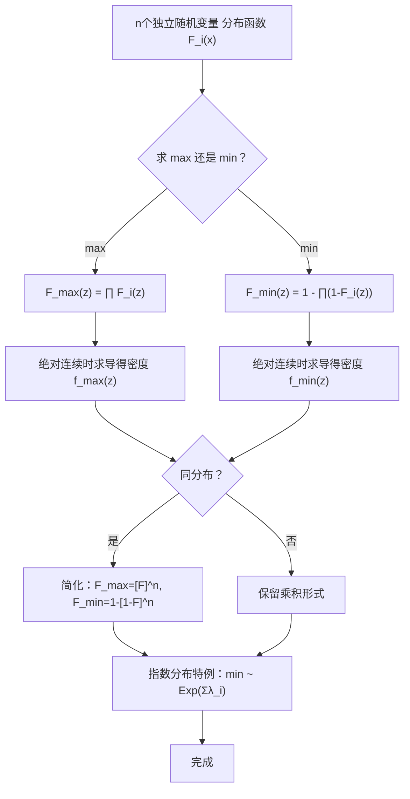

# 独立随机变量最大值与最小值的分布求法

## 适用场景

求 $n$ 个独立随机变量的最大值 $M = \max(\xi_1,\ldots,\xi_n)$ 或最小值 $N = \min(\xi_1,\ldots,\xi_n)$ 的分布。典型应用：串联系统寿命（= min）、并联系统寿命（= max）。

## 核心步骤

### 公式

设 $\xi_1,\ldots,\xi_n$ 相互独立，分布函数分别为 $F_1,\ldots,F_n$：

$$\boxed{F_{\max}(z) = P\{\max \leq z\} = \prod_{i=1}^n F_i(z)}$$

$$\boxed{F_{\min}(z) = P\{\min \leq z\} = 1 - \prod_{i=1}^n [1 - F_i(z)]}$$

### 直观理解

- $\max \leq z \iff$ **所有**分量都 $\leq z$（交事件 → 独立性时直接乘）
- $\min \leq z \iff$ **至少有一个**分量 $\leq z$ = 1 − **所有**分量都 $> z$

### 同分布特例

下面密度公式还要求各变量同分布且分布绝对连续，密度等式几乎处处成立。分布函数乘积式本身对离散或混合变量也成立。

若 $F_i = F$ 相同：

$$F_{\max}(z) = [F(z)]^n, \quad f_{\max}(z) = n[F(z)]^{n-1} f(z)$$

$$F_{\min}(z) = 1 - [1-F(z)]^n, \quad f_{\min}(z) = n[1-F(z)]^{n-1} f(z)$$

### 指数分布特例

若 $\xi_i \sim \text{Exp}(\lambda_i)$ 独立，则：

$$\boxed{N = \min(\xi_1,\ldots,\xi_n) \sim \text{Exp}\!\left(\sum_{i=1}^n \lambda_i\right)}$$

即独立指数分布的 $\min$ 仍是指数分布，参数相加（串联系统寿命）。

> [!warning] 关键点
> - $\max/\min$ 公式依赖**独立性**——不独立时需用联合分布函数。
> - $\min$ 的密度公式容易与 $\max$ 混淆：$f_{\min}$ 含 $[1-F]^{n-1}$，$f_{\max}$ 含 $[F]^{n-1}$。

## 流程图

## 典型例题

> **题目**：$\xi_1,\xi_2,\xi_3$ i.i.d. $\sim \text{Exp}(\lambda)$。求 $M=\max$ 和 $N=\min$ 的分布。

> [!example]- 解答
> 指数分布函数：$F(x) = 1 - e^{-\lambda x}$（$x \geq 0$）。
>
> 以下结果在 $z<0$ 时分布函数及密度均为零。**max**：$F_M(z) = [1-e^{-\lambda z}]^3$。
> $f_M(z) = 3[1-e^{-\lambda z}]^2 \cdot \lambda e^{-\lambda z}$，$z \geq 0$。
>
> **min**：$F_N(z) = 1 - [1-F(z)]^3 = 1 - (e^{-\lambda z})^3 = 1 - e^{-3\lambda z}$。
> 故 $N \sim \text{Exp}(3\lambda)$！参数为各参数之和。
>
> **点评**：独立指数分布的 $\min$ 仍是指数分布——这正是串联系统寿命模型。$\max$ 不再是单一指数分布。两个极端次序统计量在可靠性工程中有直接对应：串联寿命 = $\min$，并联寿命 = $\max$。

## 知识链接

- [[01_Knowledge/多维随机变量函数的分布]]
- [[03_Sources/Reviews/概率论/专题复习/常见连续型分布]]

## 习题链接

- [[03_Sources/Courses/概率论/作业/03-多维随机变量/习题3.16]] — 独立指数分布的 $\min$ 分布

## 同一样本最小值与最大值的联合事件

第15节令 $U=\min_iX_i,V=\max_iX_i$，独立同分布样本的分布函数为F。若 $x<y$，从全体不超过y的事件中减去全体位于 $(x,y]$ 的事件，得
$$P(U\le x,V\le y)=F(y)^n-[F(y)-F(x)]^n.$$
若 $x\ge y$，则 $V\le y$ 已蕴含 $U\le x$，联合分布为 $F(y)^n$。该CDF式不要求连续；不能把分别计算边缘时的独立样本乘积误用为U与V独立。一般独立性也不能只靠一句U≤V作普遍判断，须检验具体联合分布。
