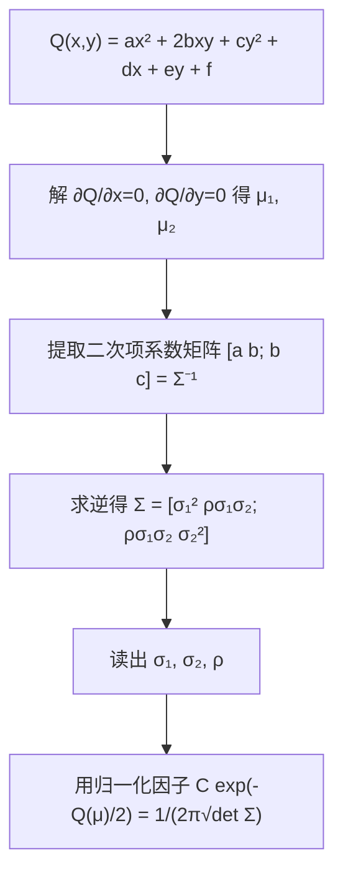

# 由二次型识别二维正态分布参数

## 适用场景
从联合密度的指数二次型中提取二维正态的五个参数 $(\mu_1, \mu_2, \sigma_1^2, \sigma_2^2, \rho)$。也用于正态卷积积分中的二次型配方化简。

## 核心公式/步骤

给定密度 $f(x,y) = C \cdot \exp\{-Q(x,y)/2\}$，要求二次项系数矩阵正定、支撑为全平面，才能按非退化二维正态处理；三步提取参数：

**三步法**：

1. **求 $\mu_1, \mu_2$**：解 $\partial Q/\partial x = 0,\; \partial Q/\partial y = 0$ 得驻点，即均值向量。
2. **取 $Q$ 的二次齐次部分**，写成矩阵形式——这就是 $\Sigma^{-1}$：
   $$Q(x,y) = ax^2 + 2bxy + cy^2 - \cdots \quad\Rightarrow\quad \begin{bmatrix}a & b \\ b & c\end{bmatrix} = \Sigma^{-1}$$
3. **求逆得 $\Sigma = \begin{bmatrix} \sigma_1^2 & \rho\sigma_1\sigma_2 \\ \rho\sigma_1\sigma_2 & \sigma_2^2 \end{bmatrix}$**，直接读出 $\sigma_1, \sigma_2, \rho$。

设 $\mu=(\mu_1,\mu_2)^T$，配方后 $Q(z)=(z-\mu)^T\Sigma^{-1}(z-\mu)+Q(\mu)$。归一化应验证 $C e^{-Q(\mu)/2}=1/(2\pi\sqrt{\det\Sigma})$，即原始 $C=e^{Q(\mu)/2}/(2\pi\sqrt{\det\Sigma})$，不能漏常数项。

## 典型例题

> **题目**（习题3.13）：对二元正态密度函数
> $$p(x, y) = \frac{1}{2\pi} \exp\left\{-\frac{1}{2}\left(2x^{2} + y^{2} + 2xy - 22x - 14y + 65\right)\right\}$$
> 求参数 $\mu_1, \mu_2, \sigma_1, \sigma_2, \rho$ 及边缘密度、条件密度。

> [!example]- 解答
> 令 $Q(x,y) = 2x^2 + y^2 + 2xy - 22x - 14y + 65$。
>
> **(1) 求 $\mu_1, \mu_2$**：
> $$\begin{aligned}
> \frac{\partial Q}{\partial x} &= 4x + 2y - 22 = 0 \\
> \frac{\partial Q}{\partial y} &= 2y + 2x - 14 = 0
> \end{aligned}$$
> 解得 $\mu_1 = 4,\;\mu_2 = 3$。
>
> **(2) 二次项矩阵**：
> 二次项 $2x^2 + 2xy + y^2$，矩阵形式 $\begin{bmatrix}2 & 1 \\ 1 & 1\end{bmatrix} = \Sigma^{-1}$。
>
> **(3) 求逆**：
> $\det(\Sigma^{-1}) = 2\cdot 1 - 1\cdot 1 = 1$，故 $\Sigma = \begin{bmatrix}1 & -1 \\ -1 & 2\end{bmatrix}$。
>
> 由归一化因子 $\frac{1}{2\pi\sigma_1\sigma_2\sqrt{1-\rho^2}} = \frac{1}{2\pi}$ 得 $\sigma_1\sigma_2\sqrt{1-\rho^2}=1$。
>
> 从 $\Sigma$ 读出：$\sigma_1^2 = 1 \Rightarrow \sigma_1 = 1$，$\sigma_2^2 = 2 \Rightarrow \sigma_2 = \sqrt{2}$，$\rho\sigma_1\sigma_2 = -1 \Rightarrow \rho = -\frac{1}{\sqrt{2}}$。
>
> **(4) 边缘密度**：$X \sim N(4, 1)$，即 $p_1(x) = \frac{1}{\sqrt{2\pi}} e^{-(x-4)^2/2}$。
>
> **(5) 条件密度**：$X|Y=y \sim N\!\left(4 - \frac{1}{2}(y-3),\; \frac{1}{2}\right)$。
>
> **点评**：配方/矩阵求逆法比"配方法"快得多——30 秒出五参数，不碰繁琐代数展开。二次项系数矩阵直接对应 $\Sigma^{-1}$，求逆即得 $\Sigma$。

## 链接的知识点
- [[01_Knowledge/二维正态分布]]

## 链接的习题
- [[03_Sources/Courses/概率论/作业/03-多维随机变量/习题3.13]]
- [[03_Sources/Courses/概率论/作业/03-多维随机变量/习题3.2]]
