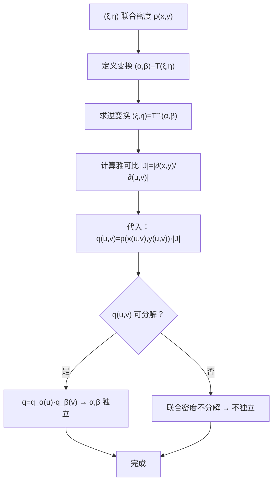

# 联合概率密度的雅可比变换法

## 适用场景

求多维随机变量经过一般非线性变换后的联合分布——特别适用于和与比的联合分布（如 Gamma + Beta 分解）。

## 核心步骤

### 公式

设 $(\xi,\eta)$ 有联合密度 $p(x,y)$，作变换 $(\alpha,\beta) = T(\xi,\eta)$，在原密度支撑域的开集内部，要求 $T$ 为 $C^1$ 一一变换、雅可比不为零，逆映射也为 $C^1$（可忽略零概率边界）。逆变换为 $(\xi,\eta)=T^{-1}(\alpha,\beta)$。则 $(\alpha,\beta)$ 的联合密度为：

$$\boxed{q(u,v) = p(x(u,v),\; y(u,v)) \cdot |J|}$$

只在像域 $T(D)$ 上套用，域外密度为零。若是多对一变换，需分成可逆分支并对各原像贡献求和，不能任取一个逆。这里 $J$ 为逆变换的雅可比行列式：

$$\boxed{J = \frac{\partial(x,y)}{\partial(u,v)} = \begin{vmatrix} \frac{\partial x}{\partial u} & \frac{\partial x}{\partial v} \\ \frac{\partial y}{\partial u} & \frac{\partial y}{\partial v} \end{vmatrix}}$$

### 操作步骤

**①** 确定变换 $(\alpha,\beta) = T(\xi,\eta)$ 及其值域

**②** 求逆变换 $(\xi,\eta) = T^{-1}(\alpha,\beta)$

**③** 计算雅可比行列式 $|J|$

**④** 代入联合密度：$q(u,v) = p(x(u,v), y(u,v)) \cdot |J|$

**⑤** 将支撑域的指示函数包括在内，在整个平面几乎处处检验归一化边缘密度乘积。分解 $q(u,v)$ 为边缘密度的乘积（若可分解，则两变量独立）

> [!warning] 关键点
> - **雅可比行列式必须取绝对值** $|J|$。
> - 变换的定义域要与原密度的支撑域匹配。
> - 若 $q(u,v) = q_\alpha(u) \cdot q_\beta(v)$ 可分解，则 $\alpha$ 与 $\beta$ 独立。

## 流程图

## 典型例题

> **题目**（习题 3.22）：$\xi\sim\Gamma(r_1,\lambda)$，$\eta\sim\Gamma(r_2,\lambda)$ 独立，求 $\alpha=\xi+\eta$ 与 $\beta=\xi/(\xi+\eta)$ 的联合密度，并证明两者独立。

> [!example]- 解答
> 联合密度：$p(x,y) = \frac{\lambda^{r_1+r_2}}{\Gamma(r_1)\Gamma(r_2)} x^{r_1-1}y^{r_2-1} e^{-\lambda(x+y)}$，$x,y>0$。
>
> **变换**：$\alpha = \xi+\eta$，$\beta = \xi/(\xi+\eta)$。
> **逆变换**：$\xi = \alpha\beta$，$\eta = \alpha(1-\beta)$。值域：$\alpha > 0$，$0 < \beta < 1$。
>
> **雅可比**：
> $$J = \begin{vmatrix} \beta & \alpha \\ 1-\beta & -\alpha \end{vmatrix} = -\alpha\beta - \alpha(1-\beta) = -\alpha \;\Rightarrow\; |J| = \alpha$$
>
> **代入**：
> $$\begin{aligned}
> q(u,v) &= p(uv, u(1-v)) \cdot u \\
> &= \frac{\lambda^{r_1+r_2}}{\Gamma(r_1)\Gamma(r_2)} (uv)^{r_1-1}[u(1-v)]^{r_2-1} e^{-\lambda u} \cdot u \\
> &= \frac{\lambda^{r_1+r_2}}{\Gamma(r_1)\Gamma(r_2)} u^{r_1+r_2-1} e^{-\lambda u} \cdot v^{r_1-1}(1-v)^{r_2-1}
> \end{aligned}$$
>
> **分解**：
> $$q(u,v) = \underbrace{\frac{\lambda^{r_1+r_2}}{\Gamma(r_1+r_2)} u^{r_1+r_2-1} e^{-\lambda u}}_{q_\alpha(u)} \cdot \underbrace{\frac{\Gamma(r_1+r_2)}{\Gamma(r_1)\Gamma(r_2)} v^{r_1-1}(1-v)^{r_2-1}}_{q_\beta(v)}$$
>
> **结论**：(1) $\beta \sim \text{Beta}(r_1,r_2)$；(2) $\alpha$ 与 $\beta$ 独立，且 $\alpha \sim \Gamma(r_1+r_2,\lambda)$。
>
> **点评**：这道题揭示了 Gamma 分布与 Beta 分布之间的深刻联系——两个独立同尺度 Gamma 变量，其和与比值相互独立。

## 知识链接

- [[01_Knowledge/多维随机变量函数的分布]]
- [[01_Knowledge/联合分布]]

## 习题链接

- [[03_Sources/Courses/概率论/作业/03-多维随机变量/习题3.22]] — Gamma 分布和与比的联合分布（变量变换法）
