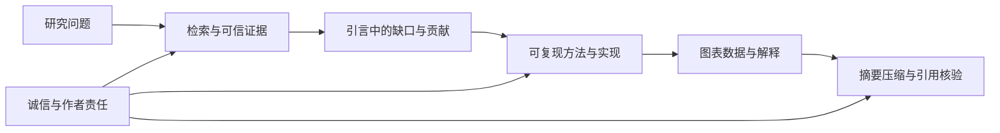

# 专业写作基础

## 课程知识路线（2026-11-08提炼）

以下是本次来源支持的阅读依赖与应用路线，不表示读者已掌握。资料缺失、课程通知和未完整承接段落仍保留待审。

### 问题与证据

- [[01_Knowledge/科技论文]]
- [[01_Knowledge/研究选题到论文修改的执行流程]]
- [[01_Knowledge/文献检索与可信度筛选]]
- [[01_Knowledge/学术研究的证据与贡献边界]]
- [[01_Knowledge/正文引用与参考文献核对]]

### 组织与表达

- [[01_Knowledge/论文标题与关键词拟定]]
- [[01_Knowledge/引言的问题缺口贡献链]]
- [[01_Knowledge/可复现的方法论写作]]
- [[01_Knowledge/算法伪代码的表达]]
- [[01_Knowledge/科研图表的信息与可读性检查]]
- [[01_Knowledge/实验结果图表的介绍数据解释法]]
- [[01_Knowledge/研究摘要五步写作法]]

### 合作与工具

- [[01_Knowledge/论文实质贡献与作者署名]]
- [[01_Knowledge/AI辅助学术写作的人工核验流程]]
- [[01_Knowledge/LaTeX结构化学术排版]]

### 真实来源入口

- [[03_Sources/Courses/专业写作基础/课堂笔记/2026-09-01-第1节-转写_电子科大王君豪的快速会议]]
- [[03_Sources/Courses/专业写作基础/课堂笔记/2026-09-08-第2节-文献检索与科技论文写作授课]]
- [[03_Sources/Courses/专业写作基础/课堂笔记/2026-09-15-第3节-学术论文写作规范培训]]
- [[03_Sources/Courses/专业写作基础/课堂笔记/2026-09-22-第4节-期末论文与AI辅助写作宣讲]]

<!-- v2-generated:start -->
## 主题知识

动态汇集自身及全部下层主题的原子知识，每篇笔记显示一次。新增原子自动出现；主题层级变化后运行 views 更新递归范围。

![[99_System/knowledge/v2/generated/topics/da503233d3f1.base]]
<!-- v2-generated:end -->
