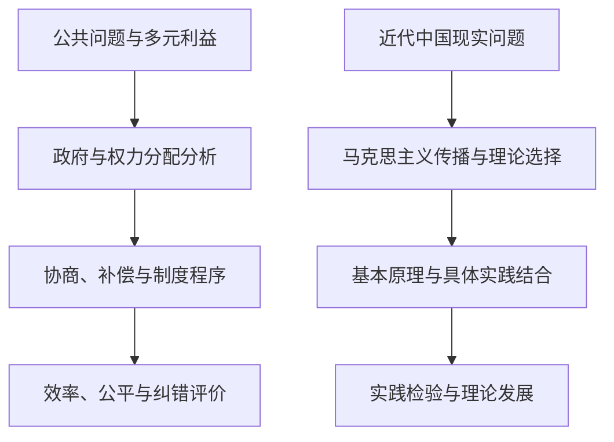

# 习近平新时代中国特色社会主义思想概论

## 课程知识路线（2026-11-08提炼）

以下是本次来源支持的阅读依赖与应用路线，不表示读者已掌握。资料缺失、课程通知和未完整承接段落仍保留待审。

### 公共政治的分析

- [[01_Knowledge/政治的政府公共事务协商分配四个视角]]
- [[01_Knowledge/公共利益冲突的协商协调]]
- [[01_Knowledge/公共决策的多维评价]]

### 传播与理论实践

- [[01_Knowledge/近代中国选择马克思主义的课堂解释]]
- [[01_Knowledge/马克思主义中国化的实践逻辑]]

### 真实来源入口

- [[03_Sources/Courses/习近平新时代中国特色社会主义思想概论/课堂笔记/2026-09-03-第2节-政治学概论与马克思主义中国化讲座]]

<!-- v2-generated:start -->
## 主题知识

动态汇集自身及全部下层主题的原子知识，每篇笔记显示一次。新增原子自动出现；主题层级变化后运行 views 更新递归范围。

![[99_System/knowledge/v2/generated/topics/f9607c280a38.base]]
<!-- v2-generated:end -->
