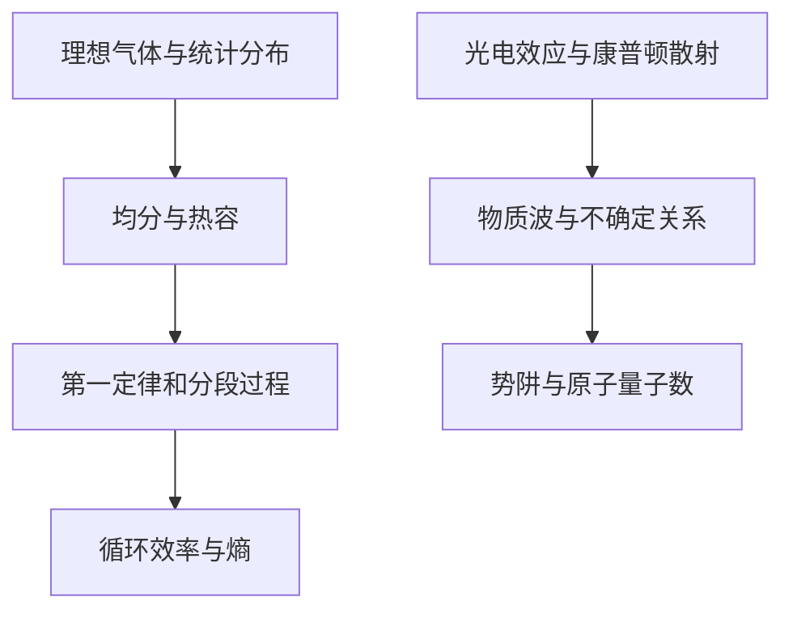

# 大学物理

统计描述与热力学过程 → 能量与熵核算；光量子实验 → 物质波与量子态。

## 原子笔记入口

### 概念与边界

- [[01_Knowledge/麦克斯韦速率分布]]
- [[01_Knowledge/摩尔热容]]
- [[01_Knowledge/熵]]
- [[01_Knowledge/玻尔氢原子理论]]
- [[01_Knowledge/一维无限深势阱]]

### 条件与结论

- [[01_Knowledge/理想气体状态方程]]
- [[01_Knowledge/压强和温度的统计意义]]
- [[01_Knowledge/能量均分定理]]
- [[01_Knowledge/热力学第一定律]]
- [[01_Knowledge/绝热过程]]
- [[01_Knowledge/循环过程与热机效率]]
- [[01_Knowledge/光电效应]]
- [[01_Knowledge/康普顿散射]]
- [[01_Knowledge/德布罗意波]]
- [[01_Knowledge/不确定关系]]
- [[01_Knowledge/原子量子数与轨道角动量的允许取值]]

### 解题与检查方法

- [[01_Knowledge/非均匀温度理想气体的分片守恒计算]]
- [[01_Knowledge/理想气体分段过程的能量核算]]
- [[01_Knowledge/卡诺热机与制冷机的能量反算]]
- [[01_Knowledge/按电子计数核查原子电子组态]]

## 2026-11-08归档状态

本次处理原子归档，未据此判断学习掌握。具体已归档、数学错误/题设待核及资料缺失请看本周检查报告。历史来源与新附勘误并存时优先阅读标明日期的核查段，不把原错式当成已验证结论。

<!-- v2-generated:start -->
## 主题知识

动态汇集自身及全部下层主题的原子知识，每篇笔记显示一次。新增原子自动出现；主题层级变化后运行 views 更新递归范围。

![[99_System/knowledge/v2/generated/topics/1a1553bd3e2d.base]]
<!-- v2-generated:end -->
