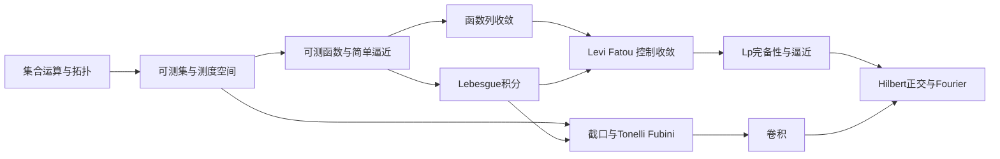

# 实变函数

实变函数把集合、拓扑、测度、可测函数和积分连成一条论证链，最后进入Lp与Fourier分析。上层为 [[02_Maps/MOC-数学]]；集合与拓扑可横向进入 [[02_Maps/MOC-集合与空间]]，极限与积分进入 [[02_Maps/MOC-收敛性与积分理论]]，概率应用进入 [[02_Maps/MOC-概率与随机结构]]。

## 集合操作与空间

- [[01_Knowledge/De Morgan法则]] 和 [[01_Knowledge/像与原像的集合运算法则]] 把逻辑量词转成集合运算；[[01_Knowledge/集合列不交化法]] 支持测度可数可加性，[[01_Knowledge/集合列上下极限与指示函数]] 沟通集合与函数极限。
- [[01_Knowledge/证明集合可数的方法]] 与 [[01_Knowledge/有限维欧氏空间的连续统基数]] 区分枚举、可数乘积和全体函数；[[01_Knowledge/用可数禁值集选择几何参数]] 是可数性到存在性的应用。
- [[01_Knowledge/度量空间]]、[[01_Knowledge/开集与闭集]]、[[01_Knowledge/内点导集闭包与边界的计算]] 组织邻域与极限；[[01_Knowledge/有限维坐标收敛与范数收敛等价]] 给有限维统一性。

## 从测度到可测函数

- [[01_Knowledge/测度空间与Lebesgue测度]] 的定义域由 [[01_Knowledge/σ代数]] 描述，[[01_Knowledge/测度对单调集合列的连续性]] 区分升列与有限测度降列。
- [[01_Knowledge/零测集]] 与 [[01_Knowledge/Cantor三分集]] 说明测度、基数、稠密性分别衡量不同结构；[[01_Knowledge/Vitali不可测集的平移矛盾]] 解释可测范围不能任意扩张。
- [[01_Knowledge/计数测度与Dirac测度]]、[[01_Knowledge/非负密度生成测度]] 和 [[01_Knowledge/双射搬运与推前测度]] 提供离散、加权与分布模型。
- [[01_Knowledge/可测函数]] 的水平集刻画和 [[01_Knowledge/简单函数]] 的升列逼近将集合测度提升为积分；[[01_Knowledge/可测函数的连续函数列几乎处处逼近]] 通过Lusin和延拓连接连续性。

## 收敛、积分与可交换运算

- [[01_Knowledge/一致收敛]]、[[01_Knowledge/几乎一致收敛]]、[[01_Knowledge/依测度收敛]] 须逐一检查定义域与量词。[[01_Knowledge/Egorov定理]] 用有限测度把a.e.提升为a.u.；[[01_Knowledge/Riesz定理]] 从依测度提取a.e./a.u.子列。[[01_Knowledge/逐点收敛集合的量词表示]] 是证明中的集合骨架。
- [[01_Knowledge/Lebesgue积分]] 由简单函数开始；[[01_Knowledge/Lebesgue积分的序性质与零积分判别]]、[[01_Knowledge/可积函数积分的绝对连续性]] 和 [[01_Knowledge/可积函数积分的区域可数可加性]] 控制局部与全域积分。
- [[01_Knowledge/Levi单调收敛定理]] → [[01_Knowledge/Fatou引理]] → [[01_Knowledge/Lebesgue控制收敛定理]] 形成非负升列、半连续估计、可积控制的递进。[[01_Knowledge/函数列收敛与积分失效的典型反例]] 检查尖峰与质量逃逸。
- [[01_Knowledge/非负函数级数的逐项积分]] 与 [[01_Knowledge/积分绝对可和级数的逐项积分]] 区分非负项与有符号绝对可和；[[01_Knowledge/控制收敛下参变积分的连续性与可微性]] 处理参数极限和求导。
- [[01_Knowledge/Dirichlet函数的两种积分行为]]、[[01_Knowledge/黎曼积分与Lebesgue积分的一致性]]、[[01_Knowledge/振幅函数与Darboux积分差]]、[[01_Knowledge/黎曼可积充要条件]] 组成两种积分的比较链。

## 重积分、Lp与Fourier

- [[01_Knowledge/截口]] → [[01_Knowledge/Fubini定理]] 把几何切片推广到非负与绝对可积函数；[[01_Knowledge/下方图]] 给积分的体积意义，[[01_Knowledge/卷积]] 是交换积分次序的典型应用。
- [[01_Knowledge/Young乘积不等式]] → [[01_Knowledge/Hölder不等式]] → [[01_Knowledge/Minkowski不等式]] 建立乘积估计与Lp范数；[[01_Knowledge/L^p空间]]、[[01_Knowledge/Riesz-Fisher定理]]、[[01_Knowledge/可分性定理]] 分别给对象、完备性、稠密逼近与端点差异。
- [[01_Knowledge/Fourier变换与Plancherel积分计算法]] 先核对符号和归一化，再选直接积分、卷积或Gauss微分方程；[[01_Knowledge/Hilbert空间正交基与Parseval等式]] 将正交系数平方和转成级数求和。

有限测度条件主要出现在Egorov、有界收敛和Lp包含关系；Levi、Fatou、Riesz子列及可积控制版本通常无需整个定义域有限。来源中的错误陈述须核实后再归档，提炼状态不表示学习掌握程度。

<!-- v2-generated:start -->
## 主题知识

动态汇集自身及全部下层主题的原子知识，每篇笔记显示一次。新增原子自动出现；主题层级变化后运行 views 更新递归范围。

![[99_System/knowledge/v2/generated/topics/5e35bfb48396.base]]
<!-- v2-generated:end -->
