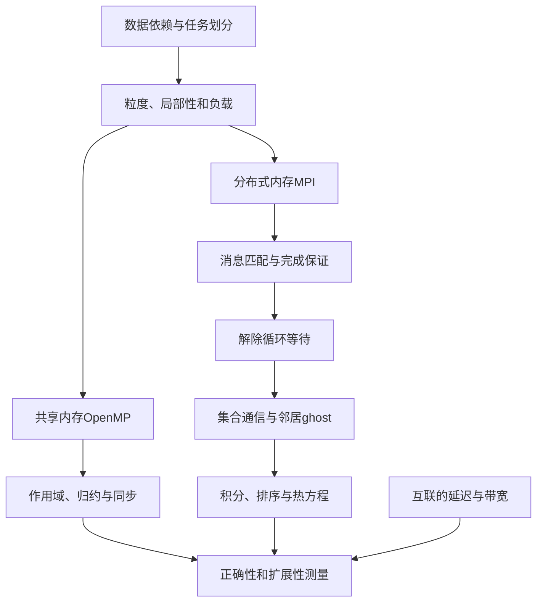
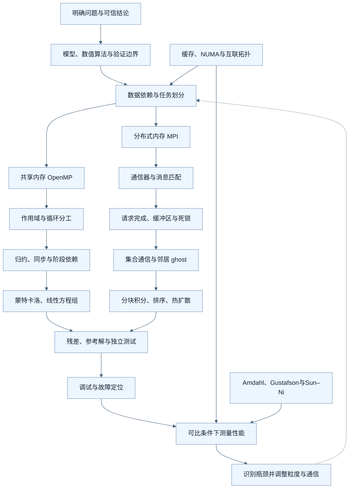

# 并行与分布式计算

## 课程知识路线（2026-11-08提炼）

以下是来源支持的知识依赖与应用路线，不表示已掌握。通知、导航和来源说明不提炼；资料不足按范围规则排除，其余未承接知识属于待完成工作。

### 硬件与性能模型

- [[01_Knowledge/存储程序与计算节点]]
- [[01_Knowledge/并行计算的任务粒度与开销]]
- [[01_Knowledge/Amdahl与Gustafson加速定律]]
- [[01_Knowledge/并行程序性能测量与可扩展性]]
- [[01_Knowledge/延迟带宽通信成本模型]]
- [[01_Knowledge/互联网络的拓扑指标]]
- [[01_Knowledge/网孔环绕网与超立方体拓扑]]
- [[01_Knowledge/网络嵌入与膨胀]]
- [[01_Knowledge/总线交叉开关与Omega网络]]
- [[01_Knowledge/RDMA与高性能互联的作用]]
- [[01_Knowledge/Flynn分类与共享分布式内存模型]]
- [[01_Knowledge/缓存局部性与NUMA访问]]
- [[01_Knowledge/并行算法的数据依赖判定]]
- [[01_Knowledge/进程线程与硬件执行单元]]

### 开发环境与OpenMP

- [[01_Knowledge/Linux终端文件文本与脚本工作流]]
- [[01_Knowledge/C命令行参数的解析校验]]
- [[01_Knowledge/OpenMP的Fork-Join与数据作用域]]
- [[01_Knowledge/OpenMP循环分工与归约]]
- [[01_Knowledge/OpenMP同步结构的选择]]
- [[01_Knowledge/并行浮点归约的误差核验]]
- [[01_Knowledge/Makefile依赖目标与自动变量]]
- [[01_Knowledge/Git分支与SSH协作流程]]

### MPI与数值应用

- [[01_Knowledge/MPI通信器rank与程序生命周期]]
- [[01_Knowledge/MPI点对点消息匹配与接收容量]]
- [[01_Knowledge/MPI阻塞完成与死锁的等待依赖]]
- [[01_Knowledge/MPI双向交换与非阻塞缓冲区纪律]]
- [[01_Knowledge/MPI环形令牌协议的更新计数]]
- [[01_Knowledge/MPI连续均衡分块与局部和汇总]]
- [[01_Knowledge/复合中点积分的分层数值验证]]
- [[01_Knowledge/CMake构建CTest与故障注入验证]]
- [[01_Knowledge/MPI集合通信的数据效果与参与顺序]]
- [[01_Knowledge/MPI邻居交换与ghost数据]]
- [[01_Knowledge/每进程单值的奇偶交换排序]]
- [[01_Knowledge/MPI多进程断点调试]]
- [[01_Knowledge/热方程显式中心差分更新法]]

热扩散模型与解析模态另复用 [[01_Knowledge/热传导方程与Fourier热流定律]] 与 [[01_Knowledge/有限区间波动与热方程的模态求解]]；该课程以通信和离散实现为应用切入。

### 真实来源入口

- [[03_Sources/Courses/并行与分布式计算/课堂笔记/2026-08-31-第1节-计算科学演进与高性能计算导论]]
- [[03_Sources/Courses/并行与分布式计算/课堂笔记/2026-09-02-第2节-高性能计算应用与系统架构导论]]
- [[03_Sources/Courses/并行与分布式计算/课堂笔记/2026-09-07-第3节-并行计算机互联网络]]
- [[03_Sources/Courses/并行与分布式计算/课堂笔记/2026-09-09-第4节-并行计算与超算架构授课]]
- [[03_Sources/Courses/并行与分布式计算/课堂笔记/2026-09-14-第5节-并行计算性能评测讲座]]
- [[03_Sources/Courses/并行与分布式计算/课堂笔记/2026-09-16-第6节-并行计算与Linux基础讲座]]
- [[03_Sources/Courses/并行与分布式计算/课堂笔记/2026-09-21-第7节-Linux命令与OpenMP并行编程教学]]
- [[03_Sources/Courses/并行与分布式计算/课堂笔记/2026-09-23-第8节-OpenMP并行计算编程教学]]
- [[03_Sources/Courses/并行与分布式计算/课堂笔记/2026-09-28-第9节-缺少逐字稿]]
- [[03_Sources/Courses/并行与分布式计算/课堂笔记/2026-09-30-第10节-OpenMP并行编程培训]]
- [[03_Sources/Courses/并行与分布式计算/课堂笔记/2026-10-10-第11节-OpenMP并行编程与作业布置课程]]
- [[03_Sources/Courses/并行与分布式计算/课堂笔记/2026-10-12-第12节-MPI并行计算与Git版本控制课程宣讲]]
- [[03_Sources/Courses/并行与分布式计算/课堂笔记/2026-10-14-第13节-Git与MPI编程教学]]
- [[03_Sources/Courses/并行与分布式计算/课堂笔记/2026-10-19-第14节-MPI通信与并行计算培训]]
- [[03_Sources/Courses/并行与分布式计算/课堂笔记/2026-10-21-第15节-MPI并行计算与死锁课程]]
- [[03_Sources/Courses/并行与分布式计算/课堂笔记/2026-10-26-第16节-MPI集合通信与CMake编译教学]]
- [[03_Sources/Courses/并行与分布式计算/课堂笔记/2026-10-28-第17节-MPI并行计算与热扩散方程课程]]
- [[03_Sources/Courses/并行与分布式计算/课堂笔记/2026-11-02-第18节-热方程求解与调试培训]]

<!-- v2-generated:start -->
## 主题知识

动态汇集自身及全部下层主题的原子知识，每篇笔记显示一次。新增原子自动出现；主题层级变化后运行 views 更新递归范围。

![[99_System/knowledge/v2/generated/topics/1f56856dfcd3.base]]
<!-- v2-generated:end -->

## 本周归档复核（2026-11-09）

11月2日的MPI调试与热差分课堂已完成归档。环境问题先按 [[01_Knowledge/容器调试环境的分层排查]]定位，再用断点跟踪数据流；数值结果需检查差分步长、边界和旧层邻居数据。9月28日重建单元也已按可核实范围完成，仍保留“非逐字稿”来源说明。

## 本轮收尾与复习路线（2026-11-09）

本次完成16篇遗留课堂的逐段知识覆盖，本轮核对的18篇课堂笔记均已完成知识归档。`status=done`只表示原子归档，`polish_status`独立保留；不代表课程已结课、作业已提交或教师工程已经复现。9月28日仍按前后课与课件重建范围注明非逐字稿。

### 先回答这七个问题

1. **为什么并行**：先看计算任务、粒度与开销，再用Amdahl、Gustafson与Sun–Ni区分扩展假设。
2. **机器怎样限制程序**：结合访存、NUMA、互联拓扑及延迟带宽模型定位瓶颈。
3. **哪些步骤能同时执行**：检查数据依赖；高斯消元按主元分阶段，Jacobi按旧层更新。
4. **共享内存怎样避免竞争**：先定数据作用域，再选工作共享、归约及必要同步。
5. **分布式内存怎样交换数据**：明确通信器、rank、消息匹配、缓冲区完成保证与集合参与顺序。
6. **怎样形成应用算法**：从分块到积分、蒙特卡洛、奇偶排序及热方程邻居交换。
7. **怎样相信结果与加速**：模型/离散/实现分别核查，断点和测试定位错误，再在可比条件下测量性能。

### 本轮补齐的独立知识

- [[01_Knowledge/计算机辅助证明与有限数值验证的边界]]
- [[01_Knowledge/科学计算模拟的可信性检查]]
- [[01_Knowledge/数学表示的发明与结构关系的发现]]
- [[01_Knowledge/浮点运算代价与FMA的取舍]]
- [[01_Knowledge/并行程序设计模型与基本范式]]
- [[01_Knowledge/蒙特卡洛估计圆周率的并行采样]]
- [[01_Knowledge/矩形域热方程的乘积正弦模态]]

线性方程组作业另复用 [[01_Knowledge/Jacobi迭代]] 与 [[01_Knowledge/Gauss消元法]]；已明确Jacobi的SPD条件误用，并补充每轮依赖、同步和残差检查。

### 每课的知识归档入口

| 日期 | 状态 | 主要原子入口 |
|---|---|---|
| [[03_Sources/Courses/并行与分布式计算/课堂笔记/2026-08-31-第1节-计算科学演进与高性能计算导论\|2026-08-31]] | done | [[01_Knowledge/Amdahl与Gustafson加速定律]]、[[01_Knowledge/Flynn分类与共享分布式内存模型]]、[[01_Knowledge/存储程序与计算节点]]、[[01_Knowledge/并行程序性能测量与可扩展性]]、[[01_Knowledge/并行算法的数据依赖判定]]、[[01_Knowledge/并行计算的任务粒度与开销]]、[[01_Knowledge/数学表示的发明与结构关系的发现]]、[[01_Knowledge/科学计算模拟的可信性检查]] |
| [[03_Sources/Courses/并行与分布式计算/课堂笔记/2026-09-02-第2节-高性能计算应用与系统架构导论\|2026-09-02]] | done | [[01_Knowledge/互联网络的拓扑指标]]、[[01_Knowledge/存储程序与计算节点]]、[[01_Knowledge/并行程序性能测量与可扩展性]]、[[01_Knowledge/并行计算的任务粒度与开销]]、[[01_Knowledge/总线交叉开关与Omega网络]]、[[01_Knowledge/科学计算模拟的可信性检查]]、[[01_Knowledge/网孔环绕网与超立方体拓扑]]、[[01_Knowledge/计算机辅助证明与有限数值验证的边界]] |
| [[03_Sources/Courses/并行与分布式计算/课堂笔记/2026-09-07-第3节-并行计算机互联网络\|2026-09-07]] | done | [[01_Knowledge/Amdahl与Gustafson加速定律]]、[[01_Knowledge/RDMA与高性能互联的作用]]、[[01_Knowledge/互联网络的拓扑指标]]、[[01_Knowledge/存储程序与计算节点]]、[[01_Knowledge/延迟带宽通信成本模型]]、[[01_Knowledge/总线交叉开关与Omega网络]]、[[01_Knowledge/网孔环绕网与超立方体拓扑]]、[[01_Knowledge/网络嵌入与膨胀]] |
| [[03_Sources/Courses/并行与分布式计算/课堂笔记/2026-09-09-第4节-并行计算与超算架构授课\|2026-09-09]] | done | [[01_Knowledge/Flynn分类与共享分布式内存模型]]、[[01_Knowledge/并行程序性能测量与可扩展性]]、[[01_Knowledge/并行算法的数据依赖判定]]、[[01_Knowledge/并行计算的任务粒度与开销]]、[[01_Knowledge/缓存局部性与NUMA访问]] |
| [[03_Sources/Courses/并行与分布式计算/课堂笔记/2026-09-14-第5节-并行计算性能评测讲座\|2026-09-14]] | done | [[01_Knowledge/Amdahl与Gustafson加速定律]]、[[01_Knowledge/并行程序性能测量与可扩展性]]、[[01_Knowledge/并行计算的任务粒度与开销]]、[[01_Knowledge/延迟带宽通信成本模型]]、[[01_Knowledge/浮点运算代价与FMA的取舍]] |
| [[03_Sources/Courses/并行与分布式计算/课堂笔记/2026-09-16-第6节-并行计算与Linux基础讲座\|2026-09-16]] | done | [[01_Knowledge/Flynn分类与共享分布式内存模型]]、[[01_Knowledge/Linux终端文件文本与脚本工作流]]、[[01_Knowledge/OpenMP循环分工与归约]]、[[01_Knowledge/并行程序设计模型与基本范式]]、[[01_Knowledge/并行算法的数据依赖判定]]、[[01_Knowledge/并行计算的任务粒度与开销]]、[[01_Knowledge/进程线程与硬件执行单元]] |
| [[03_Sources/Courses/并行与分布式计算/课堂笔记/2026-09-21-第7节-Linux命令与OpenMP并行编程教学\|2026-09-21]] | done | [[01_Knowledge/C命令行参数的解析校验]]、[[01_Knowledge/Linux终端文件文本与脚本工作流]]、[[01_Knowledge/OpenMP的Fork-Join与数据作用域]]、[[01_Knowledge/缓存局部性与NUMA访问]]、[[01_Knowledge/进程线程与硬件执行单元]] |
| [[03_Sources/Courses/并行与分布式计算/课堂笔记/2026-09-23-第8节-OpenMP并行计算编程教学\|2026-09-23]] | done | [[01_Knowledge/Makefile依赖目标与自动变量]]、[[01_Knowledge/OpenMP同步结构的选择]]、[[01_Knowledge/OpenMP循环分工与归约]]、[[01_Knowledge/OpenMP的Fork-Join与数据作用域]]、[[01_Knowledge/复合中点积分的分层数值验证]]、[[01_Knowledge/并行程序性能测量与可扩展性]]、[[01_Knowledge/并行算法的数据依赖判定]]、[[01_Knowledge/并行计算的任务粒度与开销]] |
| [[03_Sources/Courses/并行与分布式计算/课堂笔记/2026-09-28-第9节-缺少逐字稿\|2026-09-28]] | done | [[01_Knowledge/OpenMP循环分工与归约]]、[[01_Knowledge/OpenMP的Fork-Join与数据作用域]]、[[01_Knowledge/并行浮点归约的误差核验]]、[[01_Knowledge/并行算法的数据依赖判定]] |
| [[03_Sources/Courses/并行与分布式计算/课堂笔记/2026-09-30-第10节-OpenMP并行编程培训\|2026-09-30]] | done | [[01_Knowledge/Git分支与SSH协作流程]]、[[01_Knowledge/OpenMP同步结构的选择]]、[[01_Knowledge/OpenMP循环分工与归约]]、[[01_Knowledge/OpenMP的Fork-Join与数据作用域]]、[[01_Knowledge/并行浮点归约的误差核验]]、[[01_Knowledge/并行程序性能测量与可扩展性]]、[[01_Knowledge/并行算法的数据依赖判定]]、[[01_Knowledge/缓存局部性与NUMA访问]] |
| [[03_Sources/Courses/并行与分布式计算/课堂笔记/2026-10-10-第11节-OpenMP并行编程与作业布置课程\|2026-10-10]] | done | [[01_Knowledge/Gauss消元法]]、[[01_Knowledge/Jacobi迭代]]、[[01_Knowledge/OpenMP同步结构的选择]]、[[01_Knowledge/OpenMP循环分工与归约]]、[[01_Knowledge/并行程序性能测量与可扩展性]]、[[01_Knowledge/并行算法的数据依赖判定]]、[[01_Knowledge/蒙特卡洛估计圆周率的并行采样]] |
| [[03_Sources/Courses/并行与分布式计算/课堂笔记/2026-10-12-第12节-MPI并行计算与Git版本控制课程宣讲\|2026-10-12]] | done | [[01_Knowledge/Flynn分类与共享分布式内存模型]]、[[01_Knowledge/Git分支与SSH协作流程]]、[[01_Knowledge/MPI通信器rank与程序生命周期]]、[[01_Knowledge/Makefile依赖目标与自动变量]]、[[01_Knowledge/并行程序性能测量与可扩展性]]、[[01_Knowledge/并行程序设计模型与基本范式]]、[[01_Knowledge/并行算法的数据依赖判定]]、[[01_Knowledge/并行计算的任务粒度与开销]] |
| [[03_Sources/Courses/并行与分布式计算/课堂笔记/2026-10-14-第13节-Git与MPI编程教学\|2026-10-14]] | done | [[01_Knowledge/Git分支与SSH协作流程]]、[[01_Knowledge/MPI通信器rank与程序生命周期]]、[[01_Knowledge/Makefile依赖目标与自动变量]] |
| [[03_Sources/Courses/并行与分布式计算/课堂笔记/2026-10-19-第14节-MPI通信与并行计算培训\|2026-10-19]] | done | [[01_Knowledge/CMake构建CTest与故障注入验证]]、[[01_Knowledge/MPI通信器rank与程序生命周期]]、[[01_Knowledge/MPI点对点消息匹配与接收容量]]、[[01_Knowledge/复合中点积分的分层数值验证]]、[[01_Knowledge/MPI阻塞完成与死锁的等待依赖]]、[[01_Knowledge/MPI环形令牌协议的更新计数]]、[[01_Knowledge/Linux终端文件文本与脚本工作流]]、[[01_Knowledge/Makefile依赖目标与自动变量]]、[[01_Knowledge/MPI连续均衡分块与局部和汇总]]、[[01_Knowledge/Git分支与SSH协作流程]] |
| [[03_Sources/Courses/并行与分布式计算/课堂笔记/2026-10-21-第15节-MPI并行计算与死锁课程\|2026-10-21]] | done | [[01_Knowledge/MPI通信器rank与程序生命周期]]、[[01_Knowledge/MPI点对点消息匹配与接收容量]]、[[01_Knowledge/并行浮点归约的误差核验]]、[[01_Knowledge/MPI连续均衡分块与局部和汇总]]、[[01_Knowledge/MPI阻塞完成与死锁的等待依赖]]、[[01_Knowledge/复合中点积分的分层数值验证]]、[[01_Knowledge/CMake构建CTest与故障注入验证]]、[[01_Knowledge/MPI双向交换与非阻塞缓冲区纪律]] |
| [[03_Sources/Courses/并行与分布式计算/课堂笔记/2026-10-26-第16节-MPI集合通信与CMake编译教学\|2026-10-26]] | done | [[01_Knowledge/CMake构建CTest与故障注入验证]]、[[01_Knowledge/MPI通信器rank与程序生命周期]]、[[01_Knowledge/MPI点对点消息匹配与接收容量]]、[[01_Knowledge/MPI连续均衡分块与局部和汇总]]、[[01_Knowledge/MPI集合通信的数据效果与参与顺序]]、[[01_Knowledge/MPI阻塞完成与死锁的等待依赖]]、[[01_Knowledge/MPI双向交换与非阻塞缓冲区纪律]]、[[01_Knowledge/复合中点积分的分层数值验证]]、[[01_Knowledge/MPI邻居交换与ghost数据]] |
| [[03_Sources/Courses/并行与分布式计算/课堂笔记/2026-10-28-第17节-MPI并行计算与热扩散方程课程\|2026-10-28]] | done | [[01_Knowledge/MPI通信器rank与程序生命周期]]、[[01_Knowledge/MPI集合通信的数据效果与参与顺序]]、[[01_Knowledge/MPI邻居交换与ghost数据]]、[[01_Knowledge/每进程单值的奇偶交换排序]]、[[01_Knowledge/热传导方程与Fourier热流定律]]、[[01_Knowledge/CMake构建CTest与故障注入验证]]、[[01_Knowledge/MPI连续均衡分块与局部和汇总]]、[[01_Knowledge/复合中点积分的分层数值验证]]、[[01_Knowledge/并行浮点归约的误差核验]]、[[01_Knowledge/MPI双向交换与非阻塞缓冲区纪律]]、[[01_Knowledge/Dirichlet-Neumann-Robin边界条件]]、[[01_Knowledge/有限区间波动与热方程的模态求解]]、[[01_Knowledge/矩形域热方程的乘积正弦模态]] |
| [[03_Sources/Courses/并行与分布式计算/课堂笔记/2026-11-02-第18节-热方程求解与调试培训\|2026-11-02]] | done | [[01_Knowledge/MPI多进程断点调试]]、[[01_Knowledge/容器调试环境的分层排查]]、[[01_Knowledge/有限区间波动与热方程的模态求解]]、[[01_Knowledge/热传导方程与Fourier热流定律]]、[[01_Knowledge/热方程显式中心差分更新法]] |

### 材料边界

完整教师工程缺失、个别题号与现场性能数据不清的情况仍在来源中保留，不补造运行日志或教师结论。这些限制与已记录知识的方法归档分开标明；取得新资料后，只对新增或变化内容重新核查。
