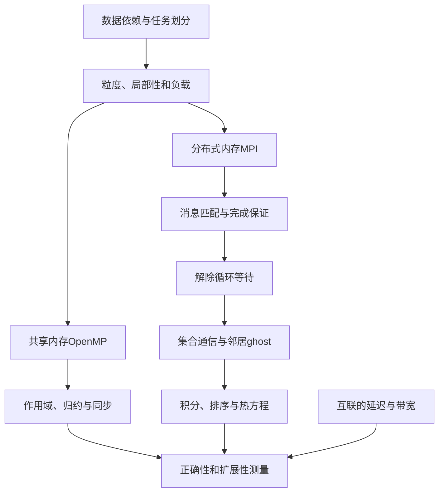

# 并行与分布式计算

## 课程知识路线（2026-11-08提炼）

以下是本次来源支持的阅读依赖与应用路线，不表示读者已掌握。资料缺失、课程通知和未完整承接段落仍保留待审。

### 硬件与性能模型

- [[01_Knowledge/存储程序与计算节点]]
- [[01_Knowledge/并行计算的任务粒度与开销]]
- [[01_Knowledge/Amdahl与Gustafson加速定律]]
- [[01_Knowledge/并行程序性能测量与可扩展性]]
- [[01_Knowledge/延迟带宽通信成本模型]]
- [[01_Knowledge/互联网络的拓扑指标]]
- [[01_Knowledge/网孔环绕网与超立方体拓扑]]
- [[01_Knowledge/网络嵌入与膨胀]]
- [[01_Knowledge/总线交叉开关与Omega网络]]
- [[01_Knowledge/RDMA与高性能互联的作用]]
- [[01_Knowledge/Flynn分类与共享分布式内存模型]]
- [[01_Knowledge/缓存局部性与NUMA访问]]
- [[01_Knowledge/并行算法的数据依赖判定]]
- [[01_Knowledge/进程线程与硬件执行单元]]

### 开发环境与OpenMP

- [[01_Knowledge/Linux终端文件文本与脚本工作流]]
- [[01_Knowledge/C命令行参数的解析校验]]
- [[01_Knowledge/OpenMP的Fork-Join与数据作用域]]
- [[01_Knowledge/OpenMP循环分工与归约]]
- [[01_Knowledge/OpenMP同步结构的选择]]
- [[01_Knowledge/并行浮点归约的误差核验]]
- [[01_Knowledge/Makefile依赖目标与自动变量]]
- [[01_Knowledge/Git分支与SSH协作流程]]

### MPI与数值应用

- [[01_Knowledge/MPI通信器rank与程序生命周期]]
- [[01_Knowledge/MPI点对点消息匹配与接收容量]]
- [[01_Knowledge/MPI阻塞完成与死锁的等待依赖]]
- [[01_Knowledge/MPI双向交换与非阻塞缓冲区纪律]]
- [[01_Knowledge/MPI环形令牌协议的更新计数]]
- [[01_Knowledge/MPI连续均衡分块与局部和汇总]]
- [[01_Knowledge/复合中点积分的分层数值验证]]
- [[01_Knowledge/CMake构建CTest与故障注入验证]]
- [[01_Knowledge/MPI集合通信的数据效果与参与顺序]]
- [[01_Knowledge/MPI邻居交换与ghost数据]]
- [[01_Knowledge/每进程单值的奇偶交换排序]]
- [[01_Knowledge/MPI多进程断点调试]]
- [[01_Knowledge/热方程显式中心差分更新法]]

热扩散模型与解析模态另复用 [[01_Knowledge/热传导方程与Fourier热流定律]] 与 [[01_Knowledge/有限区间波动与热方程的模态求解]]；该课程以通信和离散实现为应用切入。

### 真实来源入口

- [[03_Sources/Courses/并行与分布式计算/课堂笔记/2026-08-31-第1节-计算科学演进与高性能计算导论]]
- [[03_Sources/Courses/并行与分布式计算/课堂笔记/2026-09-02-第2节-高性能计算应用与系统架构导论]]
- [[03_Sources/Courses/并行与分布式计算/课堂笔记/2026-09-07-第3节-并行计算机互联网络]]
- [[03_Sources/Courses/并行与分布式计算/课堂笔记/2026-09-09-第4节-并行计算与超算架构授课]]
- [[03_Sources/Courses/并行与分布式计算/课堂笔记/2026-09-14-第5节-并行计算性能评测讲座]]
- [[03_Sources/Courses/并行与分布式计算/课堂笔记/2026-09-16-第6节-并行计算与Linux基础讲座]]
- [[03_Sources/Courses/并行与分布式计算/课堂笔记/2026-09-21-第7节-Linux命令与OpenMP并行编程教学]]
- [[03_Sources/Courses/并行与分布式计算/课堂笔记/2026-09-23-第8节-OpenMP并行计算编程教学]]
- [[03_Sources/Courses/并行与分布式计算/课堂笔记/2026-09-28-第9节-缺少逐字稿]]
- [[03_Sources/Courses/并行与分布式计算/课堂笔记/2026-09-30-第10节-OpenMP并行编程培训]]
- [[03_Sources/Courses/并行与分布式计算/课堂笔记/2026-10-10-第11节-OpenMP并行编程与作业布置课程]]
- [[03_Sources/Courses/并行与分布式计算/课堂笔记/2026-10-12-第12节-MPI并行计算与Git版本控制课程宣讲]]
- [[03_Sources/Courses/并行与分布式计算/课堂笔记/2026-10-14-第13节-Git与MPI编程教学]]
- [[03_Sources/Courses/并行与分布式计算/课堂笔记/2026-10-19-第14节-MPI通信与并行计算培训]]
- [[03_Sources/Courses/并行与分布式计算/课堂笔记/2026-10-21-第15节-MPI并行计算与死锁课程]]
- [[03_Sources/Courses/并行与分布式计算/课堂笔记/2026-10-26-第16节-MPI集合通信与CMake编译教学]]
- [[03_Sources/Courses/并行与分布式计算/课堂笔记/2026-10-28-第17节-MPI并行计算与热扩散方程课程]]
- [[03_Sources/Courses/并行与分布式计算/课堂笔记/2026-11-02-第18节-热方程求解与调试培训]]

<!-- v2-generated:start -->
## 主题知识

动态汇集自身及全部下层主题的原子知识，每篇笔记显示一次。新增原子自动出现；主题层级变化后运行 views 更新递归范围。

![[99_System/knowledge/v2/generated/topics/1f56856dfcd3.base]]
<!-- v2-generated:end -->
