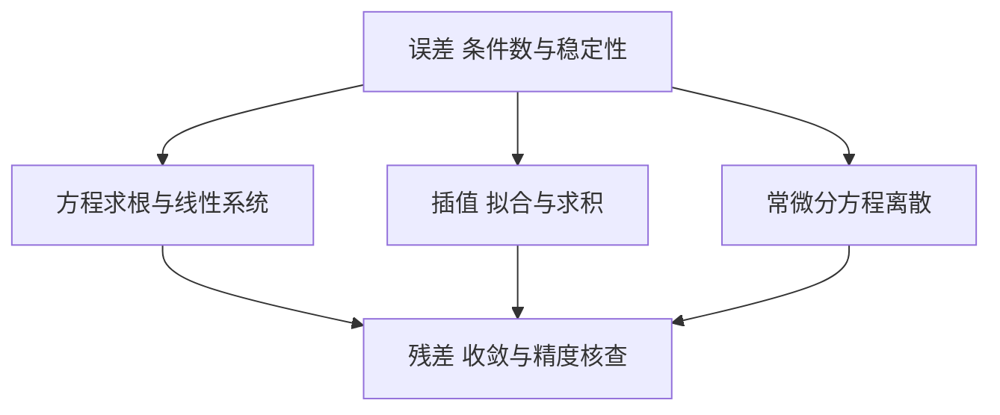

# 数值分析

先分清问题条件数与算法稳定性，再选离散形式、迭代及误差检验。

## 原子笔记入口

### 概念与边界

- [[01_Knowledge/数值稳定性]]
- [[01_Knowledge/范数]]
- [[01_Knowledge/QR分解]]

### 条件与结论

- [[01_Knowledge/收敛阶定理]]
- [[01_Knowledge/隐式中点法的A稳定性]]

### 解题与检查方法

- [[01_Knowledge/不动点迭代]]
- [[01_Knowledge/牛顿法]]
- [[01_Knowledge/条件数误差分析流程]]
- [[01_Knowledge/LU分解(Doolittle)]]
- [[01_Knowledge/Crout分解与三角方程求解]]
- [[01_Knowledge/线性定常迭代法的收敛性判别]]
- [[01_Knowledge/Cholesky分解]]
- [[01_Knowledge/A共轭方向的构造与精确搜索]]
- [[01_Knowledge/幂法]]
- [[01_Knowledge/逆幂法与位移法]]
- [[01_Knowledge/LagrangeNewton插值构造流程]]
- [[01_Knowledge/三次样条插值]]
- [[01_Knowledge/最小二乘法(法方程)]]
- [[01_Knowledge/线性最小二乘拟合的法方程与QR选择]]
- [[01_Knowledge/复化求积法]]
- [[01_Knowledge/Romberg外推]]
- [[01_Knowledge/Gauss求积]]
- [[01_Knowledge/EulerRK迭代流程]]
- [[01_Knowledge/Runge-Kutta方法]]
- [[01_Knowledge/线性多步法(Adams)]]
- [[01_Knowledge/线性多步法的泰勒阶条件核验]]
- [[01_Knowledge/梯度下降法]]

## 2026-11-08归档状态

本次处理原子归档，未据此判断学习掌握。具体已归档、数学错误/题设待核及资料缺失请看本周检查报告。历史来源与新附勘误并存时优先阅读标明日期的核查段，不把原错式当成已验证结论。

<!-- v2-generated:start -->
## 主题知识

动态汇集自身及全部下层主题的原子知识，每篇笔记显示一次。新增原子自动出现；主题层级变化后运行 views 更新递归范围。

![[99_System/knowledge/v2/generated/topics/a2e354ee8d2a.base]]
<!-- v2-generated:end -->
