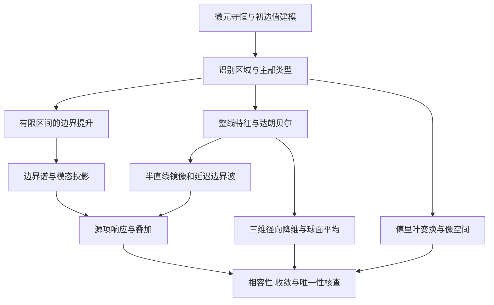

# 数学物理方程

## 从模型到解的路线

1. 建模：[[01_Knowledge/弦与弹性杆的微元振动建模]]、[[01_Knowledge/热传导方程与Fourier热流定律]]、[[01_Knowledge/Dirichlet-Neumann-Robin边界条件]]、[[01_Knowledge/Dirac分布与集中冲量初速度]]。
2. 有限区间：[[01_Knowledge/非齐次边界的提升与初值同步修正]] → [[01_Knowledge/一维区间四种齐次端点的特征谱]] → [[01_Knowledge/有限区间波动与热方程的模态求解]]。非齐次项分别用 [[01_Knowledge/静态特解与瞬态分解]] 或 [[01_Knowledge/波动方程的Duhamel时间叠加]]。
3. 无界与半无界：[[01_Knowledge/二阶PDE的特征坐标化简与初值求解]]、[[01_Knowledge/达朗贝尔公式]]、[[01_Knowledge/半直线波动方程的奇偶延拓法]]、[[01_Knowledge/半直线波动方程的延迟边界波]]、[[01_Knowledge/三维径向波动方程的乘半径降维]]。
4. 理论核查：[[01_Knowledge/定解问题的适定性]]、[[01_Knowledge/分离变量形式级数的经典解核查]]、[[01_Knowledge/波动方程唯一性的能量法]]、[[01_Knowledge/齐次热方程最大值原理与数据稳定性]]。
5. 本周进入积分变换：[[01_Knowledge/Fourier变换]] → [[01_Knowledge/傅里叶级数与傅里叶积分的中点收敛]] → [[01_Knowledge/积分变换解偏微分方程的核查流程]]。球面平均仅按已确认讲授范围见 [[01_Knowledge/球面平均]]。

## 2026-11-08 周检查

本周作业11月2日、11月6日的镜像/边界波/源项叠加已原子化。11月6日课堂的积分变换主线已提炼，但录音缺段、§4.4习题编号及检测题仍待补；11月4日考试资料缺失，不能据后课补造。10月9日作业的Robin参数符号需核实。相容性失败可描述理想化弱解，不自动视为算错；必须明确解的意义。

复习顺序：先独立核对题设及边界类型，再选方法，最后检查原方程、所有数据和正则性；具体长例题从原子 source 回到作业。

<!-- v2-generated:start -->
## 主题知识

动态汇集自身及全部下层主题的原子知识，每篇笔记显示一次。新增原子自动出现；主题层级变化后运行 views 更新递归范围。

![[99_System/knowledge/v2/generated/topics/62117f909bc6.base]]
<!-- v2-generated:end -->
