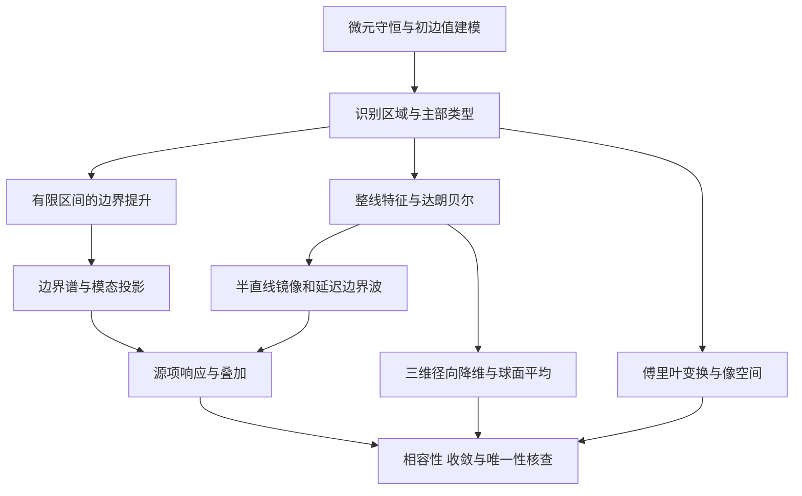
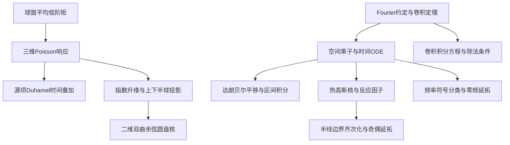
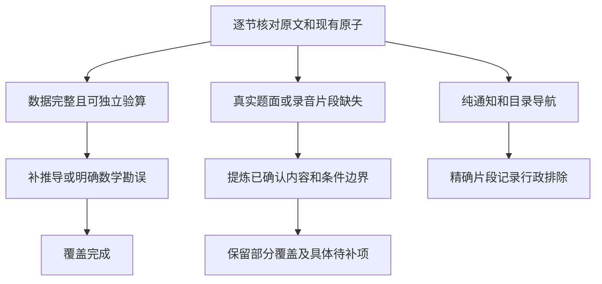

# 数学物理方程

## 从模型到解的路线

1. 建模：[[01_Knowledge/弦与弹性杆的微元振动建模]]、[[01_Knowledge/热传导方程与Fourier热流定律]]、[[01_Knowledge/Dirichlet-Neumann-Robin边界条件]]、[[01_Knowledge/Dirac分布与集中冲量初速度]]。
2. 有限区间：[[01_Knowledge/非齐次边界的提升与初值同步修正]] → [[01_Knowledge/一维区间四种齐次端点的特征谱]] → [[01_Knowledge/有限区间波动与热方程的模态求解]]。非齐次项分别用 [[01_Knowledge/静态特解与瞬态分解]] 或 [[01_Knowledge/波动方程的Duhamel时间叠加]]。
3. 无界与半无界：[[01_Knowledge/二阶PDE的特征坐标化简与初值求解]]、[[01_Knowledge/达朗贝尔公式]]、[[01_Knowledge/半直线波动方程的奇偶延拓法]]、[[01_Knowledge/半直线波动方程的延迟边界波]]、[[01_Knowledge/三维径向波动方程的乘半径降维]]。
4. 理论核查：[[01_Knowledge/定解问题的适定性]]、[[01_Knowledge/分离变量形式级数的经典解核查]]、[[01_Knowledge/波动方程唯一性的能量法]]、[[01_Knowledge/齐次热方程最大值原理与数据稳定性]]。
5. 本周进入积分变换：[[01_Knowledge/Fourier变换]] → [[01_Knowledge/傅里叶级数与傅里叶积分的中点收敛]] → [[01_Knowledge/积分变换解偏微分方程的核查流程]]。球面平均仅按已确认讲授范围见 [[01_Knowledge/球面平均]]。

## 2026-11-08 周检查

本周作业11月2日、11月6日的镜像/边界波/源项叠加已原子化。11月6日课堂的积分变换主线已提炼，但录音缺段、§4.4习题编号及检测题仍待补；11月4日考试资料缺失，不能据后课补造。10月9日作业的Robin参数符号需核实。相容性失败可描述理想化弱解，不自动视为算错；必须明确解的意义。

复习顺序：先独立核对题设及边界类型，再选方法，最后检查原方程、所有数据和正则性；具体长例题从原子 source 回到作业。

<!-- v2-generated:start -->
## 主题知识

动态汇集自身及全部下层主题的原子知识，每篇笔记显示一次。新增原子自动出现；主题层级变化后运行 views 更新递归范围。

![[99_System/knowledge/v2/generated/topics/62117f909bc6.base]]
<!-- v2-generated:end -->

## 特殊时间项的方法补充

[[01_Knowledge/指数换元消去时间一阶项]]先消去阻尼项，随后仍需核查反应项及初边值，再进入模态求解。

## 课堂笔记提炼状态（2026-11-09复核）

`status`表示原子归档，`polish_status`表示课堂笔记润色。这12篇已有原子记录，其中7篇完成归档、5篇仍有题式或覆盖缺口。来源冲突按原记录保留，通知和提交安排不再列为待用户审查。

| 课堂日期 | polish_status | 原子数 | status | 当前原因 |
|---|---|---|---|---|
| [[03_Sources/Courses/数学物理方程/课堂笔记/2026-09-16-第1节-数理方程课程导论与基础知识回顾\|2026-09-16]] | done | 4 | done | 已有真实原子及来源覆盖记录；通知、导航等经明确授权排除。 |
| [[03_Sources/Courses/数学物理方程/课堂笔记/2026-09-18-第2节-偏微分方程课程讲授\|2026-09-18]] | done | 5 | done | 已有真实原子及来源覆盖记录；通知、导航等经明确授权排除。 |
| [[03_Sources/Courses/数学物理方程/课堂笔记/2026-09-23-第3节-二阶PDE化简与理论授课\|2026-09-23]] | done | 4 | not done | 原笔记例题仍有未可靠转写的系数；已提炼分类和换元方法，剩余题式待从原记录恢复。 |
| [[03_Sources/Courses/数学物理方程/课堂笔记/2026-09-30-第4节-偏微分方程原理与解法授课\|2026-09-30]] | done | 6 | done | 已有真实原子及来源覆盖记录；通知、导航等经明确授权排除。 |
| [[03_Sources/Courses/数学物理方程/课堂笔记/2026-10-09-第5节-偏微分方程分离变量法授课\|2026-10-09]] | done | 5 | done | 已有真实原子及来源覆盖记录；通知、导航等经明确授权排除。 |
| [[03_Sources/Courses/数学物理方程/课堂笔记/2026-10-10-第6节-偏微分方程解法课程\|2026-10-10]] | done | 4 | done | 已有真实原子及来源覆盖记录；通知、导航等经明确授权排除。 |
| [[03_Sources/Courses/数学物理方程/课堂笔记/2026-10-14-第7节-偏微分方程期中复习与考试安排\|2026-10-14]] | done | 6 | done | 已有真实原子及来源覆盖记录；通知、导航等经明确授权排除。 |
| [[03_Sources/Courses/数学物理方程/课堂笔记/2026-10-21-第8节-偏微分方程非齐次边界条件授课\|2026-10-21]] | done | 4 | not done | 最后例题仅有条件性方程和不完整初值。按各自原记录保留课堂与个人小测，不拼成同一道题；仍须补齐可验证的题式。 |
| [[03_Sources/Courses/数学物理方程/课堂笔记/2026-10-23-第9节-偏微分方程初值问题授课\|2026-10-23]] | done | 5 | not done | 两个例题缺初速度或完整题设，无穷远条件的适用范围尚待核查。 |
| [[03_Sources/Courses/数学物理方程/课堂笔记/2026-10-28-第10节-偏微分方程考前复习宣讲\|2026-10-28]] | done | 11 | done | 已有真实原子及来源覆盖记录；通知、导航等经明确授权排除。 |
| [[03_Sources/Courses/数学物理方程/课堂笔记/2026-10-30-第11节-波动方程半无界问题与高维推广课程\|2026-10-30]] | done | 6 | not done | 平方初位移例缺可确认的初速度；未讲的后续内容不计入覆盖。 |
| [[03_Sources/Courses/数学物理方程/课堂笔记/2026-11-06-第13节-积分变换与傅里叶变换课程\|2026-11-06]] | done | 3 | not done | 已提炼傅里叶主线，第四章前式及检测题缺失；仅缺通知或题号不阻塞知识归档。 |

## 球面响应与积分变换的两条路线

三维多项式初值先用 [[01_Knowledge/球面平均]] 的矩计算进入 [[01_Knowledge/三维波动方程的Poisson球面公式]]，源项统一由 [[01_Knowledge/波动方程的Duhamel时间叠加]] 叠加。带正零阶项的二维问题可用 [[01_Knowledge/指数升维与二维波动方程的双曲余弦核]]，并检查上下半球Jacobian与常数数据。

整线变换路线从 [[01_Knowledge/Fourier变换]] 与 [[01_Knowledge/卷积]] 出发，按 [[01_Knowledge/Fourier变换与Plancherel积分计算法]] 统一常数。波动解连接 [[01_Knowledge/达朗贝尔公式]]；扩散解连接 [[01_Knowledge/全线热方程的高斯核与反应因子]]。半线必须由边界选择 [[01_Knowledge/正弦与余弦变换的奇偶延拓]] 及 [[01_Knowledge/半线热方程的镜像核与常数边界齐次化]]。[[01_Knowledge/卷积积分方程的频域求解]] 展示同一乘积规则在积分方程中的使用。

11月9日作业四题的知识覆盖完整。11月11日课堂已提炼现有可确认知识，但分段奇函数精确系数、加入一阶项思考题的完整数据、末段高阶方程完整原题仍待原图或清晰音频；保留未完成归档状态。

## 既有来源覆盖复核：区分可算的条件与真实缺题面

9月21日建模作业的守恒、热流、冲量和相容性已由既有原子覆盖。10月9日Robin题无需人为指定未知符号：[[01_Knowledge/Robin端点特征值的符号检查]]给出任意实参数的正、零、负谱及阈值。9月23日完整重特征原式可独立用[[01_Knowledge/二阶PDE的特征坐标化简与初值求解]]验算局部标准型，不能把教师中间转写缺失等同于原方程不可求。

10月21日、10月23日、10月30日、11月6日仍各有真实课堂题面或录制缺口。已知例子、自测与公式表已映射原子；条件性推导不作为缺题面已经恢复的证据。11月6日作业编号的行政歧义已有11月9日用户明确记录可参照，但不因此补造缺失检测题。

