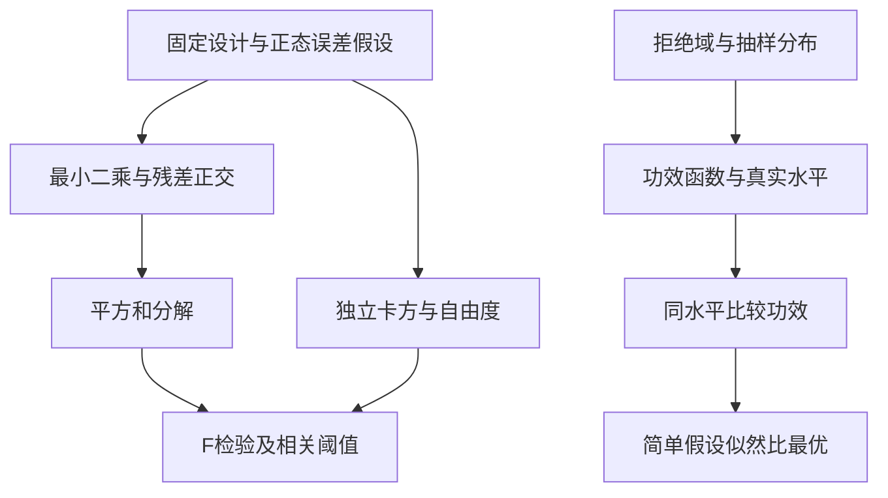
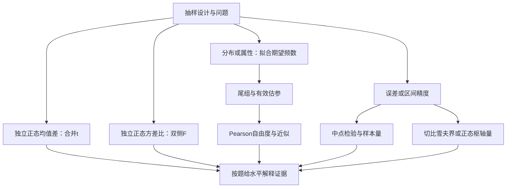
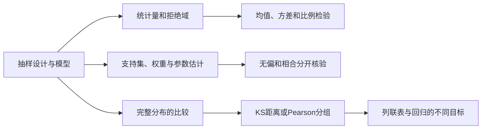

# 数理统计

学科与主题导航。

<!-- v2-generated:start -->
## 主题知识

动态汇集自身及全部下层主题的原子知识，每篇笔记显示一次。新增原子自动出现；主题层级变化后运行 views 更新递归范围。

![[99_System/knowledge/v2/generated/topics/030f9c517f56.base]]
<!-- v2-generated:end -->

## 2026-11-08 新增主线：回归与最佳检验

[[01_Knowledge/一元正态线性回归模型]] → [[01_Knowledge/一元回归最小二乘估计]] → [[01_Knowledge/一元回归平方和分解]] → [[01_Knowledge/正态一元回归估计量的抽样分布]] → [[01_Knowledge/一元回归斜率的F检验与相关系数检验]]。

检验比较以 [[01_Knowledge/检验的功效函数与真实水平]] 为基础；[[01_Knowledge/已知方差正态均值右侧检验的功效]] 是具体例子；[[01_Knowledge/简单假设的奈曼皮尔逊似然比准则]] 解决简单备择的功效最优问题。零相关不能排除非线性关系，回归显著性也不等于模型选择已完成。

11月5日已完成知识提炼并标status:done；课程预告、作业安排和来源说明按用户规则排除。11月3日完整录音缺失，后课回顾只能恢复明确部分。归档完成不等于已经掌握。

## 回归方法的适用边界（2026-11-09补充）

[[01_Knowledge/自变量变换的线性化回归]]说明怎样把 $a+b/x$ 改写为线性参数模型；[[01_Knowledge/线性回归用作二分类器的边界]]区分阈值分类、概率建模和回归显著性。

## 2026-11-15 贝叶斯主线

[[01_Knowledge/贝叶斯参数模型与后验更新]]明确总体、先验与样本层次；[[01_Knowledge/条件独立样本的边缘依赖]]避免误用独立性；[[01_Knowledge/Beta伯努利共轭更新与收缩估计]]提供计算实例。再由 [[01_Knowledge/统计决策的损失与三类风险]] 到 [[01_Knowledge/平方损失下后验均值的最优性]]选择决策。11月10日完整内容已承接；11月12日仅有开头片段，保持整课未完成。

## 2026-11-15 假设检验作业与期末检查链

[[03_Sources/Courses/数理统计/作业/11.14数理统计|11.14作业]]的12题已按知识职责归档。先判断独立、配对与分布模型，再定原假设下统计量，最后解释不拒绝的含义。以下是复习路线，不把做过一次题当作已经掌握。

- 第1、7题 → [[01_Knowledge/独立同方差正态双样本的合并t检验]]；第2、18题 → [[01_Knowledge/独立正态双样本方差的双侧F检验]]。独立样本不因表格等长而配对，双侧水平必须分给两个尾部。
- 第3、4、5题 → [[01_Knowledge/Pearson拟合检验的分组与自由度]]；泊松尾组和估参精度 → [[01_Knowledge/泊松拟合的尾组概率与分组似然校准]]。第8题 → [[01_Knowledge/列联表独立性的边际拟合与卡方检验]]。
- 第9、10题 → [[01_Knowledge/固定两正态均值的中点检验与一致性]]、[[01_Knowledge/检验的功效函数与真实水平]]。第14、15题 → [[01_Knowledge/切比雪夫不等式法]]、[[01_Knowledge/已知方差正态均值区间的长度与样本量设计]]。

## 2026-11-15 检验课程的补充覆盖

第12节已完整归档；第13、15、16节已归档可核实知识，原始数据缺口保持not done，不把新编自测当作找回教师原题。

[[01_Knowledge/假设检验的构造与证据解释]]串起统计判断；均值、方差、比例分别进入 [[01_Knowledge/正态总体均值的标准化检验]]、[[01_Knowledge/配对差值的t检验]]、[[01_Knowledge/正态单总体方差的卡方检验]]、[[01_Knowledge/二项比例的正态近似检验]]。讲评中的估计链由 [[01_Knowledge/加权线性估计的无偏与相合条件]]、[[01_Knowledge/平移指数模型的位置参数估计]]、[[01_Knowledge/正态样本均值方差的MLE与无偏修正]]、[[01_Knowledge/频数线性无偏估计的系数比较法]]承接；[[01_Knowledge/经验分布函数与KS距离]]与Pearson比较全分布的两条路线。

