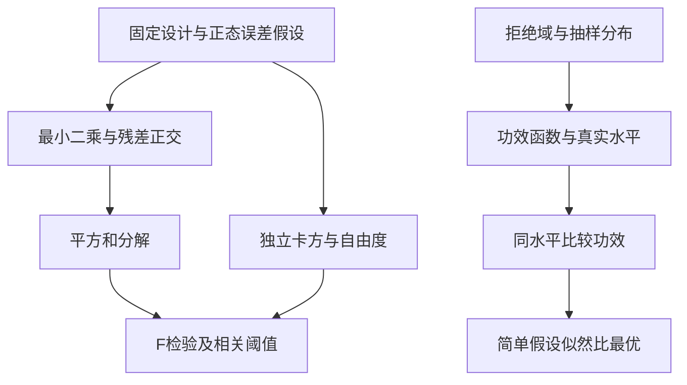

# 数理统计

学科与主题导航。

<!-- v2-generated:start -->
## 主题知识

动态汇集自身及全部下层主题的原子知识，每篇笔记显示一次。新增原子自动出现；主题层级变化后运行 views 更新递归范围。

![[99_System/knowledge/v2/generated/topics/030f9c517f56.base]]
<!-- v2-generated:end -->

## 2026-11-08 新增主线：回归与最佳检验

[[01_Knowledge/一元正态线性回归模型]] → [[01_Knowledge/一元回归最小二乘估计]] → [[01_Knowledge/一元回归平方和分解]] → [[01_Knowledge/正态一元回归估计量的抽样分布]] → [[01_Knowledge/一元回归斜率的F检验与相关系数检验]]。

检验比较以 [[01_Knowledge/检验的功效函数与真实水平]] 为基础；[[01_Knowledge/已知方差正态均值右侧检验的功效]] 是具体例子；[[01_Knowledge/简单假设的奈曼皮尔逊似然比准则]] 解决简单备择的功效最优问题。零相关不能排除非线性关系，回归显著性也不等于模型选择已完成。

11月5日教学知识已提炼；课程预告、作业说明等保留待人工审查。11月3日完整录音缺失，后课回顾只能恢复明确部分。归档完成不等于已经掌握。