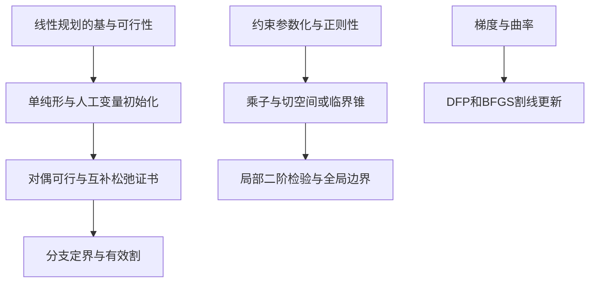

# 最优化

本页是主题归属与阅读导航，原子之间的依赖、讨论对象及使用关系分别由 prerequisites/about/uses/related 表达。

## 人工学习路线

- 几何与条件：[[01_Knowledge/凸集]] → [[01_Knowledge/凸函数]] → [[01_Knowledge/KKT条件]]、[[01_Knowledge/KKT互补松弛]]。
- 无约束步骤：[[01_Knowledge/下降方向]] → [[01_Knowledge/线搜索]] → [[01_Knowledge/Armijo准则]]、[[01_Knowledge/Wolfe准则]] → [[01_Knowledge/回溯线搜索]]。
- 选择算法：[[01_Knowledge/梯度下降法]]、[[01_Knowledge/共轭梯度法]]；一维区间搜索可看 [[01_Knowledge/黄金分割法]]。
- 拓展问题：[[01_Knowledge/对偶]] → [[01_Knowledge/对偶间隙]]；[[01_Knowledge/Pareto最优]] → [[01_Knowledge/Pareto前沿]]。
- 数值实现中的误差与稳定性见 [[02_Maps/MOC-数值计算]]。

箭头表示阅读顺序，数学适用条件以原笔记和来源为准；不代表已经完成数学正确性复核或个人已经掌握。

## 动态主题原子

![[总览/核心知识.base#最优化]]

本视图仅聚合 topics 显式指向本页的 v1 核心原子，排除系统文件；不按目录名自动归属。

<!-- v2-generated:start -->
## 主题知识

动态汇集自身及全部下层主题的原子知识，每篇笔记显示一次。新增原子自动出现；主题层级变化后运行 views 更新递归范围。

![[99_System/knowledge/v2/generated/topics/ae1fb3a11593.base]]
<!-- v2-generated:end -->

## 2026-11-08 线性与约束优化主线

[[01_Knowledge/线性规划的基与基本可行解]] → [[01_Knowledge/单纯形法]]；缺初始基用 [[01_Knowledge/两阶段法与大M初始化]]。[[01_Knowledge/线性规划对偶构造与互补松弛]] 提供最优证书，[[01_Knowledge/从单纯形基恢复对偶解]] 检查表与目标符号。整数问题接 [[01_Knowledge/分支定界法]]、[[01_Knowledge/Gomory分数割平面法]]。

光滑约束问题先看 [[01_Knowledge/等式约束的降维与奇异点检查]]，再用 [[01_Knowledge/等式约束的Lagrange乘子与切空间二阶检验]] 或 [[01_Knowledge/不等式约束二阶条件的临界锥检验]]。不把驻点、局部极值与全局最优混为一谈。无约束方向中，本次补充 [[01_Knowledge/拟牛顿逆更新的DFP与BFGS]]。

本轮最优化后续对偶、外罚、投影与多目标等12份以及前序37份尚未形成可应用提案，保留not done；本页展示已完成提炼的部分。数学错误已列入来源待核项，不以提炼取代修订。
