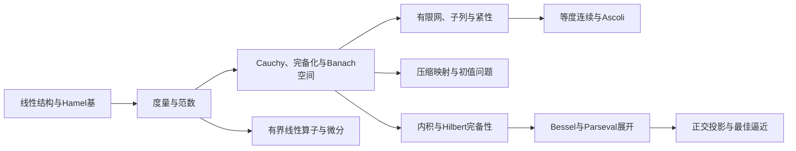
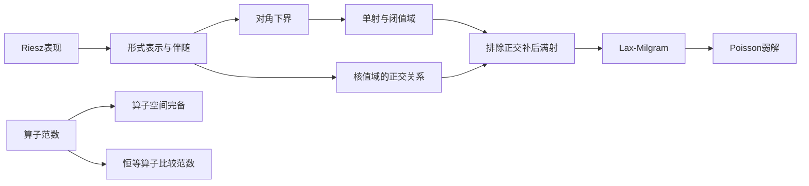
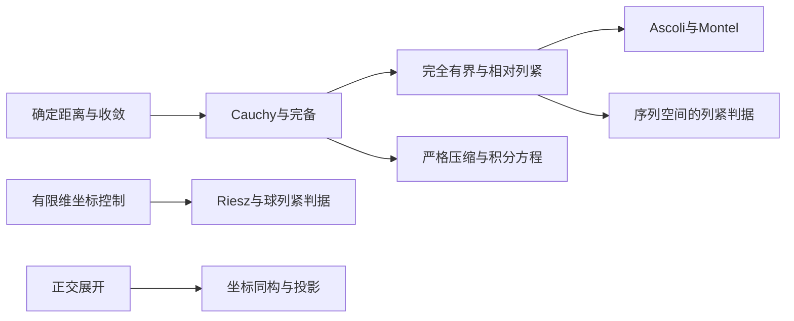

# 泛函分析

## 课程知识路线（2026-11-08提炼）

以下是来源支持的知识依赖与应用路线，不表示已掌握。通知、导航和来源说明不提炼；资料不足按范围规则排除，其余未承接知识属于待完成工作。

### 代数结构与集合工具

- [[01_Knowledge/泛函与算子]]
- [[01_Knowledge/偏序全序与良序]]
- [[01_Knowledge/超限归纳法]]
- [[01_Knowledge/选择公理良序定理与Zorn引理]]
- [[01_Knowledge/线性空间子空间与张成]]
- [[01_Knowledge/直和与唯一分解]]
- [[01_Knowledge/Hamel基扩充的Zorn证明法]]

### 度量完备性与紧性

- [[01_Knowledge/拓扑与距离线性空间]]
- [[01_Knowledge/度量空间]]
- [[01_Knowledge/开集与闭集]]
- [[01_Knowledge/所有序列空间的逐坐标度量]]
- [[01_Knowledge/lp序列空间与包含关系]]
- [[01_Knowledge/L^p空间]]
- [[01_Knowledge/Cauchy序列与完备空间]]
- [[01_Knowledge/连续函数空间完备性的统一估计证明]]
- [[01_Knowledge/Lp空间完备性的子列证明法]]
- [[01_Knowledge/距离空间的Cauchy序列完备化]]
- [[01_Knowledge/完全有界与相对列紧]]
- [[01_Knowledge/完全有界集可分]]
- [[01_Knowledge/度量空间紧性与序列紧性]]
- [[01_Knowledge/嵌套子列的对角线抽取]]
- [[01_Knowledge/等度连续与一致有界函数族]]
- [[01_Knowledge/Arzela-Ascoli定理]]

### 线性算子与微分

- [[01_Knowledge/范数]]
- [[01_Knowledge/有界线性算子连续性的等价判定]]
- [[01_Knowledge/有限维赋范空间的坐标等价]]
- [[01_Knowledge/无穷维单位向量列的非紧性]]
- [[01_Knowledge/微分与切空间对偶基]]
- [[01_Knowledge/Picard迭代证明初值问题局部存在唯一]]
- [[01_Knowledge/Frechet导数]]

### Hilbert几何与逼近

- [[01_Knowledge/内积空间与Hilbert空间]]
- [[01_Knowledge/有限正交分解与Bessel不等式]]
- [[01_Knowledge/内积Schwarz不等式]]
- [[01_Knowledge/Hilbert空间正交基与Parseval等式]]
- [[01_Knowledge/Hilbert闭子空间的正交投影定理]]
- [[01_Knowledge/二次正交补等于线性闭包]]

### 真实来源入口

- [[03_Sources/Courses/泛函分析/课堂笔记/2026-09-15-第1节-泛函分析课程导学]]
- [[03_Sources/Courses/泛函分析/课堂笔记/2026-09-18-第2节-线性空间与拓扑结构课程]]
- [[03_Sources/Courses/泛函分析/课堂笔记/2026-09-22-第3节-数学分析课程讲座]]
- [[03_Sources/Courses/泛函分析/课堂笔记/2026-09-29-第4节-缺少逐字稿]]
- [[03_Sources/Courses/泛函分析/课堂笔记/2026-10-09-第5节-泛函分析空间完备性讲座]]
- [[03_Sources/Courses/泛函分析/课堂笔记/2026-10-13-第6节-泛函分析紧性与等度连续讲座]]
- [[03_Sources/Courses/泛函分析/课堂笔记/2026-10-20-第7节-泛函分析课程授课]]
- [[03_Sources/Courses/泛函分析/课堂笔记/2026-10-23-第8节-泛函分析基础概念讲座]]
- [[03_Sources/Courses/泛函分析/课堂笔记/2026-10-27-第9节-常微分方程与内积空间讲座]]
- [[03_Sources/Courses/泛函分析/课堂笔记/2026-11-03-第11节-希尔伯特空间定理授课]]

<!-- v2-generated:start -->
## 主题知识

动态汇集自身及全部下层主题的原子知识，每篇笔记显示一次。新增原子自动出现；主题层级变化后运行 views 更新递归范围。

![[99_System/knowledge/v2/generated/topics/5c41f7fcd870.base]]
<!-- v2-generated:end -->

## 重建课堂的范围说明（2026-11-09）

9月29日已依据前后课及教材界定Cauchy序列、完备性和连续函数空间证明范围，该重建知识已归档。未恢复的课堂实录、现场例子和作业不被补造；后续 $L^p$ 完备性仍从实际对应来源复习。

## 从Hilbert表示到变分方程（2026-11-10来源提炼）

[[01_Knowledge/Hilbert空间的Riesz表现定理]]以连续泛函为输入，产生内积表示；固定变量后得到[[01_Knowledge/Hilbert空间有界算子的伴随]]和[[01_Knowledge/有界共轭双线性形式的算子表示]]。[[01_Knowledge/伴随算子的运算与范数等式]]控制反序、共轭与范数，[[01_Knowledge/伴随算子的核值域正交关系]]把代数问题转成正交几何。

[[01_Knowledge/算子下界证明单射与闭值域]]说明下界、完备与连续性各自负责的步骤；满射还需排除遗漏方向。[[01_Knowledge/Lax–Milgram定理]]把这些步骤合成变分解的存在唯一性与稳定性，[[01_Knowledge/用Lax–Milgram证明Poisson零边值弱解]]再检查测试空间、右端连续与Poincaré–Friedrichs下界。弱解的存在唯一不直接推出经典正则性。

[[01_Knowledge/范数]]承接一般算子范数定义；[[01_Knowledge/算子范数的上下界与逼近向量法]]用坐标乘子说明上确界可以不达到；[[01_Knowledge/有界线性算子空间的完备性]]区分逐点极限与算子范数极限，并推出连续对偶完备；[[01_Knowledge/有界算子代数与复合范数估计]]在定义域和值域匹配后组织复合；[[01_Knowledge/范数强弱与等价的恒等算子判据]]由恒等映射的双向有界解释等价拓扑。

来源的自测1对应伴随定义，自测2对应下界方法的右移反例，自测3对应乘子范数，自测4对应$c_{00}$上范数不等价。决策与速查内容分别由上述表示、下界、弱解、求范数、算子完备性及范数比较卡承接，不另造重复综合卡。

真实来源：[[03_Sources/Courses/泛函分析/课堂笔记/2026-11-10-第13节-泛函分析与PDE基础讲座]]。本文仅整理该来源明确的教学与整理补足内容，不恢复11月6日缺失课堂或01:35后不可辨认内容。

## 完备性、紧性与算子方法的复核路线（2026-11-15积压提炼）

用[[01_Knowledge/所有序列空间的逐坐标度量]]和[[01_Knowledge/lp序列空间与包含关系]]先确定所用收敛；[[01_Knowledge/Lp空间完备性的子列证明法]]与[[01_Knowledge/距离空间的Cauchy序列完备化]]再解决极限是否留在空间。[[01_Knowledge/Banach空间的绝对收敛级数判据]]以可和差分把完备性和向量级数连接起来。

[[01_Knowledge/完全有界与相对列紧]]通过有限网与分离列连接[[01_Knowledge/度量空间紧性与序列紧性]]。在函数族上配合等度连续得到[[01_Knowledge/Arzela-Ascoli定理]]，解析函数借Cauchy积分公式得到[[01_Knowledge/Montel定理]]；后者来自明确自学线索及教材补足，不计作已完整讲授。

[[01_Knowledge/lp空间相对列紧的统一尾部判据]]需要有界及统一小尾部，[[01_Knowledge/所有序列空间列紧的逐坐标有界判据]]则利用几何权重直接由坐标有界抽子列。[[01_Knowledge/可分性]]中的最终常值逼近处理收敛数列空间，不能误用仅最终为零的近似。

[[01_Knowledge/有限维赋范空间的坐标等价]]给有限维流形闭性和线性算子自动有界；[[01_Knowledge/Riesz引理]]由真闭子空间递归选分离方向，得到[[01_Knowledge/球的相对列紧性刻画有限维]]。这与[[01_Knowledge/无穷维单位向量列的非紧性]]的具体例子相互校验。

[[01_Knowledge/Picard迭代证明初值问题局部存在唯一]]与[[01_Knowledge/用压缩映射求解平方可积核积分方程]]共用完备、自映射、严格压缩三项检查；前者检查矩形不出界，后者检查可测核、L2等价类和参数。[[01_Knowledge/Frechet导数]]连接函数扰动与观测变化，[[01_Knowledge/微分与切空间对偶基]]区分作用对象。[[01_Knowledge/Hilbert空间正交基与Parseval等式]]及[[01_Knowledge/Hilbert闭子空间的正交投影定理]]分别以可数支撑/满射构造和反例明确几何结论的边界。

作业10.27全部14题与课堂新编自测均已按证明中心映射；来源自身的缺失原板书、不可辨认公式及未给出具体模型保留资料边界。课程来源的提炼状态不表示学习掌握。
