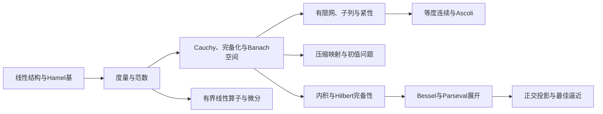

# 泛函分析

## 课程知识路线（2026-11-08提炼）

以下是本次来源支持的阅读依赖与应用路线，不表示读者已掌握。资料缺失、课程通知和未完整承接段落仍保留待审。

### 代数结构与集合工具

- [[01_Knowledge/泛函与算子]]
- [[01_Knowledge/偏序全序与良序]]
- [[01_Knowledge/超限归纳法]]
- [[01_Knowledge/选择公理良序定理与Zorn引理]]
- [[01_Knowledge/线性空间子空间与张成]]
- [[01_Knowledge/直和与唯一分解]]
- [[01_Knowledge/Hamel基扩充的Zorn证明法]]

### 度量完备性与紧性

- [[01_Knowledge/拓扑与距离线性空间]]
- [[01_Knowledge/度量空间]]
- [[01_Knowledge/开集与闭集]]
- [[01_Knowledge/所有序列空间的逐坐标度量]]
- [[01_Knowledge/lp序列空间与包含关系]]
- [[01_Knowledge/L^p空间]]
- [[01_Knowledge/Cauchy序列与完备空间]]
- [[01_Knowledge/连续函数空间完备性的统一估计证明]]
- [[01_Knowledge/Lp空间完备性的子列证明法]]
- [[01_Knowledge/距离空间的Cauchy序列完备化]]
- [[01_Knowledge/完全有界与相对列紧]]
- [[01_Knowledge/完全有界集可分]]
- [[01_Knowledge/度量空间紧性与序列紧性]]
- [[01_Knowledge/嵌套子列的对角线抽取]]
- [[01_Knowledge/等度连续与一致有界函数族]]
- [[01_Knowledge/Arzela-Ascoli定理]]

### 线性算子与微分

- [[01_Knowledge/范数]]
- [[01_Knowledge/有界线性算子连续性的等价判定]]
- [[01_Knowledge/有限维赋范空间的坐标等价]]
- [[01_Knowledge/无穷维单位向量列的非紧性]]
- [[01_Knowledge/微分与切空间对偶基]]
- [[01_Knowledge/Picard迭代证明初值问题局部存在唯一]]
- [[01_Knowledge/Frechet导数]]

### Hilbert几何与逼近

- [[01_Knowledge/内积空间与Hilbert空间]]
- [[01_Knowledge/有限正交分解与Bessel不等式]]
- [[01_Knowledge/内积Schwarz不等式]]
- [[01_Knowledge/Hilbert空间正交基与Parseval等式]]
- [[01_Knowledge/Hilbert闭子空间的正交投影定理]]
- [[01_Knowledge/二次正交补等于线性闭包]]

### 真实来源入口

- [[03_Sources/Courses/泛函分析/课堂笔记/2026-09-15-第1节-泛函分析课程导学]]
- [[03_Sources/Courses/泛函分析/课堂笔记/2026-09-18-第2节-线性空间与拓扑结构课程]]
- [[03_Sources/Courses/泛函分析/课堂笔记/2026-09-22-第3节-数学分析课程讲座]]
- [[03_Sources/Courses/泛函分析/课堂笔记/2026-09-29-第4节-缺少逐字稿]]
- [[03_Sources/Courses/泛函分析/课堂笔记/2026-10-09-第5节-泛函分析空间完备性讲座]]
- [[03_Sources/Courses/泛函分析/课堂笔记/2026-10-13-第6节-泛函分析紧性与等度连续讲座]]
- [[03_Sources/Courses/泛函分析/课堂笔记/2026-10-20-第7节-泛函分析课程授课]]
- [[03_Sources/Courses/泛函分析/课堂笔记/2026-10-23-第8节-泛函分析基础概念讲座]]
- [[03_Sources/Courses/泛函分析/课堂笔记/2026-10-27-第9节-常微分方程与内积空间讲座]]
- [[03_Sources/Courses/泛函分析/课堂笔记/2026-11-03-第11节-希尔伯特空间定理授课]]

<!-- v2-generated:start -->
## 主题知识

动态汇集自身及全部下层主题的原子知识，每篇笔记显示一次。新增原子自动出现；主题层级变化后运行 views 更新递归范围。

![[99_System/knowledge/v2/generated/topics/5c41f7fcd870.base]]
<!-- v2-generated:end -->
