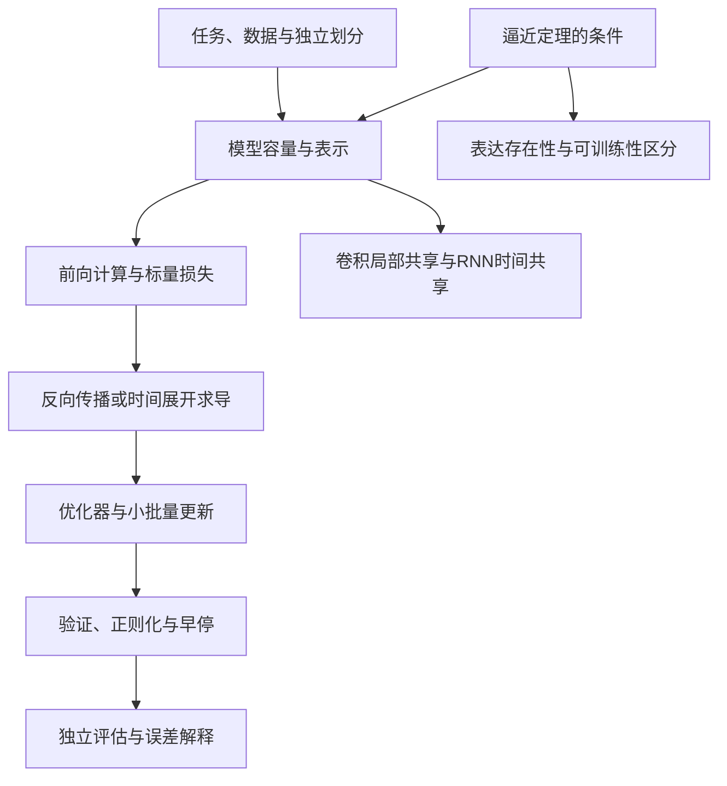

# 深度学习

学科与主题导航。

<!-- v2-generated:start -->
## 主题知识

动态汇集自身及全部下层主题的原子知识，每篇笔记显示一次。新增原子自动出现；主题层级变化后运行 views 更新递归范围。

![[99_System/knowledge/v2/generated/topics/9f7aa0250d82.base]]
<!-- v2-generated:end -->

## 课程知识路线（2026-11-08提炼）

以下是本次来源支持的阅读依赖与应用路线，不表示读者已掌握。资料缺失、课程通知和未完整承接段落仍保留待审。

### 数据模型与评估

- [[01_Knowledge/机器学习的数据模型与经验风险]]
- [[01_Knowledge/模型容量过拟合与独立评估]]
- [[01_Knowledge/多项式回归的设计矩阵构造]]
- [[01_Knowledge/张量形状广播与矩阵运算核对]]
- [[01_Knowledge/球与长方体的均匀采样]]

### 表示与梯度

- [[01_Knowledge/人工神经元与激活函数]]
- [[01_Knowledge/神经网络参数表示的非唯一性]]
- [[01_Knowledge/全连接网络参数量与运算量]]
- [[01_Knowledge/前馈网络反向传播]]
- [[01_Knowledge/标量损失梯度与完整Jacobian的区别]]
- [[01_Knowledge/中心差分梯度校验]]
- [[01_Knowledge/万能近似定理的表达能力边界]]

### 训练与泛化控制

- [[01_Knowledge/梯度下降法]]
- [[01_Knowledge/动量梯度更新]]
- [[01_Knowledge/AdaGrad与RMSProp坐标缩放]]
- [[01_Knowledge/Adam一阶二阶矩更新]]
- [[01_Knowledge/小批量梯度iteration与epoch]]
- [[01_Knowledge/梯度消失与梯度爆炸]]
- [[01_Knowledge/PyTorch前向反传更新的训练循环]]
- [[01_Knowledge/神经网络随机初始化与对称性]]
- [[01_Knowledge/L1与L2显式正则化]]
- [[01_Knowledge/验证集早停]]

### 分类局部结构与序列

- [[01_Knowledge/Softmax概率与交叉熵]]
- [[01_Knowledge/分类标签准确率与预测可视化]]
- [[01_Knowledge/神经网络卷积的互相关与参数共享]]
- [[01_Knowledge/卷积尺寸与平移等变边界]]
- [[01_Knowledge/最大池化]]
- [[01_Knowledge/RNN时间展开与参数共享]]
- [[01_Knowledge/RNN共享参数的多路径求导]]
- [[01_Knowledge/序列预测移位标签与损失归一化]]
- [[01_Knowledge/GRU与LSTM门控状态]]
- [[01_Knowledge/实Stone-Weierstrass定理的应用检查]]

### 真实来源入口

- [[03_Sources/Courses/深度学习/作业/第1-6章-课件与课堂提问汇编作业]]
- [[03_Sources/Courses/深度学习/课堂笔记/2026-08-31-第1节-转写_电子科大王君豪的快速会议]]
- [[03_Sources/Courses/深度学习/课堂笔记/2026-09-02-第2节-机器学习基础概念与模型构建教学]]
- [[03_Sources/Courses/深度学习/课堂笔记/2026-09-07-第3节-机器学习基础与NumPy实操讲座]]
- [[03_Sources/Courses/深度学习/课堂笔记/2026-09-14-第5节-神经网络反向传播算法推导与复杂度分析讲座]]
- [[03_Sources/Courses/深度学习/课堂笔记/2026-09-16-第6节-深度学习优化理论讲座]]
- [[03_Sources/Courses/深度学习/课堂笔记/2026-09-21-第7节-随机优化算法讲解]]
- [[03_Sources/Courses/深度学习/课堂笔记/2026-09-23-第8节-深度学习模型训练与正则化讲座]]
- [[03_Sources/Courses/深度学习/课堂笔记/2026-10-12-第11节-深度学习编程与分类模型宣讲]]
- [[03_Sources/Courses/深度学习/课堂笔记/2026-10-14-第12节-神经网络分类模型代码编写]]
- [[03_Sources/Courses/深度学习/课堂笔记/2026-10-19-第13节-神经网络与卷积网络课程宣讲]]
- [[03_Sources/Courses/深度学习/课堂笔记/2026-11-02-第18节-深度学习理论与RNN原理授课]]
