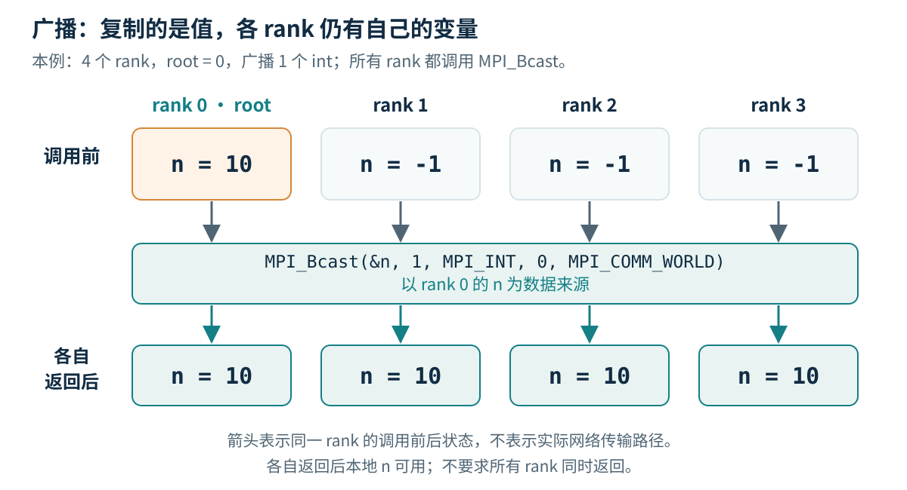
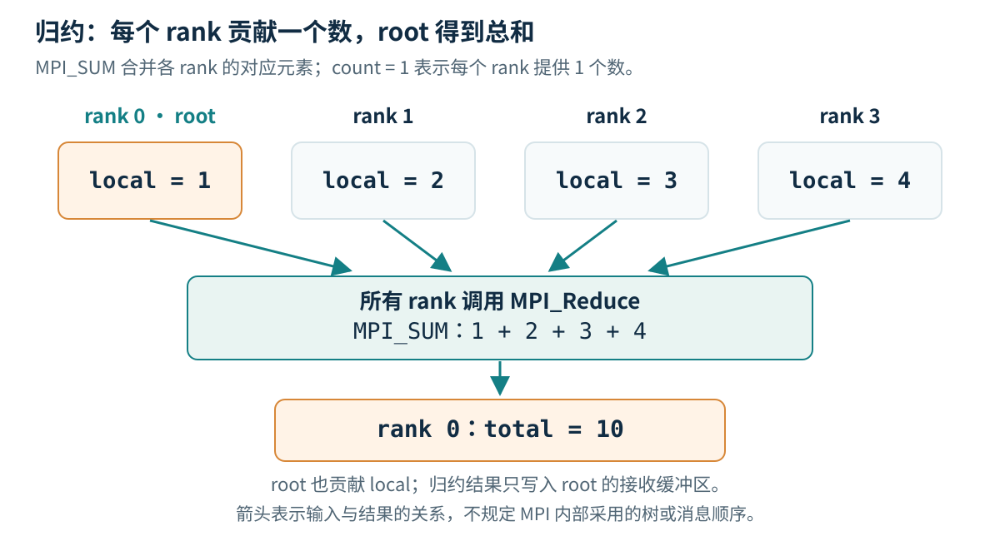
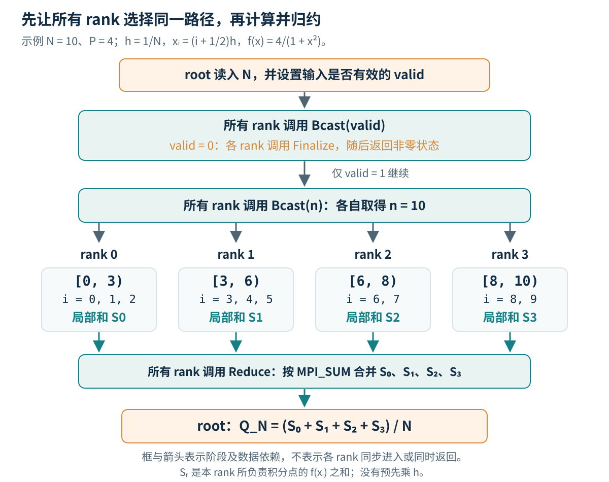

# 第六讲：广播与归约

**用集合通信组织并行数值积分**

第四讲已经把 π 的积分计算分给多个进程，再由 rank 0 逐个接收局部和。第五讲讨论了通信何时完成、为什么调用顺序会造成等待。本讲继续使用同一个数值算法，把两个共同需求直接写出来：**让所有进程得到同一个输入，让根进程得到所有局部结果的和。**

本讲只讨论 `MPI_COMM_WORLD` 这类包含一个进程组的通信器，采用每个进程一个应用线程的程序。示例使用 `MPI_Bcast` 和 `MPI_Reduce` 的阻塞接口。

## 一、先看数据：谁有输入，谁需要结果？

设有 4 个 rank，积分小区间数为 `N=10`：

1. rank 0 读取并检查输入 N。
2. 所有 rank 都需要知道 N，才能确定自己的下标范围及中点位置。
3. 各 rank 计算自己的局部和。
4. rank 0 需要所有局部和相加的结果，才能输出积分近似。

第二步是**广播**（broadcast）：从一个进程提供的值，得到每个进程中的本地副本。第四步是**归约**（reduction，也称规约）：按给定运算合并多个进程的贡献。本讲主要使用求和。

| 操作 | 操作前的数据 | 成功返回后可使用什么 |
|---|---|---|
| `MPI_Bcast` | root 提供输入，其他成员准备接收空间 | 每个调用进程都有该数据的本地副本 |
| `MPI_Reduce` | 每个成员提供自己的输入，root 也参与 | root 的接收缓冲区中有归约结果 |

**root 是当前通信器中的一个 rank。**它在一次操作中负责提供广播数据或接收归约结果，并不是另外创建的进程，也不必永远是 rank 0。一次调用中各成员必须对 root 的取值达成一致。

## 二、MPI_Bcast：将 root 的数据复制给所有成员

### 2.1 从四个本地变量开始

下面片段由每个 rank 执行。假定已经完成 MPI 初始化，并取得 `rank`：

```c
const int root = 0;
int n = (rank == root) ? 10 : -1;
MPI_Bcast(&n, 1, MPI_INT, root, MPI_COMM_WORLD);
printf("rank %d: n=%d\n", rank, n);
```

调用前，rank 0 的 n 是 10，其他 rank 的 n 是 −1。各进程从这次广播成功返回后，自己的 n 都是 10，接下来的打印才会使用这个值。打印行的先后顺序仍不固定。



这里没有把四个 n 变成一个共享变量。广播结束后，rank 2 单独执行 `n = 99`，只会修改 rank 2 的 n；要把这个新值交给其他进程，需要新的通信。`&n` 是本进程变量的地址，各进程不需要传入相同的地址数值。

### 2.2 逐项读懂一次调用

```c
MPI_Bcast(&n, 1, MPI_INT, root, MPI_COMM_WORLD);
```

| 参数 | 本例中的意义 |
|---|---|
| `&n` | root 的输入地址；其他成员用于接收的本地地址 |
| `1` | 本次广播 1 个元素，与进程数无关 |
| `MPI_INT` | 元素类型，与 C 的 `int` 对应 |
| `root` | 本次数据提供者在通信器内的 rank |
| `MPI_COMM_WORLD` | 确定参与者及通信上下文 |

root 先给 n 赋值，然后**root 和其他所有成员都调用同一个 `MPI_Bcast`**。其他成员不另写 `MPI_Recv` 来接这次广播。

本课程用相同的基础类型和元素数匹配广播，例如所有 rank 都写 `1, MPI_INT`。接收空间必须足够；不能因为本机变量更大，就任意改变本次调用的数据类型或元素数。

### 2.3 从函数返回，具体保证了什么？

`MPI_Bcast` 是阻塞调用。本进程从调用成功返回后，可以使用或修改自己的通信缓冲区：非 root 可以读取收到的数据，root 也可以重新使用原来的输入空间。

**这个返回不表示其他进程也已经返回。**它也不为后面的 `printf` 排序。不能把广播当成所有进程在同一时刻集合、再同时继续的屏障。

## 三、MPI_Reduce：把各进程的贡献按运算合并

### 3.1 四个整数的和，结果放在哪里？

先不用积分，直接让 rank 0、1、2、3 分别提供 1、2、3、4：

```c
const int root = 0;
int local = rank + 1;
int total = 0;
MPI_Reduce(&local, &total, 1, MPI_INT, MPI_SUM,
           root, MPI_COMM_WORLD);
if (rank == root) {
    printf("total=%d\n", total);
}
```



四个进程都调用 `MPI_Reduce`，每个进程都提供一个整数。`MPI_SUM` 指定加法，root 得到 `1+2+3+4=10`。rank 0 自己的 1 已经参与这次求和，不能在归约后再加一次。

只有 root 的接收缓冲区被定义为这次调用的归约输出。其他 rank 也在代码中声明 total，是为了使片段一致；不能把它们的 total 当作全局和来读取和报告。初始化 `total=0` 不会使非 root 自动得到结果。

### 3.2 逐项读懂归约调用

```c
MPI_Reduce(&local, &total, 1, MPI_INT, MPI_SUM,
           root, MPI_COMM_WORLD);
```

| 参数 | 本例中的意义 |
|---|---|
| `&local` | 本进程提供的输入 |
| `&total` | root 上存放合并结果的位置；非 root 的此参数不承载归约输出 |
| `1` | 每个进程提供 1 个元素，root 也接收 1 个归约结果 |
| `MPI_INT` | 输入和结果的元素类型 |
| `MPI_SUM` | 指定逐元素相加；它是预定义的 `MPI_Op` 运算句柄 |
| `root`、`comm` | 结果接收者及参与通信的成员 |

参与本次归约的进程采用相同的 `count`、`datatype`、`op`、`root` 和通信器。本例将 local 与 total 放在不同存储空间，不涉及原地归约。

`MPI_Reduce` 的 C 返回值是错误码，求和结果通过 root 的 total 写回，不能用 `total = MPI_Reduce(...)` 来取得总和。`MPI_Bcast` 同样通过缓冲区参数传递数据。

`MPI_SUM` 不会替我们除以进程数。若要算平均值，应在得到总和后，根据数学定义除以相应的数量。`MPI_MAX`、`MPI_MIN` 是求最大值、最小值的预定义运算；运算与数据类型必须是 MPI 支持的组合。

### 3.3 count=2 是两组归约，不是把数组接起来

若各 rank 提供长度为 2 的数组：

| rank | 输入数组 |
|---|---|
| 0 | `[1, 10]` |
| 1 | `[2, 20]` |
| 2 | `[3, 30]` |
| 3 | `[4, 40]` |

使用 `count=2`、`MPI_INT`、`MPI_SUM`，root 得到 `[10,100]`：第 0 个位置相加，第 1 个位置分别相加。root 应准备 2 个整数的接收空间。结果既不是 8 个元素的拼接数组，也不是所有元素再相加得到的单个 110。

### 3.4 阻塞归约的完成效果

从 `MPI_Reduce` 成功返回后，每个进程可以复用自己的输入缓冲区；root 还可以读取完整归约结果。非 root 返回不代表 root 已经返回，root 返回也不保证所有非 root 已走到下一行。

本讲调用本身确认阻塞操作完成，没有产生供应用程序另行等待的 `MPI_Request`，因此不接 `MPI_Wait`。上一讲的 `MPI_Wait` 用于已经发起的非阻塞操作，不能凭空添加一个请求来等待广播或归约。

## 四、集合通信的调用约定

### 4.1 所有成员参与，root 决定角色

下面是**错误片段，用于阅读分析**：

```c
if (rank == 0) {
    MPI_Bcast(&n, 1, MPI_INT, 0, MPI_COMM_WORLD);
}
```

问题在于其他成员没有参加这个集合操作。MPI 不会因此自动让它们跳进函数，也不会用普通的 `MPI_Recv` 补齐这次集合调用。程序违反集合通信约定，不能期待它正常完成。

正确结构是：

```c
if (rank == 0) {
    n = 10;
}
MPI_Bcast(&n, 1, MPI_INT, 0, MPI_COMM_WORLD);
```

条件判断可以控制 root 的赋值或打印；集合调用通常放在所有参与成员都能走到的执行路径上。空任务进程同样是通信器的成员，不能直接跳过归约。

### 4.2 同一通信器中的调用顺序必须一致

本讲 π 程序在正常路径上的顺序为：

```text
每个 rank：Bcast(valid) → Bcast(n) → 本地计算 → Reduce(local_sum)
```

各 rank 可以在不同时间到达这些调用，本地计算时间也可以不同；但不能让一部分 rank 先广播再归约，另一部分先归约再广播。

集合调用没有供程序指定的 `tag`。它们的匹配依靠通信器及集合调用顺序，并遵守相应的参数约定。即使写了两次相同类型的广播，也必须确保各 rank 把第一轮与第一轮、第二轮与第二轮对应起来；不能让不同进程将同一轮理解为不同的数据。

### 4.3 集合通信替我们表达了什么？

第四讲手工写“哪些进程发送、root 从哪些进程接收并相加”。`MPI_Reduce` 直接表达“把这个通信器中每个成员的贡献按指定运算合并”。

MPI 实现可以选择适合通信环境的算法。课堂图中的箭头只表示逻辑上的数据关系，不规定实现必须让 root 逐个直连其他 rank，也不代表实测传输过程。接口更直接，并不构成本例必然更快的证据；性能比较需要相同问题和明确计时条件。

## 五、一个可以完整读完的程序

先运行 [collective_demo.c](../../../../../../%E8%AF%BE%E7%A8%8B/%E5%B9%B6%E8%A1%8C%E4%B8%8E%E5%88%86%E5%B8%83%E5%BC%8F%E8%AE%A1%E7%AE%97/examples/mpi/07_pi_collective/collective_demo.c)，只观察一个整数的广播和各 rank 编号加一后的归约。完整程序如下：

```c
#include <mpi.h>
#include <stdio.h>

int main(int argc, char *argv[])
{
    int rank;
    int size;
    MPI_Init(&argc, &argv);
    MPI_Comm_rank(MPI_COMM_WORLD, &rank);
    MPI_Comm_size(MPI_COMM_WORLD, &size);
    const int root = 0;

    int n = rank == root ? 10 : -1;
    MPI_Bcast(&n, 1, MPI_INT, root, MPI_COMM_WORLD);
    printf("rank=%d/%d n=%d\n", rank, size, n);

    const int local = rank + 1;
    int total = 0;
    MPI_Reduce(&local, &total, 1, MPI_INT, MPI_SUM, root, MPI_COMM_WORLD);
    if (rank == root) {
        printf("root=%d total=%d\n", root, total);
    }
    MPI_Finalize();
    return 0;
}
```

当 P=4 时，四个 rank 的 n 都应为 10，root 报告 total=10；P=1 时，唯一的进程同时是广播输入者和归约结果接收者，total=1。不要从输出行的排列顺序推断集合调用的返回顺序。

## 六、用 Bcast/Reduce 改写 π 计算

### 6.1 保留第四讲的数学问题和分块方式

仍取

$$
f(x)=\frac{4}{1+x^2},\qquad \int_0^1 f(x)\,\mathrm dx=\pi,
$$

并使用复合中点公式

$$
x_i=\frac{i+\tfrac12}{N},\qquad
Q_N=\frac1N\sum_{i=0}^{N-1}f(x_i).
$$

各 rank 处理互不重叠的连续区间 `[begin,end)`。令 $N=qP+s$，其中 $0\le s<P$；前 s 个 rank 各有 q+1 个任务，其余各有 q 个。rank r 的起点为 $rq+\min(r,s)$。

当 N=10、P=4 时：

| rank | 下标区间 | 任务数 | 本地计算 |
|---|---|---|---|
| 0 | `[0,3)` | 3 | $S_0=f(x_0)+f(x_1)+f(x_2)$ |
| 1 | `[3,6)` | 3 | $S_1=f(x_3)+f(x_4)+f(x_5)$ |
| 2 | `[6,8)` | 2 | $S_2=f(x_6)+f(x_7)$ |
| 3 | `[8,10)` | 2 | $S_3=f(x_8)+f(x_9)$ |

每个进程只需共同的 N 和自己的 rank/size，就能计算区间并生成中点；不需要先把所有采样点存成数组再发送。局部和还没有乘区间宽度，最终结果为

$$
Q_N=\frac{S_0+S_1+\cdots+S_{P-1}}{N}.
$$

### 6.2 完整的集合归约计算函数

配套目录为 `examples/mpi/07_pi_collective`。`pi_core.c/h` 保留第四讲的积分、分块和输入检查函数，`pi_mpi.c` 使用下面的实现：

```c
double pi_parallel(int n, MPI_Comm comm)
{
    int rank;
    int size;
    MPI_Comm_rank(comm, &rank);
    MPI_Comm_size(comm, &size);

    const Range range = block_range(n, rank, size);
    const double local_sum = midpoint_sum(n, range.begin, range.end);
    double total_sum = 0.0;
    MPI_Reduce(&local_sum, &total_sum, 1, MPI_DOUBLE, MPI_SUM, 0, comm);

    if (rank == 0) {
        return total_sum / n;
    }
    return 0.0;
}
```

重点对照原来的 Send/Recv 版本：

1. `block_range`、`midpoint_sum` 计算的数学量相同。
2. `MPI_Reduce` 的 `count=1` 表示每个 rank 贡献一个 `double` 局部和；不是每个 rank 只计算一个小区间。
3. `MPI_SUM` 把各局部和相加，包含 rank 0 自己的贡献。
4. 只有 root 使用 total_sum，最后除以 n 一次。

该函数要求所有成员以相同的合法 n 和通信器调用。返回值约定与第四讲相同：root 返回积分近似，其他进程返回 `0.0` 作为本课程函数的约定值，**这个 0 不是 MPI 返回的全局积分结果**。

### 6.3 没有分到任务，为什么还要归约？

当 N=2、P=4 时，四段分别为 `[0,1)`、`[1,2)`、`[2,2)`、`[2,2)`。后两个进程的循环执行零次，局部和自然是 0。

它们仍然执行 `MPI_Reduce`，贡献加法的单位元 0。这样所有通信器成员都参与归约，总和也不受空区间影响。不能用“任务数为 0”作为跳过集合调用的理由。

### 6.4 root 读取输入，其他 rank 怎样知道它是否有效？

程序要求命令行提供 N，范围沿用第四讲：`1 <= N <= 100000000`。只由 root 解析输入，随后先广播验证标志 `valid`。这样其他 rank 才能选择与 root 一致的后续路径。

完整运行入口如下：

```c
#include "pi_core.h"
#include "pi_mpi.h"
#include <math.h>
#include <stdio.h>

int main(int argc, char *argv[])
{
    int rank;
    int size;
    int n = 0;
    int valid = 1;
    MPI_Init(&argc, &argv);
    MPI_Comm_rank(MPI_COMM_WORLD, &rank);
    MPI_Comm_size(MPI_COMM_WORLD, &size);

    if (rank == 0) {
        valid = argc == 2 && parse_intervals(argv[1], &n);
    }
    MPI_Bcast(&valid, 1, MPI_INT, 0, MPI_COMM_WORLD);
    if (!valid) {
        if (rank == 0) {
            fprintf(stderr, "Usage: %s N (decimal integer, 1 <= N <= %d)\n",
                    argv[0], MAX_INTERVALS);
        }
        MPI_Finalize();
        return 1;
    }

    MPI_Bcast(&n, 1, MPI_INT, 0, MPI_COMM_WORLD);
    const double pi = pi_parallel(n, MPI_COMM_WORLD);
    if (rank == 0) {
        printf("N=%d NP=%d pi=%.15f abs_error=%.3e\n",
               n, size, pi, fabs(pi - acos(-1.0)));
    }
    MPI_Finalize();
    return 0;
}
```

为什么不能只让 root 在输入错误时直接退出？因为其他成员可能已经准备等待后面的广播或归约。上面的结构让所有成员先收到相同的 valid：

- 输入无效：各 rank 都调用 `MPI_Finalize`，随后返回非零退出状态；root 打印用法提示。
- 输入有效：所有 rank 继续广播 n，再进入并行积分。



图中各列表示各 rank 的程序顺序。两次广播及归约必须按相同顺序参与，但图中的对齐不表示各 rank 同时到达或同时返回。

### 6.5 同一个数值公式，不要求末位完全一致

归约可能以不同顺序合并局部和，浮点加法的舍入误差可能随分组改变。因此，比较串行、Send/Recv 和 Reduce 版本时，应使用相同 N，并采用有依据的数值容差，不应要求逐位相同。

还要区分两个问题：

| 比较 | 检查什么 |
|---|---|
| 并行 $Q_N$ 与串行 $Q_N$ | 相同离散问题是否被正确分配和汇总 |
| $Q_N$ 与 π 的参考值 | 数值求积近似的误差，包含离散与舍入的影响 |

小规模的独立预期仍然有用：$Q_1=3.2$，$Q_2=1344/425\approx3.16235294117647$。N=1 得到 3.2 是正确实现中点公式的结果，不应判为通信错误。N=10 的结果约为 3.142425985001，最后若干位以实际浮点运行结果为准。

程序输出的 `abs_error` 使用 `fabs(pi - acos(-1.0))` 计算：`acos(-1.0)` 给出本机数学库中的双精度 π 参考值，`fabs` 求绝对差。它用于观察精度，不是为所有 N 自动判定通过或失败的标准。

## 七、在 build 中编译、运行和测试

### 7.1 第一次完整运行

从课程仓库根目录开始，在课程 Linux 环境或已配置 MPI/GoogleTest 的 macOS 终端执行；Windows 同学在课程 Linux 容器终端操作：

```bash
cd examples/mpi/07_pi_collective
mkdir build
cd build
cmake ..
make
mpirun -n 4 ./collective_demo
./pi_serial 10
mpirun -n 4 ./pi_collective 10
ctest
```

已有 build 时直接进入。后续运行命令都以本例的 build 为当前目录；`cmake ..` 读取上一级的 `CMakeLists.txt`，`make` 构建目标，`ctest` 运行已编译的测试。

| 目标 | 用途 |
|---|---|
| `collective_demo` | 一个整数的广播与求和归约 |
| `pi_collective` | 使用广播输入、归约局部和的并行积分 |
| `pi_serial` | 同一中点公式的串行对照 |
| `pi_unit_tests`、`pi_mpi_tests` | 本地函数测试与多进程测试 |

只构建一个演示目标时，在 build 中执行 `make collective_demo` 或 `make pi_collective`，然后再启动程序。准备运行全部测试时先执行 `make`，保证测试程序也已构建。

### 7.2 CMake 沿用上一讲的结构

新增程序仍通过“创建目标、声明依赖”组织。完整构建说明见 [CMakeLists.txt](../../../../../../%E8%AF%BE%E7%A8%8B/%E5%B9%B6%E8%A1%8C%E4%B8%8E%E5%88%86%E5%B8%83%E5%BC%8F%E8%AE%A1%E7%AE%97/examples/mpi/07_pi_collective/CMakeLists.txt)，不需要为普通课堂操作设置额外 CMake 参数。

```cmake
add_executable(collective_demo collective_demo.c)
target_link_libraries(collective_demo PRIVATE MPI::MPI_C)
```

这两行说明 `collective_demo.c` 生成可执行目标 `collective_demo`，并使用 `MPI::MPI_C` 提供的 MPI 编译和链接要求。其他目标按相同思路连接本地计算库或 MPI 计算库。`add_test` 登记测试命令，使学生可以直接运行 `ctest`。

保存源码后，在 build 中重复：

```bash
make
ctest
```

CTest 不会替你重新编译。测试失败时，可在 build 中查看 `Testing/Temporary/LastTest.log`，或运行 `ctest --output-on-failure` 查看失败输出。提交 Git 时保留源码、测试、`CMakeLists.txt` 和实验记录，构建目录保留在本地。

### 7.3 测试覆盖哪些问题？

测试继续使用 GoogleTest。整数和下标检查采用精确比较，浮点结果采用绝对误差容限。MPI 测试中的所有 rank 必须运行同一组用例、保持通信顺序一致，不能让某个进程的提前返回破坏后面的集合调用。

测试应覆盖：

- 广播后所有参与进程取得相同数据，root 可以是通信器中的最后一个 rank。
- root 得到正确的标量或逐元素归约结果；root 自身贡献没有遗漏。
- N 不能被 P 整除，以及 N 小于 P 的划分与积分。
- 手算的小规模中点公式，以及较大 N 下的串并行一致性。
- 某个 rank 出错时，MPI 测试运行器将失败计入整体结果。

具体测试名、用例数和运行入口见配套 [程序详解](../../../../../../%E8%AF%BE%E7%A8%8B/%E5%B9%B6%E8%A1%8C%E4%B8%8E%E5%88%86%E5%B8%83%E5%BC%8F%E8%AE%A1%E7%AE%97/examples/mpi/07_pi_collective/%E7%A8%8B%E5%BA%8F%E8%AF%A6%E8%A7%A3.md)。测试中的绝对容差针对所选规模和算法，不是任意科学计算都可套用的阈值。

## 八、练习与参考答案

以下运行命令均在 `examples/mpi/07_pi_collective/build` 中执行。先运行原程序，再修改、保存、重新编译和验证。

### 练习 A：root 可以换成最后一个 rank 吗？

先预测并运行 `mpirun -n 4 ./collective_demo`。然后在源码 `collective_demo.c` 中，将 `const int root = 0;` 改为 `const int root = size - 1;`。初始化 n、两次集合调用与结果打印都已经使用 root 变量。

```bash
make collective_demo
mpirun -n 4 ./collective_demo
```

预测谁提供 n，哪些 rank 得到 n，谁打印 total。为什么必须让所有 rank 使用同一个 root？

**参考答案：**P=4 时 root=3。rank 3 提供 10，四个 rank 都取得本地 n=10；四个 local 仍为 1、2、3、4，rank 3 打印 total=10。root 是操作角色，不改变 rank 编号或进程数量。各成员的 root 不一致会违反本次集合操作的匹配要求。输出行先后顺序不作为正确性标准。

### 练习 B：两个元素怎样归约？

在 `collective_demo.c` 的标量归约位置，改成下面的完整数组归约与 root 打印片段，保留前面的广播：

```c
int local[2] = {rank + 1, 10 * (rank + 1)};
int total[2] = {0, 0};
MPI_Reduce(local, total, 2, MPI_INT, MPI_SUM,
           root, MPI_COMM_WORLD);
if (rank == root) {
    printf("total=[%d,%d]\n", total[0], total[1]);
}
```

重新编译 demo 并用 4 个进程运行。结果应该是一个数、两个数，还是八个数？

**参考答案：**root 得到两个数 `[10,100]`，对应两组位置上的求和。`count=2` 表示每个进程提供两个元素，root 接收两个归约输出。它没有把数组拼接起来，也不会额外把两个位置相加成 110。若练习 A 保留 root=3，结果在 rank 3；恢复 root=0 后，结果在 rank 0。

### 练习 C：改变进程数，数学问题是否改变？

```bash
./pi_serial 10
mpirun -n 1 ./pi_collective 10
mpirun -n 3 ./pi_collective 10
mpirun -n 4 ./pi_collective 10
mpirun -n 4 ./pi_collective 2
```

先写出 N=2、P=4 的四个区间，再运行。没有任务的 rank 是否可以不执行 Reduce？比较时应使用 π 还是同一个 N 的串行结果？

**参考答案：**前四条命令计算同一个 $Q_{10}$，结果应在浮点容差内一致。最后一条计算 $Q_2=1344/425$；四段为 `[0,1)`、`[1,2)`、`[2,2)`、`[2,2)`。空区间的进程贡献 0，但必须参加归约。检查并行实现时，先与相同 N 的串行结果或该 N 的独立手算值比较。

### 练习 D：输入错误时，谁决定下一步？

阅读 `pi_main.c`：如果删除 `MPI_Bcast(&valid,...)`，只让 root 在错误输入时退出，其他 rank 可能执行到哪里？正确程序中，为什么 valid 和 n 分开广播？

在原始正确代码中运行：

```bash
mpirun -n 4 ./pi_collective 0
mpirun -n 4 ./pi_collective abc
```

**参考答案：**错误写法可能让其他成员继续进入 n 的广播，等待不会再参与这次广播的 root；root 自己也可能停在 `MPI_Finalize`，程序无法正常结束。正确程序先传播 valid，让所有 rank 一致选择退出路径；无效输入不再进入 n 的广播或积分。上述两条命令应打印用法提示并返回非零状态，不能输出一个伪造的正常积分值。MPI 启动器也可能显示进程非零退出的诊断。只分析错误片段，不需要把可能等待不结束的版本直接运行。

### 练习 E：让测试发现一次局部和错误

先运行 `make`、`ctest` 确认原程序通过。在 `pi_mpi.c` 的 `pi_parallel` 中，将 `const double local_sum` 改为 `double local_sum`，在归约前临时加入：

```c
if (rank == 1) {
    local_sum += 1.0;
}
```

保存后回到 build：

```bash
make
ctest --output-on-failure
```

哪些进程数的测试会受影响？积分结果相对原来大了多少？记录失败后删除临时修改、恢复声明，再重新编译和测试。

**参考答案：**P>=2 时存在 rank 1，它使归约总和多了 1，所以积分近似增加 $1/N$；不是增加 1，也不是增加 $1/P$。P=1 没有 rank 1，因此不受这条故障语句影响。相应多进程正确性测试应失败，恢复后应再次通过。放宽容差不能修复这类算法错误。

## 九、小结与下一讲

- **广播：**root 提供数据，所有成员参与，各自得到本地副本。
- **归约：**所有成员提供贡献，按运算逐元素合并，root 取得结果。
- **顺序：**同一通信器的集合调用必须匹配；阻塞返回只给出相应的本地完成保证。
- **算法：**保留数学模型和任务划分，用集合接口替换手工的数据传播与汇总。
- **验证：**相同 N 的串并行比较、独立小算例、不能整除与空任务情况都要考虑。

本讲每个 rank 根据 N 自行生成采样点。下一讲将面对已经存成数组的数据：怎样把不同片段分给不同进程，再收集各自的结果？这将引出 `MPI_Scatter` 和 `MPI_Gather`。

## 参考文献与图示来源

资料核对日期：2026-10-24。下列标准说明与官方接口页用于核对本讲概念；代码使用课程环境已经支持的基础 C 接口。

1. [MPI Forum，MPI 5.0，§7.1 Introduction and Overview](https://www.mpi-forum.org/docs/mpi-5.0/mpi50-report/node116.htm)：集合通信、root、缓冲区完成与同步边界、集合调用没有 tag。
2. [MPI Forum，MPI 5.0，§7.2 Communicator Argument](https://www.mpi-forum.org/docs/mpi-5.0/mpi50-report/node117.htm)：参与进程组与通信上下文；本讲只讨论组内通信器。
3. [MPI Forum，MPI 5.0，Broadcast](https://www.mpi-forum.org/docs/mpi-5.0/mpi50-report/node122.htm)：广播的参与者、参数匹配与数据结果。
4. [Open MPI 5.0.10，MPI_Bcast](https://docs.open-mpi.org/en/v5.0.10/man-openmpi/man3/MPI_Bcast.3.html)：C 接口、root 参与及缓冲区参数。
5. [Open MPI 5.0.10，MPI_Reduce](https://docs.open-mpi.org/en/v5.0.10/man-openmpi/man3/MPI_Reduce.3.html)：归约的 C 接口、root 输出、逐元素运算、预定义操作及浮点次序。
6. [MPI Forum，MPI 5.0，§7.14 Correctness](https://www.mpi-forum.org/docs/mpi-5.0/mpi50-report/node174.htm)：同一通信器内集合调用顺序，以及不能依赖广播的同步副作用。
7. [CMake 3.20，cmake 命令行](https://cmake.org/cmake/help/v3.20/manual/cmake.1.html)：进入独立构建目录后配置并使用 make 构建。
8. [CMake 3.20，add_test](https://cmake.org/cmake/help/v3.20/command/add_test.html)：注册测试命令、可执行目标与测试退出状态。
9. [GoogleTest，Assertions Reference](https://google.github.io/googletest/reference/assertions.html)：整数比较、绝对误差比较以及断言失败的行为。
10. [MPI Forum，MPI 5.0，§7.9.1 Reduce](https://www.mpi-forum.org/docs/mpi-5.0/mpi50-report/node132.htm)：归约的数据角色、逐元素语义及浮点运算次序。
11. [MPI Forum，MPI 5.0，§7.2.1 Specifics for Intra-Communicator Collective Operations](https://www.mpi-forum.org/docs/mpi-5.0/mpi50-report/node118.htm)：组内集合操作需要所有成员参与。
12. [第四讲讲义](../04-%E6%95%B0%E6%8D%AE%E5%88%92%E5%88%86%E4%B8%8E%E5%B9%B6%E8%A1%8C%E6%95%B0%E5%80%BC%E7%A7%AF%E5%88%86/%E8%AE%B2%E4%B9%89.md)、[第四讲程序详解](../../../../../../%E8%AF%BE%E7%A8%8B/%E5%B9%B6%E8%A1%8C%E4%B8%8E%E5%88%86%E5%B8%83%E5%BC%8F%E8%AE%A1%E7%AE%97/examples/mpi/05_pi_send_recv/%E7%A8%8B%E5%BA%8F%E8%AF%A6%E8%A7%A3.md)：中点积分公式、分块推导、小规模手算值及测试基础。
13. [第五讲讲义](../05-%E6%AD%BB%E9%94%81%E4%B8%8E%E9%9D%9E%E9%98%BB%E5%A1%9E%E9%80%9A%E4%BF%A1/%E8%AE%B2%E4%B9%89.md)、[CMake 入门](../../../../../../%E8%AF%BE%E7%A8%8B/%E5%B9%B6%E8%A1%8C%E4%B8%8E%E5%88%86%E5%B8%83%E5%BC%8F%E8%AE%A1%E7%AE%97/docs/cmake-%E5%85%A5%E9%97%A8.md)、[本讲示例与程序详解](../../../../../../%E8%AF%BE%E7%A8%8B/%E5%B9%B6%E8%A1%8C%E4%B8%8E%E5%88%86%E5%B8%83%E5%BC%8F%E8%AE%A1%E7%AE%97/examples/mpi/07_pi_collective/%E7%A8%8B%E5%BA%8F%E8%AF%A6%E8%A7%A3.md)：通信完成、构建流程、实际源码与练习入口。
14. 本课程自绘 `bcast-local-copies.svg`、`reduce-root-result.svg`、`pi-collective-flow.svg`；依据上述 MPI 标准与本课程序绘制。图表示本地数据、调用顺序和逻辑数据关系，不表示固定网络算法、实测耗时或全局同步。
