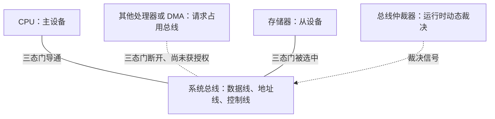

# 并行计算机硬件基础

本讲讨论两个问题：处理器、存储器和输入输出设备如何连接，以及并行计算机如何组织计算和存储资源。学习内容包括系统互连、静态与动态互连网络、标准互连技术、Flynn 分类、并行计算机结构模型和访存模型。

## 1. 计算机组成与系统互连

### 1.1 冯·诺依曼架构与并行计算机组成

冯·诺依曼架构的计算机由五个部分组成：**控制器、运算器、存储器、输入设备和输出设备**。控制器与运算器构成处理器的核心部分，处理器通过存储器取得指令和数据，并与输入输出设备交换信息。

并行计算机在这一基础上组织多个处理单元，主要包含以下要素。

| 要素 | 作用与组织方式 |
| --- | --- |
| 节点（Node） | 包含一个或多个 CPU。节点内部的 CPU 可以通过 HUB 或全互连交叉开关连接并共享内存，也可以直接进行外部 I/O 操作。 |
| 互连网络（Interconnection Network） | 将各节点连接起来，使节点能够通信。 |
| 内存（Memory） | 由多个存储模块组成。存储模块可以与节点分离，分布在互连网络另一侧，也可以放在节点内部。 |

两种内存组织方式如下。

### 1.2 总线与一次存储器读取

**总线（Bus）**是计算机各功能部件之间传送信息的公共通信干线。可以将主板比作城市，将总线比作按固定路线运行、运送比特的公共汽车。

| 总线 | 作用 |
| --- | --- |
| 数据总线（Data Bus） | 在 CPU 与 RAM 等部件之间传送需要处理或存储的数据。 |
| 地址总线（Address Bus） | 指定需要访问的存储单元地址。 |
| 控制总线（Control Bus） | 将控制单元产生的读、写等控制信号传送到有关部件。 |

CPU 从存储器读取数据时，可以分成三个步骤。

1. CPU 通过地址总线发送目标存储单元的地址。
2. CPU 通过控制总线发送读控制信号。
3. 存储器通过数据总线返回指定单元中的数据。

### 1.3 按覆盖范围理解网络

系统内部及系统之间的互连，可以按用途和覆盖范围区分。网络类别不由一个固定的距离阈值决定。

| 类别 | 英文名称 | 范围与用途 |
| --- | --- | --- |
| 系统域网络 SAN | System Area Network | 在系统或数据中心内部连接计算节点，使其组成并行系统。 |
| 局域网 LAN | Local Area Network | 连接建筑物、校园或企业范围内的设备。 |
| 城域网 MAN | Metropolitan Area Network | 连接城市或都市区域内的多个网络。 |
| 广域网 WAN | Wide Area Network | 连接远距离网络，可覆盖全球。 |

局域网技术的例子包括：

- **以太网（Ethernet）**：使用双绞线、光纤等实体介质传输电信号或光信号。
- **光纤分布式数据接口（FDDI）**：使用光纤构成局域网或主干网络。
- **Wi-Fi**：使用 2.4 GHz、5 GHz、6 GHz 等频段的无线电波，在空间中传播信号。

### 1.4 局部总线、I/O 总线、SAN 与 LAN 的层次

局部总线用于连接处理器附近的部件，I/O 总线连接输入输出设备，SAN 连接组成并行系统的节点，LAN 则连接更大范围内的设备或系统。下图比较了这些互连层次在系统中的位置。

## 2. 互连网络的类型与性能指标

### 2.1 静态互连与动态互连

**静态互连网络（Static Interconnection Network）**在处理单元之间设置固定连接。在程序执行期间，点到点链路的连接关系保持不变。典型结构有一维线性阵列、二维网孔、树、超立方、立方环、洗牌交换网络和蝶形网络。

**动态互连网络（Dynamic Interconnection Network）**使用交换开关，根据应用程序的通信要求动态改变连接关系。典型结构有总线、交叉开关和多级互连网络。

理解这一区别时，应区分物理线路与逻辑连接。总线的物理线路固定，但同一时刻由谁占用、哪个设备响应，可以由仲裁和控制机制动态决定。

### 2.2 节点度、网络直径与对剖带宽

| 指标 | 定义 | 对性能与成本的影响 |
| --- | --- | --- |
| 节点度（Node Degree） | 一个节点直接连接的边或链路数。 | 节点度越高，同时通信的通道越多，路由选择越灵活，局部带宽也可能越高。但路由器端口、线缆、功耗和成本增加，扩展更困难。 |
| 网络直径（Network Diameter） | 任意两个节点之间的最短路径长度的最大值，路径长度按经过的边数计算。 | 直径越大，最坏情况下的通信延迟越高，全局同步和广播等操作可能耗时更长。 |
| 对剖宽度（Bisection Width） | 将网络节点分成尽可能相等的两部分时，需要移除的最少边数。 | 表示最窄的全局通信截面上有多少条链路。 |
| 对剖带宽（Bisection Bandwidth） | 最小对剖截面上所有链路每秒可传送的信息总量，以 bit/s 或 byte/s 表示。 | 决定最坏情况下跨越网络两半的通信能力。对剖带宽太小，即使单条链路很快，全局通信也会受限。 |
| 对称性（Symmetry） | 从任意节点观察到的网络结构相同。 | 对称网络中的节点具有相同的拓扑地位。 |

在链路带宽相同的理想情况下，对剖带宽可以由对剖宽度乘以单链路带宽理解。比较网络时，需要同时考虑局部通信能力、全局通信瓶颈和实现成本。

## 3. 静态互连网络

### 3.1 线性阵列与环

一维线性阵列（1-D Linear Array）是最简单的互连方式。每个内部节点只与左右两个近邻相连，两个端点各有一个邻居。

对于 $N\geq3$ 个节点的线性阵列：

- 链路数为 $N-1$。
- 内部节点度为 $2$，端点节点度为 $1$。
- 网络直径为 $N-1$。
- 对剖宽度为 $1$。

将首尾相连，可以构成环，在拓扑上也可以看作循环移位器。环可以是单向或双向的。

| 环的类型 | 网络直径 |
| --- | --- |
| 双向环 | $\left\lfloor N/2 \right\rfloor$ |
| 单向环 | $N-1$ |

对于 $N\geq3$ 的双向环，每个节点度为 $2$，对剖宽度为 $2$。若采用有向图表示单向环，则每个节点的入度和出度分别为 $1$。

### 3.2 二维网孔、Illiac 网孔与二维环绕

令 $N=m^2$，其中 $m$ 为每一行、每一列的节点数。

**二维网孔（2-D Mesh）**将节点排列成 $m\times m$ 网格。内部节点与上下左右四个近邻相连，节点度为 $4$。边界节点的度为 $3$，角节点的度为 $2$。对于 $m\geq2$：

$$
D_{\mathrm{mesh}}=2(m-1),\qquad
E_{\mathrm{mesh}}=2m(m-1).
$$

这里 $D$ 表示网络直径，$E$ 表示链路总数。当 $m$ 为偶数时，可以沿中间一行或一列把网孔分成相等的两半，对剖宽度为：

$$
B_{\mathrm{mesh}}=m.
$$

**Illiac 网孔**在垂直方向设置环绕连接，水平方向按逐行顺序连接，行末连接到下一行的行首，最后一个节点再连回第一个节点。将节点编号为 $0,1,\ldots,N-1$，每个节点 $i$ 与：

$$
i\pm1\pmod N,\qquad i\pm m\pmod N
$$

相连。对于 $m\geq3$，每个节点的度为 $4$，网络直径为 $m-1$，链路总数为 $2N$。由于对所有节点编号同时加上同一个偏移量不会改变连接关系，它是顶点对称的。当 $m$ 为偶数且 $m\geq4$ 时，对剖宽度为 $2m$。

**二维环绕网络（2-D Torus）**在垂直与水平方向都设置各行、各列内部的首尾环绕连接。对于 $m\geq3$，节点度恒为 $4$，主要指标为：

$$
D_{\mathrm{torus}}=2\left\lfloor \frac{m}{2}\right\rfloor,\qquad
E_{\mathrm{torus}}=2N.
$$

当 $m$ 为偶数且 $m\geq4$ 时，对剖宽度为 $2m$。网孔和环绕网络的上述对剖公式均带有偶数边长条件，不能直接用于奇数边长的平衡划分。

### 3.3 二叉树、星形与胖树

二叉树的根最多有两个子节点，其他节点最多连接一个父节点和两个子节点，因此节点度至多为 $3$。任何 $N$ 节点树都有 $N-1$ 条链路。

对于各层均填满的**满二叉树**，若共有 $h\geq2$ 层，并将根计为第一层，则：

$$
N=2^h-1,\qquad
D_{\mathrm{tree}}=2(h-1)=2\bigl(\log_2(N+1)-1\bigr).
$$

切断根与一个子树之间的边，即可把节点分成相差一个节点的两部分，因此满二叉树的对剖宽度为 $1$。一般二叉树的直径和对剖宽度应依据实际树形计算。

如果由一个中心节点连接全部其余节点，则得到**星形网络**。对于 $N\geq3$，中心节点度为 $N-1$，叶节点度为 $1$，网络直径为 $2$，对剖宽度为 $\lfloor N/2\rfloor$。

传统树形网络的主要问题是上层，特别是根附近，容易成为通信瓶颈。**胖树（Fat Tree）**使节点间的通路从叶向根逐渐变宽，用于提高上层的通信能力。

### 3.4 超立方与立方环

一个 $n$ 维超立方（$n$-Cube）包含 $N=2^n$ 个节点。四维超立方可以由两个三维超立方的对应节点相连得到。

对于 $n$ 维超立方：

$$
\text{节点度}=n,\qquad
D=n,\qquad
B=\frac{N}{2},\qquad
E=\frac{nN}{2}.
$$

将 $k$ 维超立方的每个顶点替换成一个 $k$ 节点环，并让环内第 $j$ 个节点承担第 $j$ 维的外部连接，就得到**立方环（Cube-Connected Cycles）**。对于 $k\geq3$，立方环有 $N=k2^k$ 个节点，每个节点度为 $3$。

立方环的直径为：

$$
D_{\mathrm{CCC}}=
\begin{cases}
6, & k=3,\\
2k+\lfloor k/2\rfloor-2, & k\geq4.
\end{cases}
$$

这一结果见 Friš、Havel 与 Liebl 的研究论文 [The Diameter of the Cube-Connected Cycles](https://doi.org/10.1016/S0020-0190(97)00013-6)。

### 3.5 静态网络特性比较

下表按无向图计链路数。“顶点对称”指所有节点具有相同的拓扑地位。二维网络取 $N=m^2$、偶数 $m\geq4$，满二叉树取 $h\geq3$，线性阵列和星形网络取 $N\geq3$。

| 网络名称 | 网络规模 | 节点度 | 网络直径 | 对剖宽度 | 顶点对称 | 链路数 |
| --- | --- | --- | --- | --- | --- | --- |
| 线性阵列 | $N$ | 端点 $1$，内部 $2$ | $N-1$ | $1$ | 否 | $N-1$ |
| 双向环形 | $N\geq3$ | $2$ | $\lfloor N/2\rfloor$ | $2$ | 是 | $N$ |
| 2-D 网孔 | $m\times m$ | 角点 $2$、边界 $3$、内部 $4$ | $2(m-1)$ | $m$ | 否 | $2m(m-1)$ |
| Illiac 网孔 | $m\times m$ | $4$ | $m-1$ | $2m$ | 是 | $2N$ |
| 2-D 环绕 | $m\times m$ | $4$ | $2\lfloor m/2\rfloor$ | $2m$ | 是 | $2N$ |
| 满二叉树 | $N=2^h-1$ | 叶 $1$、根 $2$、其余内节点 $3$ | $2(h-1)$ | $1$ | 否 | $N-1$ |
| 星形 | $N$ | 中心 $N-1$，叶 $1$ | $2$ | $\lfloor N/2\rfloor$ | 否 | $N-1$ |
| $n$ 维超立方 | $N=2^n$ | $n$ | $n$ | $N/2$ | 是 | $nN/2$ |
| $k$ 维立方环 | $N=k2^k$，$k\geq3$ | $3$ | $k=3$ 时为 $6$，$k\geq4$ 时为 $2k+\lfloor k/2\rfloor-2$ | $N/(2k)$ | 是 | $3N/2$ |

### 3.6 网络嵌入与膨胀系数

**嵌入（Embedding）**将客网络 A 的节点映射到宿主网络 B 中，并用宿主网络中的路径实现客网络的边。

- **单条边的膨胀（Dilation）系数**：客网络中一条边在宿主网络中对应的路径长度。
- **整个嵌入的膨胀系数**：所有边的膨胀系数的最大值。
- 膨胀系数为 $1$ 时，称为**完美嵌入**。

环可以沿二维环绕网络的一条闭合路径嵌入。四维超立方也可以借助格雷编码完美嵌入 $4\times4$ 二维环绕网络。该例依赖具体维数和网络规模。超过四维的超立方节点度大于 $4$，无法在节点一一映射的条件下完美嵌入常规二维环绕网络。

二叉树可以采用 **H 树嵌入**在网孔中组织通信。此类布局的某些树边对应多跳路径，膨胀系数取这些路径长度的最大值。

能否完美嵌入，要结合客网络、宿主网络规模和映射约束判断。例如，七节点满二叉树可以将根放在 $(0,0)$，两子节点放在 $(\pm1,0)$，四叶节点放在 $(\pm2,0)$ 和 $(\pm1,1)$，从而使每条树边都对应一条网孔边。

## 4. 动态互连网络

### 4.1 系统总线的动态连接机制

系统总线的线路由设备共享，但**总线仲裁器（Bus Arbiter）**在运行时决定哪一个主设备可以使用总线。在这里讨论的共享总线模型中，同一时刻只允许一对主从设备通信。

下面示意 CPU 获得总线授权、存储器响应而其他主设备等待的状态。

在这一状态中，CPU 获得总线授权，存储器作为选中的从设备响应。其他处理器或 DMA 的三态门保持断开状态。物理上，传输线路固定共享。逻辑上，三态门和仲裁器动态建立当前的主从通信连接，因此总线属于动态互连网络。

### 4.2 交叉开关

**交叉开关（Crossbar Switch）**在输入与输出线路的交叉点设置开关。程序或控制逻辑可以动态控制各交叉点处于开或关的状态，提供任意源、目的对之间的连接。

普通单播连接要求每个输入与每个输出最多参与一条连接，因此同一行、同一列至多接通一个交叉点。只要各通信对不竞争同一输出，交叉开关就能同时建立全部连接，实现任意输入输出置换。

在处理器与存储器互连中，不同处理器可以并行访问不同存储模块；多个请求争用同一单端口存储模块时仍需仲裁。具有广播或多播能力的交叉开关可以将同一输入连接到多个输出，具体取决于硬件和通信协议。

对于规模为 $n$ 的方形交叉开关，交叉点数量为 $n^2$，开关复杂度为：

$$
O(n^2).
$$

较高的实现成本限制了单级全交叉开关在大规模系统中的应用。

### 4.3 多级互连网络与 Ω 网络

将多个小交叉开关按级组织，可以形成**多级互连网络（Multistage Interconnection Network，MIN）**。每一级使用多个 $a\times b$ 开关单元，相邻级之间采用固定级联拓扑。

$2\times2$ 开关可以实现如下四种连接状态。

对于具有 $n$ 个输入和 $n$ 个输出的 **Ω 网络**，当 $n$ 为 $2$ 的幂时：

$$
\text{级数}=\log_2 n,\qquad
\text{每级开关数}=\frac{n}{2},\qquad
\text{开关总数}=\frac{n}{2}\log_2 n.
$$

### 4.4 动态网络的复杂度与带宽比较

设有 $n$ 个单端口处理器，每个网络端口或链路的单方向带宽为 $b$ bit/s。所有带宽均按同一传输方向计算，不将全双工两个方向相加。多级网络使用固定规模的 $k\times k$ 开关，且 $n$ 为 $k$ 的幂。

| 网络特性 | 共享总线 | $n\times n$ 交叉开关 | 多级互连网络 |
| --- | --- | --- | --- |
| 单个处理器可用带宽 | 独占时至多 $b$；$n$ 个处理器持续争用且公平分配时平均约为 $b/n$。 | 输入与输出不冲突时至多 $b$。 | 路径不冲突时至多 $b$；阻塞和竞争会降低可用带宽。 |
| 全系统聚合带宽上限 | $b$ | $nb$，要求同时建立 $n$ 条互不冲突的连接。 | 至多 $nb$；达到此值取决于拓扑、路由与通信模式。 |
| 连接与开关复杂度 | $O(n)$ 个设备接口及其控制。 | $O(n^2)$ 个交叉点。 | 固定 $k$ 下为 $O(n\log_k n)$。 |
| 连线特性 | 每次由一对主从设备占用共享通路。 | 可同时实现任意输入输出置换。 | Ω 等网络可能出现内部路径阻塞。 |

增加端口数量可以提高全系统的聚合带宽，但不改变单端口节点的注入上限。交换网络的实际吞吐量还取决于目的端口竞争、内部阻塞、路由和通信负载。

## 5. 标准互连网络与技术实例

### 5.1 HiPPI、Myrinet 与 FDDI

**高性能并行接口 HiPPI**面向大型机和超级计算机，用作短距离的系统到系统、系统到外设的高速 I/O 通道。HiPPI 通道与交换开关曾用于 SGI Power Challenge、IBM 390、Cray Y-MP、C90 和 T3D/T3E 等系统。

**Myrinet**是 Myricom 公司设计的高速包交换网络，技术基础包括加州理工学院的多计算机与 VLSI 技术，以及南加州大学的 ATOMIC/LAN 技术。它通过全双工点到点链路连接主机和交换机，支持不规则拓扑，用于工作站、服务器及计算机集群的高性能互连。

早期 Myrinet 论文描述的链路由两个单方向 $640$ Mbit/s 通道组成，双向合计为 $1.28$ Gbit/s。比较速率时，应区分单方向通道带宽与双向合计值，并明确产品代际。[Myrinet: A Gigabit-per-Second Local Area Network](https://docs.switzernet.com/people/emin-gabrielyan/060708-thesis-ref/papers/Boden95.pdf)

**FDDI（Fiber Distributed Data Interface，光纤分布式数据接口）**采用光纤令牌环，标准速率为 $100$ Mbit/s。双环主要提供冗余和故障恢复能力，并不自动使单方向吞吐量翻倍。支持全双工扩展的点到点设备可以形成两个同时工作的 $100$ Mbit/s 通道，双向聚合带宽为 $200$ Mbit/s。FDDI 的多模光纤相邻站点距离可达 $2$ km。[Cisco FDDI 技术说明](https://www.cisco.com/c/en/us/tech/lan-switching/fiber-distributed-copper-distributed-data-interface-fddi-cddi/index.html)、[Cisco 全双工 FDDI 说明](https://newsroom.cisco.com/c/r/newsroom/en/us/a/y1997/m04/digital-licenses-fddi-full-duplex-technology-to-cisco.html)

### 5.2 以太网与面向 HPC、AI 的互连

**以太网（Ethernet）**是广泛使用的局域网技术，规定物理层的连线、信号以及介质访问控制协议。速率和传输距离应根据具体 PHY、介质和线缆等级判断。以下为几种经典双绞线 PHY 的对比。[IEEE 双绞线以太网 PHY 对比](https://ieee802.org/3/1TPCESG/public/tazebay_01_0512.pdf)

| PHY 类型 | 单方向数据速率 | 双绞线通道长度 | 典型线缆条件 |
| --- | --- | --- | --- |
| 10BASE-T | 10 Mbit/s | 100 m | 3 类或更高等级。 |
| 100BASE-TX | 100 Mbit/s | 100 m | 5 类或更高等级。 |
| 1000BASE-T | 1 Gbit/s | 100 m | 5e 类或更高等级。 |

光纤以太网采用不同的 PHY 和光模块，不能把双绞线的距离上限直接套用到光纤链路。高速以太网也用于数据中心、HPC 与 AI 集群。

**InfiniBand**是面向高性能计算与 AI 的高速互连技术。它支持 **RDMA（Remote Direct Memory Access，远程直接内存访问）**，可以让服务器之间直接传输内存数据，在建立好通信资源后减少常规操作系统数据通路的参与，从而降低通信延迟和 CPU 开销。

**RoCE（RDMA over Converged Ethernet）**在以太网环境中实现 RDMA 通信能力，应用于 HPC、AI 训练、分布式存储和金融交易等场景。

**Slingshot**采用以太网技术，并针对大规模 HPC 通信进行设计，用于 E 级超级计算机互连。

**NVLink 与 NVSwitch**是 NVIDIA 用于 GPU 之间的高速互连技术，可以将一台服务器或一个机柜内的多块 GPU 连接为一个计算单元。

### 5.3 灵晟超算的“灵启”互连实例

LineShine（灵晟）超算采用“灵启”（Lingqi）互连，以**双平面多轨胖树（Dual-plane Multi-rail Fat Tree）**组织网络。两个网络平面和多条通信轨道提供带宽与冗余，胖树则增加靠近上层的通信能力，以支持大规模节点间通信。该系统体现了计算节点、内存层次、互连和存储之间的协同设计。[LineShine 系统架构论文](https://journal.hep.com.cn/fcs/EN/10.1007/s11704-026-61591-w)

## 6. Flynn 分类

Michael J. Flynn 根据计算机同时处理的**指令流数量**和**数据流数量**，将计算机分为四类。

| 类别 | 全称 | 指令流 | 数据流 | 示例 |
| --- | --- | --- | --- | --- |
| SISD | Single Instruction Stream, Single Data Stream | 单个 | 单个 | 早期单核 CPU，如 Intel 8086。 |
| SIMD | Single Instruction Stream, Multiple Data Streams | 单个 | 多个 | 向量处理器，以及 GPU 的 SIMD 风格执行。 |
| MISD | Multiple Instruction Streams, Single Data Stream | 多个 | 单个 | 极少见，可用于某些特定容错计算设计。 |
| MIMD | Multiple Instruction Streams, Multiple Data Streams | 多个 | 多个 | 现代多核 CPU、超级计算机、分布式集群。 |

现代处理器经常组合多种方式。例如，多核 CPU 在核之间体现 MIMD，各核心内部又可以用 SIMD 指令扩展执行向量运算。GPU 在线程组内部采用共同指令控制的 SIMT 执行方式，而不同线程组可以独立调度。因此，分类时需要明确讨论的是单条执行通路、一个核心，还是整个系统。

## 7. 并行计算机结构模型

### 7.1 并行向量处理机 PVP

**PVP（Parallel Vector Processor）**通过高带宽交叉开关连接向量处理器与内存模块，使各处理器能够访问共享内存。

代表机型包括 Cray X-MP、Cray Y-MP、NEC SX 系列，以及我国的银河一号、银河二号。

银河二号由国防科学技术大学联合国家气象中心于 1992 年 11 月研制，峰值运算速度达到每秒 10 亿次。

### 7.2 对称多处理机 SMP

**SMP（Symmetric Multiprocessor）**通过高速总线或交叉开关，将多个处理器连接到共享存储器。

- 各处理器对共享存储器具有同等的访问权利。
- 各处理器对 I/O 设备与其他系统资源具有同等的访问权利。
- 通常使用相同类型的处理器。
- 集中共享存储器、总线带宽与一致性通信会限制扩展能力，具体处理器规模取决于实现。

代表机型包括 IBM ES/9000、R50、Sun SparcCenter 2000 和曙光一号。

曙光一号于 1993 年 10 月研制成功，是我国的全对称紧耦合共享存储多处理机系统，由中国科学院计算技术研究所国家智能计算机研究开发中心研发。它采用 Motorola M88100 微处理器，支持 16 个 CPU，定点运算速度为每秒 6.4 亿次，最大主存容量为 768 MB。

### 7.3 大规模并行处理机 MPP

**MPP（Massively Parallel Processor）**采用大量处理节点和可扩展互连，通常具有以下特征。

- 处理节点可以使用商品微处理器。
- 存储器在物理上分布于各节点。
- 采用具有高带宽和低延迟的互连网络。
- 可扩展到成百上千乃至更多处理器。
- 各处理单元独立执行，系统整体属于 MIMD。

消息传递型 MPP 的程序由多个进程组成，各进程拥有自己的地址空间，通过消息传递交互。MPP 描述系统的并行规模与组织方式，并不排斥其他存储组织。例如，Cray T3D 属于 MPP，但其存储器物理分布且支持全局寻址和远端内存访问，因此也具有分布共享存储特征。[Cray T3D 原厂硬件参考手册](https://cray-history.net/wp-content/uploads/2021/08/CMM-0602-0A0-Cray-T3D-Hardware-Reference-Manual-Volume-1-of-2.pdf)

代表机型包括 Cray T3D、Intel Paragon、IBM SP2 与曙光 1000。

曙光 1000 于 1995 年研制，采用 32 个计算节点与虫洞路由芯片，峰值运算速度为每秒 25 亿次，内存容量为 1024 MB，配置并行文件系统和 UNIX 操作系统。

### 7.4 分布共享存储 DSM

**DSM（Distributed Shared Memory）**将存储器放在各处理器或节点附近，物理位置分散，但让多个处理器在逻辑上共享地址空间。

DSM 结合了共享地址空间与分布存储，有较好的扩展能力。共享存储方式可以减少程序中显式消息传递的需要，但仍要求程序正确处理同步和数据竞争。

DSM 需要重点处理两个问题：

1. 系统需规定共享存储的一致性模型；采用共享缓存副本时，还需要维持缓存一致性。
2. 访问远端存储器通常慢于访问本地存储器，因此数据位置会影响程序性能。

硬件 DSM 的代表包括 Stanford DASH 和 SGI Origin 2000。Origin 2000 采用基于目录的缓存一致性协议，属于 CC-NUMA 系统。[The SGI Origin: A ccNUMA Highly Scalable Server](https://www.cs.umd.edu/class/fall2019/cmsc714/readings/SGI-Origin-2000.pdf)

### 7.5 工作站机群 COW

**COW（Cluster of Workstations）**将完整的工作站通过成本较低的商业网络连接起来。每个节点有自己的本地磁盘，并运行一个完整的操作系统。

| 优点 | 需要解决的问题 |
| --- | --- |
| 系统开发周期短，用户投资风险较小。 | 减少节点间的通信开销。 |
| 系统价格较低，可以利用已有系统资源。 | 改善并行程序设计环境。 |
| 系统扩展性较好，可以复用现有操作系统与开发工具。 | 充分利用所有节点组成的全局资源。 |

### 7.6 结构的融合与 Shell 节点

DSM 在物理分布的存储器上提供共享地址空间。随着机群采用更快的互连，MPP 与 COW 的界线也逐渐模糊。大量节点通过高速网络互连，每个节点内部组织处理器、缓存、本地存储器、网卡和磁盘。

**Shell 结构**使用定制支持电路，将商品微处理器与节点其他部分连接起来。这些部分包括板级缓存、局部存储器、网络接口 NIC 与磁盘。模块化接口可以减少更换处理器时对节点其他部分的改动，具体升级范围取决于接口兼容性。

## 8. 高速缓存与局部性

### 8.1 内存墙与高速缓存

**内存墙（Memory Wall）**指内存访问速度与处理器执行速度之间的差距造成的性能瓶颈。在处理器与内存之间增加速度较高的**高速缓存（Cache）**，可以减少处理器等待主存的时间。

缓存以**缓存行（Cache Line）**为基本组织和传输单位。主存划分成对应大小的块（Block），数据在内存与缓存之间按整行移动。例如，假定每行包含 $L$ 个元素，每个元素为 $8$ 字节，则一行的大小为：

$$
\text{缓存行大小}=8L\ \text{字节}.
$$

缓存行长度由硬件决定，元素大小由数据类型决定，二者应分别确定。

常见缓存写策略有以下两种。

| 写策略 | 原理 |
| --- | --- |
| 写直达（Write-through） | 缓存中的数据修改后，同时将更新写向对应的下层存储器。 |
| 写回（Write-back） | 先修改缓存行，通常在脏缓存行被替换，或一致性协议要求提供该数据等情况下，再向下层写回。 |

写直达与写回描述数据更新到下层存储器的策略。多个处理器之间的缓存一致性还需要专门的一致性协议。

处理器可以拥有多级缓存。多个处理器与局部内存、网络接口等部件共同组成节点，具体缓存级数和封装方式取决于处理器实现。

### 8.2 缓存命中、命中率与矩阵遍历

一次访存所需的数据已经在缓存中，称为**缓存命中（Cache Hit）**。数据不在缓存中，称为**缓存未命中（Cache Miss）**。

$$
\text{缓存命中率}=\frac{\text{缓存命中次数}}{\text{内存访问总次数}}.
$$

连续使用的数据如果存放在相邻内存位置，读取一条缓存行就可能供后续多次访问使用，从而提高命中率。程序员通常不直接管理缓存，但访问顺序会明显影响性能。

考虑矩阵：

$$
A=\begin{bmatrix}
a_{11} & a_{12} & \cdots & a_{1n}\\
a_{21} & a_{22} & \cdots & a_{2n}\\
\vdots & \vdots & \ddots & \vdots\\
a_{n1} & a_{n2} & \cdots & a_{nn}
\end{bmatrix}.
$$

行遍历依次访问 $a_{i1},a_{i2},\ldots,a_{in}$，列遍历依次访问 $a_{1j},a_{2j},\ldots,a_{nj}$。

对于 C/C++ 等按行连续存储的二维数组，优先按行遍历有利于利用缓存行。按列连续存储的数组，例如 Fortran 的常规数组，则应优先让连续的列内元素成为内层遍历。关键是让实际访问顺序与内存布局相匹配。

## 9. 并行计算机访存模型

### 9.1 均匀存储访问 UMA

**UMA（Uniform Memory Access）**模型让所有处理器共享物理存储器，并使各处理器访问任意存储单元具有相同的访问时间。每个处理器可以拥有私有缓存，外围设备也可以共享。

在这一模型中，还可以根据处理器的系统权限区分两种组织。

- **对称多处理机 SMP**：所有处理器等同地访问 I/O 设备，并能运行操作系统内核、I/O 服务程序及用户程序。
- **非对称多处理机**：由一个或一组主处理器执行操作系统并操纵 I/O，其余从处理器在主处理器监控下执行用户代码。

### 9.2 非均匀存储访问 NUMA

**NUMA（Nonuniform Memory Access）**将共享存储器在物理上分布到不同处理器或节点附近，所有本地存储器共同构成全局地址空间。

处理器访问不同位置的存储器，所需时间不同。

- 访问本地存储器 **LM（Local Memory）**，或群内共享存储器 **CSM（Cluster Shared Memory）**，通常较快。
- 访问远端存储器，或全局共享存储器 **GSM（Global Shared Memory）**，通常较慢。

各处理器仍可拥有私有缓存，外围设备也可以共享。

### 9.3 全缓存存储访问 COMA

**COMA（Cache-Only Memory Access）**将节点主存组织为吸引存储器（Attraction Memory），其作用类似大型缓存，所有节点的吸引存储器共同组成全局地址空间。数据不依赖一个固定的主存归属节点，可以根据访问需求迁移或复制。

- 通过分布式缓存目录 **D（Directory）**定位并访问远端缓存中的数据。
- 吸引存储器使用节点主存容量，区别于处理器中的小容量高速缓存。
- 数据初始位置可以较灵活，运行时数据可迁移到使用它的节点附近。

### 9.4 缓存一致性 NUMA：CC-NUMA

**CC-NUMA（Cache-Coherent Nonuniform Memory Access）**在 NUMA 结构上提供缓存一致性，通常采用基于目录的一致性协议。

它兼有共享存储编程的便利性与分布存储的可扩展性，因此可视为一种 DSM 多处理机系统。与传统集中式 SMP 相比，它改善了系统的扩展能力。

程序员通过统一地址空间访问数据，缓存一致性机制管理不同处理器缓存中的数据副本。缓存数据的传送或复制与物理内存页面的迁移是不同操作。程序仍需关注 NUMA 局部性，合理安排线程和数据所在节点。

### 9.5 非远程存储访问 NORMA

**NORMA（No-Remote Memory Access）**中，各处理器的存储器都是私有的，处理器不能通过普通内存读写直接访问其他节点的存储器。节点通常通过消息传递交换数据，因此它是消息传递多计算机的典型访存模型。

NUMA 提供共享地址空间和远端存储访问，NORMA 则使用私有地址空间与显式通信。DSM 在分布物理存储上提供逻辑共享，属于另一种存储组织。

### 9.6 存储组织的总体比较

并行计算机可以采用集中共享存储，也可以采用分布存储。分布存储又可以表现为逻辑共享的全局地址空间，或各节点独立的私有地址空间。缓存和一致性机制进一步决定共享数据如何被复制、更新与访问。

## 10. 并行计算机结构特性对照

结构模型、通信机制和访存模型描述系统的不同侧面。下表比较经典集中式 PVP、UMA 型 SMP、消息传递型 MPP、硬件 DSM 与工作站机群。实际系统可能结合多个模型。

| 属性 | PVP | UMA 型 SMP | 消息传递型 MPP | 硬件 DSM | COW |
| --- | --- | --- | --- | --- | --- |
| 结构类型 | 处理器之间为 MIMD，向量单元具有 SIMD 特征。 | MIMD | MIMD | MIMD | MIMD |
| 处理器类型 | 向量处理器，经典系统常专用定制。 | 通用处理器。 | 常用商品处理器。 | 常用通用处理器。 | 工作站或服务器处理器。 |
| 互连网络 | 高带宽交叉开关。 | 总线、交叉开关等。 | 可扩展高速网络。 | 支持远程访存与一致性消息的网络。 | 商用网络，如以太网。 |
| 通信机制 | 共享变量。 | 共享变量。 | 消息传递。 | 共享变量。 | 通常使用消息传递。 |
| 地址空间 | 共享地址空间。 | 共享地址空间。 | 每个进程独立。 | 全局共享地址空间。 | 每个节点或进程独立。 |
| 系统存储器 | 经典结构为集中共享。 | 物理集中共享。 | 物理分布、各节点私有。 | 物理分布、逻辑共享。 | 物理分布、各节点私有。 |
| 访存模型 | 经典结构为 UMA。 | UMA | NORMA | NUMA，提供缓存一致性时为 CC-NUMA。 | NORMA |
| 代表机器 | Cray C-90、Cray T-90、银河一号。 | IBM R50、SGI Power Challenge、曙光一号。 | Intel Paragon、IBM SP2、曙光 1000/2000。 | Stanford DASH、SGI Origin 2000。 | Berkeley NOW、Alpha Farm。 |

SMP 强调各处理器对系统资源和操作系统功能的对称权限，NUMA 则描述内存访问时间的差别，因此现代对称多处理系统也可以采用 NUMA。MPP 强调大规模并行组织，也可以支持全局寻址。判断系统时，应分别检查处理器执行方式、地址空间、存储位置和通信机制。
