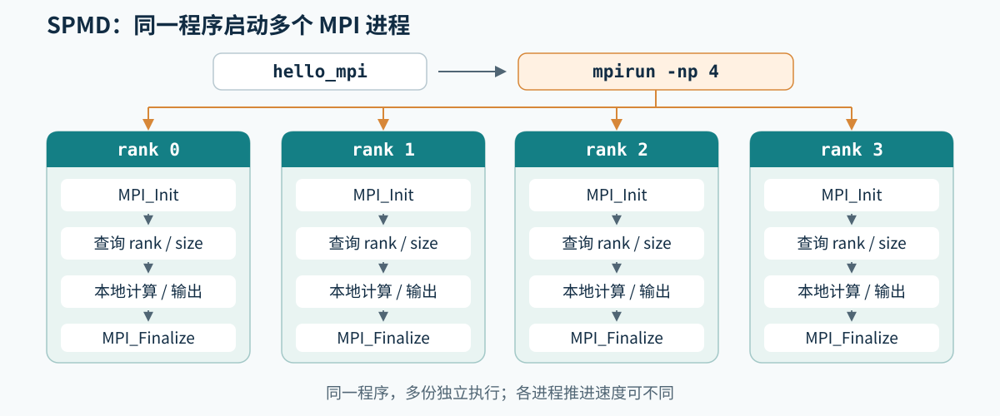
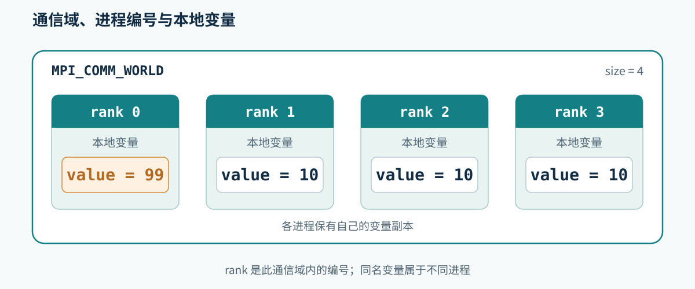

# 第二讲：第一个 MPI 程序——程序结构、rank 与通信域

**核心问题：**同一个可执行文件启动成多个进程后，每个进程怎样知道“我是谁、我们有多少人”？它们执行相同的代码，为什么还能拥有不同的变量值？

第一讲从硬件层次介绍了进程、节点与消息传递。本讲从一份短小的 C 程序出发，建立 MPI 程序的基本结构，并观察同一程序在多个进程中的执行。

## 一、一个程序，多份执行

在 OpenMP 程序中，我们常在 `main` 内通过 `#pragma omp parallel` 建立并行域。本讲的 MPI 程序使用另一种组织方式：先编译出一个可执行文件，再由启动命令运行多个进程。每个进程都从自己的 `main` 开始执行，拥有自己的局部变量和执行路径。

```bash
mpirun -np 4 ./hello_mpi
```

在课程的 Open MPI 环境中，这条命令请求启动 4 个运行 `hello_mpi` 的进程。它们执行同一份程序，但可以根据各自的编号处理不同的任务。这种常用组织方式称为 **SPMD（Single Program, Multiple Data，单程序多数据）**。



图中四列分别表示四个进程的执行路径。上下位置表示程序内的先后关系，**各列推进速度可以不同**。看到所有进程都调用同一个函数，不能据此认为它们在同一时刻执行到同一行。

`mpirun` 启动多个进程后，rank 0 也是其中一个进程。其他进程同样会执行初始化、计算和结束步骤。我们可以在程序中给 rank 0 安排特殊任务，例如打印一份说明；这是一项程序设计选择。

## 二、读懂第一个完整程序

配套源码位于课程仓库的 `examples/mpi/01_hello_world/hello_mpi.c`。

阅读程序前，先认识一个重要对象：**通信器（communicator，本讲也称通信域）**。它规定哪些进程参与通信，以及通信使用的上下文。C 接口用 **`MPI_Comm` 类型的句柄**表示这个对象；**`MPI_COMM_WORLD` 是 MPI 提供的一个预定义通信器句柄**。

因此，下面两个查询函数的第一个参数都写 `MPI_COMM_WORLD`，意思是“在这个通信器中查询编号和成员数”。`MPI_Comm` 是类型名，`MPI_COMM_WORLD` 是这个类型的预定义句柄值，二者的区别与作用在第三节进一步展开。

```c
#include <mpi.h>
#include <stdio.h>

int main(int argc, char **argv)
{
    int rank, size;

    MPI_Init(&argc, &argv);
    MPI_Comm_rank(MPI_COMM_WORLD, &rank);
    MPI_Comm_size(MPI_COMM_WORLD, &size);

    printf("Hello from rank %d of %d\n", rank, size);

    MPI_Finalize();
    return 0;
}
```

程序的执行顺序可以概括为：**初始化 MPI → 查询身份与进程数 → 执行本地任务 → 结束 MPI**。这一框架会贯穿后续的通信和数值计算程序。

### 1. `MPI_Init`：进入 MPI 环境

```c
MPI_Init(&argc, &argv);
```

这一步为调用它的进程初始化 MPI 环境。本讲的每个进程正常运行时都调用一次 `MPI_Init`，随后才能执行这里使用的通信域查询和通信操作。

`argc` 和 `argv` 是 C 程序的命令行参数。这里按 MPI 的 C 接口要求传入它们的地址。暂时记住这个标准写法即可。

### 2. `MPI_Comm_rank`：取得我在通信域中的编号

```c
MPI_Comm_rank(MPI_COMM_WORLD, &rank);
```

MPI 把结果写入当前进程的 `rank` 变量。若这个通信域包含 $p$ 个进程，则编号范围为

$$
0,1,\ldots,p-1.
$$

因此，启动 4 个进程时，各进程在 `MPI_COMM_WORLD` 中的 rank 分别为 0、1、2、3。

`&rank` 表示 `rank` 的地址，函数通过它填写结果。**函数的返回值是错误码，rank 由输出参数取得。**下面这种写法无法正确取得进程编号：

```c
/* 错误理解：函数返回值不是进程编号。 */
rank = MPI_Comm_rank(MPI_COMM_WORLD, &rank);
```

### 3. `MPI_Comm_size`：取得通信域中的进程数

```c
MPI_Comm_size(MPI_COMM_WORLD, &size);
```

MPI 把这个通信域包含的进程数写入 `size`。在本讲的 `mpirun -np 4` 运行中，四个进程都会得到 `size == 4`。

对同一个通信域，所有成员得到相同的 `size`，但各自的 `rank` 不同。`size` 描述进程组的大小；它不提供物理节点数、CPU 核心数或线程数。

`MPI_Comm_rank` 和 `MPI_Comm_size` 都是当前进程的**局部查询**，不会让其他进程等待，也不建立进程间的同步关系。

### 4. `MPI_Finalize`：正常结束 MPI

```c
MPI_Finalize();
```

程序完成计算及所需通信后调用它，清理 MPI 环境。本讲的各进程都属于同一个 `MPI_COMM_WORLD`，正常结束时都应执行到这里；不能只让 rank 0 调用它。调用后，不再使用本讲的通信域查询或通信操作。

`MPI_Finalize` 不会按照 rank 整理终端上的输出。后续遇到通信时，还必须先正确完成通信，再进入结束步骤。

### 四个接口的分工

| 接口 | 解决的问题 | 本讲中的结果 |
|---|---|---|
| `MPI_Init` | MPI 环境准备好了吗？ | 当前进程进入 MPI 环境 |
| `MPI_Comm_rank` | 我在这个通信域中是谁？ | `rank` 在 `0` 到 `size - 1` 之间 |
| `MPI_Comm_size` | 这个通信域有多少进程？ | 所有成员取得相同的 `size` |
| `MPI_Finalize` | MPI 的工作结束了吗？ | 正常清理 MPI 环境 |

本讲示例采用 C 接口；`MPI_` 前缀、函数名中的大小写、参数位置都要准确。`mpi.h` 提供相关声明，`stdio.h` 提供 `printf` 的声明。

## 三、MPI_Comm 与通信器：编号和通信属于谁？

### 1. 通信器包含成员关系与通信上下文

本讲使用的是**组内通信器（intracommunicator）**。理解它时，应把下面两个方面放在一起：

| 组成 | 解决的问题 | 作用 |
| --- | --- | --- |
| 有序进程组（group） | 哪些进程参与？它们怎样编号？ | 给成员定义从 0 开始的 rank；size 是成员数 |
| 通信上下文（context） | 这条消息属于哪一套通信？ | 隔离不同通信器中的通信，防止消息被另一套通信误接收 |

例如，同一批进程可能同时参与两个算法模块。即使两个模块使用相同的源进程编号和消息标签，使用**具有不同上下文的通信器**时，一个模块发送的消息也不会被另一个模块的接收操作匹配。上下文由 MPI 管理，应用程序通过通信器选择它。

后续的点对点通信要指定通信器，以解释发送者和接收者的 rank，并确定消息匹配的上下文；集合通信也要指定通信器，以确定这次操作的参与成员。因此，通信器既组织进程，也为协作划定通信范围。

### 2. MPI_Comm 是 C 接口中的句柄类型

`mpi.h` 提供 `MPI_Comm` 类型。通信器的内部对象由 MPI 管理，应用程序用句柄（handle）引用它。这种对象称为**不透明对象（opaque object）**：编程时通过 MPI 接口使用它，而不依赖其内部字段、大小或存储布局。

在第一个程序的 `MPI_Init` 之后，可以把两条查询写成：

```c
MPI_Comm comm = MPI_COMM_WORLD;
MPI_Comm_rank(comm, &rank);
MPI_Comm_size(comm, &size);
```

逐项区分这几个名字：

| 名字 | 在 C 程序中是什么 | 在这里表示什么 |
| --- | --- | --- |
| `MPI_Comm` | MPI 定义的句柄类型 | 变量可以保存通信器的引用 |
| `comm` | 程序自己声明的变量名 | 保存当前要使用的通信器句柄 |
| `MPI_COMM_WORLD` | 预定义通信器的句柄值 | 指定本例全部进程所在的通信器 |
| `rank`、`size` | `int` 类型的变量 | 保存对指定通信器的查询结果 |

`MPI_Comm comm = MPI_COMM_WORLD;` 把已有句柄赋给本进程的变量 `comm`。此后 `comm` 引用同一个通信器，这两条查询与直接传入 `MPI_COMM_WORLD` 的结果相同。**这条 C 赋值不会新建通信器或通信上下文，也不会创建进程或复制应用数据。**

不同 MPI 实现可以用不同方式表示句柄。编写可移植代码时，用 `MPI_Comm` 声明变量，并把句柄交给 MPI 接口；不要假定它就是普通整数或可由应用程序解引用的指针。句柄只在本进程中有意义，不能把它的内部表示当作可传给其他进程使用的通信器对象。

对应的接口声明是：

```c
int MPI_Comm_rank(MPI_Comm comm, int *rank);
int MPI_Comm_size(MPI_Comm comm, int *size);
```

第一个参数按值传入通信器句柄，指定查询对象；第二个参数传入整数变量的地址，让函数写入结果。这也解释了为什么调用时写 `comm`，而查询结果的位置写 `&rank`、`&size`。

### 3. MPI_COMM_WORLD 的意义与作用

本讲采用 `MPI_Init` / `MPI_Finalize` 的常规初始化方式。初始化完成后，**`MPI_COMM_WORLD` 是 MPI 提供的初始组内通信器**；在本讲静态启动的作业中，它包含这次启动的全部 MPI 进程，也包含当前进程自身。

用四个进程启动 Hello World 时，这四个进程组成 WORLD 的成员组：各自的 rank 为 0、1、2、3，查询到的 size 都为 4。这里的“WORLD”对应这个 MPI 作业的初始通信范围，不表示机器上所有进程，也不把另外启动的独立 MPI 作业自动包含进来。

它在本课程中的作用可以概括为：

1. **提供初始协作范围。** 初学程序可以直接使用它，无需先编写创建通信器的代码。
2. **提供编号依据。** `MPI_Comm_rank` 和 `MPI_Comm_size` 以它为对象，取得本进程的编号和这组成员的总数。
3. **提供通信范围与上下文。** 后续发送、接收、广播和归约使用它时，对象与参与者均在这个通信器内解释；具体参与方式仍取决于所调用的接口。

把 `MPI_COMM_WORLD` 传给查询函数，执行的是局部查询。通信器的存在本身不会让进程同步，也不会共享普通 C 变量或自动发送这些变量的值；这些行为需要程序安排相应操作。



图中的外框表示通信域的成员关系。各进程的普通变量仍分别存放在自己的地址空间中。

使用通信域时，把下面两个问题一起问清楚：

1. 这个通信域包含哪些进程？
2. 当前进程在这个通信域中的 rank 是多少？

### 4. rank 相对于通信器，MPI_COMM_SELF 只包含自己

rank 是**通信域内部**的编号。它不等同于操作系统的进程 ID（PID），也不直接表示节点或 CPU 核心。一个进程可以属于多个通信域，并在不同通信域中具有不同的 rank。

例如，另一个预定义通信域 **`MPI_COMM_SELF`** 只包含调用进程自身。每个进程在自己的 `MPI_COMM_SELF` 中，得到的 rank 都是 0，size 都是 1。世界通信域中的 rank 3，并没有因此变成世界通信域中的 rank 0；我们只是换了用于查询的通信域。

| 当前进程在 `MPI_COMM_WORLD` 中的 rank | 在自己的 `MPI_COMM_SELF` 中的 rank | `MPI_COMM_SELF` 的 size |
|---:|---:|---:|
| 0 | 0 | 1 |
| 1 | 0 | 1 |
| 2 | 0 | 1 |
| 3 | 0 | 1 |

后续程序如果写“发送给 rank 0”，必须同时知道使用的是哪个通信域。

也可以把前面声明 `comm` 时的初值改为 `MPI_COMM_SELF` 后重新查询，此时每个进程取得的都是 rank 0、size 1。改变查询对象改变的是编号所依据的成员组，已有进程仍然继续执行。

## 四、同名变量，分别属于不同进程

在 Hello World 的初始化与查询之后，加入下面的本地计算：

```c
int value = 10;

if (rank == 0) {
    value = 99;
}

printf("rank=%d size=%d value=%d\n", rank, size, value);
```

配套完整程序位于 `examples/mpi/02_private_data/private_data.c`。

启动 4 个进程时，每个进程都会创建自己的 `value`，初值都是 10。只有 rank 0 执行赋值 `value = 99`，所以预期结果为：

| rank | 执行 `value = 99` 吗？ | 当前进程的 `value` |
|---:|:---:|---:|
| 0 | 是 | 99 |
| 1 | 否 | 10 |
| 2 | 否 | 10 |
| 3 | 否 | 10 |

变量在源码中只有一个名字，但每个进程都有自己的那一份。即使四个进程运行在同一节点或同一容器内，这里的普通变量也不会自动共享。其他进程如果需要 rank 0 的这个数，程序必须安排数据传递；下一讲将实现这一步。

`if (rank == 0)` 的作用是选择哪些进程执行某段代码。条件为假的进程继续执行后面的代码，并不会退出 MPI 作业。

## 五、编译与启动是两个步骤

以下命令在课程仓库的 VS Code Dev Container 终端中执行，仓库根目录为 `/workspace`。配套示例已经保存在课程仓库中，编译和运行统一使用各示例目录中的 Makefile。

### 1. 编译：源码变成可执行文件

```bash
cd /workspace/examples/mpi/01_hello_world
make
```

**`mpicc` 是 MPI 的 C 编译包装器（compiler wrapper）**：它调用底层 C 编译器，并补上所需的 MPI 头文件路径和链接选项。它不会因为名字中有 MPI 就自动启动多个进程。

成功后生成可执行文件 `hello_mpi`。可以用下面的命令检查文件是否出现：

```bash
ls -l hello_mpi
```

`make` 按 Makefile 中的规则调用 `mpicc` 编译程序。修改源码后，再执行 `make` 或 `make run` 会完成必要的重新编译。

### 2. 启动：运行指定数量的进程

```bash
make run NP=1
make run NP=2
make run NP=4
```

Makefile 中的 `NP` 控制本次运行请求的进程数，运行规则调用 `mpirun -n $(NP)`。程序通过 `MPI_Comm_size` 取得实际通信域大小，因此同一份源码可以适应不同进程数，无须把 `size` 写成固定的 4。

`make run` 先检查程序是否需要编译，再启动 MPI 作业。

| 命令 | 输入 | 产生的结果 |
|---|---|---|
| `make` | C 源码与 Makefile | 可执行文件 |
| `make run NP=4` | 程序与 Makefile 运行规则 | 4 个执行该程序的 MPI 进程 |

编译成功只说明这份程序通过了编译和链接。是否按预期运行，还要检查每个进程的输出及程序是否正常退出。

## 六、怎样判断输出是否正确？

`make run NP=4` 中程序打印的一种可能输出是：

```text
Hello from rank 2 of 4
Hello from rank 0 of 4
Hello from rank 3 of 4
Hello from rank 1 of 4
```

本程序没有规定进程间打印的先后关系。MPI 启动器汇集多个进程的标准输出，终端上看到的顺序还受进程调度和输出缓冲等因素影响。

判断这次运行，应检查：

- 能否识别 rank 集合 `{0, 1, 2, 3}`，每个 rank 都执行了本程序中的打印；
- 每个进程报告的 `size` 是否都是 4；
- 程序是否正常结束并返回终端提示符。

多次运行可能显示不同顺序，也可能恰好一直相同。这两种观察都不能证明程序具有固定的全局执行顺序。`\n` 有助于区分输出行，也不会给多个进程建立 rank 顺序。

再观察一段普通 C 代码：

```c
if (rank == 0) {
    printf("Only rank 0 prints this line.\n");
}
printf("Every rank reaches this line: %d\n", rank);
```

在 rank 0 自己的执行路径中，第一条 `printf` 先于第二条。其他进程可以更早执行到自己的第二条 `printf`。**一个进程内部的程序顺序，与多个进程之间的执行关系，是两个需要分别分析的问题。**

## 七、动手实践

### 任务 A：自己完成 Hello World

先阅读完整示例，再在示例目录中新建 `hello_student.c`，补全下面的程序框架：

```c
#include <mpi.h>
#include <stdio.h>

int main(int argc, char **argv)
{
    int rank, size;

    /* TODO：初始化 MPI。 */
    /* TODO：查询 MPI_COMM_WORLD 中的 rank 和 size。 */

    printf("My rank is %d; world size is %d\n", rank, size);

    /* TODO：正常结束 MPI。 */
    return 0;
}
```

```bash
make TARGET=hello_student
make run TARGET=hello_student NP=1
make run TARGET=hello_student NP=2
make run TARGET=hello_student NP=4
```

`TARGET=hello_student` 让同一个 Makefile 编译 `hello_student.c` 并运行生成的程序。修改源码后沿用这些命令，完成时使用 `make clean` 清理可执行文件。

填写自己的运行记录：

| 请求进程数 | 观察到的 rank 集合 | 各进程报告的 size | 是否正常结束 |
|---:|---|---|---|
| 1 |  |  |  |
| 2 |  |  |  |
| 4 |  |  |  |

随后修改程序：只有 rank 0 打印一行 `World contains ... processes`，但每个进程仍打印自己的 rank。确认初始化与结束步骤仍由每个进程执行。

### 任务 B：先预测，再观察本地变量

```bash
cd /workspace/examples/mpi/02_private_data
make
make run NP=4
```

先根据第四节的代码写出各 rank 的预期 `value`，再运行核对。然后在打印之前加入：

```c
value += rank;
```

重新编译并运行，记录每个 rank 的新值。解释为什么 rank 0 的修改没有自动出现在其他进程的变量中。

### 任务 C：同一进程在两个通信域中的编号

在自己的 Hello World 中，完成 `MPI_COMM_WORLD` 的查询后，再加入：

```c
int self_rank, self_size;
MPI_Comm_rank(MPI_COMM_SELF, &self_rank);
MPI_Comm_size(MPI_COMM_SELF, &self_size);

printf("world rank=%d, world size=%d; self rank=%d, self size=%d\n",
       rank, size, self_rank, self_size);
```

在 `01_hello_world` 目录使用同一 Makefile 重新编译并启动：

```bash
make run TARGET=hello_student NP=4
```

保留输出，并解释：为什么 `world rank` 各不相同，而 `self rank` 都是 0？这是否意味着四个进程变成了同一个进程？

### 练习成果

保存自己完成的 C 源码与运行记录，并用自己的话回答：

1. `mpicc` 和 `mpirun` 分别完成什么工作？
2. `rank` 和 `size` 是谁填写的？为什么传入 `&rank` 和 `&size`？
3. rank 0 是否必须承担特殊任务？在哪里决定它的任务？
4. 普通变量由 rank 0 修改后，其他 rank 为什么仍持有原值？
5. 为什么检查 Hello World 应看 rank 的集合，而不是要求输出按编号排序？
6. `MPI_Comm`、`comm` 和 `MPI_COMM_WORLD` 分别是什么？把 WORLD 赋给 `comm` 是否创建了新通信器？
7. 为什么通信器还需要通信上下文，而不能只列出参加通信的进程？

第一讲建立的 Git 工作方式仍适用：通过 `git status` 查看新增和修改的文件，通过 `git diff` 检查已跟踪文件的改动，将源码和观察记录保存为有说明的提交。

## 八、常见问题

| 现象或疑问 | 检查与解释 |
|---|---|
| 找不到 `mpi.h`，或链接时出现 `undefined reference to MPI_...` | 先确认在课程容器中，执行 `make`；Makefile 应通过 `mpicc` 编译，而不是遗漏 MPI 配置的普通编译命令。 |
| 改了源码，运行结果却没有改变 | 再执行 `make run`；自己的程序加 `TARGET=hello_student`，确认运行对应的新可执行文件。 |
| `mpirun` 提示找不到或无法执行程序 | 检查当前目录、可执行文件名称及路径；本讲命令中的 `./hello_mpi` 指当前目录的文件。 |
| Open MPI 提示没有足够的 slots | slots 是启动器用于安排进程的资源额度，不是由 `MPI_Comm_size` 查询的结果。仅为本讲功能观察，可在课程容器中使用 `make run NP=4 MPIEXEC_FLAGS=--oversubscribe`；此时多个进程可能共享计算资源。 |
| Open MPI 拒绝以 root 运行 | 课程容器按 `student` 用户配置。检查当前用户及是否正确进入课程 Dev Container。 |
| 只让 rank 0 初始化或结束 MPI | 本讲正常执行的每个 MPI 进程都应调用初始化与结束函数；把 rank 条件分支放在它们之间。 |
| `MPI_COMM_SELF` 查询得到的 rank 全是 0 | 每个进程查询的是只包含自身的通信域；同时打印 `world rank` 来区分这些进程。 |
| rank 0 改了变量，其他进程的值没有变化 | 这是本讲普通变量各属于一个进程的预期结果。需要共享计算结果时，要设计通信。 |

## 要点回顾

一份 MPI 可执行文件可以被启动为多个进程，每个进程执行自己的程序路径并维护本地状态。`MPI_Init` 和 `MPI_Finalize` 构成基本框架。`MPI_Comm` 是通信器句柄类型，组内通信器把有序成员组与通信上下文联系起来；`MPI_COMM_WORLD` 提供本例的初始协作范围。`MPI_Comm_rank` 和 `MPI_Comm_size` 查询指定通信器中的身份与成员数。rank 的含义依赖通信器，源码中同名的普通变量也不会跨进程自动共享。

我们已经能让多个进程各自报告身份。下一讲将让一个进程发送数据，另一个进程接收数据，把这些独立的执行者连接成协作程序。

## 参考文献与图示来源

本讲的事实与接口说明集中引用以下资料；两张 SVG 图为课程自绘示意。

| 编号 | 来源 | 对应内容 |
|---|---|---|
| 1 | 本课程教学大纲（课程内部备课资料）；[第一讲](../01-背景与硬件架构/讲义.md) | MPI 程序结构、进程与硬件概念的衔接 |
| 2 | MPI Forum，[MPI-5.0 标准](https://www.mpi-forum.org/docs/mpi-5.0/mpi50-report.pdf)，§2.7、§2.10.1、§7.2.4、§7.4.1、§11.2.1–2 | 进程的独立状态、输出顺序、通信域、rank、预定义通信域、初始化与结束的标准语义 |
| 3 | Open MPI，[`MPI_Init`](https://docs.open-mpi.org/en/v5.0.10/man-openmpi/man3/MPI_Init.3.html)；[`MPI_Finalize`](https://docs.open-mpi.org/en/v5.0.10/man-openmpi/man3/MPI_Finalize.3.html) | C 接口及调用顺序 |
| 4 | Open MPI，[`MPI_Comm_rank`](https://docs.open-mpi.org/en/v5.0.10/man-openmpi/man3/MPI_Comm_rank.3.html)；[`MPI_Comm_size`](https://docs.open-mpi.org/en/v5.0.10/man-openmpi/man3/MPI_Comm_size.3.html) | 输出参数、编号范围、通信域成员数及查询的局部性质 |
| 5 | Open MPI，[包装编译器说明](https://docs.open-mpi.org/en/v5.0.10/man-openmpi/man1/ompi-wrapper-compiler.1.html)；[`mpirun / mpiexec`](https://docs.open-mpi.org/en/v5.0.10/man-openmpi/man1/mpirun.1.html) | `mpicc`、`-np`、标准输出汇集、slots 与 oversubscribe |
| 6 | [课程仓库说明](../../../README.md)；[环境自检脚本](../../../scripts/check_env.sh)；[本讲 MPI 示例](../../../examples/mpi/README.md) | 容器内路径、编译运行命令及配套源码 |
| 7 | Git，[`git-status`](https://git-scm.com/docs/git-status)；[`git-diff`](https://git-scm.com/docs/git-diff)；[`git-commit`](https://git-scm.com/docs/git-commit) | 用 Git 保存练习代码与观察记录 |
| 8 | MPI Forum，MPI-5.0 官方网站的 [Opaque Objects](https://www.mpi-forum.org/docs/mpi-5.0/mpi50-report/node35.htm)、[Contexts](https://www.mpi-forum.org/docs/mpi-5.0/mpi50-report/node181.htm)、[Intra-Communicators](https://www.mpi-forum.org/docs/mpi-5.0/mpi50-report/node182.htm)、[Predefined Intra-Communicators](https://www.mpi-forum.org/docs/mpi-5.0/mpi50-report/node183.htm) | `MPI_Comm` 的句柄与不透明对象语义、成员组与上下文、WORLD 和 SELF 的初始化与参与范围；HTML 版章节编号与正式 PDF 不同，按章节标题定位 |

图示的概念依据第 2–4 项；示例代码由本课程编写。资料核对日期：2026-10-11。
