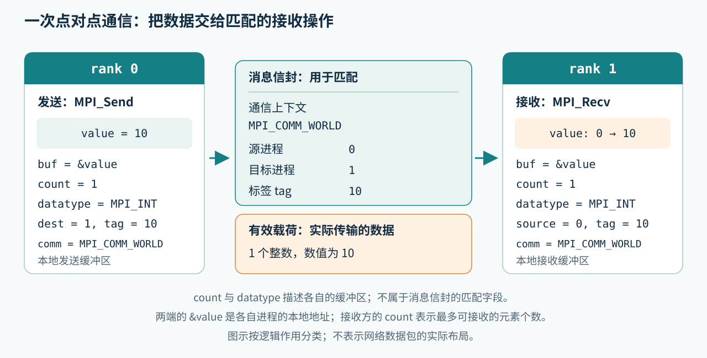
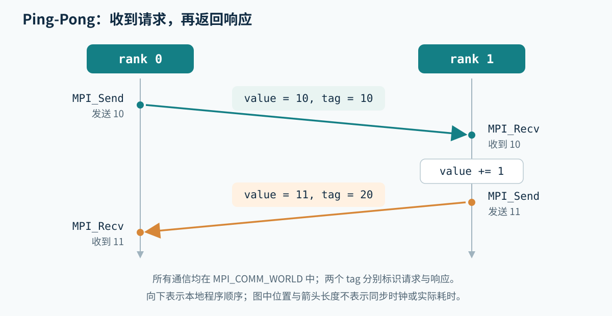
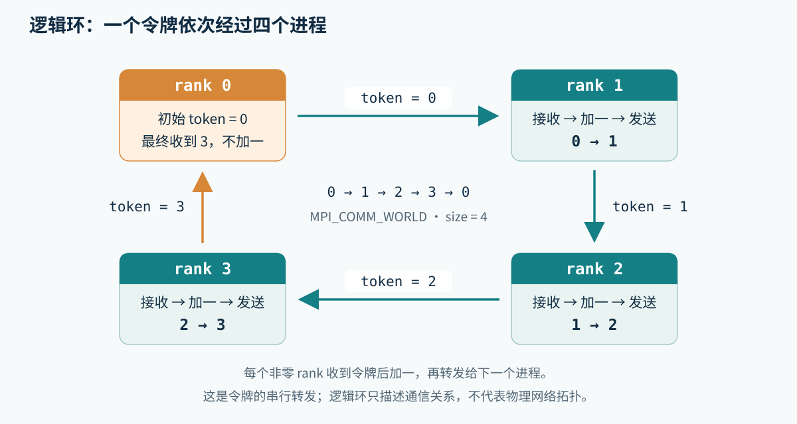

# 第三讲：点对点通信与消息匹配

**核心问题：**一个进程中的数，怎样交给另一个进程？接收操作如何找到正确的消息，又在什么时候可以使用收到的数据？

第二讲中，每个进程都有自己的普通变量。rank 0 修改 `value`，不会自动改变 rank 1 的 `value`。本讲为两个进程建立明确的数据联系：发送方给出数据与目的地，接收方给出存储位置和接收条件，再将这一过程扩展成往返通信与环形传递。

## 一、从本地赋值到消息传递

设 rank 0 的 `value` 为 10，rank 1 的 `value` 为 -1。我们希望 rank 1 得到 rank 0 保存的 10。在本讲采用的双边点对点通信中，一端执行发送，另一端执行匹配的接收；每次传递连接一个发送进程和一个接收进程。

```c
/* rank 0 */
MPI_Send(&value, 1, MPI_INT, 1, 10, MPI_COMM_WORLD);

/* rank 1 */
MPI_Recv(&value, 1, MPI_INT, 0, 10, MPI_COMM_WORLD,
         MPI_STATUS_IGNORE);
```

这是两个进程分别执行的片段。rank 0 提供自己变量的地址，rank 1 提供自己接收变量的地址。MPI 从发送缓冲区读取一个整数，并把它写入接收缓冲区。两端变量可以取不同名字；MPI 不根据 C 变量名查找消息。这里传送的是整数内容，不是把 rank 0 的地址变成 rank 1 可直接访问的地址。



图中箭头表示一条逻辑消息，并不指定消息经过网络、共享内存还是其他底层传输方式。`MPI_COMM_WORLD` 在本例中规定参与进程和通信上下文；通信参数中的 rank 都相对于这个通信器解释。

## 二、读懂 MPI_Send 与 MPI_Recv

### 2.1 发送：从哪里取数据，发给谁

本讲采用 C 语言的普通计数接口：

```c
int MPI_Send(const void *buf, int count, MPI_Datatype datatype,
             int dest, int tag, MPI_Comm comm);
```

| 参数 | 本例值 | 含义 |
|---|---|---|
| `buf` | `&value` | 发送缓冲区的起始地址；对一个普通整数取地址 |
| `count` | `1` | 发送多少个 `datatype` 类型的元素 |
| `datatype` | `MPI_INT` | 每个元素是一个与 C `int` 对应的 MPI 基本类型 |
| `dest` | `1` | 目标进程在 `comm` 中的 rank |
| `tag` | `10` | 由程序约定的非负整数标签，区分消息用途 |
| `comm` | `MPI_COMM_WORLD` | 本次通信使用的通信器 |

`MPI_Datatype` 是 MPI 数据类型句柄的 C 类型，`MPI_INT` 是预定义句柄。它让 MPI 知道如何解释缓冲区的数据。常用对应关系还包括 C `double` 与 `MPI_DOUBLE`、C `char` 与 `MPI_CHAR`。这里的 `count=1` 表示一个整数，不表示一个字节；无需把 `sizeof(int)` 填到 `count` 中。

tag 10 是本程序选择的消息类别，不是 rank，也不是 MPI 规定的特殊编号。本讲选用 10、20 这样的小标签；一般程序应遵守通信器的 `MPI_TAG_UB` 上限。`MPI_Send` 的 C 返回值是错误码，成功时为 `MPI_SUCCESS`，不是发送的元素个数。

### 2.2 接收：写到哪里，接收谁的消息

```c
int MPI_Recv(void *buf, int count, MPI_Datatype datatype,
             int source, int tag, MPI_Comm comm,
             MPI_Status *status);
```

前面三个参数描述本进程的接收存储空间。`source` 指定发送者在通信器中的 rank；`tag` 指定接受的消息标签；`comm` 指定通信上下文。最后的 `status` 用来取得本次收到的消息信息。

接收的 `count` 是**最多可接收的元素数**。例如，发送方发 3 个 `MPI_INT`，接收方提供容量为 5 的整数数组并指定 `count=5`，可以接收这一条长度为 3 的消息；后两个数组元素不会因此被写入。接收容量不够会发生消息截断错误，不能依靠 MPI 自动扩大数组。

本讲使用相同的基本类型完成两端通信。数据类型必须与实际 C 存储对应，两端传输的数据类型序列要兼容；不能因为 `int` 和某种浮点类型在机器上占相同字节数，就随意互换 `MPI_INT` 与浮点类型。

### 2.3 匹配消息：先看信封，再检查数据约定

对一个接收进程，匹配一条消息需要满足以下条件：

1. 消息的目的地是当前接收进程。
2. 消息的通信上下文与接收使用的通信器相符。
3. 发送者符合接收指定的 `source`。
4. 标签符合接收指定的 `tag`。

发送调用中的 `dest=1` 与 rank 1 的接收操作对应；接收调用中的 `source=0` 与 rank 0 的发送操作对应。因此，两边 rank 参数通常不是同一个数字。

**`count` 和 `datatype` 不用于按信封选择消息**，但选中消息后，程序仍须保证数据类型与接收容量正确。两端都写 `MPI_INT` 并不能补救错误的 tag。即使两个通信器包含同一组进程，若通信上下文不同，消息也不能混收。

| rank 0 发给 rank 1 的消息 | rank 1 的接收条件 | 判断 |
|---|---|---|
| `WORLD, tag=10, 1 个 MPI_INT` | `WORLD, source=0, tag=10, 容量=1` | 匹配且容量足够 |
| 同上 | `WORLD, source=0, tag=20, 容量=1` | 标签不匹配；不会因为一直等待而自动接受 tag 10 |
| 同上 | `WORLD, source=0, tag=10, 容量=3` | 匹配；实际仍只收到 1 个整数 |
| `WORLD, tag=10, 3 个 MPI_INT` | `WORLD, source=0, tag=10, 容量=1` | 信封匹配，但接收容量不足 |

接收端可用 `MPI_ANY_SOURCE` 接受该通信器内任一来源，用 `MPI_ANY_TAG` 接受任一标签。通信器没有这样的通配值。发送端必须指定确定的目的 rank，不能用 `MPI_ANY_SOURCE` 表示“随便发给谁”。初学时先把来源和标签写清楚；需要通配接收时，再从状态对象查询实际来源和标签。

### 2.4 状态对象：实际收到了什么

```c
MPI_Status status;
int received;
MPI_Recv(&value, 1, MPI_INT, 1, 20, MPI_COMM_WORLD, &status);
MPI_Get_count(&status, MPI_INT, &received);
printf("source=%d tag=%d count=%d value=%d\n",
       status.MPI_SOURCE, status.MPI_TAG, received, value);
```

这段代码位于 rank 0，接收 rank 1 的回复。`MPI_Status` 是状态对象类型；`status.MPI_SOURCE` 和 `status.MPI_TAG` 分别给出实际发送者和标签。`MPI_Get_count` 根据本次接收得到的状态和指定的数据类型，将实际元素个数写入 `received`，不产生新的进程间消息。

`MPI_Recv` 的函数返回值仍是错误码；不能把它当作接收个数，也不能将 `status.MPI_ERROR` 当作这次阻塞接收的可靠错误返回值。这里只讨论成功接收后的状态查询。不需要状态时传入 `MPI_STATUS_IGNORE`，此时没有可供随后查询的本次接收状态对象。

## 三、“阻塞”究竟保证什么

`MPI_Send` 是标准模式的阻塞发送。它正常返回时，发送缓冲区可以被程序安全复用。例如，发送后可以重新给 `value` 赋值，而不改变已经发出的那条消息。这个完成条件**不保证接收者已经从 `MPI_Recv` 返回**。

实现可能先将消息放入内部缓冲区，也可能等到匹配接收开始后才能推进。因此，正确程序不能把“一个小整数曾经成功发出去”当作所有消息都能先发后收的保证。

`MPI_Recv` 正常返回时，本次接收到的数据已经写入接收缓冲区，可以读取和计算。阻塞调用约束的是调用进程什么时候能越过这一行，不是让通信器内所有进程同时到达这一行。

本讲采用明确的接收与发送顺序来组织通信。死锁成因和非阻塞通信将在第五讲展开；本讲不把所有进程“先 Send、再 Recv”当作通用交换模板。

## 四、Ping-Pong：一次请求，一次回复

### 4.1 先描述协议

使用两个进程，约定两个方向的标签：

| 方向 | 标签 | 传递内容 | 接收后的工作 |
|---|---|---|---|
| rank 0 → rank 1 | `10` | 初始整数 10 | rank 1 把收到的数加 1 |
| rank 1 → rank 0 | `20` | 更新后的整数 11 | rank 0 检查结果和状态 |



箭头表示消息和数据依赖，纵向表示各进程内的程序先后；图中距离不是耗时刻度。两端顺序互补：rank 0 先发送再接收，rank 1 先接收再发送。

### 4.2 完整程序

下方为配套 `ping_pong.c` 的完整程序；新增函数与语句的逐段说明见文末的配套示例入口。

```c
#include <mpi.h>
#include <stdio.h>

int main(int argc, char *argv[])
{
    int rank;
    int size;
    int value = -1; /* 每个进程各自保存一份数据。 */
    int count;
    MPI_Status status;

    MPI_Init(&argc, &argv);
    MPI_Comm_rank(MPI_COMM_WORLD, &rank);
    MPI_Comm_size(MPI_COMM_WORLD, &size);

    /* 通信开始前，所有进程各自检查规模。 */
    if (size != 2) {
        if (rank == 0) {
            fprintf(stderr, "This example requires exactly 2 MPI processes.\n");
        }
        MPI_Finalize();
        return 1;
    }

    if (rank == 0) {
        /* rank 0 发出初值，然后等待回复。 */
        value = 10;
        MPI_Send(&value, 1, MPI_INT, 1, 10, MPI_COMM_WORLD);
        MPI_Recv(&value, 1, MPI_INT, 1, 20, MPI_COMM_WORLD, &status);
        /* 查询实际收到的元素数，不是字节数。 */
        MPI_Get_count(&status, MPI_INT, &count);
        printf("rank=0 received=%d source=%d tag=%d count=%d\n",
               value, status.MPI_SOURCE, status.MPI_TAG, count);
    } else {
        /* rank 1 先接收，再加 1 并发回。 */
        MPI_Recv(&value, 1, MPI_INT, 0, 10, MPI_COMM_WORLD,
                 MPI_STATUS_IGNORE);
        value += 1;
        MPI_Send(&value, 1, MPI_INT, 0, 20, MPI_COMM_WORLD);
    }

    MPI_Finalize();
    return 0;
}
```

rank 0 的回复值应为 11，回复来源为 1，标签为 20，收到 1 个整数。rank 1 的接收覆盖了它自己的 `value`，再由本地 `value += 1` 得到回复值。这里的往返过程建立了依赖关系，不代表两个进程拥有同一份变量。

此例用于理解通信协议；它只传一个整数，且包含输出操作，不能从这一次运行声称测得网络延迟、带宽或并行加速。

## 五、环形传递：把协议扩展到多个进程

### 5.1 逻辑邻居与令牌

令进程数为 $p\ge2$，按 rank 构成逻辑环：

$$
0\longrightarrow1\longrightarrow\cdots\longrightarrow p-1\longrightarrow0.
$$

rank $r$ 的下一个进程是 $(r+1)\bmod p$；对非零 rank，其上一个进程是 $r-1$。这是程序约定的通信关系，不表示机器或网络实际按环布线，也没有创建新的拓扑通信器。

本例让 rank 0 发送初值为 0 的令牌（token，即沿环传递的整数）。每个非零 rank 接收后加 1，再转发给下一个进程；rank 0 最后接收，不再加 1。因此，令牌回到 rank 0 时为 $p-1$。



四进程时，消息依次携带 0、1、2、3。每一条消息都使用 tag 10；接收方根据明确的来源识别上游。没有必要给每一条边使用不同标签。

### 5.2 为什么 rank 0 的顺序不同

rank 0 先发送、后接收；其余进程先接收、加 1、再发送。初始时 rank 1 已能接收来自 rank 0 的消息，之后接收与发送沿环推进。这个顺序不依赖 MPI 为全部消息提供额外缓冲空间。

如果把所有进程都改成先接收，就没有进程发出第一个令牌。如果全部改成先发送，则程序可能依赖内部缓冲而停住。不能通过在两个调用之间插入普通延时来修复协议。

### 5.3 完整程序

```c
#include <mpi.h>
#include <stdio.h>

int main(int argc, char *argv[])
{
    int rank;
    int size;
    int token = 0; /* rank 0 的初值是本轮传递的起点。 */

    MPI_Init(&argc, &argv);
    MPI_Comm_rank(MPI_COMM_WORLD, &rank);
    MPI_Comm_size(MPI_COMM_WORLD, &size);

    /* 本例需要至少两个进程。 */
    if (size < 2) {
        if (rank == 0) {
            fprintf(stderr, "This example requires at least 2 MPI processes.\n");
        }
        MPI_Finalize();
        return 1;
    }

    if (rank == 0) {
        /* rank 0 先发给 rank 1，再接收最后一跳。 */
        MPI_Send(&token, 1, MPI_INT, 1, 10, MPI_COMM_WORLD);
        MPI_Recv(&token, 1, MPI_INT, size - 1, 10, MPI_COMM_WORLD,
                 MPI_STATUS_IGNORE);
        printf("rank=0 size=%d token=%d\n", size, token);
    } else {
        int next = (rank + 1) % size; /* 最后一个 rank 回到 0。 */
        /* 非零 rank 先接收，更新后再转发。 */
        MPI_Recv(&token, 1, MPI_INT, rank - 1, 10, MPI_COMM_WORLD,
                 MPI_STATUS_IGNORE);
        token += 1;
        MPI_Send(&token, 1, MPI_INT, next, 10, MPI_COMM_WORLD);
    }

    MPI_Finalize();
    return 0;
}
```

该程序让同一令牌依次经过多个进程，数据更新有顺序依赖。增加进程数不会自动产生加速；练习要验证的是通信路径与结果。下一讲将让不同进程计算不同数据，再用点对点通信汇总局部结果。

## 六、概念辨析

先判断，再说明依据。

1. `MPI_Send` 返回后，接收方一定已经读取并处理了数据。
2. 发送 1 个整数，接收方必须也把 `count` 写成 1。
3. tag 相同且数据类型相同，两条通信一定匹配。
4. 将接收的 `source` 改成 `MPI_ANY_SOURCE` 后，程序总会先收到 rank 最小的消息。
5. 环中每个进程都调用 MPI，所以增加进程数必然让令牌更快走完一圈。

### 参考答案

1. 错。正常返回保证本进程可以安全复用发送缓冲区；接收和处理可能尚未完成。
2. 错。对于本讲相同基本类型的接收，容量至少容纳消息即可；接收容量可以大于实际个数，实际个数用 `MPI_Get_count` 查询。
3. 错。还要看目的进程、通信上下文、发送来源；数据类型本身不属于信封匹配条件，类型与容量仍须合法。
4. 错。通配来源不提供按 rank 大小排列的保证。来自不同发送者的消息可能以不同顺序被接收，应检查实际状态。
5. 错。本例的单个令牌顺序前进；每站的处理依赖前一站的消息，还增加了通信步骤。

## 七、上机练习

所有练习都先预测，再运行原程序；修改后保存源码并用 `make run` 重新编译、验证。每项修改从原始版本开始，避免叠加上一题改动。命令从课程仓库根目录出发；若在个人 Fork 中操作，应先进入自己的仓库目录。

### 练习 A：让一次往返通信完整发生

```bash
cd examples/mpi/03_ping_pong
make
make run NP=2
```

记录 rank 0 收到的值、来源、标签和实际个数。随后只把 rank 0 的初始 `value = 10` 改为 `value = 41`，重新执行 `make run NP=2`。预测回复值，并说明 rank 1 初始的 -1 为什么不影响结果。

再运行 `make run NP=1` 与 `make run NP=4`，检查程序对错误进程数的说明。这里触发的是程序主动检查，命令以非零状态结束；不是要求程序给错误规模编造通信结果。

**参考答案：**原程序的 rank 0 收到 `value=11, source=1, tag=20, count=1`；修改初值后为 42。rank 1 的原值被接收数据覆盖，然后再加 1。程序要求恰好两个进程，不符合时在通信前统一结束。Makefile 默认 `NP=2`，使用 `NP=4` 不能把这份两进程协议自动扩展为四进程协议。

### 练习 B：接收容量与实际长度

在 `03_ping_pong` 中另建 `count_demo.c`，沿用本讲 Ping-Pong 的初始化、查询 rank/size、检查两个进程与结束框架。两端通信片段如下，通信器均为 WORLD：

```c
/* rank 0 */
int values[3] = {10, 20, 30};
MPI_Send(values, 3, MPI_INT, 1, 30, MPI_COMM_WORLD);

/* rank 1 */
int values[5] = {-1, -1, -1, -1, -1};
MPI_Status status;
int received;
MPI_Recv(values, 5, MPI_INT, 0, 30, MPI_COMM_WORLD, &status);
MPI_Get_count(&status, MPI_INT, &received);
```

补充输出语句显示五个数组元素和 `received`。数组名在这里提供首元素地址，发送与接收都按元素数填写 `count`。用现有 Makefile 编译自己的文件：

```bash
make run TARGET=count_demo NP=2
```

**参考答案：**接收数组为 `10, 20, 30, -1, -1`，`received=3`。这里接收容量为 5，只修改前三个位置。不能通过扩大 `count` 声称扩大了实际 C 数组；若仍声明 `int values[1]` 却给出容量 5，程序就错误描述了可用存储空间。若把接收 `count` 改为 2，三元素消息会造成截断错误，该配置不属于正常结果。

### 练习 C：观察环形传递的结果

从课程仓库根目录进入环形示例；若当前在 Ping-Pong 目录，也可直接 `cd ../04_ring_token`。

```bash
cd examples/mpi/04_ring_token
make run NP=2
make run NP=3
make run NP=4
```

填写下表，再将非零 rank 的 `token += 1` 改为 `token += 2`，重新验证。保留 rank 0 的初值为 0。

| 进程数 $p$ | 原程序预测值 | 原程序观察值 | 每站加 2 的预测值 | 每站加 2 的观察值 |
|---|---|---|---|---|
| 2 |  |  |  |  |
| 3 |  |  |  |  |
| 4 |  |  |  |  |

**参考答案：**原程序分别为 1、2、3；每站加 2 时分别为 2、4、6，一般式为 $2(p-1)$。若进一步把 rank 0 初值改成 $a$、每个非零 rank 加 $d$，最终值为 $a+d(p-1)$。只有 $p-1$ 个进程执行加法，rank 0 负责发起并收回。

### 练习 D：检查协议并保存记录

阅读本讲程序，画出各进程的 Send/Recv 先后关系，并回答：如果仅把 rank 1 回复的发送标签改成 21，rank 0 仍接收 tag 20，会发生什么？如何修正？此题通过读代码推理即可。

**参考答案：**rank 0 的接收不能用 tag 21 的消息完成；程序会等待匹配的 tag 20。应把对应发送和接收的回复标签一致改为 21，或统一恢复为 20。不要用任意通配来掩盖尚未理解的协议错误。

将命令、修改、预测与观察整理为 `实验记录.md`，并保存源码修改：

```bash
git status --short
git diff
```

确认差异后，只 `git add` 本次自己的源码和记录文件，再 `git commit`。可执行文件不应提交。在 `03_ping_pong` 目录中用 `make clean TARGET=count_demo` 清理新增目标；默认示例用各自目录内的 `make clean` 清理。

## 八、常见问题与排查顺序

| 现象 | 先检查什么 |
|---|---|
| 程序一直没有完成 | 先看是否有对应发送与接收；核对通信器、目的 rank、来源、tag 和调用顺序。额外增加进程或插入延时不能自动修复协议。 |
| 发生消息截断 | 接收 `count` 是否足够；实际数组是否至少提供声明的容量；两端类型是否正确。 |
| 接收后得到意外的数 | 是否发送了初始化后的值；传入的是否为缓冲区地址；接收成功后才读数据；是否误用了旧可执行文件。 |
| 使用 `NP=1` 不能运行本讲两个示例 | 两者都检查规模；Ping-Pong 要求恰好 2，环形示例要求至少 2。单进程自发自收需要另外设计调用顺序。 |
| Open MPI 提示 slots 不足 | 功能观察可使用 `make run NP=4 MPIEXEC_FLAGS=--oversubscribe`；此时可能共享计算资源，不能据此声称性能加速。 |
| 修改结果没有变化 | 保存源码后执行 `make run`；自编文件核对 `TARGET`，确保运行了对应程序。 |

对已经启动且确实停住的课堂程序，可在其终端按 `Ctrl+C` 结束，再检查协议。记录终端输出时根据 rank 和消息内容判断；启动器的输出汇集顺序不能替代 MPI 通信关系的分析。

## 要点回顾

一条消息有数据内容，也有用于匹配的通信上下文、来源、目的地和标签。`MPI_Send` 给出数据与目标，`MPI_Recv` 给出存储位置和接收条件。`count` 按类型元素计数，接收端表示容量；`MPI_Status` 和 `MPI_Get_count` 帮助检查实际收到的消息。阻塞调用的完成具有明确的本地含义，通信顺序必须按数据依赖设计。

下一讲将把计算区间划分给不同进程，并用今天的 Send/Recv 汇总结果，完成数值积分计算 π。

## 参考文献与图示来源

正文、图示与接口解释的资料统一列在这里。示例代码与三张 SVG 均为课程原创；图示描述逻辑关系，不代表实测耗时或物理网络。资料核对日期：2026-10-17。

| 编号 | 来源 | 对应内容 |
|---|---|---|
| 1 | [第二讲：程序结构与通信域](../02-程序结构与通信域/讲义.md) | 初始化、rank/size、通信器、本地变量及本讲的前置知识 |
| 2 | MPI Forum，[MPI-5.0 标准](https://www.mpi-forum.org/docs/mpi-5.0/mpi50-report.pdf)，章 *Point-to-Point Communication*，小节 *Blocking Send and Receive Operations*、*Datatype Matching and Data Conversion*、*Communication Modes*、*Semantics of Point-to-Point Communication*；章 *Groups, Contexts, Communicators, and Caching* | 消息信封与匹配、类型与长度约束、阻塞完成条件、通信上下文与通配来源的语义；按章节标题定位 |
| 3 | Open MPI 5.0.10，[MPI_Send](https://docs.open-mpi.org/en/v5.0.10/man-openmpi/man3/MPI_Send.3.html) | C 发送接口、缓冲区、元素计数、类型、目的 rank 与标签 |
| 4 | Open MPI 5.0.10，[MPI_Recv](https://docs.open-mpi.org/en/v5.0.10/man-openmpi/man3/MPI_Recv.3.html) | 接收容量、消息截断、来源/tag 匹配、通配值、状态与接收完成 |
| 5 | Open MPI 5.0.10，[MPI_Get_count](https://docs.open-mpi.org/en/v5.0.10/man-openmpi/man3/MPI_Get_count.3.html) | 根据接收状态取得实际元素数；本讲使用相同基本类型进行查询 |
| 6 | [Ping-Pong 完整示例与逐段解释](../../../examples/mpi/03_ping_pong/程序详解.md)；[环形令牌完整示例与逐段解释](../../../examples/mpi/04_ring_token/程序详解.md)；[Makefile 入门](../../../examples/mpi/01_hello_world/程序详解.md) | 本讲源代码、输出的推导、Makefile 使用与实验修改；三张自绘图依据第 2–5 项及课程程序 |
| 7 | [课程环境说明](../../../docs/setup-docker.md)；Open MPI，[mpirun](https://docs.open-mpi.org/en/v5.0.10/man-openmpi/man1/mpirun.1.html)；Git，[git-diff](https://git-scm.com/docs/git-diff)、[git-add](https://git-scm.com/docs/git-add)、[git-commit](https://git-scm.com/docs/git-commit) | 编译启动环境、slots、输出汇集与实验记录保存 |

课程自绘图与许可范围见[图片来源与许可说明](../ASSET-SOURCES.md)。
