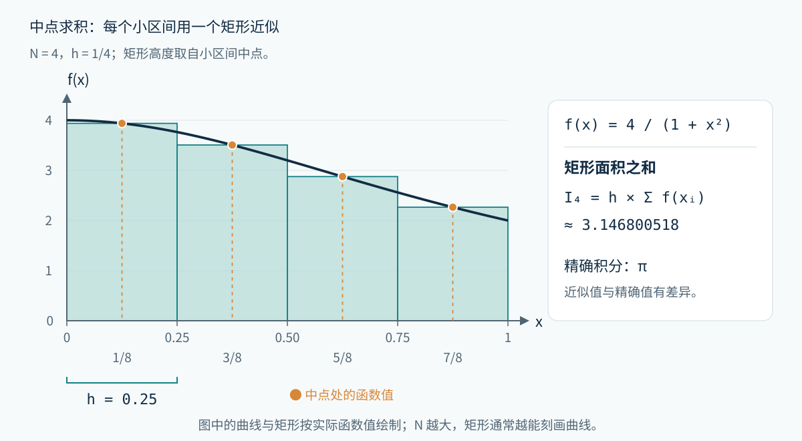
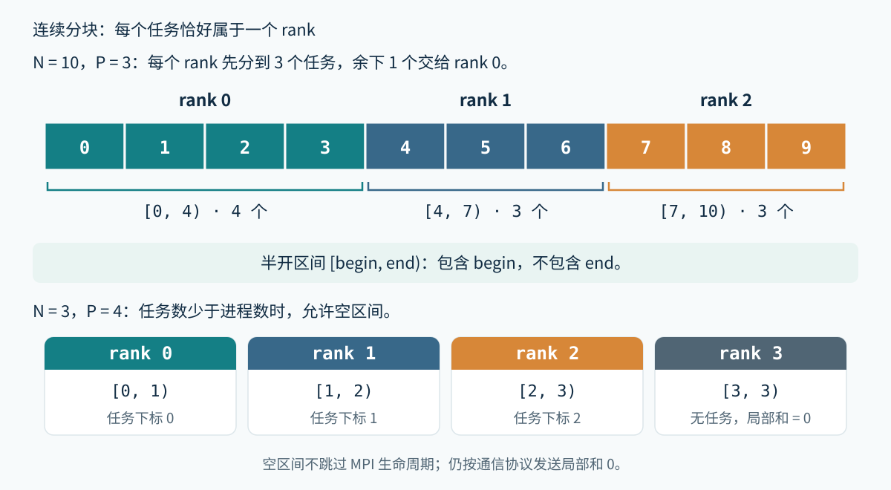
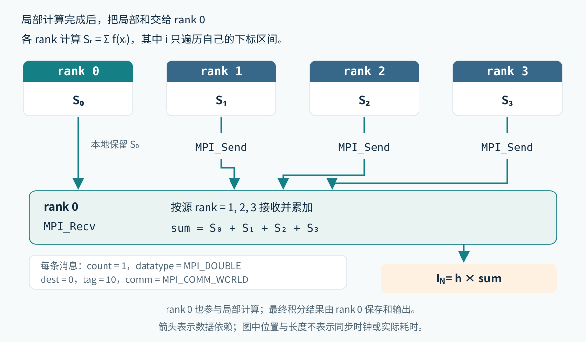

# 第四讲：数据划分与并行数值积分

**用 GoogleTest 验证 MPI 程序**

第三讲已经能把一个整数从一个进程传到另一个进程。本讲让各进程承担不同的计算任务，再用 `MPI_Send` 和 `MPI_Recv` 汇总结果。我们还会把“这个结果对不对”写成可重复运行的测试。

**核心问题：**怎样把一个求和分给多个进程，保证没有遗漏和重复？输出看起来接近 π，是否足以说明程序正确？

## 一、从数学问题得到可计算的求和

### 1.1 为什么这个积分等于 π

沿用 OpenMP 部分的例子，令

$$
f(x)=\frac{4}{1+x^2},\qquad
\int_0^1 f(x)\,\mathrm dx
=4[\arctan x]_0^1=\pi.
$$

计算机程序将用有限次函数求值近似这个积分。把 $[0,1]$ 均匀分成 $N$ 个小区间，其中 $N$ 为正整数，每段宽度为 $h=1/N$。第 $i$ 段是 $[ih,(i+1)h]$，取中点

$$
x_i=(i+\tfrac12)h,\quad i=0,1,\ldots,N-1.
$$

以 $f(x_i)$ 作为这一段矩形的高度，得到复合中点求积公式：

$$
Q_N=h\sum_{i=0}^{N-1}f(x_i)
=\frac1N\sum_{i=0}^{N-1}\frac{4}{1+((i+\tfrac12)/N)^2}.
$$

这里 $Q_N$ 是离散近似，π 是积分的真实值。本讲采用从 0 开始的下标；前面的 OpenMP 程序若用 `i=1,...,N` 和 `(i-0.5)*h`，取到的是同一组中点。



图中曲线与矩形均按 $f(x)$ 计算，取 $N=4$ 方便观察；它展示的是数值求积原理，不是运行性能。

### 1.2 用小问题建立明确预期

只有一个小区间时，中点为 $0.5$：

$$
Q_1=f(0.5)=3.2.
$$

两个小区间时，中点为 $0.25$ 和 $0.75$：

$$
Q_2=\frac12\left(\frac{64}{17}+\frac{64}{25}\right)
=\frac{1344}{425}\approx3.16235294117647.
$$

这两个结果可直接由公式手算。它们为测试提供独立的预期值，尤其提醒我们：`N=1` 的程序得到 3.2 是正确执行了中点公式；要求它已经非常接近 π，反而是错误的测试要求。

## 二、把串行程序整理成可测试的函数

配套示例目录为 `examples/mpi/05_pi_send_recv`。我们把实际计算与命令行、打印、测试入口分开，让运行程序与测试调用同一份计算函数。

| 文件 | 职责 |
|---|---|
| `pi_core.h`、`pi_core.c` | 被积函数、区间划分、局部求和、串行积分和输入检查 |
| `pi_mpi.h`、`pi_mpi.c` | 用点对点通信汇总局部结果 |
| `pi_main.c`、`serial_main.c` | MPI 与串行运行入口 |
| `tests/test_core.cc` | 普通单元测试 |
| `tests/test_mpi.cc` | 多进程集成测试 |
| `Makefile` | 编译、链接、运行、测试和清理 |

### 2.1 局部求和与积分宽度

本讲的计算函数如下；`n>0`，并要求 `0 <= begin <= end <= n`。

```c
double pi_integrand(double x)
{
    return 4.0 / (1.0 + x * x);
}

double midpoint_sum(int n, int begin, int end)
{
    double sum = 0.0;
    for (int i = begin; i < end; ++i) {
        const double x = (i + 0.5) / n;
        sum += pi_integrand(x);
    }
    return sum;
}

double pi_serial(int n)
{
    return midpoint_sum(n, 0, n) / n;
}
```

区间采用**左闭右开**的形式 `[begin,end)`：包含 begin，不包含 end。循环中的 `i < end` 与这个约定一致；相邻分块可以直接在同一个端点衔接。

`midpoint_sum` 返回函数值的和，尚未乘宽度；`pi_serial` 在汇总完整求和后除以 n。并行版也会在最终汇总后除以 n，保持同一约定。重复乘宽度或完全忘记宽度，都会改变所求的量。

当 `begin == end` 时，循环一次也不执行，局部和为 0。零是加法的单位元，这为没有分到任务的进程提供了自然的结果。

### 2.2 输入范围是程序约定

运行入口接受一个正整数 N。本例将范围限定为 `1 <= N <= 100000000`，并检查空输入、非整数、负数、零和超出范围的数。这个上限是课程示例的输入约定，不是 MPI 或 GoogleTest 的限制。

计算函数的前置条件与输入检查分工明确：入口先验证 N，再进入计算。不能为了绕过除以零而让 `N=0` 返回一个看起来正常的 π 值。

## 三、GoogleTest：把预期写进程序

### 3.1 一个最小测试

GoogleTest 是 C++ 测试框架，常简称 gtest。我们保留 C 计算代码，在 `.cc` 文件中写测试。下面的测试直接调用刚才的串行积分函数：

```cpp
#include <gtest/gtest.h>
#include "pi_core.h"

TEST(QuadratureTest, OneIntervalHasKnownValue) {
    EXPECT_NEAR(3.2, pi_serial(1), 1e-14);
}
```

`TEST` 定义并注册一个测试。第一个名字 `QuadratureTest` 是测试套件，用来归类；第二个名字 `OneIntervalHasKnownValue` 是测试名。完整名称为 `QuadratureTest.OneIntervalHasKnownValue`。花括号中的语句就是测试内容。

`EXPECT_NEAR(a,b,tol)` 检查两个值之差的绝对值是否不超过 tol。这里的 `1e-14` 用于比较一次很小的浮点计算与手算的 $Q_1$，不是要求 `Q_1` 与 π 相差小于 `1e-14`。

### 3.2 本讲使用的断言

| 写法 | 检查内容 | 适用例子 |
|---|---|---|
| `EXPECT_EQ(a, b)` | 两者相等 | 整数下标、区间长度、错误状态 |
| `EXPECT_NEAR(a, b, tol)` | 绝对差不超过 tol | 浮点积分结果 |
| `EXPECT_TRUE(condition)` | 条件为真 | 输入校验是否成功 |
| `ASSERT_*` | 相应检查失败时结束当前函数 | 单进程测试中，后续检查依赖当前条件时 |

`EXPECT_*` 失败后继续当前函数，便于一次看到多个问题；`ASSERT_*` 失败后提前返回。两者都会把失败记入测试结果。GoogleTest 会报告失败位置以及相关值，测试程序的退出状态也应表明失败。

对浮点结果，不要求串行与并行的二进制表示完全相同。求和分组变化可能引入舍入差异，容差需要与问题和测试规模对应。`EXPECT_NEAR` 的第三个参数是绝对误差限，不是相对百分比。

### 3.3 为什么 C++ 测试能调用 C 函数

在公共头文件中使用以下结构：

```c
#ifdef __cplusplus
extern "C" {
#endif

double pi_integrand(double x);
double pi_serial(int n);

#ifdef __cplusplus
}
#endif
```

C++ 编译时，`__cplusplus` 已定义，`extern "C"` 为这些函数声明指定 C 语言链接方式；C 编译时跳过这两段 C++ 语法。它不改变计算算法，也不把 GoogleTest 变成 C 库。

C 源文件仍由 `mpicc` 按 C11 编译；C++ 测试文件由 `mpicxx` 按 C++17 编译和链接。本讲调用的 MPI 函数仍是熟悉的 C 接口。

### 3.4 先运行，再选择一个测试套件

在课程仓库根目录运行环境检查，再进入本例：

```bash
bash scripts/check_gtest.sh
cd examples/mpi/05_pi_send_recv
make
make test
make test GTEST_FLAGS='--gtest_filter=QuadratureTest.*'
```

`make test` 运行普通单元测试，不通过 `mpirun` 启动多个进程。筛选参数中的 `*` 用引号保护，交给测试程序处理；这里选择名称以 `QuadratureTest.` 开头的测试。测试目标依赖测试可执行文件，所以修改并保存源码后再次运行，会先完成必要的编译。

先关注“运行了哪些测试、哪一个失败、失败在哪一行、预期与实际是什么”。修改测试预期必须有数学或程序契约的依据，不能只为了让红色提示消失而放宽条件。

## 四、把 N 个小区间分给 P 个进程

### 4.1 连续分块，余数也要分完

设进程数为 $P$，当前 rank 为 $r$。将 N 除以 P，写成

$$
N=qP+s,\qquad q=\lfloor N/P\rfloor,\quad 0\le s<P.
$$

先给每个进程 q 个任务，再给前 s 个进程各一个额外任务。因此

$$
\begin{aligned}
\mathrm{count}_r&=q+\begin{cases}1,&r<s,\\0,&r\ge s,\end{cases}\\
\mathrm{begin}_r&=rq+\min(r,s),\\
\mathrm{end}_r&=\mathrm{begin}_r+\mathrm{count}_r.
\end{aligned}
$$

`begin` 中的 `min(r,s)` 统计前面进程已经领取的额外任务。这样各分块恰好相邻，所有任务合起来是 `[0,N)`，任意两个分块长度相差不超过 1。



| N | P | 各 rank 的区间 | 任务数 |
|---|---|---|---|
| 10 | 3 | `[0,4)`、`[4,7)`、`[7,10)` | 4、3、3 |
| 3 | 4 | `[0,1)`、`[1,2)`、`[2,3)`、`[3,3)` | 1、1、1、0 |

当 P 大于 N 时，部分进程的区间为空，这在算法中是合法情况；进程更多并不保证计算更快。

### 4.2 将划分规则写成函数

```c
typedef struct {
    int begin;
    int end;
} Range;

Range block_range(int n, int rank, int size)
{
    const int q = n / size;
    const int r = n % size;
    const int extra_before = rank < r ? rank : r;
    Range range;
    range.begin = rank * q + extra_before;
    range.end = range.begin + q + (rank < r ? 1 : 0);
    return range;
}
```

代码变量 `r` 表示余数，对应前文公式中的 $s$；进程编号仍使用 `rank`。

`Range` 只保存区间端点，不保存实际采样数组。每个进程根据自己的下标范围生成中点并计算函数值，不需要 rank 0 先创建和分发全部采样点。

### 4.3 为划分写测试

```cpp
TEST(PartitionTest, TenIntervalsOnThreeRanks) {
    const Range a = block_range(10, 0, 3);
    const Range b = block_range(10, 1, 3);
    const Range c = block_range(10, 2, 3);
    EXPECT_EQ(0, a.begin);
    EXPECT_EQ(4, a.end);
    EXPECT_EQ(4, b.begin);
    EXPECT_EQ(7, b.end);
    EXPECT_EQ(7, c.begin);
    EXPECT_EQ(10, c.end);
}
```

预期区间来自上面的手工分配。除具体例子外，还要在多个 N、P 组合上检查：首段从 0 开始，末段到 N 结束，相邻段端点相接，全部长度相加为 N，最大长度与最小长度之差不超过 1。

这样的测试同时检查具体结果与一般性质，而不是把实现公式复制到测试中，再与自身比较。

## 五、局部计算与 Send/Recv 汇总

### 5.1 各进程分别计算什么

rank r 的局部和为

$$
S_r=\sum_{i=\mathrm{begin}_r}^{\mathrm{end}_r-1}f(x_i),
\qquad Q_N=h\sum_{r=0}^{P-1}S_r.
$$

各进程都有相同的 N，但处理不同的下标。运行命令给每个进程传入相同参数；本例没有通过 `MPI_Bcast` 分发 N。



rank 0 也执行自己的局部计算。其余进程将一个 `double` 局部和发送给 rank 0，统一使用 tag 10。rank 0 按 source 1 到 P−1 逐个接收，将收到的值加到自己的局部和上，最后除以 N。

### 5.2 完整的并行计算函数

下面是并行计算函数；完整运行入口、输入检查与测试框架见配套源码。函数要求所有参与进程以相同的合法 N、同一通信器执行本轮计算。

```c
double pi_parallel(int n, MPI_Comm comm)
{
    int rank;
    int size;
    MPI_Comm_rank(comm, &rank);
    MPI_Comm_size(comm, &size);

    const Range range = block_range(n, rank, size);
    const double local_sum = midpoint_sum(n, range.begin, range.end);

    if (rank == 0) {
        double total_sum = local_sum;
        for (int source = 1; source < size; ++source) {
            double received_sum;
            MPI_Recv(&received_sum, 1, MPI_DOUBLE, source, 10, comm,
                     MPI_STATUS_IGNORE);
            total_sum += received_sum;
        }
        return total_sum / n;
    }

    MPI_Send(&local_sum, 1, MPI_DOUBLE, 0, 10, comm);
    return 0.0;
}
```

返回值约定是：rank 0 返回全局积分近似，其余进程返回 0；后者不是全局积分结果。调用者应按 rank 使用返回值。本例的 rank 0 是传入通信器中的 rank 0。

注意三个边界：

- **P=1：**rank 0 只计算自己的全部任务，接收循环不执行。
- **空区间：**局部和为 0，仍发送这个数；rank 0 按协议等待每个非零 rank 的一条消息。
- **汇总顺序：**某个进程的发送可以等待 root 对应的接收；root 不需要先向工作进程发送另一条消息，因此此处没有相互等待形成的闭环。按 rank 接收不会保证实际计算或终端打印按 rank 排序。

### 5.3 编译与运行

在本例目录中运行：

```bash
make serial N=100000
make run NP=4 N=100000
make run NP=1 N=10
make run NP=3 N=10
make run NP=4 N=3
```

`NP` 传给 MPI 启动器，决定启动进程数；`N` 作为程序参数，决定积分小区间数。这两个变量控制不同的东西。最后一条命令刻意让一个进程分不到任务。

观察串行与并行的积分值，核对使用的是同一个 N。不同 N 的近似误差本来就可以不同。程序没有进行严谨的并行性能测量，GoogleTest 打印的测试耗时也不能直接作为并行加速比。

## 六、让测试覆盖计算与协作

### 6.1 两层测试分别回答什么

| 层次 | 运行方式 | 验证内容 |
|---|---|---|
| 普通单元测试 | `make test` | 被积函数、输入解析、区间划分、空区间、手算小规模积分 |
| MPI 集成测试 | `make test-mpi NP=4` | 多个进程真实执行局部计算、发送、接收与汇总 |
| 统一检查 | `make check` | 普通测试，加上 NP=1、2、3、4 的 MPI 测试 |

普通测试通过，不能单独证明 MPI 收发正确；多个进程成功退出，也不能单独证明计算公式正确。两层测试调用同一份被测函数，但使用不同的可核对依据。

### 6.2 串并行一致与积分精度是两个判断

**第一种比较：同一 N 的串行与 MPI 结果。** 它检查任务分配与汇总是否保持了同一求和。浮点加法的分组改变可能带来小差异，因此本讲已选测试规模 `N<=10000` 使用 `1e-11` 的绝对容差；它不是对任意 N、任意机器的通用误差保证。

**第二种比较：数值积分与 π。** 对二阶连续可微函数，复合中点公式在精确算术下满足

$$
|Q_N-\pi|\le\frac{\max_{[0,1]}|f''(x)|}{24N^2}.
$$

本例

$$
f''(x)=\frac{24x^2-8}{(1+x^2)^3},\qquad
\max_{[0,1]}|f''(x)|\le8,
$$

所以可用保守上界 $1/(3N^2)$。这解释了离散误差为什么随网格加细减小。浮点程序还存在舍入误差，不能把精确算术的求积误差界当作浮点运算的完整保证。

配套测试在选定规模内使用 `1/(3*N*N)+1e-11` 的误差限，并以 `acos(-1.0)` 提供 π 的浮点参考值。代码应先把 N 转为 `double` 再相乘，避免整数表达式先溢出。容差中的两部分分别对应求积误差上界和所选测试规模的舍入余量。

### 6.3 MPI 测试为什么要有自己的入口

普通测试运行器负责初始化 GoogleTest、执行 `RUN_ALL_TESTS()` 并返回测试状态。MPI 测试还要初始化与结束 MPI，并协调各进程的测试结果。

配套运行器完成以下工作：所有 rank 执行同一组、同一顺序的测试；测试中的收发完成后再检查结果；用已学过的点对点通信汇总各 rank 的失败信息；由 root 输出全局结果；任何一个 rank 失败，都使测试命令返回非零状态。

不要在尚有匹配通信未完成时，让某个 rank 因 `ASSERT_*` 或 `return` 提前离开。否则其他进程可能一直等待它。这也是本讲 MPI 测试优先在通信之后使用 `EXPECT_*` 的原因。

本例的运行器只开放讲义所用的筛选参数；需要确保所有 rank 选择相同测试。空筛选结果也应报告失败，避免“零个测试通过”被误当作验证成功。测试命令带超时限制，挂起视为测试失败。

```bash
make test GTEST_FLAGS='--gtest_filter=PartitionTest.*'
make test-mpi NP=3
make test-mpi NP=4
make check
```

## 七、Makefile 的新增内容

第二讲已经介绍目标、依赖、命令和自动变量。本讲需要把多个源文件分别编译成目标文件，再链接成不同的可执行文件：

```text
pi_core.c  ──编译──> pi_core.o ─┬─> 串行程序
                              ├─> MPI 程序（再链接 pi_mpi.o 等）
                              ├─> 普通测试（再链接测试对象和 gtest）
                              └─> MPI 测试（再链接 MPI 与测试对象）
```

`.c` 用 `MPICC` 编译，`.cc` 用 `MPICXX` 编译，链接 GoogleTest 的测试程序也由 C++ 编译器驱动。通过 `pkg-config` 取得 GoogleTest 的编译和链接参数；没有可用的元数据时，Makefile 提供常规库参数和可覆盖变量，具体设置见配套说明。

Makefile 中的 `| $(BUILD)` 是顺序依赖：构建对象前要先创建目录，但目录时间变化本身不会触发重编译。`$<` 表示第一项依赖，`$@` 表示当前目标。

**头文件也必须列入依赖。** 如果接口声明改变，只检查 `.c` 文件时间是不够的。`test` 和 `test-mpi` 依赖对应测试程序，所以修改计算函数或测试源码后，执行测试目标会先重建受到影响的对象。

测试运行器已经提供自己的 `main`，因此链接 `gtest`；再加入提供另一份 `main` 的库并非本例所需。`make clean` 删除生成的对象和可执行文件，保留 `.c`、`.cc`、头文件与实验记录。

## 八、上机练习与参考答案

每题先运行原始程序和测试，再作一项修改，观察失败并修复。不同练习从原始版本开始；不要把错误留到下一题。

### 练习 A：写一个有数学依据的测试

在 `tests/test_core.cc` 增加对 `pi_serial(2)` 的检查。先在纸上计算两个中点及对应函数值，再运行该套件。

```bash
make test GTEST_FLAGS='--gtest_filter=QuadratureTest.*'
```

**参考答案：**中点为 0.25 和 0.75，预期值为 `1344.0 / 425.0`。在这个小规模计算中，可写 `EXPECT_NEAR(1344.0 / 425.0, pi_serial(2), 1e-14)`。若配套套件已经包含该检查，可自行添加一个不同名字的测试，并解释这个预期为何独立于程序实现。

### 练习 B：让测试发现遗漏的余数任务

先画出 N=10、P=3 的分块。然后在 `block_range` 中暂时去掉给前 s 个进程分配额外任务的处理，写成每个进程只分到 q 个任务。运行：

```bash
make test GTEST_FLAGS='--gtest_filter=PartitionTest.*'
make test-mpi NP=3
```

观察哪条区间检查或积分比较失败。恢复正确分块规则，再运行相同命令。

**参考答案：**正确范围为 `[0,4)`、`[4,7)`、`[7,10)`。若错误地只分 q=3 个任务并连续排列，总共只有 9 个任务，下标 9 被遗漏。具体区间测试和完整覆盖检查都应发现问题；当 MPI 使用错误划分计算 N=10 时，也会与同一 N 的串行结果不一致。不要将正确预期改成错误程序的输出。

### 练习 C：检查空区间仍然参与通信

运行 `make run NP=4 N=3`，写出各 rank 的区间、局部求和是否为空，以及 root 等待几条消息。通过读代码回答：若空区间进程直接跳过发送，会发生什么？此题不要求故意运行挂起程序。

**参考答案：**区间为 `[0,1)`、`[1,2)`、`[2,3)`、`[3,3)`。rank 3 局部和为 0，仍要发送一个 `MPI_DOUBLE`。root 等待 rank 1、2、3 的三条消息；若 rank 3 跳过发送，对应接收就缺少匹配消息。

### 练习 D：区分程序错误与近似误差

先运行 `make serial N=1`，判断结果 3.2 是否正确。再观察 N=10、100、1000 的串行积分结果与 π 的差异。最后运行 `make check`，说明为什么同一 N 的串并行比较与对 π 的比较需要不同的容差依据。

**参考答案：**3.2 正确实现了一段中点求积。增大 N 会改变离散近似；在舍入误差尚未主导的这些规模下，误差通常随 N 增大而下降。串并行比较关注划分、汇总和舍入差异；对 π 的比较还必须容纳求积误差。任何一个测试通过都只支持已检查条件下的结论。

### 实验记录

记录 N、NP、修改位置、预期、实际结果、失败断言和修复原因。保存前用 `git status --short` 和 `git diff` 检查差异，只提交自己的源码、测试和记录。生成的可执行文件与目标文件不提交。

## 要点回顾

数值算法给出可计算的求和，数据划分决定每个进程负责哪些项，MPI 收发把局部结果组合起来。GoogleTest 将明确预期与一般性质转成可重复检查的程序。先确保算法、覆盖范围与消息协议正确，再讨论性能。

下一讲将进一步分析通信顺序、死锁与非阻塞通信。本讲的数值计算和测试将为后续程序修改提供基线。

## 参考文献与图示来源

资料核对日期：2026-10-17。计算函数、测试、划分公式推导和三张图均为课程自编或自绘；原理依据统一列于此处。

1. OpenStax. [Calculus Volume 2, §3.6 Numerical Integration](https://openstax.org/books/calculus-volume-2/pages/3-6-numerical-integration)：复合中点公式与误差界。
2. GoogleTest. [Primer](https://google.github.io/googletest/primer.html)：测试套件、`TEST`、断言与测试入口。
3. GoogleTest. [Assertions Reference](https://google.github.io/googletest/reference/assertions.html)：`EXPECT_EQ`、`EXPECT_NEAR` 等断言的含义。
4. GoogleTest. [Advanced Topics](https://google.github.io/googletest/advanced.html)：测试筛选与运行控制。
5. GoogleTest. [Using GoogleTest from various build systems](https://google.github.io/googletest/pkgconfig.html)：`pkg-config` 与编译、链接参数。
6. C++ 工作草案. [Linkage specifications](https://eel.is/c++draft/dcl.link)：`extern "C"` 的语言链接语义。
7. MPI Forum. [MPI 5.0 标准](https://www.mpi-forum.org/docs/mpi-5.0/mpi50-report.pdf)，Point-to-Point Communication、Groups, Contexts, Communicators：点对点收发与通信上下文。本讲仅使用基础 C 接口。
8. Open MPI. [Wrapper Compilers](https://docs.open-mpi.org/en/v5.0.10/man-openmpi/man1/ompi-wrapper-compiler.1.html)：`mpicc` 与 `mpicxx` 的作用。
9. GNU. [GNU Make Manual：Rule Introduction](https://www.gnu.org/software/make/manual/html_node/Rule-Introduction.html)、[Prerequisite Types](https://www.gnu.org/s/make/manual/html_node/Prerequisite-Types.html)：目标、普通依赖、顺序依赖与重建。
10. 本课程配套材料：[示例源码与运行说明](../../../examples/mpi/05_pi_send_recv/README.md)、[程序详解](../../../examples/mpi/05_pi_send_recv/程序详解.md)、[GoogleTest 入门](../../../docs/googletest-入门.md)。
11. 图示来源：`midpoint-rule.svg`、`block-partition.svg`、`local-to-global.svg` 均为本课程原创；Beamer 中对应图使用 TikZ 重绘，数据与含义一致。

仓库中的图示许可与来源汇总见 [图片来源说明](../ASSET-SOURCES.md)。
