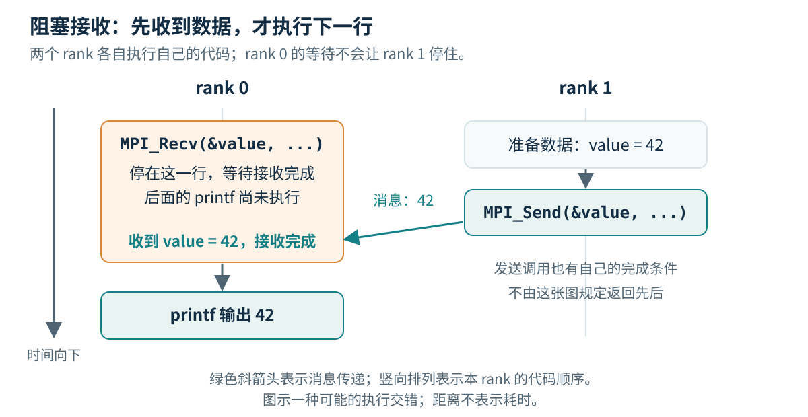
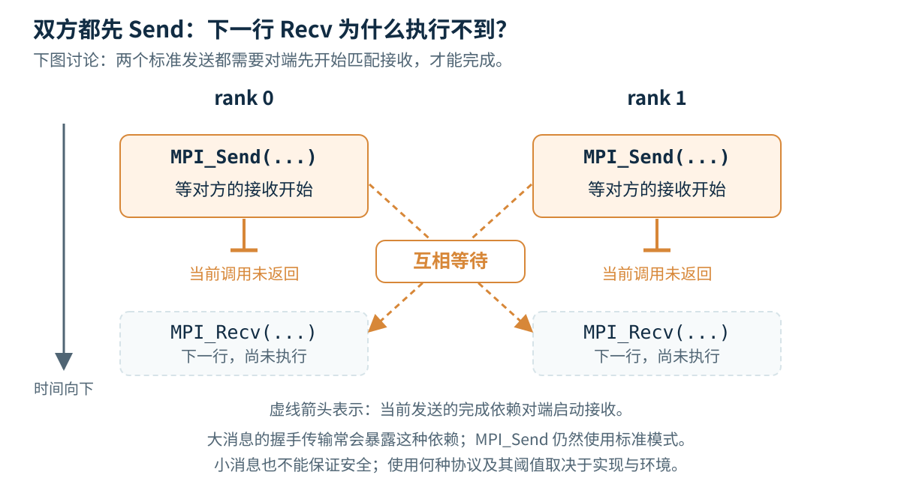
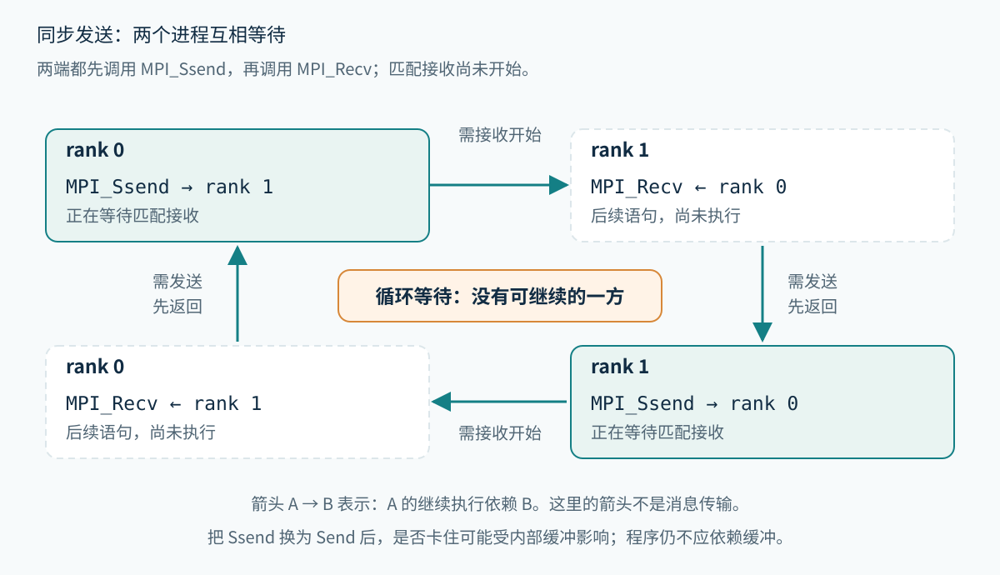
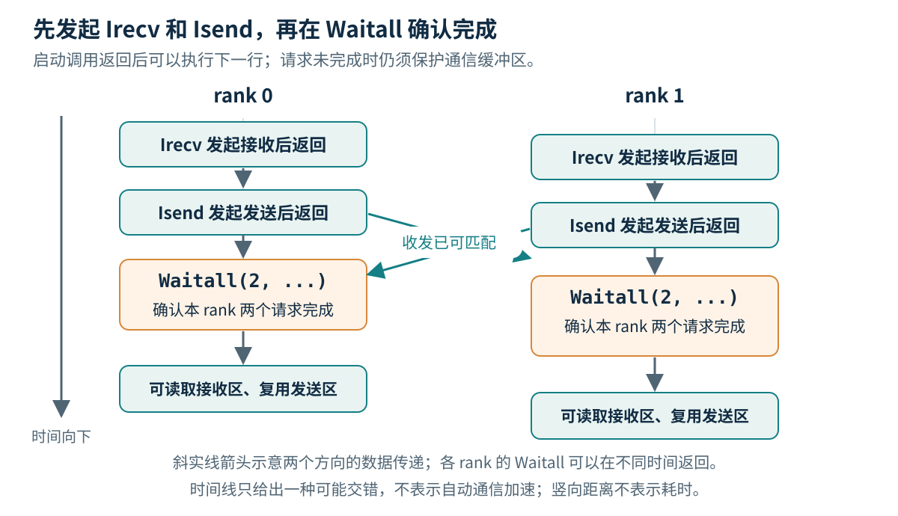
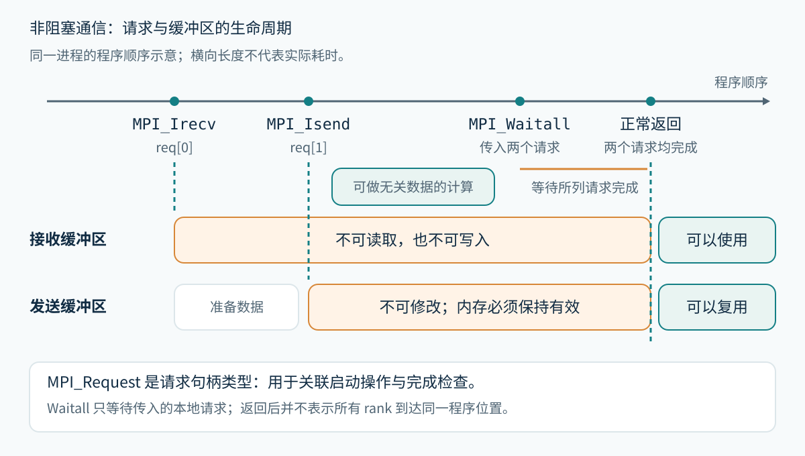
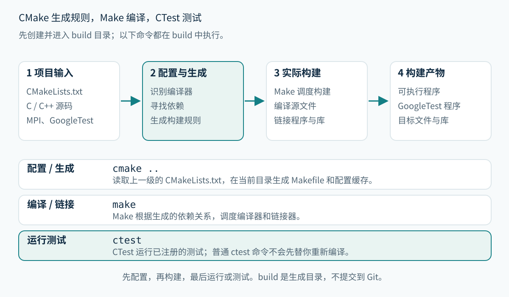

# 第五讲：死锁与非阻塞通信

**看清程序停在哪里，再学习怎样让通信继续；用 CMake 构建与测试**

第四讲用多个进程完成积分计算。这一讲先看一段更简单的程序：一个进程收一个整数。我们沿着代码一行一行看，理解“阻塞”“非阻塞”以及“等待完成”，再把它们用于两个进程交换数组。

从本讲起，新示例使用 CMake。实操沿用一个固定流程：建立 `build` 目录，进入其中执行 `cmake ..`，再用 `make` 编译、运行程序和 `ctest` 测试。

## 一、阻塞型函数：这一行没返回，下一行就不能执行

### 1.1 先看 MPI_Recv 会把程序停在哪里

`MPI_Send` 和 `MPI_Recv` 都是**阻塞型通信函数**。这里的“阻塞”是说：**当前调用尚未满足完成条件时，调用它的线程不能从这个函数返回，也就不能执行后面的语句。** 本课每个 rank 只有一个应用线程，可以直接理解为“这个 rank 暂时走不到下一行”。

假定恰有两个 rank，rank 1 向 rank 0 发送一个值为 42 的整数。MPI 初始化之后，rank 0 执行：

```c
int value = -1;
printf("before recv\n");
MPI_Recv(&value, 1, MPI_INT, 1, 20,
         MPI_COMM_WORLD, MPI_STATUS_IGNORE);
printf("received = %d\n", value);
```

rank 1 执行：

```c
int value = 42;
MPI_Send(&value, 1, MPI_INT, 0, 20, MPI_COMM_WORLD);
```

如果 rank 0 先进入 `MPI_Recv`，而 rank 1 还没有发来匹配的消息：

1. rank 0 停留在 `MPI_Recv` 内，暂时不能打印 `received`。
2. rank 1 仍然可以执行自己的代码，准备数据并调用 `MPI_Send`。
3. 消息匹配、接收完成后，rank 0 的 `MPI_Recv` 返回，才执行 `printf`，打印 42。



图示选择的是“接收方先到达”的一种执行顺序。若消息已经可接收，`MPI_Recv` 可能很快返回；**阻塞型不等于每次都必须等待很长时间**。一个 rank 在等，也不意味着其他 rank 或整台计算机都停下来了。

### 1.2 MPI_Send 在等什么

`MPI_Send` 的本地完成条件是：**MPI 不再需要原发送缓冲区，调用者可以重新使用这块内存。** 在满足这个条件前，程序停留在发送调用内。继续看 rank 1 向 rank 0 发送 42：

```c
int value = 42;
MPI_Send(&value, 1, MPI_INT, 0, 20, MPI_COMM_WORLD);
value = -1;  /* Safe after MPI_Send returns successfully. */
```

这里成功返回后把 `value` 改为 -1 是允许的；本次发送给对方的仍是 42。MPI 可以已经把数据传走，也可以先复制到它自己管理的缓冲区。因此，发送返回不能单独证明对方的 `MPI_Recv` 已经返回。

| 函数成功返回后 | 本 rank 可以做什么 |
|---|---|
| `MPI_Send` | 改写或释放这次发送所用的缓冲区 |
| `MPI_Recv` | 读取本次接收到的数据 |

两个函数都限制本 rank 的执行顺序，但它们的完成条件不同；都不是要求所有 rank 同时到达的屏障。

## 二、两个进程交换数据：为什么小数组能跑，大数组却可能卡住

### 2.1 先明确要交换什么

设通信器中恰好有两个进程，rank 分别为 0 和 1。每个进程持有一个长度为 N 的整数发送数组，以及另一个独立的接收数组。对当前 rank，通信对端为：

```c
const int peer = 1 - rank;
```

本例发送数据按下面的规则构造：

$$
\mathrm{sendbuf}_r[i]=10\,000\,000r+i,\qquad i=0,\ldots,N-1.
$$

交换结束后，rank r 的接收数组应满足

$$
\mathrm{recvbuf}_r[i]=10\,000\,000(1-r)+i.
$$

例如 N=4 时：

| 当前进程 | 发送数组 | 应收到的数组 |
|---|---|---|
| rank 0 | `0,1,2,3` | `10000000,10000001,10000002,10000003` |
| rank 1 | `10000000,10000001,10000002,10000003` | `0,1,2,3` |

两个数组占用不同的存储空间。这个例子不涉及浮点近似误差，全部元素可以按整数精确比较；只检查首元素不够，因为数组中间或末尾仍可能有错误。

本例限定 `1 <= N <= 1000000`。两个 rank 使用相同的 N、同一个算法和通信器，收发标签均为 20。进程数、输入范围与缓冲区条件属于这个示例的调用约定。

### 2.2 两边都先 Send：下一行 Recv 能执行到吗

下面是**有风险的组织方式**，两个 rank 都这样执行：

```c
/* Unsafe ordering when both ranks send first. */
MPI_Send(sendbuf, n, MPI_INT, peer, 20, comm);  /* A */
MPI_Recv(recvbuf, n, MPI_INT, peer, 20, comm,
         MPI_STATUS_IGNORE);                  /* B */
```

先不要看最后的计算结果，而是问：**两边能否从 A 返回，走到 B？**

一种常见的小消息情况是，MPI 先把整条消息复制到内部暂存区，发送调用于是能够返回。两个 rank 接着执行接收，交换看起来没有问题。这种运行依赖 MPI 恰好提供了足够的缓冲。

消息较大时，常见实现会采用 **rendezvous（会合/握手）协议**：先协调接收方，等匹配接收准备好后再安排主体数据传输，避免先缓存整条大消息。例如本机 `sizeof(int)=4` 时，N=1000000 的整数数组就有 4000000 字节；不能把任意大的消息都想成“先完整存进 MPI 的临时口袋”。

如果本次发送要等对方开始匹配接收才能完成，执行过程就变成：

| rank 0 | rank 1 |
|---|---|
| 进入 A：发送，等 rank 1 接收 | 进入 A：发送，等 rank 0 接收 |
| A 未返回，走不到 B | A 未返回，走不到 B |
| 对方需要的接收永远没有发起 | 对方需要的接收永远没有发起 |



这就是**循环等待**：各方都等着另一方做一件事，而那件事又被当前等待挡住。在没有其他参与者改变条件的本例中，程序将无法自行继续，形成死锁。

### 2.3 大消息握手与“同步发送模式”要分清

上面的握手说明了大消息更容易暴露该错误的常见原因。**消息变大并不把 `MPI_Send` 自动变成 `MPI_Ssend`。**

| 名称 | 所处层次 | 本讲应理解的含义 |
|---|---|---|
| `MPI_Send` 的标准发送模式 | MPI 接口语义 | 可以使用缓冲，也可以等待接收；程序不能依赖一定有缓冲 |
| eager / rendezvous 协议 | MPI 实现的传输方法 | 常见的先发送/缓冲与先握手策略；选择条件因实现、传输方式和运行环境而异 |
| `MPI_Ssend` 的同步发送模式 | MPI 接口语义 | 成功返回要求匹配接收已经开始并与发送匹配，不要求接收调用已经返回 |

MPI 标准没有规定统一的“大于多少字节才死锁”的界线。小消息也不能保证上述错误顺序安全。

### 2.4 用一个整数就能稳定展示同一个错误

为了直接看到等待关系，配套 `deadlock_demo` 把标准发送换成 `MPI_Ssend`。两端都执行：

```c
/* Intentional deadlock demonstration. */
MPI_Ssend(&sent, 1, MPI_INT, 1 - rank, 20, MPI_COMM_WORLD);
MPI_Recv(&received, 1, MPI_INT, 1 - rank, 20,
         MPI_COMM_WORLD, MPI_STATUS_IGNORE);
```

即使只有一个整数，同步发送也需要匹配接收参与。两端都停在 `MPI_Ssend`，都执行不到后面的 `MPI_Recv`。这个例子把前面大消息可能暴露的循环依赖，以明确的接口完成条件表现出来。



此图箭头表示“完成所依赖的操作”，不是已经发生的消息传输。错误程序的带超时运行方法见后面的可选观察。

## 三、第一种修复：让两端采用互补顺序

rank 0 先发送、后接收；rank 1 先接收、后发送。这样第一轮发送有可以执行的接收，第一轮完成后再进行反方向传递。

```c
void exchange_ordered(const int *sendbuf, int *recvbuf, int n, MPI_Comm comm)
{
    int rank;
    MPI_Comm_rank(comm, &rank);
    const int peer = 1 - rank;
    if (rank == 0) {
        MPI_Send(sendbuf, n, MPI_INT, peer, 20, comm);
        MPI_Recv(recvbuf, n, MPI_INT, peer, 20, comm, MPI_STATUS_IGNORE);
    } else {
        MPI_Recv(recvbuf, n, MPI_INT, peer, 20, comm, MPI_STATUS_IGNORE);
        MPI_Send(sendbuf, n, MPI_INT, peer, 20, comm);
    }
}
```

这里查询的是传入通信器中的 rank。两端一开始进入不同分支，这是同一个 SPMD 程序按 rank 选择执行路径。即使标准发送需要等待接收，也不会形成上述循环。

这种方法容易解释，但通信关系复杂以后，逐一安排所有进程的阻塞收发顺序会增加分析负担。

## 四、第二种修复：用 MPI_Sendrecv 表达一次交换

`MPI_Sendrecv` 将一次发送和一次接收放在同一个调用中，让 MPI 协调这两个操作。它仍然是阻塞调用；成功返回后，本次发送缓冲区可重用，接收数据可读取。

```c
void exchange_sendrecv(const int *sendbuf, int *recvbuf, int n, MPI_Comm comm)
{
    int rank;
    MPI_Comm_rank(comm, &rank);
    const int peer = 1 - rank;
    MPI_Sendrecv(sendbuf, n, MPI_INT, peer, 20,
                 recvbuf, n, MPI_INT, peer, 20,
                 comm, MPI_STATUS_IGNORE);
}
```

可以分三组阅读参数：

| 参数组 | 本例内容 | 含义 |
|---|---|---|
| 发送部分 | `sendbuf, n, MPI_INT, peer, 20` | 从哪里发送、发送多少元素、发给谁、使用什么标签 |
| 接收部分 | `recvbuf, n, MPI_INT, peer, 20` | 写到哪里、接收容量、接收谁的什么消息 |
| 公共部分 | `comm, MPI_STATUS_IGNORE` | 通信上下文和接收状态 |

发送与接收的对端、标签、类型和数量不必在所有应用中相同，但仍必须分别满足相应消息的匹配及数据兼容要求。`status` 描述接收操作。本例采用不重叠的收发数组；不要把同一个数组同时作为这两个缓冲区。

`MPI_Sendrecv` 解决这类配对交换的收发顺序问题，并不会替程序修正错误的 source、tag 或通信器。

## 五、第三种修复：非阻塞把“发起”和“完成”拆开

### 5.1 非阻塞操作让下一行先有机会执行

`MPI_Irecv` 发起非阻塞接收，`MPI_Isend` 发起非阻塞标准模式发送。**启动调用不要求等到这次数据传输完成才返回**，程序可以继续执行后面的语句。不过，调用返回和数据可用是两件事。

仍看 rank 0 从 rank 1 收取 42 的例子；rank 1 仍需执行匹配的发送：

```c
int value = -1;
MPI_Request request;
MPI_Irecv(&value, 1, MPI_INT, 1, 20,
          MPI_COMM_WORLD, &request);
printf("receive has been posted\n");
MPI_Wait(&request, MPI_STATUS_IGNORE);
printf("received = %d\n", value);
```

第一条 `printf` 不读取 `value`，无需等待消息到达就能执行。第二条 `printf` 要用接收到的数据，所以放在 `MPI_Wait` 成功返回之后。两条打印语句之间的差别，就是“可以做无关工作”与“可以使用通信结果”的差别。

**非阻塞不等于通信已经完成，不等于 MPI 自动创建了一个应用线程，也不等于程序后面永远不会等待。** 它提供的是把启动通信和确认完成分开的接口。

### 5.2 MPI_Request 保存要等待的是哪一次操作

`MPI_Request` 是请求句柄类型。可把请求理解成这次已发起操作的“查询凭据”：后面用它指定要等待哪一次发送或接收。

`&request` 是输出参数，让 MPI 写回请求句柄；函数的 C 返回值仍是错误码。请求不是数据本身，真正的数据仍保存在 `value` 或数组中。原请求尚未处理完时，不要用另一次启动调用覆盖这个变量。

### 5.3 MPI_Wait：在需要结果的地方等一个请求

```c
MPI_Wait(&request, MPI_STATUS_IGNORE);
```

`MPI_Wait` 等待 `request` 指定的**一个已发起操作**完成：

1. 如果该操作尚未完成，当前调用线程停留在 `MPI_Wait`，后面的语句暂时不能执行。
2. 如果该操作已经完成，就可以直接确认完成并返回，不必再等待对端到达某一条代码。
3. 它没有固定的“睡眠时间”。若所需匹配通信始终不出现，等待也可能一直持续。
4. 本例的非持久请求在 `MPI_Wait` 成功返回时被释放，句柄置为 `MPI_REQUEST_NULL`。

因此，`MPI_Wait` 本身是阻塞的完成操作。它不发起新的应用层发送或接收；它使代码在“后面确实需要通信结果”的位置取得完成保证。

| 等待的是哪种请求 | `MPI_Wait` 成功返回后的具体效果 |
|---|---|
| `MPI_Irecv` 创建的接收请求 | 接收数据已写好，可以读取或处理接收缓冲区 |
| `MPI_Isend` 创建的发送请求 | 原发送缓冲区可以改写或释放；不保证对方的接收调用已经返回 |

例如 rank 1 发出 42 后，下面的改写必须放到等待完成之后：

```c
int value = 42;
MPI_Request request;
MPI_Isend(&value, 1, MPI_INT, 0, 20, MPI_COMM_WORLD, &request);
printf("send has been posted\n");
MPI_Wait(&request, MPI_STATUS_IGNORE);
value = -1;  /* The original send buffer may now be reused. */
```

### 5.4 MPI_Waitall：等本 rank 列出的所有请求

一次双向交换包含两件事：接收对方的数据、发出自己的数据。因此先保存两个请求：

```c
MPI_Request requests[2];
MPI_Irecv(recvbuf, n, MPI_INT, peer, 20, comm, &requests[0]);
MPI_Isend(sendbuf, n, MPI_INT, peer, 20, comm, &requests[1]);
MPI_Waitall(2, requests, MPI_STATUSES_IGNORE);
```

- `requests[0]` 跟踪接收，`requests[1]` 跟踪发送。
- `2` 是请求个数，既不是数组的元素数 N，也不是要等待的进程数。
- `MPI_Waitall` 在这里等到**本 rank 的这两个请求都完成**才成功返回。届时接收数组可以读取，发送数组可以复用；这两个非持久句柄均置为空请求。
- 第三个参数对应状态数组，因此写复数 `MPI_STATUSES_IGNORE`。

**只等发送请求不能确认接收数组已可读；只等接收请求也不能据此确认发送数组已可改。** `Waitall` 把两项完成要求放在一个位置表达。它不会发起遗漏的通信，也不是通信器中所有 rank 的屏障；各 rank 返回的时刻可以不同。

### 5.5 为什么先 Irecv、再 Isend、最后 Waitall 能解决这个交换

```c
void exchange_nonblocking(const int *sendbuf, int *recvbuf, int n, MPI_Comm comm)
{
    int rank;
    MPI_Comm_rank(comm, &rank);
    const int peer = 1 - rank;
    MPI_Request requests[2];
    MPI_Irecv(recvbuf, n, MPI_INT, peer, 20, comm, &requests[0]);
    MPI_Isend(sendbuf, n, MPI_INT, peer, 20, comm, &requests[1]);
    /* Independent work that does not access either buffer could go here. */
    MPI_Waitall(2, requests, MPI_STATUSES_IGNORE);
}
```

按每个 rank 的代码顺序分析：

1. `Irecv` 发起接收，不必等消息实际到达就能返回，所以两端都有机会继续执行。
2. 接着两端都能发起 `Isend`，每个发送都有已经发起或将能发起的匹配接收。
3. 到 `Waitall` 才等待。此时所需的收发已经发起，不再存在“等发送完成才允许接收开始”的循环。
4. 等待可能仍需要时间，但通信所需的另一半已经有机会参与；成功返回后才检查数据。



该图只展示合法执行顺序，不表示所有 rank 同时进入或离开 `Waitall`。

### 5.6 等待前后，缓冲区能做什么

| 相应操作尚未确认完成时 | 使用约定 |
|---|---|
| 非阻塞发送缓冲区 | 内存保持有效；不能修改、释放或重新分配 |
| 非阻塞接收缓冲区 | 内存保持有效；不能读取、写入、释放或重新分配 |
| 与两块缓冲区无关的数据 | 可以处理，但仍需满足算法的数据依赖和必要通信顺序 |



配套交换函数在返回前已经调用 `Waitall`。因此，驱动程序可以在函数返回之后读取接收数组、检查每个元素并释放存储。

### 5.7 换成 Isend，却马上 Wait，仍可能卡住

下面仍是两端都执行的错误顺序：

```c
MPI_Isend(sendbuf, n, MPI_INT, peer, 20, comm, &request);
MPI_Wait(&request, MPI_STATUS_IGNORE);
MPI_Recv(recvbuf, n, MPI_INT, peer, 20, comm,
         MPI_STATUS_IGNORE);
```

虽然第一行能返回，但第二行立刻等待发送完成。若发送需要对端开始接收，双方就停在 `Wait`，仍执行不到最后的 `Recv`。**改变的是启动接口，原来阻挡接收开始的等待关系却保留了。**

正确做法是让所需接收与发送都先发起，再等待它们完成。

### 5.8 非阻塞提供安排计算的机会

如果启动通信之后有不依赖这些缓冲区的计算，可以放到等待之前。能否实现实际的通信与计算重叠，取决于 MPI 实现、通信进展、硬件与计算本身。本例只验证交换正确性；没有独立计算，也没有测量三种方法的加速比。

## 六、CMake：只先掌握一条固定的构建流程

### 6.1 创建 build，进入后执行 cmake ..

课程环境使用 Make 作为实际构建工具。第一次从仓库根目录执行：

```bash
cd examples/mpi/06_exchange
mkdir build
cd build
cmake ..
make
```

若 `build` 已经存在，直接进入即可，无需再次创建。理解每一步的对象：

| 操作 | 做了什么 |
|---|---|
| `mkdir build`、`cd build` | 创建并进入专门存放生成文件的目录 |
| `cmake ..` | 读取上一级目录的 `CMakeLists.txt`，查找编译器和库，在当前目录生成 Makefile 等文件 |
| `make` | 根据生成的依赖关系实际编译、链接默认目标，包括演示程序和测试程序 |

`..` 表示上一级目录。**CMake 管理项目说明，Make 按生成的规则执行编译。** 配置成功并不等于所有程序已经编译完成；生成的 Makefile 由 CMake 管理，无需手工编辑。



后面的运行、测试命令都在这个 `build` 目录中执行。

### 6.2 target 是要构建的目标，不是执行程序的命令

`CMakeLists.txt` 中定义了名为 `exchange_demo` 的可执行目标。只编译它可以执行：

```bash
make exchange_demo
```

这会先构建它依赖的库，再生成演示程序，但不会启动 MPI 计算。要真正运行程序，还需执行：

```bash
mpirun -n 2 ./exchange_demo nonblocking 8
```

`make` 默认构建本例的演示与测试目标；只执行 `make exchange_demo` 不会代替测试程序的构建。课堂练习开始时先执行一次 `make` 即可。

### 6.3 看懂 CMakeLists.txt 的基本组成

配套文件先声明项目和语言、查找 MPI，再创建库和程序：

```cmake
cmake_minimum_required(VERSION 3.20)
project(mpi_exchange LANGUAGES C CXX)

set(CMAKE_C_STANDARD 11)
set(CMAKE_C_STANDARD_REQUIRED ON)
set(CMAKE_C_EXTENSIONS OFF)
set(CMAKE_CXX_STANDARD 17)
set(CMAKE_CXX_STANDARD_REQUIRED ON)
set(CMAKE_CXX_EXTENSIONS OFF)

find_package(MPI REQUIRED COMPONENTS C CXX)

add_library(exchange_core STATIC exchange.c exchange_data.c)
target_include_directories(exchange_core PUBLIC "${CMAKE_CURRENT_SOURCE_DIR}")
target_link_libraries(exchange_core PUBLIC MPI::MPI_C)

add_executable(exchange_demo exchange_main.c)
target_link_libraries(exchange_demo PRIVATE exchange_core)
```

本例的算法是 C，GoogleTest 测试是 C++，因此启用两种语言。`add_library` 把共用函数组成 `exchange_core` 静态库；`add_executable` 指定程序目标及其入口文件；`target_link_libraries` 说明目标需要使用哪个库。

`MPI::MPI_C`、`MPI::MPI_CXX` 是 CMake 找到的 MPI 导入目标，提供相应的头文件和链接设置。这里 C++ 测试仍调用 MPI 的 C 接口。`PUBLIC` 表示库自身及其使用者都需要这些条件；`PRIVATE` 表示当前目标使用。本例头文件公开使用 `MPI_Comm`，所以库的 MPI 使用条件也传给调用者。

### 6.4 CTest 负责启动测试，GoogleTest 负责检查

测试构建部分如下，完整文件中还另有一个默认不构建的错误演示目标：

```cmake
include(CTest)
if(BUILD_TESTING)
    find_package(GTest REQUIRED)
    add_executable(exchange_unit_tests tests/unit_main.cc tests/test_core.cc)
    target_link_libraries(exchange_unit_tests PRIVATE exchange_core GTest::gtest)
    add_executable(exchange_mpi_tests tests/mpi_main.cc tests/test_mpi.cc)
    target_link_libraries(exchange_mpi_tests PRIVATE
                          exchange_core MPI::MPI_CXX GTest::gtest)

    add_test(NAME exchange_unit COMMAND exchange_unit_tests)
    add_test(NAME exchange_mpi_2
             COMMAND ${MPIEXEC_EXECUTABLE} ${MPIEXEC_NUMPROC_FLAG} 2
                     ${MPIEXEC_PREFLAGS} $<TARGET_FILE:exchange_mpi_tests>
                     ${MPIEXEC_POSTFLAGS})
    set_tests_properties(exchange_unit PROPERTIES TIMEOUT 30)
    set_tests_properties(exchange_mpi_2 PROPERTIES TIMEOUT 30 PROCESSORS 2)
endif()
```

`find_package(GTest REQUIRED)` 查找已安装的 GoogleTest，不在配置时下载它。自定义测试入口提供 `main`，因此链接 `GTest::gtest`。`add_test` 注册一个测试命令。

普通测试直接运行可执行文件；MPI 测试通过找到的 MPI 启动器启动两个 rank。`$<TARGET_FILE:exchange_mpi_tests>` 提供测试程序的实际路径。CTest 收集退出状态，GoogleTest 在程序内部检查数据；MPI 运行器负责让任一 rank 的失败反映到整体结果。

`TIMEOUT 30` 是测试运行的秒数上限；`PROCESSORS 2` 用于测试调度。实际启动两个 rank 的是 MPI 启动命令中的参数 2。

## 七、在 build 中运行和测试

### 7.1 运行三种交换方法

完成 `cmake ..` 和 `make` 后，仍在 `build` 中执行：

```bash
mpirun -n 2 ./exchange_demo ordered 8
mpirun -n 2 ./exchange_demo sendrecv 8
mpirun -n 2 ./exchange_demo nonblocking 8
```

`-n 2` 表示两个 MPI 进程，最后的 8 是每个数组的元素数。三个版本都应检查对方传来的全部元素，输出 `mismatches=0 PASS`。本例要求两端使用同一算法和同一 N。

### 7.2 运行测试与修改后的重建

```bash
ctest
```

默认有两个 CTest 条目：`exchange_unit` 执行 4 个普通 GoogleTest 用例，`exchange_mpi_2` 启动两个 rank 执行 9 个 MPI 用例。正常结果应是两个条目都通过。需要查看失败详情时，可运行 `ctest --output-on-failure`。

修改源码后，回到 `build` 中依次执行：

```bash
make
ctest
```

`ctest` 不会自动替你重新编译。`make` 按依赖关系重建受影响的文件；`ctest` 运行已经构建的测试程序。

### 7.3 目录和生成文件

源码、测试、`CMakeLists.txt` 都在上一级源码目录。`build` 中的 Makefile、`CMakeCache.txt`、目标文件和程序是生成结果，不提交到 Git。

若提示找不到 `CMakeLists.txt`，先确认自己是否处在正确的 `build` 中，且上一级确有该文件；若找不到程序，检查 `make` 是否成功；若修改后结果没有变化，确认已保存并重新执行 `make`。找不到 MPI 或 GoogleTest 时，先检查课程环境中的依赖安装。

## 八、练习与参考答案

### 练习 A：哪个 rank 卡在哪一行

两个进程都先 `MPI_Ssend`，再 `MPI_Recv`。分别指出它们停在哪里、为什么执行不到下一行。若改回 `MPI_Send` 后小数组运行成功，能否说明这个顺序已经正确？

**参考答案：**两端都停在 `MPI_Ssend`。每个发送都需要对方的匹配接收参与，但两端接收都排在未返回的发送后面，形成循环等待。标准发送的小数组成功可能依靠内部缓冲，不能证明这个顺序对不同规模或实现都安全。

### 练习 B：先预测，再比较三个版本

按发送数据规则写出 N=4 时两端应收到的完整数组。在 `build` 中分别运行：

```bash
mpirun -n 2 ./exchange_demo ordered 4
mpirun -n 2 ./exchange_demo sendrecv 4
mpirun -n 2 ./exchange_demo nonblocking 4
ctest
```

将 4 改成 100000，再运行三个版本并检查结果。

**参考答案：**rank 0 收到 `10000000` 至 `10000003`；rank 1 收到 `0` 至 `3`。三个版本应逐元素正确。N 增大不改变正确性要求；输出正确也不能据此排列三种算法的速度。

### 练习 C：只 Wait 一个请求够不够

两端已经分别发起匹配的接收与发送。某个 rank 执行：

```c
MPI_Irecv(recvbuf, n, MPI_INT, peer, 20, comm, &requests[0]);
MPI_Isend(sendbuf, n, MPI_INT, peer, 20, comm, &requests[1]);
MPI_Wait(&requests[1], MPI_STATUS_IGNORE);
printf("%d\n", recvbuf[0]);
```

最后一行是否已经得到足够的完成保证？如何修改？

**参考答案：**没有。这里确认的是发送请求完成，只能据此复用发送缓冲区，不能据此读取接收缓冲区。还需 `MPI_Wait(&requests[0], MPI_STATUS_IGNORE)`，或直接用 `MPI_Waitall(2, requests, MPI_STATUSES_IGNORE)` 等待两个请求，再读取接收结果。

### 练习 D：请求完成前，哪些操作不允许

在 `Irecv`、`Isend` 之后，确认相应请求完成之前，判断：读取接收数组、覆盖发送数组、处理另一个无关局部量、让收发数组随着函数返回而失去存储。

**参考答案：**只有处理无关局部量可以，且不能破坏算法的数据和通信依赖。其余操作分别破坏接收区访问约定、发送区内容约定或存储有效期。用代码阅读判断，不运行违反约定的程序来猜测结果。

### 练习 E：让 rank 1 的错误被测试看见

先运行正常测试。在源码目录 `tests/test_mpi.cc` 的 `CheckExchange` 中，交换调用之后、断言之前，临时加入：

```c
if (rank == 1) recvbuf[n - 1] = -7;
```

回到 `build`，执行：

```bash
make
ctest --output-on-failure
```

观察错误来自哪个 rank，恢复修改后再次构建和测试。

**参考答案：**rank 1 的末元素不符合发送规则，应产生断言失败；MPI 运行器汇总该失败，CTest 把 MPI 测试标为失败。恢复并重新构建后应重新通过。只运行 `cmake ..` 不会替代编译；只看 rank 0 的本地数据也不足以判断全局正确。

### 可选观察：在超时保护下看同步死锁

故意死锁的目标排除在默认 `make` 与正常 CTest 之外。仍在 `build` 中，显式构建并运行：

```bash
make deadlock_demo
python3 ../tools/run_with_timeout.py --seconds 3 -- \
  mpirun -n 2 ./deadlock_demo
```

两端进入 `MPI_Ssend` 后都无法走到接收。包装器达到限制后结束本机作业，返回 124。这个错误演示的预期是超时退出；正常交换和正常测试应当成功完成。仅凭一般程序超时不能定位死锁，还需分析调用顺序和匹配关系。

### 实验记录

记录算法名、N、进程数、运行命令、预期和实际结果、代码卡住的位置及修复原因。提交前查看 `git status --short`、`git diff`，提交源码、测试、构建说明和记录。

## 要点回顾

阻塞调用没有返回，本 rank 就不能执行下一行。双方都先发送时，一旦发送完成需要对端接收，而接收又排在后面，就会循环等待。非阻塞允许先发起所需接收和发送；`Wait` 确认一个请求完成，`Waitall` 确认列出的所有请求完成，然后才能使用相应缓冲区。

构建流程是：进入 `build` → `cmake ..` → `make` → 运行程序 / `ctest`。下一讲学习广播与归约，继续用 CMake 构建示例。

## 参考文献与图示来源

资料核对日期：2026-10-21。源程序、测试与六张图为课程自编或自绘；来源统一列于此处。

1. [MPI Forum. MPI: A Message-Passing Interface Standard, Version 5.0.](https://www.mpi-forum.org/docs/mpi-5.0/mpi50-report.pdf) 点对点通信、标准与同步发送、非阻塞请求和完成语义。
2. [Open MPI 5.0.10. MPI_Sendrecv.](https://docs.open-mpi.org/en/v5.0.10/man-openmpi/man3/MPI_Sendrecv.3.html) 发送接收组合、分离的缓冲区与接收状态。
3. [Open MPI 5.0.10. MPI_Isend.](https://docs.open-mpi.org/en/v5.0.10/man-openmpi/man3/MPI_Isend.3.html) 非阻塞发送与发送缓冲区约定。
4. [Open MPI 5.0.10. MPI_Irecv.](https://docs.open-mpi.org/en/v5.0.10/man-openmpi/man3/MPI_Irecv.3.html) 非阻塞接收与接收缓冲区约定。
5. [Open MPI 5.0.10. MPI_Wait.](https://docs.open-mpi.org/en/v5.0.10/man-openmpi/man3/MPI_Wait.3.html) 请求完成与非持久请求句柄的释放。
6. [Open MPI 5.0.10. MPI_Waitall.](https://docs.open-mpi.org/en/v5.0.10/man-openmpi/man3/MPI_Waitall.3.html) 等待请求数组与状态数组。
7. [Open MPI 5.0.10. MPI_Ssend.](https://docs.open-mpi.org/en/v5.0.10/man-openmpi/man3/MPI_Ssend.3.html) 阻塞同步发送的完成条件。
8. [CMake 3.20. cmake command-line manual.](https://cmake.org/cmake/help/v3.20/manual/cmake.1.html) 配置、生成、构建目录、缓存变量与并行构建。
9. [CMake 3.20. target_link_libraries.](https://cmake.org/cmake/help/v3.20/command/target_link_libraries.html) 目标依赖及 PUBLIC、PRIVATE 使用要求。
10. [CMake 3.20. FindMPI.](https://cmake.org/cmake/help/v3.20/module/FindMPI.html) MPI 导入目标、C/CXX 组件与 MPIEXEC 变量。
11. [CMake 3.20. FindGTest.](https://cmake.org/cmake/help/v3.20/module/FindGTest.html) GoogleTest 导入目标与依赖查找。
12. [CMake 3.20. CTest module.](https://cmake.org/cmake/help/v3.20/module/CTest.html) BUILD_TESTING 选项与测试启用。
13. [CMake 3.20. add_test.](https://cmake.org/cmake/help/v3.20/command/add_test.html) 测试命令注册与可执行目标路径。
14. [CMake 3.20. ctest command-line manual.](https://cmake.org/cmake/help/v3.20/manual/ctest.1.html) 测试运行、列出、筛选与失败输出。
15. [CMake 3.20. cmake-buildsystem manual.](https://cmake.org/cmake/help/v3.20/manual/cmake-buildsystem.7.html) 目标、使用要求与不同生成器的构建配置。
16. [GoogleTest. Primer.](https://google.github.io/googletest/primer.html) 测试用例、断言与自定义 main。
17. [Open MPI 5.0.10. MPI_Send.](https://docs.open-mpi.org/en/v5.0.10/man-openmpi/man3/MPI_Send.3.html) 标准模式、阻塞发送；本地完成条件结合 MPI 标准理解。
18. [Open MPI 5.0.10. MPI_Recv.](https://docs.open-mpi.org/en/v5.0.10/man-openmpi/man3/MPI_Recv.3.html) 阻塞接收，返回后接收缓冲区包含消息。
19. [Open MPI 5.0.10. The Modular Component Architecture，§8.1.5.](https://docs.open-mpi.org/en/v5.0.10/mca.html) TCP 传输中短消息 eager 与长消息 rendezvous 的实现示例，及可调整的协议阈值。
20. [Open MPI 5.0.10. Shared Memory，§11.2.3.3.](https://docs.open-mpi.org/en/v5.0.10/tuning-apps/networking/shared-memory.html) 小消息缓冲与较大消息等待接收方就绪的具体实现说明；本讲示意不承诺所有传输方式采用同一阈值。
21. 本课程第五讲配套材料：[交换示例与练习](../../../examples/mpi/06_exchange/README.md)、[程序详解](../../../examples/mpi/06_exchange/程序详解.md)、[CMake 入门](../../../docs/cmake-入门.md)。源代码、测试与命令按本讲实际项目核对。
22. 本课程自绘图：`blocking-recv-timeline.svg`、`send-first-stall.svg`、`nonblocking-exchange-timeline.svg`、`wait-cycle.svg`、`request-buffer-lifetime.svg` 依据上述 MPI 完成条件与示例代码；`cmake-workflow.svg` 依据 CMake 配置、Make 构建与 CTest 测试流程。时间线只表示操作顺序与依赖，不表示实测耗时或所有 rank 同步。Beamer 对应图形以 TikZ 重绘。
