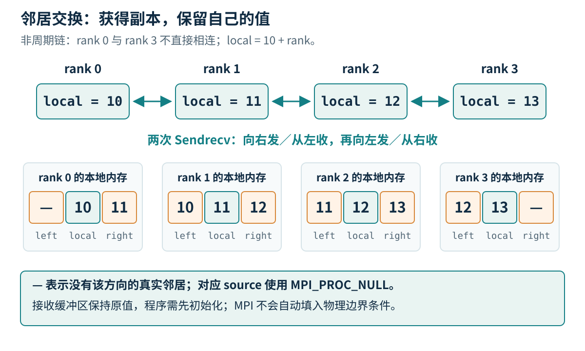
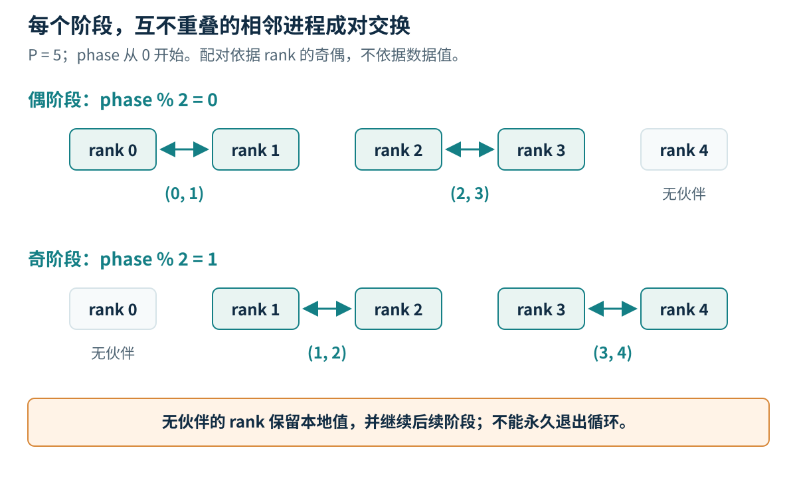
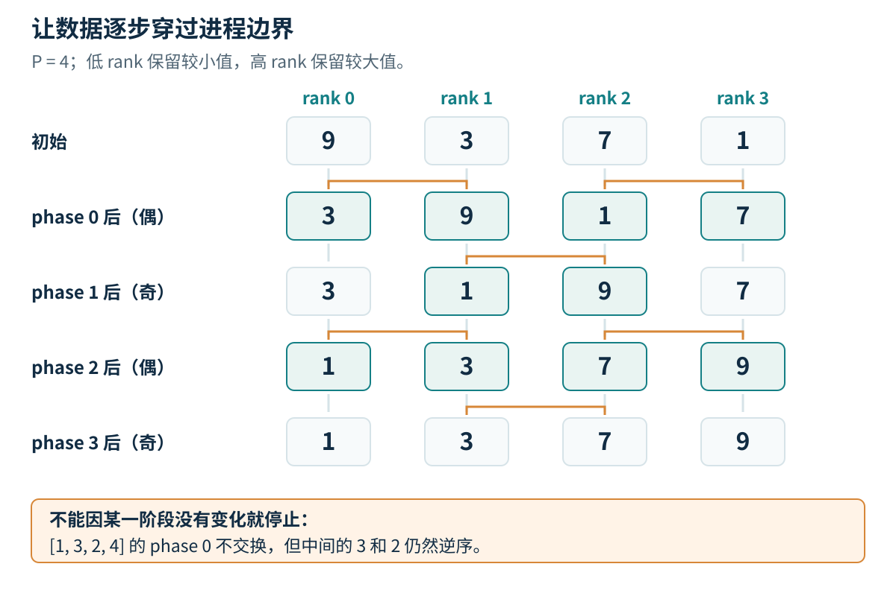
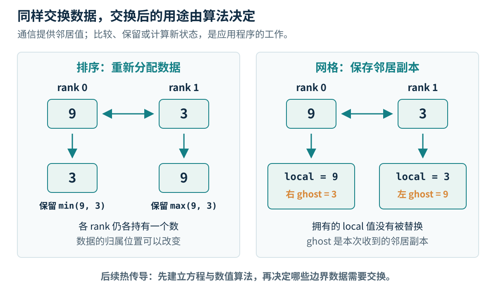

# 第八讲：邻居通信与奇偶排序

**让相邻进程合作，观察数据怎样逐轮排好序**

前面的集合通信把输入分发给各进程，或把结果收集到根进程。本讲把注意力移到计算中间：**一个进程已经有了自己的数据，但下一步还需要邻居的数据，应该怎样交换？**

我们先建立一条非周期的一维进程链，再用奇偶转置排序（odd-even transposition sort，简称奇偶排序）观察相邻交换的作用。完整排序示例采用 **P 个进程、P 个整数，每个 rank 持有一个整数**。这里的左右表示通信器中的逻辑相邻关系，与进程实际运行在哪台机器上无关。本讲使用组内通信器和单线程 MPI 进程。

## 一、从分布式数组到相邻依赖

### 1.1 每个 rank 持有一个元素

设 root 保存数组 `[9,3,7,1]`，启动 4 个 MPI 进程。一次每进程分发一个整数的 Scatter 之后：

| rank | 0 | 1 | 2 | 3 |
|---|---:|---:|---:|---:|
| 本地变量 `local` | 9 | 3 | 7 | 1 |

每个 `local` 位于所属进程的内存中。rank 1 不能直接通过下标读取 rank 2 的变量；即使两个进程运行在同一节点上，也需要相应的进程间通信。

若最终要求按 rank 从小到大排列的数值非递减，就需要满足：

$$
x_0\le x_1\le\cdots\le x_{P-1}.
$$

这里下标表示持有数据的 rank。排序过程中 rank 不变，变化的是各 rank 保存的数值。

### 1.2 回顾 Scatter 与 Gather

以下片段假定 root 已准备 P 个元素的 `input` 和 `output`；非 root 上相应指针初始化为 `NULL`。

```c
MPI_Scatter(input, 1, MPI_INT, &local, 1, MPI_INT,
            0, MPI_COMM_WORLD);
/* Each rank works on its own local value. */
MPI_Gather(&local, 1, MPI_INT, output, 1, MPI_INT,
           0, MPI_COMM_WORLD);
```

Scatter 的发送计数 `1` 表示**分给每个 rank 一个元素**。Gather 的接收计数 `1` 表示**从每个 rank 接收一个元素**，root 的 `output` 需要容纳 P 个整数。所有成员都调用；Gather 按 rank 顺序放置结果，不按消息到达先后排列。

这两个调用负责分发和收集。它们自身不比较数值，也不完成排序。排序需要发生在中间的各进程协作中。

## 二、一维进程链：谁是我的邻居？

在非周期进程链中，rank r 的左邻居为 r−1，右邻居为 r+1。两端有例外：rank 0 没有左邻居，rank P−1 没有右邻居。

```c
int left  = rank > 0        ? rank - 1 : MPI_PROC_NULL;
int right = rank + 1 < size ? rank + 1 : MPI_PROC_NULL;
```

`MPI_PROC_NULL` 是 MPI 提供的特殊通信对象。向它发送的操作可以直接完成；从它接收的操作可以直接完成，**接收缓冲区的内容保持不变**。它适合统一处理非周期边界，使各进程可以写相同的通信语句。程序应使用这个符号，不假设其具体整数值。



图中各 rank 的本地值为 `10+rank`。以 rank 1 为例，它的本地值为 11；交换之后，左侧副本为 10，右侧副本为 12。这些副本是 rank 1 自己内存中的两个变量。rank 0 没有左邻居，rank 3 没有右邻居，对应的接收变量保留初始化值 −1。

本例用 −1 方便观察边界。它只是显示用的占位值，不是一般数值问题的物理边界条件，也不是判断邻居是否存在的依据。

## 三、MPI_Sendrecv：一次调用组织发送与接收

### 3.1 先看它做的两件事

```c
int MPI_Sendrecv(const void *sendbuf, int sendcount,
                 MPI_Datatype sendtype, int dest, int sendtag,
                 void *recvbuf, int recvcount,
                 MPI_Datatype recvtype, int source, int recvtag,
                 MPI_Comm comm, MPI_Status *status);
```

前半部分指定发什么、发给谁，后半部分指定收什么、从谁接收。`dest` 和 `source` 可以相同，也可以不同；两部分使用同一个通信器。

| 参数组 | 本例中的问题 |
|---|---|
| `sendbuf, sendcount, sendtype` | 从本地哪个地址发送几个什么类型的元素？ |
| `dest, sendtag` | 发送给哪个 rank，使用哪个消息标签？ |
| `recvbuf, recvcount, recvtype` | 接收到本地哪个地址，最多容纳几个元素？ |
| `source, recvtag` | 接收哪个 rank 发来的、什么标签的消息？ |
| `comm` | 在哪个通信上下文中匹配？ |
| `status` | 接收操作的状态；本例不使用时传 `MPI_STATUS_IGNORE`。 |

`MPI_Sendrecv` 是阻塞操作。成功返回后，本进程可以复用发送缓冲区，并读取接收缓冲区。发送与接收缓冲区必须分开，不能把同一个变量的地址同时作为这两个缓冲区。

对于本讲这样的匹配收发，MPI 可以协调发送和接收，避免“所有进程先阻塞发送、再接收”造成的循环等待。**匹配仍由程序负责**：发送者、接收者、标签、通信器和数据类型必须对应。把标签写错，仍可能一直等待；函数返回也不表示所有 rank 都已经返回。

### 3.2 第一遍：把本地值发右边，从左边接收

```c
int local = 10 + rank;
int left_ghost = -1;
int right_ghost = -1;

MPI_Sendrecv(&local, 1, MPI_INT, right, 10,
             &left_ghost, 1, MPI_INT, left, 10,
             MPI_COMM_WORLD, MPI_STATUS_IGNORE);
```

rank 1 发送 11 给 rank 2，同时接收 rank 0 的 10。rank 2 的接收来源是 rank 1，标签同为 10，因而与这次发送匹配。rank 0 的接收来源为 `MPI_PROC_NULL`，`left_ghost` 保持 −1。

这一次调用只获得左侧副本。发送本地值不会把 `local` 清空或搬走。

### 3.3 第二遍：把本地值发左边，从右边接收

```c
MPI_Sendrecv(&local, 1, MPI_INT, left, 11,
             &right_ghost, 1, MPI_INT, right, 11,
             MPI_COMM_WORLD, MPI_STATUS_IGNORE);
```

此处方向反转，标签改为 11。两个方向的消息意义不同，使用不同标签便于阅读与核对。仍然发送原本的 `local`，不是把刚收到的 `left_ghost` 再转发出去。

4 个进程的结果应为：

| rank | 左侧副本 `left_ghost` | 本地值 `local` | 右侧副本 `right_ghost` |
|---|---:|---:|---:|
| 0 | −1 | 10 | 11 |
| 1 | 10 | 11 | 12 |
| 2 | 11 | 12 | 13 |
| 3 | 12 | 13 | −1 |

完整短程序 [neighbor_demo.c](../../../examples/mpi/08_odd_even/neighbor_demo.c) 如下。程序把每个 rank 的三个值 Gather 到 root 后统一打印，便于检查数据；打印顺序由 root 的循环控制。

```c
#include <mpi.h>
#include <stdio.h>
#include <stdlib.h>

int main(int argc, char **argv)
{
    MPI_Init(&argc, &argv);
    int rank, size;
    MPI_Comm_rank(MPI_COMM_WORLD, &rank);
    MPI_Comm_size(MPI_COMM_WORLD, &size);
    const int left = rank == 0 ? MPI_PROC_NULL : rank - 1;
    const int right = rank == size - 1 ? MPI_PROC_NULL : rank + 1;
    int local = 10 + rank;
    int left_ghost = -1, right_ghost = -1;
    MPI_Sendrecv(&local, 1, MPI_INT, right, 10,
                 &left_ghost, 1, MPI_INT, left, 10,
                 MPI_COMM_WORLD, MPI_STATUS_IGNORE);
    MPI_Sendrecv(&local, 1, MPI_INT, left, 11,
                 &right_ghost, 1, MPI_INT, right, 11,
                 MPI_COMM_WORLD, MPI_STATUS_IGNORE);

    int row[3] = {left_ghost, local, right_ghost};
    int *rows = rank == 0 ? malloc((size_t)size * 3 * sizeof(int)) : NULL;
    if (rank == 0 && rows == NULL) {
        MPI_Abort(MPI_COMM_WORLD, 1);
        return 1;
    }
    MPI_Gather(row, 3, MPI_INT, rows, 3, MPI_INT, 0, MPI_COMM_WORLD);
    int passed = 1;
    if (rank == 0) {
        puts("rank  left_ghost  local  right_ghost");
        for (int r = 0; r < size; ++r) {
            printf("%4d  %10d  %5d  %11d\n",
                   r, rows[3 * r], rows[3 * r + 1], rows[3 * r + 2]);
            passed = passed && rows[3 * r] == (r == 0 ? -1 : 9 + r) &&
                     rows[3 * r + 1] == 10 + r &&
                     rows[3 * r + 2] == (r == size - 1 ? -1 : 11 + r);
        }
        puts(passed ? "CHECK PASS" : "CHECK FAIL");
    }
    MPI_Bcast(&passed, 1, MPI_INT, 0, MPI_COMM_WORLD);
    free(rows);
    MPI_Finalize();
    return passed ? 0 : 1;
}
```

root 为每个 rank 预留三个整数的位置；非 root 的 `rows` 初始化为 `NULL`，该参数在它们的 Gather 调用中被忽略。分配失败时用 `MPI_Abort` 终止作业，避免其他 rank 留在集合调用中等待。检查结论再广播给所有 rank，使程序返回一致的状态。

## 四、先理解排序算法，再写 MPI

### 4.1 两个数怎样比较交换？

若 rank 0 和 rank 1 分别保存 9 与 3，两者先把自己的值发给对方。接下来各自在本地计算：低 rank 保存较小值 3，高 rank 保存较大值 9。

$$
(a,b)\longmapsto(\min(a,b),\max(a,b)).
$$

两端必须比较交换前的两个值。每一对交换都保持元素的数值与出现次数，只改变它们所在的位置。相同的值允许重复，目标是非递减顺序。

### 4.2 同一轮选择互不重叠的邻居对

若让 `(0,1)` 和 `(1,2)` 同时改写各自的值，rank 1 会同时出现在两个比较对中。奇偶排序将比较分成两类阶段（phase），阶段编号从 0 开始：

| 阶段 | 参与比较的邻居对 |
|---|---|
| 偶阶段：0、2、4…… | `(0,1)`、`(2,3)`、`(4,5)`…… |
| 奇阶段：1、3、5…… | `(1,2)`、`(3,4)`、`(5,6)`…… |

每个阶段中的比较对互不重叠，可以并行进行。偶、奇阶段依次交替，下一阶段使用上一阶段产生的值。阶段名称根据**阶段编号**确定，偶阶段也包含奇 rank。



P=5 时，偶阶段 rank 4 没有伙伴；奇阶段 rank 0 没有伙伴。无伙伴的进程保留自己的值，并继续执行后续阶段。

### 4.3 手算 `[9,3,7,1]` 的全过程

| 状态 | 本阶段比较对 | rank 0 | rank 1 | rank 2 | rank 3 |
|---|---|---:|---:|---:|---:|
| 初始 | — | 9 | 3 | 7 | 1 |
| phase 0 后 | `(0,1)`、`(2,3)` | 3 | 9 | 1 | 7 |
| phase 1 后 | `(1,2)` | 3 | 1 | 9 | 7 |
| phase 2 后 | `(0,1)`、`(2,3)` | 1 | 3 | 7 | 9 |
| phase 3 后 | `(1,2)` | 1 | 3 | 7 | 9 |



本例在 phase 2 后已经有序，程序仍完成 phase 3。对于每个进程一个元素的奇偶转置排序，P 个交替阶段足以排序 P 个元素，P 为奇数或偶数均可。固定执行 P 个阶段，使所有 rank 对循环次数有一致约定。

可以直观看到：大值通过相邻比较向右移动，小值向左移动，每阶段最多跨过一个相邻位置。但“最大值最后到了右端”本身还不能证明所有其他值也已排序；完整阶段数的结论来自奇偶转置排序的正确性定理，延伸证明见文末资料。

### 4.4 一次没交换，能否提前结束？

考虑 `[1,3,2,4]`。phase 0 比较 `(1,3)` 和 `(2,4)`，两对都不交换，但中间的 3 和 2 仍然逆序。phase 1 才会处理它们。

所以，**单个阶段没有交换不足以判断整体有序**。某一个 rank 没有交换更不能成为它自行退出循环的理由，否则其他 rank 后面可能还在等待它的消息。本讲程序不实现提前结束。

## 五、把一次比较交换写成 MPI

### 5.1 各 rank 计算自己的伙伴

下面片段已经取得 `rank`、`size`，`phase` 为当前阶段编号：

```c
int partner = (rank % 2 == phase % 2) ? rank + 1 : rank - 1;
if (partner < 0 || partner >= size) {
    partner = MPI_PROC_NULL;
}
```

公式使偶阶段的偶 rank 向右、奇 rank 向左；奇阶段则相反。若 rank 1 算出伙伴为 rank 2，那么 rank 2 在同一阶段也必须算出伙伴为 rank 1。伙伴选择需要双向一致。

例如 P=5：

| rank | 0 | 1 | 2 | 3 | 4 |
|---|---:|---:|---:|---:|---:|
| 偶阶段伙伴 | 1 | 0 | 3 | 2 | `MPI_PROC_NULL` |
| 奇阶段伙伴 | `MPI_PROC_NULL` | 2 | 1 | 4 | 3 |

### 5.2 先拿到对方旧值，再更新本地值

```c
int received = local;
MPI_Sendrecv(&local, 1, MPI_INT, partner, 42,
             &received, 1, MPI_INT, partner, 42,
             MPI_COMM_WORLD, MPI_STATUS_IGNORE);
if (partner != MPI_PROC_NULL) {
    if (rank < partner) {
        local = local < received ? local : received;
    } else {
        local = local > received ? local : received;
    }
}
```

`local` 为发送缓冲区，`received` 为接收缓冲区，地址分开。调用成功返回后，`received` 才能参与比较。rank 比伙伴低就保留较小值，rank 比伙伴高就保留较大值。

无伙伴时，`received` 保留初始化的本地值，程序跳过比较。将它初始化为 `local` 也提供了一个合理的默认值。若另写一个错误版本，先把 `received` 初始化成 −1，再让无伙伴的 rank 无条件与它比较，就可能将占位值混入结果，破坏原有元素集合。判断是否存在伙伴应检查 `partner`；−1 本身可能是合法输入。

此片段和配套源码都用标签 42 表示排序交换。所有匹配端必须使用一致的标签；它与前面的邻居副本示例属于各自独立的程序。

### 5.3 为什么排序循环中没有 MPI_Barrier？

每个 rank 按相同阶段顺序执行，当前匹配的 Sendrecv 成功返回后才更新本地值，随后进入下一阶段。下一阶段即使某个 rank 先到达，它也要等待自己的对应消息，才能完成相应的接收。本例固定来源、标签和单线程调用顺序，消息的匹配与顺序规则使相邻阶段的交换按需要衔接。

因此，本算法不要求每阶段另加一个全体屏障。这个结论依赖于本例正确的伙伴和调用顺序，并不意味着任意通信程序都可以随意删除屏障，也不意味着 Sendrecv 本身就是全局屏障。

配套源码把伙伴计算、取较小或较大值、MPI 阶段交换分成小函数，便于单独测试。`partner_for_phase` 用 −1 表示“没有伙伴”，MPI 层再将它转成 `MPI_PROC_NULL`；这里的 −1 是辅助函数的约定。`keep_for_rank` 只在真实伙伴存在时执行比较。纯排序函数如下：

```c
int odd_even_sort_value(int local, MPI_Comm comm)
{
    int size;
    MPI_Comm_size(comm, &size);
    for (int phase = 0; phase < size; ++phase) {
        local = odd_even_step(local, phase, comm);
    }
    return local;
}
```

每个 rank 得到的返回值是自己最终持有的一个整数。此函数只含 P 个邻居交换阶段，没有 Gather 或 Barrier。具体对应关系见 [程序详解](../../../examples/mpi/08_odd_even/程序详解.md)。

## 六、分发、排序、收集与验证分别做什么？

完整流程为：

1. root 解析并保留原始输入；广播输入是否有效，所有 rank 一致地继续或退出。
2. Scatter 给每个 rank 分发一个整数。
3. 各 rank 依次执行 P 个奇偶阶段，和当前伙伴比较交换。
4. Gather 把每个 rank 最后的值收集到 root。
5. root 对原始输入的副本使用串行排序，逐元素比较参考结果和 MPI 结果。

第 3 步完成后，排好序的结果已经分布在各 rank 上；第 4 步使 root 可以输出和验证。演示程序在小规模运行时还会在每个阶段后 Gather 一次，以显示轨迹。**这些逐阶段收集是观察工具，排序算法本身只需要相邻交换。**

如果只检查结果是否非递减，错误程序可能把所有数据都变成 0 后仍然通过。正确结果必须同时满足：顺序正确，原有每个值的出现次数也正确。与原始输入的串行排序结果逐元素一致，同时检验了这两个要求。

本讲使用原值比较求 min/max，不通过相减的正负判断大小，避免极端整数相减溢出。GoogleTest 覆盖倒序、有序、重复值、负数、全相等值和整数极值，并在不同进程数下检验结果。

## 七、编译运行：看邻居，再看排序

从课程仓库根目录开始：

```bash
cd examples/mpi/08_odd_even
mkdir build
cd build
cmake ..
make
mpirun -n 4 ./neighbor_demo
mpirun -n 4 ./odd_even_sort
ctest
```

已有 `build` 时直接进入。`cmake ..` 在当前构建目录配置项目，`make` 编译目标；`ctest` 运行已登记的单元测试和多进程测试。CMake 的基本操作沿用 [第五讲 CMake 入门](../../../docs/cmake-入门.md)。

无输入参数、P=4 时，排序程序使用 `[9,3,7,1]`。观察每个阶段输出，与前面的手算表逐行比较；最终结果应为 `[1,3,7,9]`，检查通过。

然后换成奇数个进程，显式给出 P 个输入整数：

```bash
mpirun -n 5 ./odd_even_sort 5 -2 5 0 -2
mpirun -n 1 ./odd_even_sort 7
```

第一条结果应为 `[-2,-2,0,5,5]`；第二条只有一个值，阶段中没有真实邻居通信，结果仍为 7。其他进程数不带输入参数时，程序生成与进程数相应的倒序数据。输入规则、输出格式和目标名称见 [实验 README](../../../examples/mpi/08_odd_even/README.md)。

修改源码并保存后，在 `build` 中再次执行：

```bash
make
ctest --output-on-failure
```

当前 CTest 包含 13 个测试入口，涵盖普通函数、1–5 进程的 MPI 测试、邻居示例、排序示例和非法输入。MPI 测试还穷举 P≤5 时不同元素的排列。测试报告通过说明相应功能样例通过，不构成加速比证据。不要把逐阶段打印和 Gather 包含在计时里，再据此评价相邻通信的性能。

## 八、概念辨析与参考答案

### 8.1 邻居一定在同一机器上吗？

**答案：**不一定。本讲邻居由通信器中的 rank 决定；实际进程放置由运行环境和启动方式决定。逻辑相邻并不保证物理网络上直接相连。

### 8.2 MPI_PROC_NULL 会给接收变量写入 0 吗？

**答案：**不会。从它接收时接收缓冲区保持不变。本例 −1 来自程序的初始化；排序更新要根据伙伴是否存在判断，不能把占位值当作真实输入。

### 8.3 偶阶段是否只有偶 rank 执行通信？

**答案：**不是。每一对的两个 rank 都参与。例如 phase 0 的 `(0,1)` 需要 rank 0 和 rank 1 分别调用匹配的通信。偶、奇描述阶段编号及配对方式。

### 8.4 Gather 会将数据按数值大小排好序吗？

**答案：**不会。Gather 按 rank 排列收集到的数据。若 rank 0 到 3 的值仍为 `[9,3,7,1]`，收集结果也是这个顺序；数值顺序由前面的排序算法建立。

### 8.5 单个阶段没有交换，能否结束排序？

**答案：**不能由此确定有序。`[1,3,2,4]` 在 phase 0 没有交换，仍有 3 与 2 逆序。本讲固定完成 P 个阶段；某个 rank 自行退出还会破坏后续通信匹配。

## 九、上机练习与参考答案

### 练习一：先预测，再验证逐阶段轨迹

在默认 4 进程示例运行前，写出 phase 0 和 phase 1 后各 rank 的值。运行原程序，并核对轨迹与最终检查结果。

**参考答案：**phase 0 后为 `[3,9,1,7]`，phase 1 后为 `[3,1,9,7]`；phase 2 后为 `[1,3,7,9]`，phase 3 后保持不变。单看某一对已经有序，不能推断整个序列有序。

### 练习二：奇数进程与边界

先写出 P=5 时 rank 4 在偶、奇阶段的伙伴，再运行：

```bash
mpirun -n 5 ./odd_even_sort 5 -2 5 0 -2
ctest
```

**参考答案：**rank 4 在偶阶段无伙伴，在奇阶段与 rank 3 配对。最终 rank 0 到 4 分别保存 `[-2,-2,0,5,5]`。重复值保留相同的出现次数，负数按通常的整数大小比较。

### 练习三：两端都保留较大值，测试能发现吗？

先运行原程序和 `ctest`。在 `odd_even_core.c` 的 `keep_for_rank` 函数中，将低 rank 分支的 `<` 暂时改成 `>`，让它也保留较大值：

```c
/* WRONG: both ranks keep the maximum. */
return local > received ? local : received;
```

先预测默认输入的 phase 0 结果，再保存、重新 `make`，运行默认示例和 `ctest --output-on-failure`。观察失败报告后，恢复 `<`，重新编译并确认测试通过。

**参考答案：**phase 0 错误地产生 `[9,9,7,7]`：3 和 1 已经丢失，9 和 7 被复制。继续执行可能得到 `[9,9,9,9]`，它非递减却不保留原输入。与独立串行参考逐元素比较能检出错误。恢复低 rank 留 min、高 rank 留 max 后，原输入的值及其出现次数得到保留。

### 练习四：关掉快照，排序结果是否改变？

在同一 `build` 内运行：

```bash
mpirun -n 4 ./odd_even_sort
mpirun -n 4 ./odd_even_sort --quiet
```

定位 `odd_even_main.c` 中带快照的循环，以及 `odd_even_mpi.c` 中不带快照的纯排序函数。

**参考答案：**默认模式每个阶段后额外 Gather 并打印；`--quiet` 使用 `odd_even_sort_value`，不收集逐阶段快照。两者都执行 P 个比较交换阶段，最终结果相同，均为 `[1,3,7,9]` 并显示 `CHECK PASS`。`--quiet` 仍保留初始、最终结果及验收结论。

## 十、从排序走向网格边界交换



邻居通信是一种数据依赖模式，收到数据后做什么由算法决定。本讲排序比较两个值，重新决定它们的归属；网格计算则常在本地保存邻居边界数据的副本，称为幽灵区或 halo。原来的网格数据仍由原进程拥有，本进程用副本完成靠近分区边界的计算。

后续热传导内容将先建立数学模型，再介绍数值方法和离散，最后确定哪些边界数据需要通信。本讲的非周期进程链、缓冲区、匹配和边界处理为那时的实现作准备。

当前每个 rank 只有一个整数，P 个阶段，每阶段最多交换一个整数，所以阶段数随 P 线性增长。各阶段比较对互不重叠。把一对比较交换视为一次逻辑操作，共有 `P(P−1)/2` 个比较交换对；MPI 实现中两端分别计算 min/max。在每次比较与通信成本固定的简化模型中，并行阶段时间为 O(P)，总工作量为 O(P²)。这适合作为邻居通信的教学例子；实际开销还取决于消息启动、进程放置和网络。

如果每个 rank 持有一个等长数组块，需要先在本地排序，再与伙伴交换并归并两个有序块，低 rank 保留较小的一半，高 rank 保留较大的一半。这是比较分裂（compare-split）的扩展；不能把两个块只各取一个最小值来代替。本讲配套程序实现并验证每 rank 一个值的版本。

## 参考文献与图示来源

以下资料支持接口语义、排序算法与图示中的概念。资料核对日期：2026-10-27。正文数值轨迹为按所述比较规则手算的课程例子，运行结果以配套程序为准。

1. MPI Forum，*MPI 4.1*，§4.2.7 [Blocking Send-Receive](https://www.mpi-forum.org/docs/mpi-4.1/mpi41-report/node62.htm)：Sendrecv 参数、独立收发缓冲区、阻塞完成和链式交换。
2. MPI Forum，*MPI 4.1*，§4.10 [Null MPI Processes](https://www.mpi-forum.org/docs/mpi-4.1/mpi41-report/node84.htm)：`MPI_PROC_NULL` 及接收缓冲区保持不变。
3. MPI Forum，*MPI 4.1*，§4.5 [Semantics of Point-to-Point Communication](https://www.mpi-forum.org/docs/mpi-4.1/mpi41-report/node68.htm)：单线程下匹配消息的不越序与进展语义；阶段衔接的讨论基于本讲调用顺序。
4. Open MPI 5.0.x，[MPI_Scatter](https://docs.open-mpi.org/en/v5.0.x/man-openmpi/man3/MPI_Scatter.3.html)：每个 rank 的发送计数、root 参与和缓冲区角色。
5. Open MPI 5.0.x，[MPI_Gather](https://docs.open-mpi.org/en/v5.0.x/man-openmpi/man3/MPI_Gather.3.html)：每个 rank 的接收计数及按 rank 排列结果。
6. H. W. Lang，[Odd-even transposition sort](https://www.hwlang.de/algorithmen/sortieren/networks/oetsen.htm)，2023-02-07 更新：交替比较网络、P 个阶段、比较次数及基于 0–1 原理的正确性证明。
7. GoogleTest，[Primer](https://google.github.io/googletest/primer.html)：测试组织、断言与运行。MPI 测试的共同调用顺序及参考结果设计为课程代码中的应用。
8. CMake 3.31，[ctest(1)](https://cmake.org/cmake/help/v3.31/manual/ctest.1.html)：运行已登记的测试和显示失败输出；基本构建流程沿用第五讲。
9. CSC Training，[MPI introduction：Heat equation](https://github.com/csc-training/mpi-introduction/blob/main/heat-equation/README.md)：子域、邻居边界与 ghost 层的概念联系，本讲不展开其方程离散。
10. A. Grama、A. Gupta、G. Karypis、V. Kumar，*Introduction to Parallel Computing* 配套 [Chapter 9: Sorting Algorithms](https://www.cs.purdue.edu/homes/ayg/book/Slides/chap9_slides.pdf)，2003，第 5–7 页：比较交换、比较分裂和多元素块的扩展。

四幅 SVG 及 Beamer 中对应 TikZ 图为**课程自绘**：`neighbor-halo-copies.svg` 依据文献 1、2、9；`odd-even-partners.svg`、`odd-even-trace.svg` 依据文献 6 及本讲算例；`sort-vs-halo.svg` 依据文献 6、9。图中的箭头表示逻辑数据关系，不表示物理布线、MPI 内部实现路线或全局同步。图示来源记录见 [assets/SOURCE.md](assets/SOURCE.md)。
